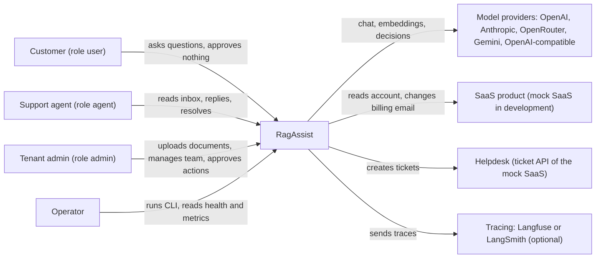
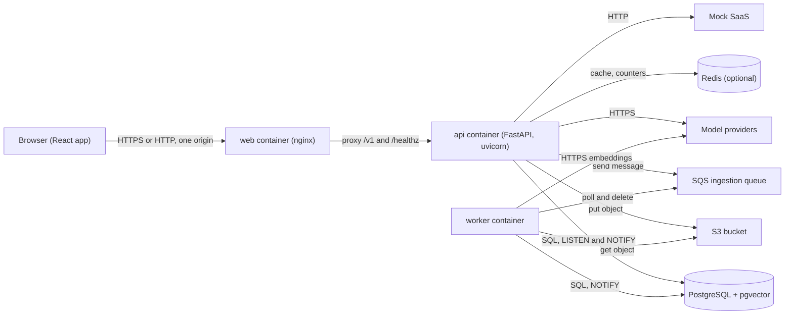

# 3. Context and scope

**Type:** Architecture · **Audience:** architects, integrators, reviewers · **Verified against:** `a989287`

**In plain English:** This page shows what is inside RagAssist and what is outside it. It lists the people and the
external systems that talk to the system, and the data that moves between them.

## 3.1 Business context

The diagram shows the people and systems around RagAssist. Customers, agents and admins use the web app. The system calls
model providers, the SaaS product and the helpdesk.

| Partner | Direction | Data | Notes |
|---|---|---|---|
| Customer | In and out | Questions, answers, citations | Sees only the own conversations |
| Support agent | In and out | Replies, ticket state | Gets live events for escalations |
| Tenant admin | In and out | Files, team changes, approvals | Only an admin can approve a write action |
| Operator | In | CLI commands, `/healthz`, `/metrics` | `/metrics` needs the `admin` role |
| Model providers | Out | Prompts, text to embed, decision prompts | The tenant data in a prompt leaves the system. See section [11](11-risks-and-technical-debt.md). |
| SaaS product | Out | Account and subscription reads, billing email change | The token for each call is short-lived. |
| Helpdesk | Out | Ticket create call | `POST /helpdesk/tickets` on the mock SaaS |
| Tracing service | Out | Spans and metadata | Off by default. When on, question and answer text goes to the service. `redact` removes credentials only. |

## 3.2 Technical context

The diagram shows the technical channels. Every browser call goes through one origin.

| Channel | Protocol | Detail |
|---|---|---|
| Browser to web | HTTP or HTTPS | nginx does not end TLS. A terminator in front does. |
| Web to API | HTTP, same origin | The `/v1` paths and `/healthz` pass. `/docs`, `/openapi.json` and `/metrics` do not pass through nginx. |
| Chat and events | Server-sent events (SSE) | See the [SSE contract](../api/sse-contract.md). Buffering is off. |
| API to database | PostgreSQL protocol | Each tenant call sets `app.tenant_id` in a transaction. |
| API to worker | SQS message | The message holds `job_id`, `tenant_id`, `object_key` and `document_id`, and no file content. The worker reads the object key from the document row. It uses the key in the message only when the row has none. |
| API and worker to API processes | PostgreSQL `LISTEN` and `NOTIFY` | Channel `ragassist_events`. Each API process keeps one listener. |
| Cache and counters | Redis protocol | Used only when `CACHE_BACKEND=redis`. Redis must have a password. |

## 3.3 Scope

Inside the scope:

- The API, the worker, the CLI and the web app.
- The database schema, the RLS policies and the migrations.
- The platform adapters for models, embeddings, rerankers, cache, queue, storage and events.

Outside the scope:

- The real SaaS product and the real helpdesk. A mock SaaS stands in for both.
- The real AWS account. LocalStack stands in for S3, SQS and Secrets Manager.
- TLS termination, DNS and the identity of the host.
- Email delivery. The API shows an invite or reset link once. An admin passes it on.
- Multi-factor authentication. A self-service "forgot password" flow does not exist. Only an admin can issue a reset link.
