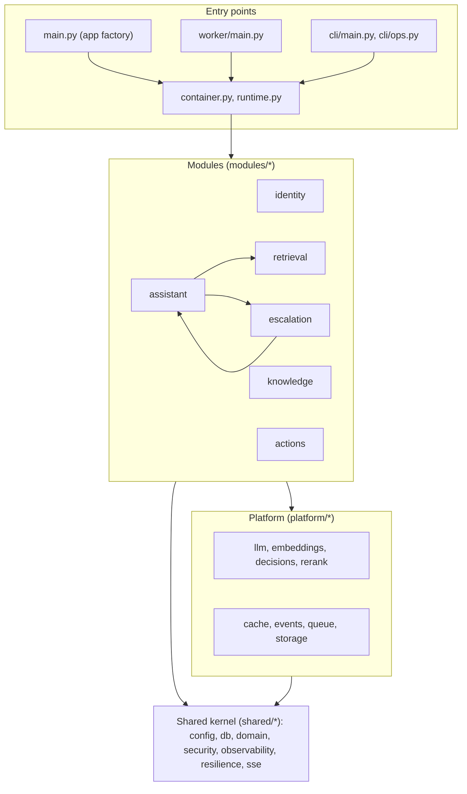
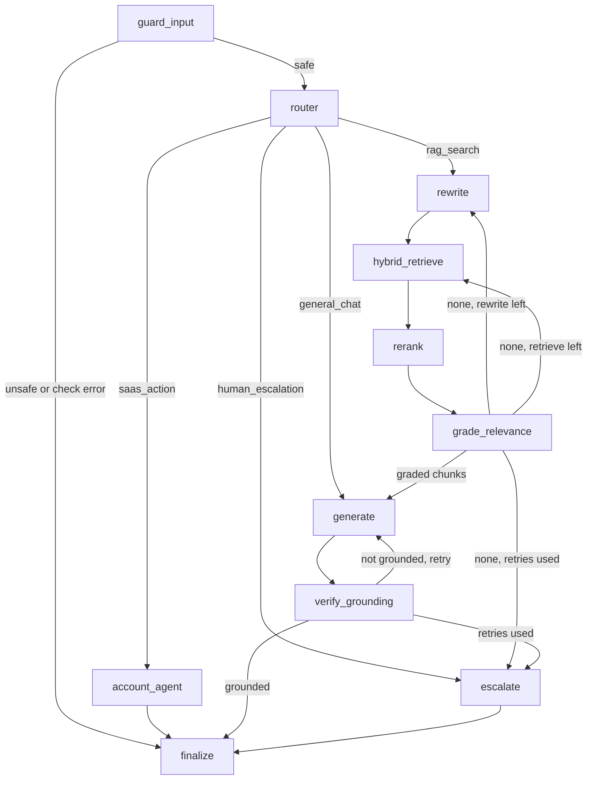

# 5. Building block view

**Type:** Architecture · **Audience:** engineers, architects · **Verified against:** `a989287`

**In plain English:** This page shows the parts of the code and how they depend on each other. Level 1 shows the whole
system. Level 2 opens the modules and the assistant graph.

## 5.1 Level 1: the whole system

The diagram shows three groups. The six modules depend on the platform and on the shared kernel. The platform and the
modules never depend on the entry points.

| Block | Responsibility | Path |
|---|---|---|
| Entry points | Build the app, run the worker, run the CLI | `src/ragassist/main.py`, `worker/main.py`, `cli/` |
| Wiring | `container.py` holds the dependency injection. `runtime.py` builds the stores, adapters, graph and event bus for the Postgres backend. | `src/ragassist/container.py`, `runtime.py` |
| Modules | Six vertical bounded contexts | `src/ragassist/modules/` |
| Platform | Swappable adapters for AI and infrastructure | `src/ragassist/platform/` |
| Shared kernel | Code that every module may use | `src/ragassist/shared/` |

The assistant and escalation modules use each other. The assistant calls the escalation facade to open a ticket. The
escalation module imports one name from the assistant module. This is the only cycle between modules.
Section [11](11-risks-and-technical-debt.md) lists it as a risk to watch.

## 5.2 Layers inside a module

Each module has the same four layers. A dependency points inward only.

| Layer | Holds | May import |
|---|---|---|
| `domain` | Value objects, entities, errors, ports of the module | Python and Pydantic only |
| `application` | Use cases | `domain` and ports |
| `adapters` | Persistence, parsers, chunkers, clients | `domain`, `application`, `platform` |
| `api` | FastAPI routers and HTTP schemas | `application` through injection |

The assistant module also has a `graph/` folder for the LangGraph graph. The actions module also has a `tools/` folder.

## 5.3 Level 2: the six modules

| Module | Responsibility | Key parts | ADR |
|---|---|---|---|
| `identity` | Accounts, login, refresh sessions, invites, resets, team API, login throttle | Argon2id hashing, access JWT, refresh token family | [0007](../adr/0007-accounts-and-sessions.md) |
| `knowledge` | Upload, ingestion jobs, parsers, chunker, document and chunk stores | `ProcessIngestionJob`, parsers for 4 MIME types, 5-pass chunker | [0003](../adr/0003-hybrid-chunking.md) |
| `retrieval` | Dense and keyword search, rank fusion, rerank, result cache | `HybridRetriever`, `GET /v1/chunks/{id}` | [0001](../adr/0001-pgvector-unified-storage.md), [0005](../adr/0005-reranker-chain.md) |
| `assistant` | Conversations, messages, the graph, SSE streaming, approvals | `ask_message`, `decide_action`, detached turns | [0004](../adr/0004-decision-layer.md), [0006](../adr/0006-conversation-access-and-approval-binding.md) |
| `actions` | Tool registry, tool authorisation, tool audit rows | `ToolRegistry`, account tools | [0006](../adr/0006-conversation-access-and-approval-binding.md) |
| `escalation` | Tickets, handoff, agent replies, resolve, inbox | `EscalateConversation`, `ReplyToEscalation`, `ResolveEscalation` | [0008](../adr/0008-live-events-handoff-and-detached-turns.md) |

The routers mount under the `/v1` prefix. The routes `/healthz` and `/metrics` have no prefix. The OpenAPI pages `/docs`,
`/redoc` and `/openapi.json` are always on.

## 5.4 Level 2: the platform layer

| Package | Port and adapters | Notes |
|---|---|---|
| `llm` | Providers from `config/models.yaml`: openai, anthropic, openrouter, gemini, openai_compatible | A role (generator, rewriter, judge, decider, agent) lists a primary model and fallbacks. |
| `embeddings` | Chain `openai,sentence_transformers`. The dimension is 1536. | The `[ml]` extra holds torch and sentence-transformers. |
| `decisions` | Deciders: `openai_decisions`, `jev`, `strands_local`, `llm_structured`, `semantic_router`, `rules` | Confidence gated. See section 5.6. |
| `rerank` | Chain `cross_encoder,flashrank,none` | A timeout falls back to the original order. |
| `cache` | Memory, Redis and Null adapters, `CacheService` | Keys use an HMAC of `SECRET_KEY`. See ADR 0015. |
| `events` | `PostgresEventBus`, `PostgresEventPublisher` | Channel `ragassist_events`. |
| `queue` | SQS adapter | The runtime (`src/ragassist/runtime.py`) wraps it in a `DeferredQueue`. A send waits for the database commit. |
| `storage` | S3 adapter | The object key has the form `tenants/<tenant_id>/documents/<document_id>/<safe_filename>`. |

## 5.5 Level 2: the shared kernel

| Package | Holds |
|---|---|
| `config` | `Settings` with no defaults for deployment values |
| `db` | `UnitOfWork`, `ScopedDatabase`, session factory |
| `domain` | Shared value objects |
| `security` | JWT encode and decode, FastAPI dependencies, rate limiter |
| `observability` | structlog logging, a Prometheus registry, tracing helpers |
| `resilience.py` | `FallbackChain` and the bounded CPU executor (`run_cpu_bound`, 4 workers) |
| `registry.py` | `ProviderRegistry` |
| `sse.py`, `http_cache.py`, `counters.py` | SSE framing, `ETag` helpers, the counter port |

## 5.6 Level 2: the assistant graph

The diagram shows the 11 nodes of the graph and the four routes. Solid arrows are the normal path. The retry loops
return to earlier nodes.

Text equivalent of the graph:

1. `guard_input` checks the message for safety. A failed check ends the turn with a refusal. The check fails closed: an
   error in the check gives the answer "I could not run the safety check just now" and the error code `safety_check_error`.
2. `router` picks a route: `rag_search`, `saas_action`, `general_chat` or `human_escalation`. A failed route defaults to
   `rag_search` and records `provider_used=fallback_default`.
3. On the `rag_search` route the graph runs `rewrite`, `hybrid_retrieve`, `rerank` and `grade_relevance`.
4. After grading, `route_after_grade` picks `generate` when graded chunks exist. Otherwise it returns to `rewrite` while
   `rewrite_count` is below 2. Then it returns to `hybrid_retrieve` while `retrieve_count` is below 3. Then it escalates.
5. After `generate`, `verify_grounding` checks the answer. `route_after_grounding` picks `finalize` when the answer is
   grounded. Otherwise it returns to `generate` while `generate_count` is below 2. Then it escalates.
6. `account_agent` handles the `saas_action` route. A read tool runs at once. A write tool pauses the graph. See
   [section 6](06-runtime-view.md).
7. `finalize` closes the turn.

The nodes use the model tier "cheap" when the complexity score is below 2.0. Otherwise they use "strong".

The failure modes differ by node:

| Check | When it fails |
|---|---|
| Input safety | Fails closed. The turn ends with a refusal. |
| Relevance grading | Fails open. The chunk counts as relevant. |
| Grounding | Fails closed. The graph retries, then escalates. |
| Route | Falls back to `rag_search`. |

## 5.7 Level 2: the decision layer

A `Decider` answers three kinds of question: a predicate (yes or no), a choice, and a score. A chain of deciders runs in
order. The first decider that answers wins. For the route choice, the answer must also reach the minimum confidence.
The other checks accept any confidence from a decider that does not fail.

| Setting | Default | Meaning |
|---|---|---|
| `DECIDER_CHAIN` | `openai_decisions,jev,llm_structured,llm_structured_2,rules` | Order for safety, grading and grounding |
| `ROUTER_DECIDER_CHAIN` | `semantic_router,openai_decisions,llm_structured,llm_structured_2,rules` | Order for routing |
| `DECIDER_TIMEOUT_MS` | 8000 | Time limit for one decider |
| `DECIDER_MIN_CONFIDENCE` | 0.70 | Lowest confidence that ends the chain for the route choice only |
| `ESCALATION_THRESHOLD` | 0.65 | Used for the grounding check |

The registry builds at most 3 LLM deciders. They come from the `decider` role chain and then the `generator` role chain.
The `rules` decider stays last in the default chains. A failed predicate raises an error. A failed choice returns a default with confidence 0.5
(see [ADR 0004](../adr/0004-decision-layer.md)).
