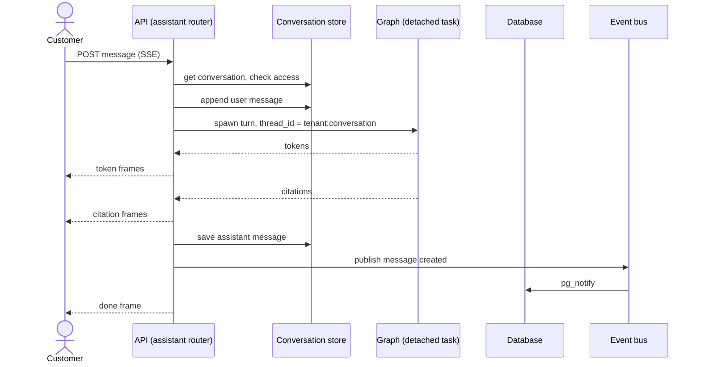
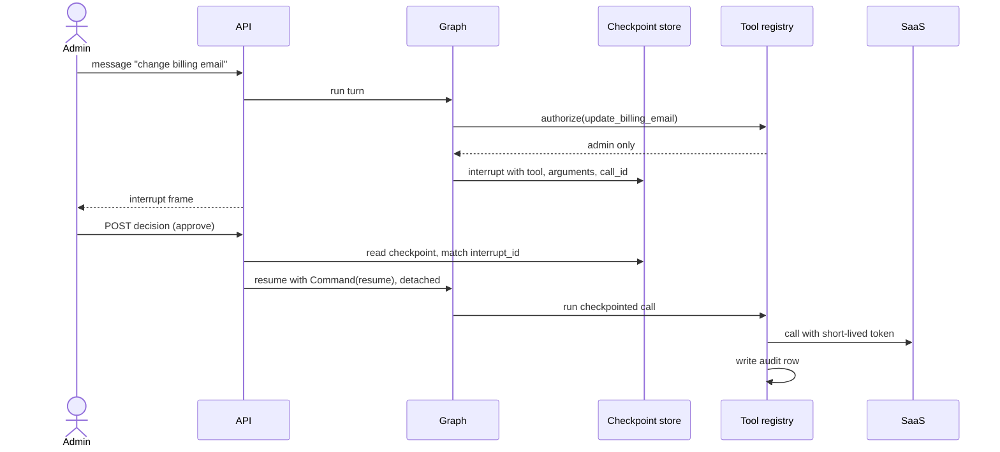
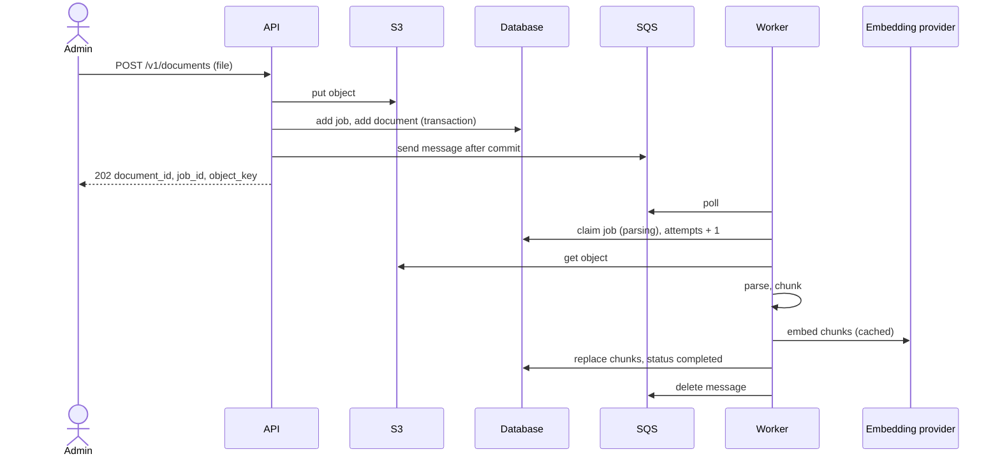
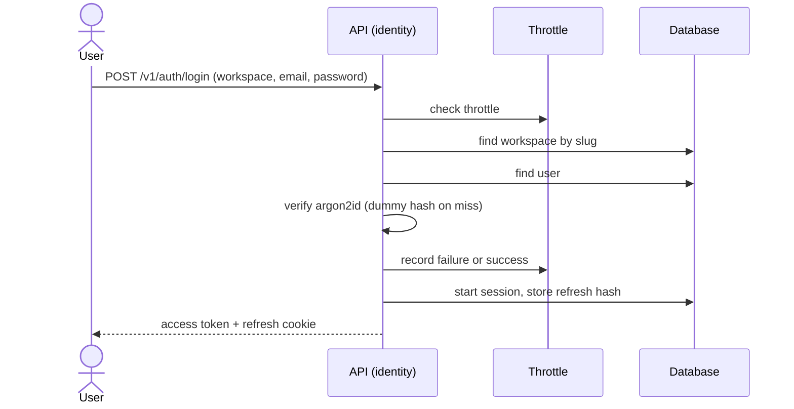
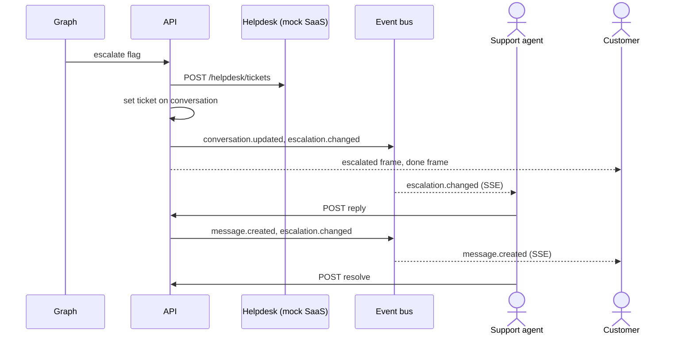
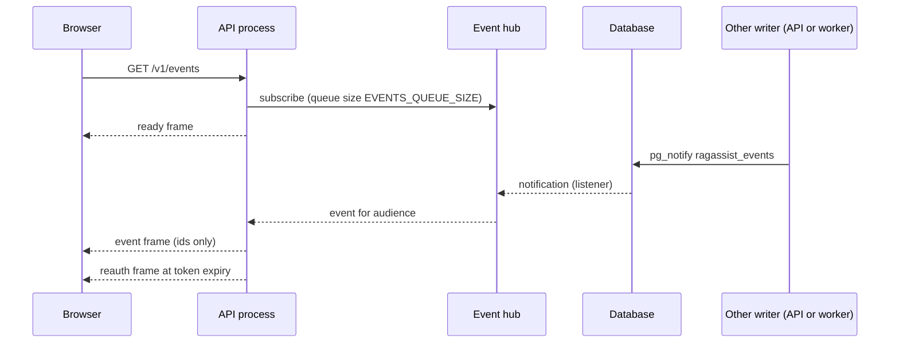

# 6. Runtime view

**Type:** Architecture · **Audience:** engineers, architects, reviewers · **Verified against:** `a989287`

**In plain English:** This page shows how the parts work together at run time. It follows seven scenarios: a chat turn, an
approval, document ingestion, sign-in, token refresh, human handoff and live events. More views are in
[the dynamic views](../c4/08-dynamic-views.md).

## 6.1 A chat turn

A customer sends a message. The API checks access, runs the graph in a detached task and streams the result.
The diagram shows the order of the main steps for a normal question.

Steps in text:

1. The API loads the conversation. It checks that the caller may access it (`can_access_conversation`).
   A conversation of another user gives 404.
2. The API appends the user message.
3. If the conversation status is `escalated`, the API runs the handoff (see 6.6) and does not run the graph.
4. Otherwise the API builds the thread id `{tenant_id}:{conversation_id}`. It starts the graph as a task through
   `turns.spawn`. The task does not stop when the HTTP client leaves.
5. The API sends frames in this order: tokens, citations, an optional `interrupt`, then `escalated` when a ticket opens,
   then `done`. A `reset` frame follows a token run when the graph regenerates the answer.
6. The API saves the assistant message and publishes `message.created` before it sends the last frames.
7. The API sends a `: ping` comment every 15 seconds to keep the connection open.

An SSE request with an unknown conversation id creates a new conversation. A JSON request with an unknown id gives 404.
The frame formats are in the [SSE contract](../api/sse-contract.md).

On shutdown, the API calls `drain()`. It waits up to 30 seconds for running turns.

## 6.2 An account change with approval

The assistant never writes account data on its own. The graph pauses at a write tool. An admin approves the exact call.

Steps in text:

1. The router picks `saas_action`. The `account_agent` node chooses a tool.
2. A read tool (`get_account_overview`, `get_subscription`, `list_invoices`) runs at once.
3. A write tool (`update_billing_email`) first calls `ToolRegistry.authorize`. Only an admin passes.
4. The node calls `interrupt()` with `{action: approval_required, tool, arguments, call_id}`. The checkpoint saves it.
5. The owner of the conversation or an admin posts a decision. The API checks these rules in order:
   - 404 when the conversation is not visible to the caller.
   - 403 when the caller is neither the owner nor an admin.
   - 503 when the API cannot read the checkpoint.
   - 409 when the `interrupt_id` does not match the pending interrupt.
6. The API records the decision. It resumes the graph with `Command(resume=...)` as a detached task.
   It answers 502 when the resume fails. It returns the status `resumed` or `interrupted`.
7. After the resume, the node runs the call that the checkpoint holds. The arguments come from the checkpoint and not
   from the request. The decision `approve` runs the tool.
8. Each tool call gets a short-lived token and writes a row in the tool audit table.

The graph state keeps the principal with an empty `raw_token`. The checkpoint never holds the access token.
The tools `query_dataset` and `get_invoices` are hidden. `query_dataset` raises "not available yet".
See [ADR 0006](../adr/0006-conversation-access-and-approval-binding.md).

## 6.3 Document ingestion

An admin uploads a file. The API stores it and queues a job. The worker parses it and indexes the chunks.

Steps in text:

1. The upload needs the `admin` role. The API reads at most 50 MiB and answers 413 above that.
   It accepts `text/markdown`, `text/html`, `text/csv` and `application/pdf`. Other types give 415. An empty file gives 400.
2. The API puts the object, adds the job, adds the document and sends the SQS message. The queue adapter holds the message
   until the transaction commits. On failure the API removes what it stored.
3. The API publishes `job.updated` and `document.changed`. The answer is 202.
4. The worker polls SQS with the concurrency set by `WORKER_CONCURRENCY`.
5. `ProcessIngestionJob.handle` checks that the tenant of the message matches the job row. It checks that the job is not
   complete. It claims the job in one atomic step.
6. The object key must start with `tenants/<tenant>/`. The key comes from the document row and not from the message.
7. The worker parses the file, chunks it, embeds the chunks and replaces the old chunks. The job becomes `completed`.

The job states:

| Outcome | Result for the job | Message |
|---|---|---|
| `COMPLETED` | `completed` | Deleted |
| `DUPLICATE_SKIPPED` | Unchanged | Deleted |
| `REJECTED` | Unchanged | Deleted |
| `DEAD_LETTERED` | `failed` after `WORKER_MAX_RETRIES` attempts | Deleted |
| `RETRY` | Back to `queued` | Kept, so SQS delivers it again |

`claim_job` takes a job again when it has stayed claimed for more than 240 seconds. A failed job stores the stage and the
class of the exception. The queue has a redrive policy with `maxReceiveCount` of 3.

Other endpoints: `POST /v1/documents/{id}/reindex`, `GET /v1/ingestion-jobs/{job_id}` and `DELETE /v1/documents/{id}`.

## 6.4 Sign-in

The login flow takes the same work for a known and an unknown account. This limits timing leaks.

Steps in text:

1. The API checks the throttle. The count is per process unless `CACHE_BACKEND=redis`.
2. The API finds the workspace by its slug. A special RLS policy on `tenants` allows this lookup.
3. The API finds the user and verifies the password once. On a miss it verifies a dummy hash.
4. The API records the failure or the success. It rehashes the password when the hash parameters are old.
5. `start_session` makes an access token that lives `AUTH_ACCESS_TOKEN_MINUTES` (default 15). It makes a refresh token of
   the form `{tenant_id}.{random}`. The database stores only the SHA-256 of the refresh token.
6. The API sets the cookie `ragassist_refresh`. The cookie is `httpOnly` and `SameSite=Strict`. Its path is `/v1/auth`.
   `AUTH_COOKIE_SECURE` sets the `Secure` flag.

## 6.5 Token refresh

The browser keeps the access token in memory only. It calls refresh when the token ends.

| Case | Result |
|---|---|
| Valid refresh token | The API rotates the token and sends a new pair. |
| Token already rotated or revoked | The API revokes the whole token family. The answer is 401. |
| Two requests race with the same token | The API revokes the family. |
| Expired token, disabled user or missing user | 401 |

`require_trusted_origin` guards refresh and logout. The `Origin` header must match `CORS_ORIGINS` or `WEB_BASE_URL`. A
request without an origin gets 403.

The web app sends one refresh call at a time and uses a Web Lock for this. The server treats a race as a replay.
Two refresh calls that skip the lock can therefore end the session. See section [11](11-risks-and-technical-debt.md).

## 6.6 Human handoff

The graph escalates when it cannot answer. After that, an agent owns the conversation.

Steps in text:

1. `EscalateConversation` is idempotent while the status is `escalated`. It creates the ticket, saves the ticket id and
   publishes `conversation.updated` and `escalation.changed`.
2. Later customer messages do not run the graph. The API publishes `message.created` and `escalation.changed`. It sends
   the frames `escalated` and `done`, and the JSON route is `human_handoff`.
3. `ReplyToEscalation` needs the `agent` role. An admin gets 403. The status must be `escalated`, or the answer is 409.
   Both `/reply` and `/replies` exist.
4. `ResolveEscalation` needs the `agent` or `admin` role. It sets the status to `resolved`.
5. `GET /v1/escalations` lists escalated and resolved conversations for agents and admins.

## 6.7 Live events

The browser opens one event stream. The stream carries id-only events. The browser then reads the data again.

Facts:

- Event types: `job.updated`, `document.changed`, `message.created`, `conversation.updated`, `escalation.changed`. The
  stream also sends `ready`, `resync` and `reauth`.
- Payloads hold ids only: `job_id`, `document_id`, `conversation_id`, `ticket_id`.
- The audiences are `ADMINS`, `STAFF` and `OWNER_AND_STAFF`.
- Each API process keeps one listener. It probes the connection every 30 seconds. It reconnects with a back-off from
  0.5 to 10 seconds. After a reconnect it sends `resync` to all subscribers.
- When a subscriber queue overflows, that subscriber gets `resync`.
- `EVENTS_MAX_STREAMS_PER_USER` limits streams for each user in one process. Above the limit the API answers 429 with
  `Retry-After: 5`.
- The stream ends with `reauth` when the access token expires. The client then needs a fresh token.
- A `document.changed` event also changes the corpus version of the cache (ADR 0015).
- The web client reads the stream with `fetch` and uses back-off with jitter (base 1 second, maximum 30 seconds, idle
  watchdog 45 seconds).
