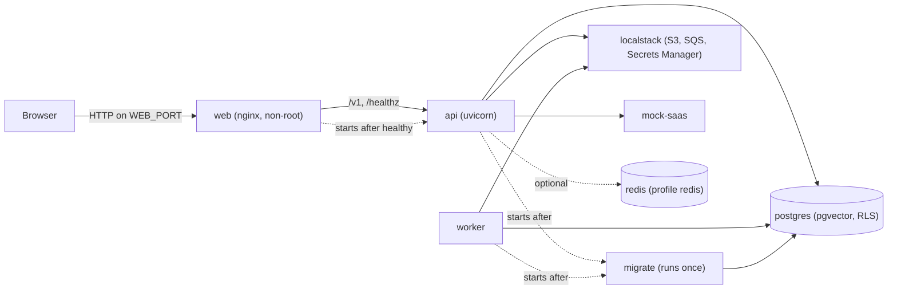

# 7. Deployment view

**Type:** Architecture · **Audience:** operators, engineers, reviewers · **Verified against:** `a989287`

**In plain English:** This page shows which containers run, how they start in order and how a request reaches the API.
It covers the web delivery from ADR 0014 and the other compose services. Every host and port comes from `.env`.

## 7.1 Docker Compose stack (development and single-host)

The diagram shows the containers in `compose.yaml`. An arrow means "depends on" or "talks to". The `redis` container
is optional.



The same facts in text:

```
 browser ──HTTP──> web (nginx, non-root, WEB_PORT, published on loopback)
                     │  /            built SPA (frontend/dist), SPA fallback to index.html
                     │  /assets/*    immutable, content-hashed
                     │  /v1/*, /healthz   proxied, same origin (SSE unbuffered)
                     ▼
                   api (uvicorn, behind --proxy-headers, trusts TRUSTED_PROXY_IPS)
                     │
        ┌────────────┼──────────────┬───────────────┐
        ▼            ▼              ▼               ▼
    postgres     localstack      mock-saas       worker (SQS ingestion)
   (pgvector,    (S3, SQS,
     RLS)        Secrets Manager)
```

| Container | Image | Role | Depends on |
|---|---|---|---|
| `web` | built from `infra/docker/web.Dockerfile` on `nginx/nginx-unprivileged` | Serves the SPA, proxies the API, sets security headers | `api` healthy (restarted when `api` is recreated) |
| `api` | built from `infra/docker/api.Dockerfile` | FastAPI HTTP and SSE | `migrate` completed, `localstack` healthy, `mock-saas` healthy |
| `worker` | same as `api` | Ingestion worker | `migrate`, `localstack` |
| `migrate` | same as `api` | `ragassist db upgrade`, then exits. It does not restart. | `postgres` |
| `postgres` | `pgvector/pgvector:pg16` | Data. The port binds to the loopback address. The data lives in the volume `postgres_data`. | none |
| `localstack` | `localstack/localstack:3.8.1` | S3, SQS and Secrets Manager stand-ins. The data lives in the volume `localstack_data`. | none |
| `mock-saas` | local build | Stand-in for the SaaS product and the helpdesk | none |
| `redis` | `redis:8.2.11-alpine` | Optional shared cache and counters. Enabled by the compose profile `redis`. | none |

Redis uses the policy `allkeys-lru` and keeps no data on disk. It refuses to start without a password.

## 7.2 Start order and health checks

Each long-running container has a health check. The next container waits for it.

| Container | Health check |
|---|---|
| `postgres` | `pg_isready` |
| `localstack` | `curl` on the health JSON of LocalStack |
| `mock-saas` | A Python `urlopen` call |
| `api` | A Python `urlopen` call on `/healthz`, with a 20 second start period |
| `web` | `/web-healthz`, which returns `ok` |

The start order:

1. `postgres`, `localstack` and `mock-saas` start first.
2. `migrate` runs `ragassist db upgrade`. This step also creates the LangGraph checkpoint tables and the grants.
3. `api` starts after `migrate` completes and `localstack` and `mock-saas` are healthy.
4. `worker` starts after `migrate` completes and `localstack` is up.
5. `web` starts after `api` is healthy. It restarts when `api` is recreated.

The script `infra/postgres/create-app-role.sh` creates the app role. The role is not a superuser and has `NOBYPASSRLS`.
LocalStack runs `init.sh` at start. It creates the bucket and the queues, with a redrive policy of `maxReceiveCount` 3.

## 7.3 Why one origin

The refresh cookie is `SameSite=Strict` and path-scoped (ADR 0007). Serving the app and the API from the same origin
means the browser always sends it, the API needs no credentialed CORS, and `WEB_BASE_URL` (the origin the cookie-bearing
endpoints accept, and the base of invite links) is simply the address of the `web` container. In frontend development
the Vite dev server plays the same role (`API_PROXY_TARGET`, ADR 0009).

## 7.4 Configuration

Every host, port and address comes from `.env` (template: `.env.example`). The web container reads `WEB_PORT`,
`WEB_SERVER_NAME`, `WEB_API_UPSTREAM` and `WEB_HSTS`; the API reads `WEB_BASE_URL` and `TRUSTED_PROXY_IPS`. nginx renders
`infra/nginx/templates/*.template` with `envsubst` when the container starts and refuses to start if a required value
is missing.

| Setting | Rule |
|---|---|
| `WEB_PORT` | Required. A number of 1024 or higher, because the container is non-root. |
| `WEB_SERVER_NAME` | Required. |
| `WEB_API_UPSTREAM` | Required. The form is `host:port` with no scheme. |
| `WEB_HSTS` | Optional. |
| `WEB_BASE_URL` | Read by the API. |
| `TRUSTED_PROXY_IPS` | Read by uvicorn as `forwarded_allow_ips`. |

The command `ragassist init-env` writes a working `.env` from `.env.example` with random secrets.
`Settings` has no defaults for deployment values. A missing value stops the start. Three more checks run at start:

- The Redis URL has no credentials and is required for the Redis backend.
- `AUTH_COOKIE_SECURE` must be true in staging and production.
- The signing key must have at least 32 characters outside development and test.

The shared `x-app` environment in `compose.yaml` fixes `DB_HOST`, `DB_PORT`, `LOCALSTACK_ENDPOINT`, `MOCK_SAAS_BASE_URL` and
`PERSISTENCE_BACKEND=postgres` for the containers. This is a deployment value in a committed file. Section
[11](11-risks-and-technical-debt.md) lists it.

## 7.5 Request path properties

- Client address: nginx overwrites `X-Forwarded-For` with the address it saw; uvicorn believes it only from
  `TRUSTED_PROXY_IPS`. The per-address sign-in throttle (ADR 0007) and the API rate limiter therefore count real clients.
- Streams: `/v1/events` and `POST /v1/conversations/{id}/messages` have `proxy_buffering off`, no compression and a
  one-hour read timeout (ADR 0008, `docs/api/sse-contract.md`).
- Uploads: `POST /v1/documents` accepts up to 52 MiB at the proxy; the API enforces its own 50 MiB cap. Other locations
  accept 1 MiB.
- Static files: `/assets/` is immutable. Other paths fall back to `index.html`.
- Closed paths: nginx does not proxy `/docs`, `/openapi.json` or `/metrics`. The API itself still serves them.
- TLS is not terminated here. Behind a TLS terminator set `AUTH_COOKIE_SECURE=true`, `WEB_HSTS` and an `https`
  `WEB_BASE_URL`.
- The content security policy keeps `style-src 'unsafe-inline'`. ADR 0014 records the reason and the cost.

## 7.6 Images

| Image | Build |
|---|---|
| API and worker | `infra/docker/api.Dockerfile`. It copies the `seed/` folder. Unverified: the `seed/` folder is not in git, so a clean build can fail. No build was run. |
| Web | `infra/docker/web.Dockerfile`. Two stages: `node:22-alpine` builds the app. `nginx/nginx-unprivileged:1.30.6-alpine` serves it. |

The nginx templates are `default.conf.template`, `proxy.inc.template` and `security-headers.inc.template`. The script
`15-web-env.envsh` checks the required values.

## 7.7 Port binding

Compose binds the ports of `postgres`, `api` and `web` to the loopback address. The ports of `localstack` and
`mock-saas` have no loopback bind in the file. On a shared host they can be open to the network. Bind them to the
loopback address before you use the stack on such a host.
