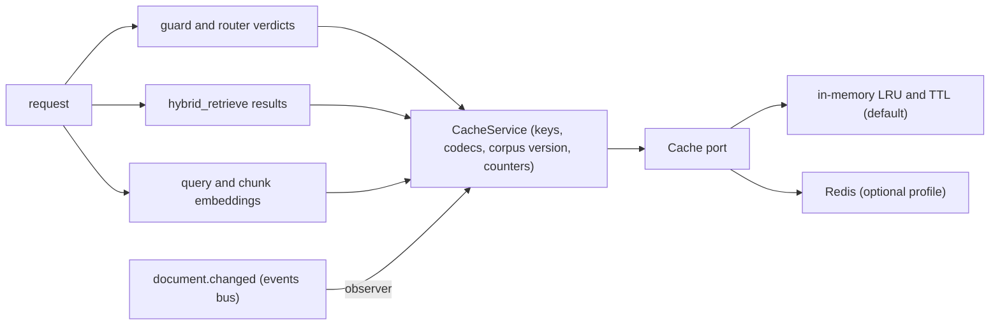

# 8. Crosscutting concepts

**Type:** Architecture · **Audience:** engineers, architects, security reviewers · **Verified against:** `a989287`

**In plain English:** These are the ideas that many parts of the code share. They are tenant isolation, sessions, events,
caching, fallbacks, tracing and configuration. Read this page before you change code that touches more than one module.

## 8.1 Tenant isolation

Isolation has two layers. The code layer sets the tenant. The database layer enforces it.

| Layer | Rule | Where |
|---|---|---|
| Identity | `tenant_id`, `user_id` and `role` come only from the verified JWT `Principal`. Model output and tool arguments never set them. | `shared/security/` |
| Unit of work | `UnitOfWork` refuses a session that already has an open transaction (`TenantIsolationError`). It runs `set_config('app.tenant_id', :tid, true)`. | `shared/db/uow.py` |
| Scoped database | `ScopedDatabase.scope()` and `transaction()` do the same. A transaction cannot span two tenants. `defer_until_commit` runs work after the commit. | `shared/db/scoped.py` |
| RLS | RLS is enabled and forced on tenant tables. The app role has `NOBYPASSRLS`. | Migration `0001`, [ADR 0002](../adr/0002-row-level-security.md) |
| Global rows | `documents` and `chunks` have a read policy that also allows rows with `tenant_id IS NULL`. The write policy allows the own tenant only. | Migration `0001` |
| Slug lookup | A policy on `tenants` uses `app.tenant_slug` so login can find a workspace before the tenant is known. | Migration `0002` |
| Object keys | The key has the form `tenants/<tenant_id>/documents/<document_id>/<safe_filename>`. The worker checks the prefix. | `modules/knowledge` |
| Graph threads | The thread id is `{tenant_id}:{conversation_id}`. | `modules/assistant/api/router.py` |
| Cache keys | Every key holds the tenant. See 8.7. | `platform/cache/keys.py` |

The tests `tests/security/test_leak_gate.py` and `tests/security/test_cache_isolation.py` guard these rules.

## 8.2 Accounts and sessions

[ADR 0007](../adr/0007-accounts-and-sessions.md) holds the reasons. These are the facts.

- Passwords use argon2id. A login with an unknown account still verifies a dummy hash.
- The access token is a JWT. Its life is `AUTH_ACCESS_TOKEN_MINUTES` (default 15).
- The refresh token has the form `{tenant_id}.{random}`. The database keeps only its SHA-256.
- Refresh rotates the token. A replay of an old token revokes the whole family.
- The cookie `ragassist_refresh` is `httpOnly`, `SameSite=Strict` and has the path `/v1/auth`.
- `require_trusted_origin` guards refresh and logout.
- `get_current_principal` only decodes the JWT. It does not read the database. An access token therefore stays valid
  after a disable or a role change, until it expires.
- `GET /v1/auth/me` does check that the account is active.
- The team API needs the `admin` role. An admin cannot change the account of the same admin. The last active admin cannot be removed.
  Both cases give 409.
- A disabled member loses all sessions and all links. Invite and reset links show once. The accept token travels in the
  URL fragment.
- The development token endpoint `/v1/auth/token` works only in development and test. It needs the header
  `X-Dev-Auth-Secret`, compared with `DEV_AUTH_SECRET` in constant time.

## 8.3 Authorisation

| Resource | Rule |
|---|---|
| Conversation | The owner and the staff roles can read it. Another user gets 404. |
| Approval of an action | The owner or an admin. The approval is bound to the checkpoint and the `interrupt_id`. |
| Write tools | An admin only (`ToolRegistry.authorize`). |
| Documents | Upload, reindex and delete need `admin`. |
| Inbox | `agent` and `admin` can list. Only `agent` can reply. |
| `/metrics` | `admin` only. |

Each tool call gets a short-lived token and writes a row in the tool audit table. The graph state keeps the principal
with an empty `raw_token`, so a checkpoint never holds a usable token.

## 8.4 Rate limiting and throttling

- `RateLimitMiddleware` uses a sliding window of 300 requests in 60 seconds. The values are in the code. They are not
  settings. The key is `request.client.host`. The paths `/healthz`, `/metrics`, `/docs`, `/redoc`, `/openapi.json` and
  `/v1/events` are exempt.
- The login throttle has two limits in a sliding window. One counts all attempts from one client address. The other counts only failures for one account. A success clears the account count.
- Both counters are per process unless `CACHE_BACKEND=redis`.
- `EVENTS_MAX_STREAMS_PER_USER` caps the event streams for each user in one process.

## 8.5 Middleware order

The app adds four middleware. The last one added is the outermost. The order from outside to inside is:

1. `RequestTimingMiddleware`
2. `NoStoreMiddleware`
3. `RateLimitMiddleware`
4. CORS

A comment in `src/ragassist/main.py` calls `NoStoreMiddleware` the outermost. The order above is the one in the code.

## 8.6 Events

The platform has one event bus on PostgreSQL `LISTEN` and `NOTIFY` ([ADR 0008](../adr/0008-live-events-handoff-and-detached-turns.md)).

- The publisher calls `pg_notify` on the channel `ragassist_events` inside a `ScopedDatabase` transaction.
- Each API process keeps one psycopg listener and one hub with a queue for each subscriber.
- Payloads hold ids only. Clients read the data again through the normal, authorised endpoints.
- A cache observer on `document.changed` moves the corpus version (`install_corpus_invalidation`).

Section [6.7](06-runtime-view.md) describes the stream. The [SSE contract](../api/sse-contract.md) holds the frames.

## 8.7 Caching

The diagram shows what the cache serves and how the events bus clears it.



```
 request ─> guard / router ──> VerdictCache ────────┐
            hybrid_retrieve ──> RetrievalResultCache ├─> CacheService ──> Cache port ──> in-memory LRU+TTL (default)
 query / chunk embedding ───> EmbeddingService ─────┘      │  keys, codecs,                └> Redis (optional profile)
                                                          │  corpus version, counters
 document.changed (events bus) ──> observer ──────────────┘
```

- **One rule:** every key holds the tenant (and role where results depend on it) and a keyed hash of normalised text,
  never the text; every entry has a TTL; the store is bounded; a hit cannot cross a tenant or role. Built by
  `platform/cache/keys.py`, tested in `tests/security/test_cache_isolation.py`. The hash is an HMAC with `SECRET_KEY`.
- **Invalidation:** the per-tenant corpus version token changes on `document.changed`; the events bus already carries
  that signal from the API and from the worker to every API process.
- **Failure:** a cache backend error is a miss, counted on `/metrics`; the application never fails because of the cache.
  Degraded retrieval results are not cached.
- **Switch:** `CACHE_ENABLED=false` restores the exact previous behaviour; `CACHE_BACKEND=redis` shares the cache
  between processes (deployment: `docs/arc42/07-deployment-view.md`, compose profile `redis`).
- **Provider side:** the generator prompt starts with a fixed system message so OpenAI and Gemini implicit prompt
  caching can match the prefix; cached input tokens are recorded.
- **HTTP caching:** `ETag` plus `private` cache headers on `GET /v1/chunks/{id}` (`max-age`) and `GET /v1/documents`
  (`no-cache`, revalidate), `304` only after authorisation; `Cache-Control: no-store` on `/v1/auth/*` and `/v1/events`
  (`shared/http_cache.py`, `NoStoreMiddleware`). Contract: `docs/api/sse-contract.md`.
- **Shared counters:** with `CACHE_BACKEND=redis` the sign-in throttle and the rate limiter count in Redis so limits hold
  across API replicas (`shared/counters.py` port, `platform/cache/counters.py` adapter); an unreachable Redis falls back to
  the per-process counters. The event-stream cap stays per process. The Redis counters are fixed windows. A breaker of
  5 seconds protects the fallback.
- **Embeddings:** only the vectors of the first provider in the chain are cached.

See [ADR 0015](../adr/0015-caching.md).

## 8.8 Fallbacks and resilience

| Area | Behaviour |
|---|---|
| Models | Each role in `config/models.yaml` lists a primary model and fallbacks. The `generate` node loops over the models. Agent models use `with_fallbacks`. |
| Unconfigured provider | A provider with `skip_when_unconfigured` (Gemini) drops out of the chain when its key is empty. See [ADR 0013](../adr/0013-gemini-provider.md). |
| Deciders | A chain of deciders with a time limit. A confidence gate applies to the route choice. The `rules` decider stays last in the default chains. See [ADR 0004](../adr/0004-decision-layer.md). |
| Rerankers | The chain `cross_encoder,flashrank,none`. A timeout (`RERANK_TIMEOUT_MS`, default 1500) moves to the next chain member. When no member answers, the original order stays. See [ADR 0005](../adr/0005-reranker-chain.md). |
| Embeddings | The chain `openai,sentence_transformers`. |
| Cache | A backend error is a miss. |
| Checks in the graph | Safety and grounding fail closed. Relevance fails open. The route falls back to `rag_search`. |
| Worker | A failed job returns to `queued` until `WORKER_MAX_RETRIES`. Then it is `failed`. |
| Event listener | It reconnects with back-off and tells clients to `resync`. |

CPU-bound work runs in `run_cpu_bound` in `shared/resilience.py`. It uses a thread pool of 4 workers. Argon2,
sentence-transformers, the cross-encoder and FlashRank use it. The PDF parser and the chunker do not. Section
[11](11-risks-and-technical-debt.md) lists this gap.

## 8.9 Observability

- **Logging:** structlog. The output is JSON when `APP_ENV` is `production`. The logs do not bind a request id or a tenant id.
- **Metrics:** a hand-written Prometheus registry on `/metrics`. Only an admin can read it.
- **Tracing:** Langfuse (off by default) and LangSmith. The code supports `redact` and `mask_otel_spans`. They remove credentials from spans. Question and answer text
  still goes to the trace service when tracing is on. See [ADR 0012](../adr/0012-langfuse-tracing.md).
- **Shutdown:** the API calls `drain()`, `shutdown_tracing`, `stop_runtime` and `shutdown_cache` in this order.

## 8.10 Configuration

- `Settings` in `src/ragassist/shared/config/settings.py` reads the environment. A field without a default is required.
- `.env.example` is the template. `ragassist init-env` writes `.env` with random secrets.
- Model choices live in `config/models.yaml`. `OPENAI_COMPATIBLE_MODEL` overrides all roles when it is set.
- Section [11](11-risks-and-technical-debt.md) lists the settings that the code declares and never reads.

## 8.11 Testing

The test tiers are `unit`, `graph`, `security`, `integration`, `e2e`, `hygiene`, `selfcheck`, `live` and `gates`. The
[test guide](../testing.md) describes them. The hygiene tier holds the architecture rules and the secret scan.

## 8.12 Error handling

- A domain error becomes an HTTP status in the `api` layer. Examples: 404 for a hidden conversation, 409 for a state
  conflict, 413 and 415 for uploads, 429 for the stream cap.
- The SSE endpoint sends an unhandled error as an `error` frame with a sanitised message. See the [SSE contract](../api/sse-contract.md).
- A cache error never reaches the caller.
