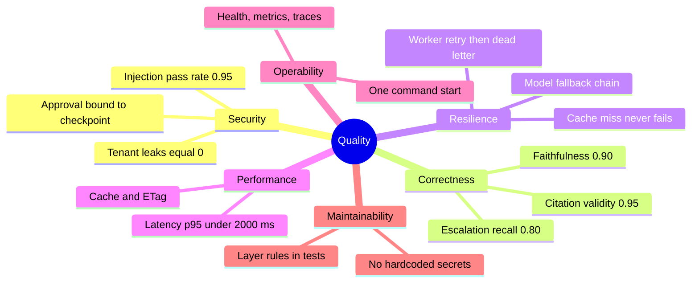

# 10. Quality requirements

**Type:** Architecture · **Audience:** architects, testers, reviewers · **Verified against:** `a989287`

**In plain English:** This page lists the quality goals as measurable targets. It says which test checks each target.
It also says which numbers are real and which come from an offline simulation.

## 10.1 Quality tree

The diagram groups the goals. Each branch ends in the measure that checks it.

## 10.2 Quality scenarios

| ID | Goal | Scenario | Measure | Check |
|---|---|---|---|---|
| Q1 | Isolation | The gate seeds tenant A with canary values. It reads everything that tenant B can observe. | 0 canaries seen | `tests/security/test_leak_gate.py` |
| Q2 | Isolation | A cache hit crosses a tenant or a role. | 0 crossings | `tests/security/test_cache_isolation.py` |
| Q3 | Safety | A prompt injection reaches the model. | Pass rate 0.95 or more | `tests/data/injection/floors.yaml` |
| Q4 | Correctness | The answer states a fact that the chunks do not hold. | Faithfulness 0.90 or more | `tests/support/spec.py` |
| Q5 | Correctness | A citation points to a chunk that does not support the claim. | Citation validity 0.95 or more | `tests/support/spec.py` |
| Q6 | Correctness | The assistant should escalate and does not. | Escalation recall 0.80 or more | `tests/support/spec.py` |
| Q7 | Resilience | The first model fails. | The next model in the chain answers. | Unverified: the exact test files. Graph and unit tests cover the chains. |
| Q8 | Resilience | The reranker is slow or missing. | The original order after `RERANK_TIMEOUT_MS` | Unverified: the exact test files. Unit tests cover the chain. |
| Q9 | Resilience | An ingestion job fails. | Retry up to `WORKER_MAX_RETRIES`, then `failed` | Unverified: the exact test files. Worker tests cover retries. |
| Q10 | Performance | A chat turn with a normal question. | Latency p95 under 2000 ms (target in `evals/runner.py`) | Evals |
| Q11 | Operability | A new engineer starts the stack. | `ragassist init-env` and one compose command | [Test guide](../testing.md) |
| Q12 | Maintainability | A domain file imports FastAPI. | The build fails. | `tests/hygiene/test_architecture.py` |

The injection tests use floors by decider. The `rules` decider has a floor of 0.8 for direct injections and 0.0 for
the other kinds. Benign false positives must be 0. The live tier needs a pass rate of 0.95.

## 10.3 The state of the numbers

- The thresholds in 10.2 come from `tests/support/spec.py` (marked "arc42 section 10") and the files named above.
- `evals/reports/eval_summary.md` comes from an offline, hermetic run of 80 cases. Its retrieval scores (Hit@5, MRR@5 and
  nDCG@5) are 1.000, faithfulness is 0.995 and relevance is 0.955. This is a simulation and not a measure of a real model. Do not quote it as a quality result.
- `evals/runner.py` mentions accuracy of 0.85 or more, grounding of 0.90 or more and latency p95 under 2000 ms.
- Unverified: no run against real models is in the repository. The quality numbers for real models are not known.
- Coverage: the gate is advisory. The value was 82.4 percent against a minimum of 85 percent on 2026-11-09.
- Test baseline on 2026-11-09: 1903 passed, 75 skipped and 70 expected failures. This is a snapshot from the
  [test guide](../testing.md). Unverified: the defect registry in `tests/support/defects.py` is empty at this commit, so
  the count of expected failures is probably out of date.

## 10.4 Continuous integration

The workflow `.github/workflows/ci.yml` has these jobs:

| Job | What it does |
|---|---|
| `lint-and-typecheck` | Secret scan, tests and scripts lint, and `lint-imports` are blocking. Lint and mypy of `src` are advisory (`continue-on-error`). |
| `unit-tests` | Runs the unit tests. |
| `integration-tests` | Starts a pgvector container with `docker run`. Runs hygiene, integration and security tests. |
| `coverage` | The gate is advisory (`continue-on-error`). The minimum is 85 percent. |
| `frontend` | Suspended. Runs only when `RUN_FRONTEND_CI=true`. |
| `web-image` | Builds the web image. |
| `flake-nightly` | Runs on a schedule or by hand. Looks for unstable tests. |

Unverified: the rules for branch protection on the repository were not checked. The file shows only which steps the
workflow allows to fail.
