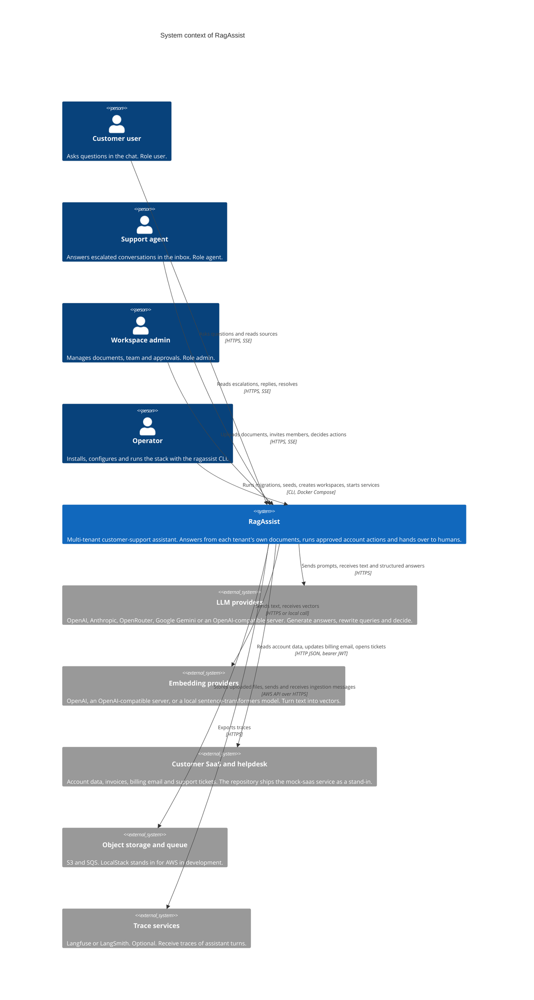
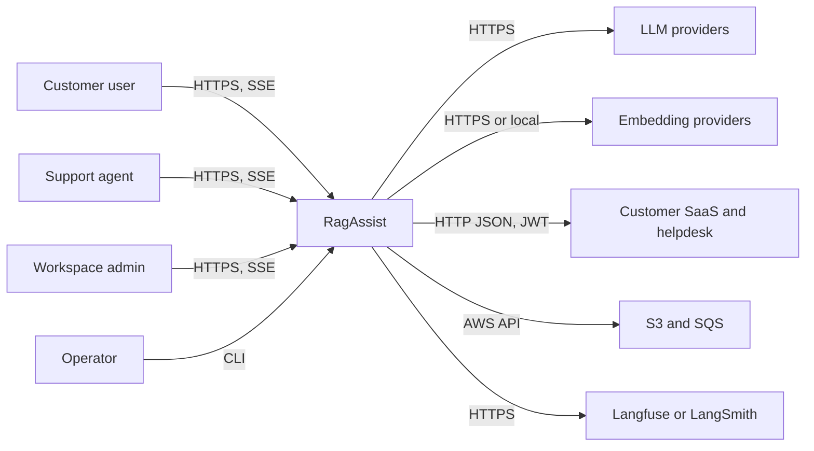

# C4 level 1: system context

**Type:** Architecture · **Audience:** everyone who needs the big picture · **Verified against:** `a989287`

**In plain English:** This page shows RagAssist as one box. Around the box you see four kinds of people and the outside
systems that RagAssist calls. Read it first. It tells you who uses the system and what the system needs from other services.

**Scope:** the whole RagAssist system. It does not show any container or component. See [containers](02-containers.md) for the next
zoom level and [the C4 introduction](README.md) for the notation.

## Diagram

Look for the one `RagAssist` box in the middle, the four people on the left, and the outside systems on the right. Each arrow says
who starts the call.

**Key:** Person = a human with a role. `System` = RagAssist. `System_Ext` = a system RagAssist does not own. Arrows
carry a verb and the protocol.

## In text

| From | Verb | To | Protocol | Notes |
|---|---|---|---|---|
| Customer user | asks questions and reads sources | RagAssist | HTTPS and Server-Sent Events | Sees only own conversations. See [roles](../reference/roles-and-permissions.md). |
| Support agent | reads escalations, replies, resolves | RagAssist | HTTPS and Server-Sent Events | Sees every conversation of the tenant. Only an agent can post a reply. |
| Workspace admin | uploads documents, invites members, decides actions | RagAssist | HTTPS and Server-Sent Events | Also resolves escalations and reads `/metrics`. |
| Operator | runs migrations, seeds, creates workspaces, starts services | RagAssist | command line | `ragassist db upgrade`, `seed`, `workspace create`, `token`, `serve`, `worker`, `init-env`. See [CLI reference](../reference/cli.md). |
| RagAssist | sends prompts to | LLM providers | HTTPS | Chosen by `config/models.yaml` and the `LLM_ROLE_*` settings. See [provider abstraction](../explanation/provider-abstraction-and-fallbacks.md). |
| RagAssist | sends text to | Embedding providers | HTTPS or local call | `EMBEDDING_PROVIDER` and `EMBEDDING_FALLBACK_CHAIN` select the provider. |
| RagAssist | calls | Customer SaaS and helpdesk | HTTP JSON with a short-lived bearer JWT | Account tools and ticket creation. The base URL is `MOCK_SAAS_BASE_URL`. |
| RagAssist | stores files and messages in | Object storage and queue | AWS API | Bucket `S3_BUCKET_DOCS`, queues `SQS_QUEUE_INGEST` and `SQS_QUEUE_INGEST_DLQ`. |
| RagAssist | exports traces to | Trace services | HTTPS | Off by default. See [observability and privacy](../explanation/observability-and-privacy.md). |

## Who the four people are

| Person | Role in the token | What they do in the system | Where to read more |
|---|---|---|---|
| Customer user | `user` | Asks questions. Reads the passage behind a citation. Can use read-only account tools. A write tool needs the `admin` role. | [Tutorial 3](../tutorials/03-upload-a-document-and-ask-a-question.md) |
| Support agent | `agent` | Works the inbox. Replies to escalated conversations. Resolves them. | [Tutorial 4](../tutorials/04-handle-an-escalation-as-an-agent.md) |
| Workspace admin | `admin` | Uploads and deletes documents. Manages members, invitations and reset links. Approves write actions. | [Manage the team](../how-to/manage-team-and-invites.md) |
| Operator | none | Is not a user of the application. Runs the command line and owns `.env`. | [Tutorial 1](../tutorials/01-run-the-stack-locally.md) |

The role comes only from the verified JWT. See [tenant isolation](../explanation/tenant-isolation-defence-in-depth.md).

## Outside systems that are optional or replaceable

- **LLM providers.** At least one chat model must be available. A model with a missing key is skipped, and start-up fails
  only if no model is left for a role (`runtime._role_models`). See [ADR 0013](../adr/0013-gemini-provider.md) for the Gemini provider.
- **Embedding providers.** The default chain can include a local model. The local model needs the optional `[ml]` extra.
- **Customer SaaS.** The mock service stands in for the real product. The assistant reaches it only through the
  `SaaSClient` and `HelpdeskClient` adapters.
- **Trace services.** `LANGFUSE_TRACING` is `false` by default. LangSmith needs `LANGSMITH_TRACING` and a key. See
  [ADR 0012](../adr/0012-langfuse-tracing.md).
- **Redis.** An optional shared cache and counter store (`CACHE_BACKEND=redis`). It is a container, so it appears on the
  [containers page](02-containers.md) and not here. See [ADR 0015](../adr/0015-caching.md).

## Flowchart fallback

Use this plain flowchart if the C4 diagram above does not draw. It has the same relationships.

## Related pages

- Next zoom level: [containers](02-containers.md).
- [arc42 section 3: context and scope](../arc42/03-context-and-scope.md).
- [arc42 section 1: introduction and goals](../arc42/01-introduction-and-goals.md).
- [Glossary](../glossary.md).
