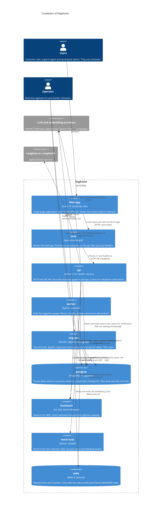
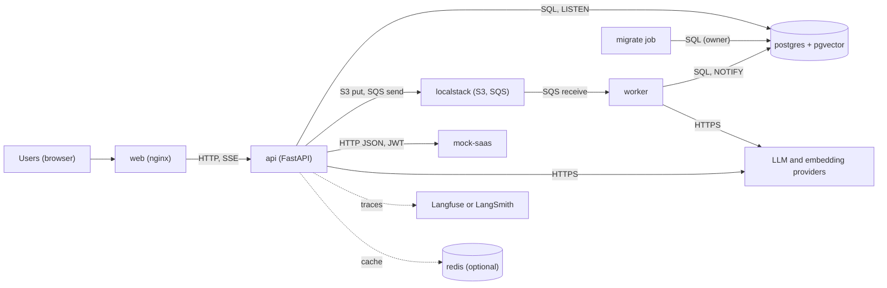

# C4 level 2: containers

**Type:** Architecture · **Audience:** engineers, operators and reviewers · **Verified against:** `a989287`

**In plain English:** This page opens the RagAssist box from the [context page](01-system-context.md). It shows the programs
and data stores that run together: a web server, an API, a worker, a database and a few helpers. Each arrow shows which
program calls which, and over which protocol. Read this page to know what runs where before you read any code.

**Scope:** the containers of RagAssist and the outside systems they call. It does not show the parts inside a container. See
[components of the api](03-components-api.md), [components of the assistant graph](04-components-assistant-graph.md),
[components of ingestion](05-components-ingestion.md) and [components of the web app](06-components-web-app.md). For the
nodes that run the containers, see the [deployment view](09-deployment.md).

## Diagram

Look for the `web` container in front, the `api` container in the middle, the `worker` that reads the queue, and the two
data stores. The database is the only place where tenant data lives. The worker and the API never call each other. They share
the database and the queue.

**Key:** `Container` = a unit that runs on its own. `ContainerDb` = a data store. The dashed frame = the RagAssist
boundary. The label of each arrow has a verb and, in the second part, the protocol.

## The containers

| Container | What it is | Technology | Started by | Facts |
|---|---|---|---|---|
| Web app | The single-page application | React 19, TypeScript, Vite, TanStack Query, Tailwind 4 | the browser, after `web` serves it | Access token in module memory only. See [ADR 0009](../adr/0009-web-app.md). |
| `web` | Static server and reverse proxy | `nginx/nginx-unprivileged` | compose service `web` | Runs as a non-root user on `WEB_PORT`. Own health route `/web-healthz`. See [ADR 0014](../adr/0014-web-delivery.md). |
| `api` | HTTP and SSE application | FastAPI, uvicorn, LangGraph | compose service `api`, command `ragassist serve` | Health route `/healthz`. Holds the compiled assistant graph and the event listener. |
| `worker` | Background ingestion | `ragassist worker`, `IngestionWorker` | compose service `worker` | Concurrency from `WORKER_CONCURRENCY`. Retries from `WORKER_MAX_RETRIES`. |
| `migrate` | Schema job | Alembic, `ragassist db upgrade` | compose service `migrate` (`restart: "no"`) | Runs `alembic upgrade head`, then `AsyncPostgresSaver.setup()`, then grants rights to the application role. |
| `postgres` | System of record | `pgvector/pgvector:pg16` | compose service `postgres` | The application role has no superuser right and no `BYPASSRLS`. See [ADR 0002](../adr/0002-row-level-security.md). |
| `localstack` | AWS stand-in | LocalStack with `SERVICES: s3,sqs,secretsmanager` | compose service `localstack` | An init script creates the bucket and the queues. Secrets Manager is enabled, and `Settings` has the field `SECRETS_MANAGER_SECRET_NAME`, but no code at this commit calls the service. |
| `mock-saas` | Customer SaaS stand-in | FastAPI, `services/mock_saas/main.py` | compose service `mock-saas` | Routes `/accounts/overview`, `/accounts/subscription`, `/accounts/invoices`, `/accounts/billing-email`, `/helpdesk/tickets`, `/healthz`. |
| `redis` | Optional shared cache | `redis:8.2.11-alpine` | compose profile `redis` | No published port. Needs `CACHE_REDIS_PASSWORD`. See [ADR 0015](../adr/0015-caching.md). |

## The relationships

| From | Verb | To | Protocol | Where in the code |
|---|---|---|---|---|
| User | uses | Web app | browser | `frontend/src/main.tsx` |
| Web app | loads assets and calls the API through | `web` | HTTPS or HTTP, same origin | `frontend/src/api/http.ts` (`apiFetch`) |
| `web` | proxies `/v1` and `/healthz` to | `api` | HTTP/1.1. Streams are not buffered. | `infra/nginx/templates/default.conf.template` |
| `api` | reads and writes | `postgres` | SQL through SQLAlchemy and asyncpg. A separate psycopg pool serves the LangGraph checkpoints. A dedicated psycopg connection serves `LISTEN`. | `shared/db/scoped.py`, `runtime.build_checkpointer`, `platform/events/adapters/postgres.py` |
| `api` | puts files and sends messages to | `localstack` | S3 and SQS API | `platform/storage/s3_adapter.py`, `platform/queue/sqs_adapter.py` |
| `api` | calls | `mock-saas` | HTTP JSON with a bearer JWT that the API mints for the verified user | `modules/actions/adapters/saas_client.py`, `modules/escalation/adapters/helpdesk.py` |
| `api` | sends prompts to | LLM providers | HTTPS | `platform/llm/adapters/*` |
| `api` | exports traces to | trace services | HTTPS | `shared/observability/tracing.py` |
| `api` | reads and writes | `redis` | Redis protocol | `platform/cache/adapters/redis_adapter.py` |
| `worker` | receives messages from and gets files from | `localstack` | SQS and S3 API | `worker/main.py` |
| `worker` | claims jobs in, writes chunks to, publishes `NOTIFY` to | `postgres` | SQL | `modules/knowledge/adapters/persistence/repositories.py`, `platform/events/adapters/postgres.py` (`PostgresEventPublisher`) |
| `worker` | embeds chunks with | embedding providers | HTTPS or local call | `platform/embeddings/service.py` |
| `migrate` | applies the schema to | `postgres` | SQL as the owner role (`DATABASE_ADMIN_URL`) | `cli/ops.py` (`db_upgrade`) |

Other facts about the arrows:

- **One origin.** The browser talks only to `web`. The refresh cookie is `SameSite=Strict`, so the app and the API must share one
  origin. See [accounts, sessions and tokens](../explanation/accounts-sessions-and-tokens.md).
- **Two database roles.** The API and the worker connect with the application role (`DATABASE_URL`). The `migrate` job and the
  `seed` command use the owner role (`DATABASE_ADMIN_URL`). Row-level security applies only to the application role.
- **The operator and the database.** The command `ragassist seed` inserts the demo tenants with the owner role. It then issues
  the set-password links with the application role. The command `ragassist workspace create` uses the application role only.
  Both commands talk to `postgres` directly. They do not call the `api` container. See the [CLI reference](../reference/cli.md).
- **The worker informs the API through the database.** After a job changes, the worker calls `pg_notify`. The API holds one
  `LISTEN` connection and fans the event out to the browsers. See [live events](../explanation/human-handoff-and-live-events.md)
  and [ADR 0008](../adr/0008-live-events-handoff-and-detached-turns.md).
- **Optional parts.** Redis, LangSmith and Langfuse are off by default. Without Redis, the cache and the counters live in each process.

## In memory mode

`PERSISTENCE_BACKEND` accepts `memory` or `postgres`. With `memory`, `lifespan` does not call `start_runtime`. The routers then
use in-memory stores, an in-memory queue, an in-memory object store and an in-memory event bus. No `postgres`, `localstack` or
`worker` is needed. This mode is for tests and offline use. The compose file sets `PERSISTENCE_BACKEND: postgres`.

## Flowchart fallback

Use this flowchart if the C4 diagram does not draw.

A dashed arrow marks an optional path.

## Related pages

- [Components of the api](03-components-api.md): the inside of `api`.
- [Deployment](09-deployment.md): the nodes that run these containers.
- [arc42 section 5: building block view](../arc42/05-building-block-view.md).
- [arc42 section 7: deployment view](../arc42/07-deployment-view.md).
- [Configuration reference](../reference/configuration.md): every setting named on this page.
- [Why a modular monolith](../explanation/why-a-modular-monolith.md): why `api` holds the assistant graph.
