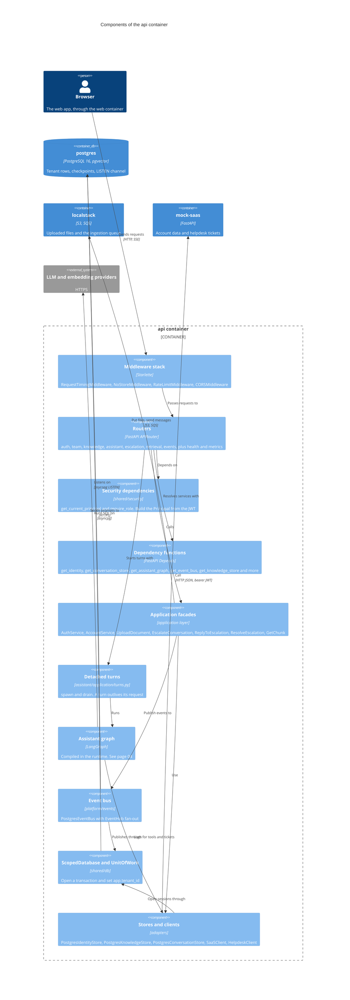
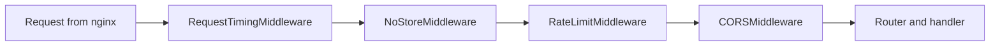
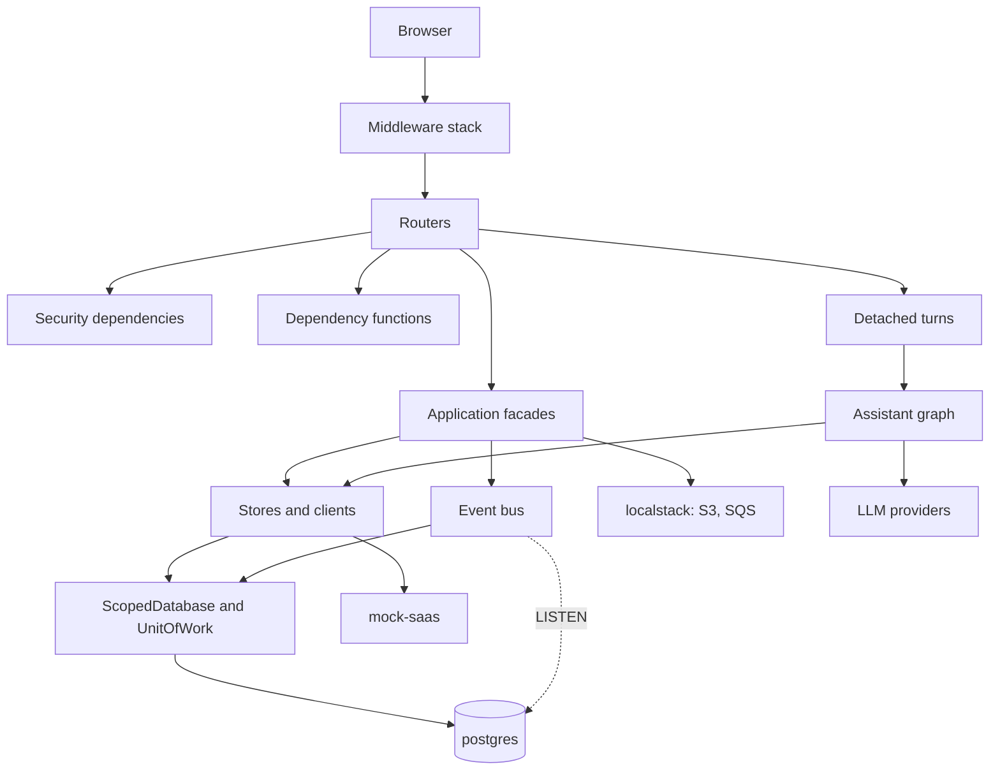

# C4 level 3: components of the api container

**Type:** Architecture · **Audience:** engineers who change the HTTP layer · **Verified against:** `a989287`

**In plain English:** This page opens the `api` container. It shows the parts that a request passes on its way to the
database: middleware, a router, a security check, an application use case and a data store. Read it to learn where to put a
new endpoint and which part owns which rule.

**Scope:** the components of the `api` container only. Other containers are in the [containers page](02-containers.md). The
inside of the assistant graph is in [page 04](04-components-assistant-graph.md). The ingestion path is in
[page 05](05-components-ingestion.md). See the [C4 introduction](README.md) for the notation.

## Diagram

Look for the one-way flow from the browser at the top, through the middleware stack, a router and the security
dependencies, down to the application facades and the data layer. The routers never touch the database directly. They call
facades or stores through the dependency functions.

**Key:** `Component` = a group of code with one job. `Container_Boundary` = the `api` container. Arrows point from the caller
to the callee.

## In text

| From | Verb | To | Where in the code |
|---|---|---|---|
| Browser | sends requests to | Middleware stack | `src/ragassist/main.py` (`create_app`) |
| Middleware stack | passes requests to | Routers | `app.include_router(...)` in `create_app` |
| Routers | depend on | Security dependencies | `Depends(get_current_principal)` in every protected route |
| Routers | resolve services with | Dependency functions | `get_identity`, `get_conversation_store`, `get_assistant_graph`, `get_event_bus`, `get_knowledge_store`, `get_object_store`, `get_message_queue`, `get_chunk_reader` |
| Routers | call | Application facades | for example `UploadDocument(...).execute(command)` in `modules/knowledge/api/router.py` |
| Routers | start turns with | Detached turns | `spawn(...)` in `modules/assistant/api/router.py` |
| Detached turns | run | Assistant graph | `graph.astream_events` and `graph.ainvoke` |
| Application facades | use | Stores and clients | the stores are passed in through the constructor |
| Application facades and routers | publish events to | Event bus | `publish_safely(events, ...)` |
| Stores and clients | open sessions through | ScopedDatabase | `ScopedDatabase.scope(tenant_id)` |
| Event bus | publishes through | ScopedDatabase | `PostgresEventPublisher.publish` runs `pg_notify` inside `scope` |
| ScopedDatabase | runs SQL on | `postgres` | SQLAlchemy `AsyncSession` over asyncpg |
| Event bus | listens on | `postgres` | one psycopg connection that runs `LISTEN ragassist_events` |

## The middleware stack

`create_app` adds the middleware in this order: `CORSMiddleware`, `RateLimitMiddleware`, `NoStoreMiddleware`. Then
`setup_observability` adds `RequestTimingMiddleware`. Starlette makes the last middleware that you add the outermost one. A
request therefore passes the layers in this order.

The same facts in text: the request enters `RequestTimingMiddleware` first and `CORSMiddleware` last, and then reaches the
route handler. The response leaves in the reverse order.

| Order | Middleware | Job | Source |
|---|---|---|---|
| 1 (outermost) | `RequestTimingMiddleware` | Measures the time, adds `X-Process-Time`, counts requests by route template. A cancelled request counts as status `499`. | `shared/observability/metrics.py` |
| 2 | `NoStoreMiddleware` | Adds `Cache-Control: no-store` and `Pragma: no-cache` on `/v1/auth/*` and `/v1/events`. Pure ASGI, so a stream stays unbuffered. | `shared/http_cache.py` |
| 3 | `RateLimitMiddleware` | Counts requests for each client address. Returns `429` with `Retry-After` over the limit. Uses shared Redis counters when `CACHE_BACKEND=redis`. Skips `/healthz`, `/metrics`, `/docs`, `/redoc`, `/openapi.json` and `/v1/events`. | `shared/security/rate_limiter.py` |
| 4 (innermost) | `CORSMiddleware` | Allows the origins in `CORS_ORIGINS` with credentials. | FastAPI |

The code comment on `NoStoreMiddleware` says that it is the outermost layer. `RequestTimingMiddleware` is added after it, so
it wraps `NoStoreMiddleware`. The effect on the headers is the same.

## The routers

`create_app` mounts every router below with the prefix `API_V1_PREFIX`. The value of the prefix is `/v1` in `.env.example`. See the [API endpoints reference](../reference/api-endpoints.md) for the full contract.

| Router | Module | Routes (after the prefix) | Role rule |
|---|---|---|---|
| `auth_router` | `modules/identity/api/router.py` | `POST /auth/login`, `POST /auth/refresh`, `POST /auth/logout`, `GET /auth/me`, `POST /auth/invites/accept`, `POST /auth/token` (development only) | `refresh` and `logout` need a trusted `Origin` (`require_trusted_origin`). `me` needs a token. |
| `team_router` | `modules/identity/api/team_router.py` | `GET /team/members`, `PATCH /team/members/{user_id}`, `POST /team/members/{user_id}/reset-link`, `GET /team/invites`, `POST /team/invites`, `DELETE /team/invites/{invite_id}` | `admin` only (`require_role`) |
| `knowledge_router` | `modules/knowledge/api/router.py` | `POST /documents`, `GET /documents`, `DELETE /documents/{document_id}`, `POST /documents/{document_id}/reindex`, `GET /ingestion-jobs/{job_id}` | upload, delete and re-index: `admin`. List and job status: any signed-in user. |
| `assistant_router` | `modules/assistant/api/router.py` | `POST /conversations`, `GET /conversations`, `GET /conversations/{conversation_id}`, `POST /conversations/{conversation_id}/messages`, `POST /conversations/{conversation_id}/actions/{interrupt_id}` | owner or staff reads. Owner or `admin` decides an action. |
| `escalation_router` | `modules/escalation/api/router.py` | `GET /escalations`, `POST /escalations/{escalation_id}/reply`, `POST /escalations/{escalation_id}/replies`, `POST /escalations/{escalation_id}/resolve` | list: `agent` or `admin`. Reply: `agent` only. Resolve: `agent` or `admin`. |
| `retrieval_router` | `modules/retrieval/api/router.py` | `GET /chunks/{chunk_id}` | any signed-in user. A chunk of another tenant gives `404`. |
| `events_router` | `platform/events/router.py` | `GET /events` | any signed-in user. At most `EVENTS_MAX_STREAMS_PER_USER` streams. |
| (in `main.py`) | `src/ragassist/main.py` | `GET /healthz`, `GET /metrics`, `/docs`, `/redoc`, `/openapi.json` | `/metrics`: `admin` only. The others: open. |

The reply route has two paths (`/reply` and `/replies`). Both call the same handler `_handle_reply`.

## Security dependencies

| Function | Job | Source |
|---|---|---|
| `get_current_principal` | Reads `Authorization: Bearer`. Calls `decode_access_token`. Returns a `Principal`. Answers `401` when the token is invalid. | `shared/security/deps.py` |
| `require_role(*roles)` | Wraps `get_current_principal`. Answers `403` when the role is not in the list. | `shared/security/deps.py` |
| `require_trusted_origin` | Compares the `Origin` header with `CORS_ORIGINS` and `WEB_BASE_URL`. Guards `refresh` and `logout`. | `modules/identity/api/deps.py` |
| `is_staff`, `owns`, `can_access_conversation`, `can_decide_action`, `owner_filter` | Per-user rules inside one tenant. | `modules/assistant/application/access.py` |

The `tenant_id`, the `user_id` and the role come from the `Principal` only. No route reads them from a body or a query
string. See [tenant isolation](../explanation/tenant-isolation-defence-in-depth.md) and
[ADR 0006](../adr/0006-conversation-access-and-approval-binding.md).

## Dependency functions and the runtime

The API has no single dependency-injection framework. Each router declares small functions and passes them to `Depends`. Each
function returns the PostgreSQL implementation when the runtime is started and the in-memory implementation otherwise.

| Function | Runtime started (`PERSISTENCE_BACKEND=postgres`) | Runtime not started |
|---|---|---|
| `get_identity` | `IdentityServices` over `PostgresIdentityStore` | `IdentityServices` over `InMemoryIdentityStore` |
| `get_conversation_store` | `runtime.conversations` | an `InMemoryConversationStore` |
| `get_assistant_graph` | `runtime.graph` (through `Container.get_assistant_graph`) | a graph built by `Container` with `MemorySaver` |
| `get_event_bus` | `runtime.events` (`PostgresEventBus`) | one `InMemoryEventBus` |
| `get_knowledge_store` | `runtime.knowledge` | an `InMemoryDocumentStore` |
| `get_object_store`, `get_message_queue` | `runtime.object_store`, `runtime.queue` | in-memory or S3 and SQS adapters, chosen from the settings |
| `get_chunk_reader` | `runtime.chunks` | an `InMemoryChunkRepository` |

`lifespan` in `main.py` calls `start_runtime(settings)` when `PERSISTENCE_BACKEND` is `postgres`. `start_runtime` calls
`build_runtime`. That function builds, in this order:

1. The SQLAlchemy engine and the `ScopedDatabase`.
2. The object store and the queue. Then it creates the bucket and the queues on LocalStack when `USE_LOCALSTACK` is true.
3. The model catalog and `LLMService`, the embedding service, the decision service and the reranker chain.
4. The `HybridRetriever` (dense and sparse) and the tool registry.
5. The LangGraph checkpointer on its own psycopg pool.
6. The compiled assistant graph.
7. The `PostgresEventBus`, started with its listener task, and the cache invalidation hook.

On shutdown `lifespan` waits for the running turns (`drain`), shuts down tracing, stops the runtime and closes the cache.

## Application facades

A facade is a small class in the application layer. A router builds it for one request and calls `execute`.

| Facade | Module | What it does | Port it needs |
|---|---|---|---|
| `AuthService` | `modules/identity/application/auth_service.py` | `login`, `refresh`, `logout`, `me`, `start_session` | `IdentityStore`, `PasswordHasher`, `LoginThrottle` |
| `AccountService` | `modules/identity/application/account_service.py` | `create_workspace`, `invite`, `reset_link`, `change_member`, `accept` | `IdentityStore`, `PasswordHasher` |
| `UploadDocument` | `modules/knowledge/application/ingestion_service.py` | Checks the MIME type and size. Stores the file, the job row and the document row. Sends the queue message. | object store, queue, document store |
| `EscalateConversation` | `modules/escalation/application/__init__.py` | Opens one helpdesk ticket for a conversation. It is idempotent. | conversation store, `HelpdeskPort` |
| `ReplyToEscalation` | same file | Saves an agent reply. Announces it. | conversation store |
| `ResolveEscalation` | same file | Sets the conversation to `resolved`. | conversation store |
| `GetChunk` | `modules/retrieval/application/__init__.py` | Reads one passage for the tenant. | `ChunkReader` |

Modules call each other through these facades and through the event bus. The assistant router, for example, opens a ticket
through `EscalateConversation` and does not read the escalation tables.

## Detached turns

`spawn(coro)` in `modules/assistant/application/turns.py` creates an asyncio task that the request does not own. The set of
running tasks keeps a strong reference. `drain(timeout)` waits for them at shutdown and cancels any task that is still running
after 30 seconds. This is why the answer is saved and the ticket opened when the browser closes the connection. See
[ADR 0008](../adr/0008-live-events-handoff-and-detached-turns.md).

## Data layer

| Component | Source | Behaviour |
|---|---|---|
| `ScopedDatabase.scope(tenant_id)` | `shared/db/scoped.py` | Opens a session in an explicit transaction and runs `SELECT set_config('app.tenant_id', :tid, true)`. Inside `transaction()` it reuses the open transaction and refuses a second tenant. |
| `ScopedDatabase.transaction()` | same file | Groups several repository calls. Callbacks added with `defer_until_commit` run after the commit. The upload uses this for the queue message. |
| `UnitOfWork` | `shared/db/uow.py` | The same `set_config` call on a session that has no open transaction. The dense and sparse retrievers use it. |
| `PostgresEventBus` | `platform/events/adapters/postgres.py` | `pg_notify` on the channel `ragassist_events`, and one listener connection. |

Every tenant table has forced row-level security. The `set_config` call with the last argument `true` has the same effect as
`SET LOCAL`. See the [data model reference](../reference/data-model.md) and
[ADR 0002](../adr/0002-row-level-security.md).

## Flowchart fallback

Use this flowchart if the C4 diagram does not draw. It has the same relationships.

A dashed arrow marks the separate listener connection.

## Related pages

- Previous zoom level: [containers](02-containers.md).
- [Ports and adapters reference](../reference/ports-and-adapters.md).
- [Roles and permissions reference](../reference/roles-and-permissions.md).
- [How to add an API endpoint](../how-to/add-an-api-endpoint.md).
- [arc42 section 5: building block view](../arc42/05-building-block-view.md).
- [Why a modular monolith](../explanation/why-a-modular-monolith.md).
