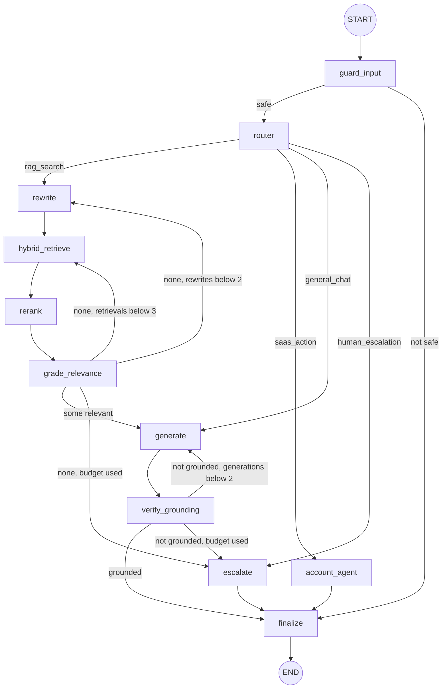
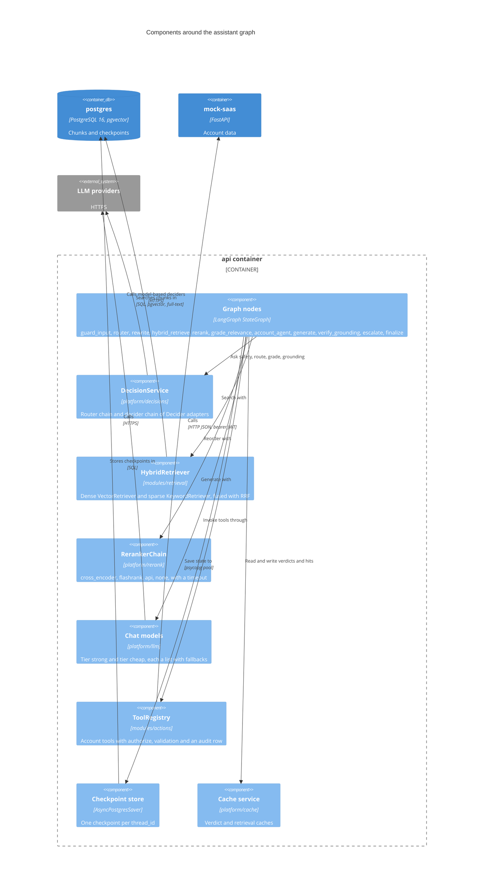
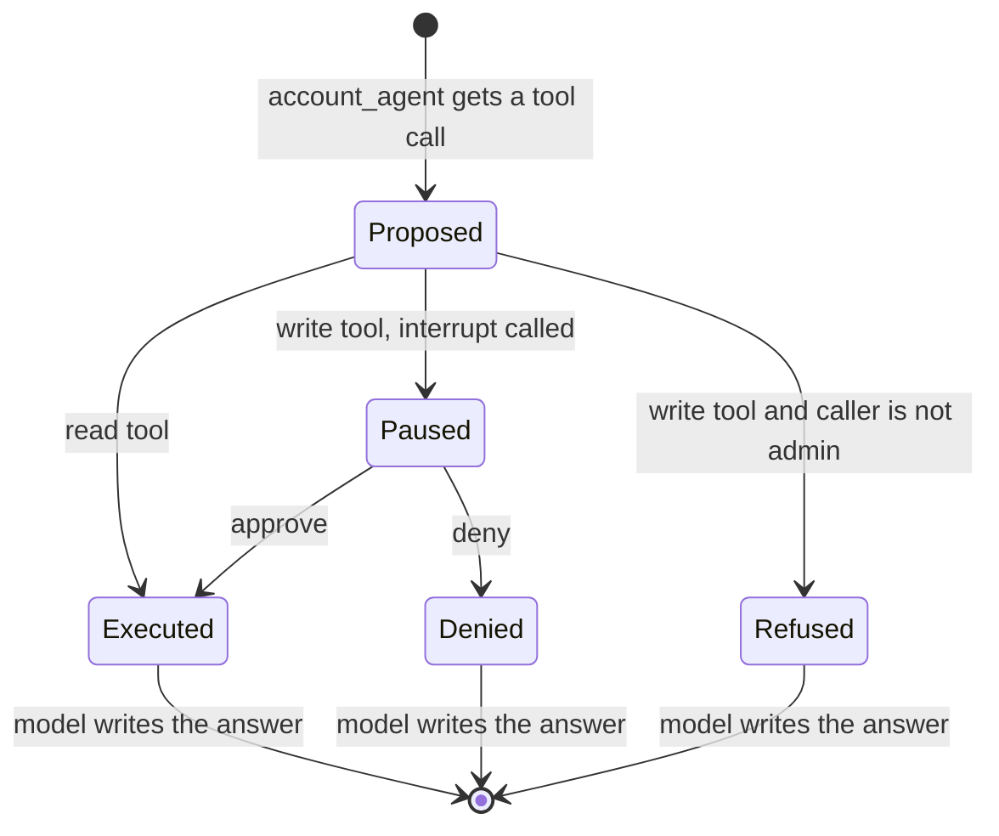
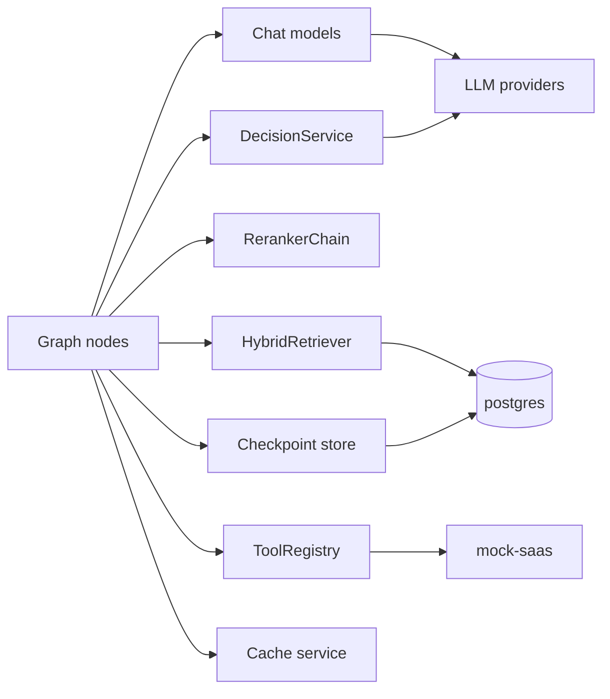

# C4 level 3: components of the assistant graph

**Type:** Architecture · **Audience:** engineers who change the assistant, reviewers of its safety rules · **Verified against:** `a989287`

**In plain English:** One question from a customer runs through a small program called a graph. The graph has 11 steps
(nodes). Each node does one job: check safety, choose a route, search, grade, write the answer, check the answer, hand over
to a person. This page shows every node and every edge, the services each node calls, and how a write action pauses for
approval.

**Scope:** the components that make one assistant turn inside the `api` container. It does not show the HTTP layer
([page 03](03-components-api.md)) or the database tables. For the stream that carries the answer to the browser see
[dynamic views](08-dynamic-views.md). For the state fields see the [assistant graph reference](../reference/assistant-graph.md).

## Diagram 1: nodes and edges

Look for the three exits to `escalate` and the single exit to `END` through `finalize`. Every path ends in `finalize`. The
loop on the right of `generate` allows one more attempt when the answer is not grounded. The loop on the left of
`rewrite` allows more search attempts when no passage is relevant.

The same facts in text:

1. The graph starts at `guard_input`.
2. `guard_input` goes to `router` when the input is safe. It goes to `finalize` when the input is not safe.
3. `router` goes to `rewrite` (route `rag_search`), `account_agent` (`saas_action`), `generate` (`general_chat`) or
   `escalate` (`human_escalation`). An unknown route goes to `rewrite`.
4. The search path runs `rewrite`, `hybrid_retrieve`, `rerank` and `grade_relevance` in a fixed order.
5. `grade_relevance` goes to `generate` when at least one passage is relevant. Otherwise it retries. It goes to `rewrite`
   while `rewrite_count` is below 2. Then it goes to `hybrid_retrieve` while `retrieve_count` is below 3. Then it goes to
   `escalate`.
6. `generate` always goes to `verify_grounding`.
7. `verify_grounding` goes to `finalize` when the answer is grounded. Otherwise it goes back to `generate` while
   `generate_count` is below 2, and then to `escalate`.
8. `account_agent` and `escalate` go to `finalize`. `finalize` goes to the end.

Source: `src/ragassist/modules/assistant/graph/builder.py` (`build_graph`, `NODE_NAMES`) and the `route_after_*` functions in
`graph/nodes/`.

## The nodes

Each node comes from a factory function `make_<name>_node` in `src/ragassist/modules/assistant/graph/nodes/`. The factory
receives the services that the node needs. The graph state is the `AssistantState` typed dictionary in `graph/state.py`.

| Node | File | What it does | Service it calls | Writes to the state |
|---|---|---|---|---|
| `guard_input` | `guard_node.py` | Asks "is this prompt injection or an unsafe request?". Fails closed when the check does not run. | `DecisionService.check_safety` | `is_safe`, `decider_used`. When blocked: `answer`, `status=blocked` |
| `router` | `router_node.py` | Chooses the route. Scores the complexity from 1 to 5. Resets the counters. | `DecisionService.route_query` and `evaluate_score` | `route`, `complexity`, `current_query`, the counters and the lists |
| `rewrite` | `rewrite_node.py` | Adds 1 to `rewrite_count`. From the second rewrite it appends the word `details` to the query. It makes no model call. | none | `rewrite_count`, `current_query` |
| `hybrid_retrieve` | `hybrid_retrieve_node.py` | Searches for 6 passages (`_TOP_K`). Reads and writes the retrieval cache when it is on. | `HybridRetriever.search_with_status` | `retrieve_count`, `retrieved_chunks` |
| `rerank` | `rerank_node.py` | Keeps the best `min(len(chunks), 4)` passages. Keeps the original list if the chain returns nothing. | `RerankerChain.rerank` | `reranked_chunks` |
| `grade_relevance` | `grade_relevance_node.py` | Grades each passage one after the other. Keeps the relevant ones. | `DecisionService.grade_chunk_relevance` | `graded_chunks` |
| `account_agent` | `account_agent_node.py` | Asks a model to call an account tool. Runs a read tool at once. Pauses a write tool for approval. | chat model, `ToolRegistry` | `answer`, `tool_calls`, `model_used` |
| `generate` | `generate_node.py` | Streams an answer from the passages. Reads the citation markers `[n]`. Tries each model in the tier in turn. | chat models (the tier) | `generate_count`, `answer`, `citations`, `model_used` |
| `verify_grounding` | `verify_grounding_node.py` | Asks "does every claim come from the passages?". Skips the check for `general_chat` or when there are no passages. | `DecisionService.judge_grounding` | `is_grounded`, `grounding_score`, `decider_used` |
| `escalate` | `escalate_node.py` | Marks the turn as escalated. Sets a default answer when there is none. | none | `escalated`, `status=escalated`, `answer` |
| `finalize` | `finalize_node.py` | Sends the custom events `citation` and `done`. Fills the final fields. | LangGraph `adispatch_custom_event` | `status`, `answer`, `citations` and the rest |

Facts about the nodes:

- **Tier.** `generate` and `account_agent` use the tier `cheap` when `complexity` is below 2.0. Otherwise they use `strong`.
  In `runtime.build_runtime`, `strong` holds the models of the `generator` role. `cheap` holds the models of the `rewriter`
  role.
- **Streaming.** Only the chat-model tokens of the nodes in `ANSWER_NODES` (`generate` and `account_agent`) go to the
  browser. See `modules/assistant/api/router.py`.
- **Tracing.** Three nodes open a trace observation: `check-safety` (guard), `route-question` (router) and
  `retrieve-passages` (retrieve). See [observability](../reference/observability.md).
- **Caches.** `guard_input` and `router` use `VerdictCache` when the cache is on. A fail-closed or defaulted result is never
  stored. `hybrid_retrieve` uses `RetrievalResultCache`. See [ADR 0015](../adr/0015-caching.md).
- **Doc and code note:** `build_runtime` passes an `agent_tiers` argument to `build_graph`. `build_graph` accepts it through
  `**kwargs` and does not use it. The `account_agent` node reads `generator_tiers`. See the end of this page.

## Diagram 2: services behind the nodes

Look for the ports (`Decider`, `Reranker`, chat models, retriever, tool registry, checkpoint store) on the right. A node
never creates a provider itself. It receives a service that the composition root built from the settings.

**Key:** `Component` = a group of code with one job. The boundary is the `api` container.

### In text

| From | Verb | To | Notes |
|---|---|---|---|
| Graph nodes | ask | `DecisionService` | `guard_input`, `router`, `grade_relevance` and `verify_grounding` |
| Graph nodes | search with | `HybridRetriever` | `hybrid_retrieve` only. The retriever runs both searches in parallel with `asyncio.gather`. |
| Graph nodes | reorder with | `RerankerChain` | `rerank` only |
| Graph nodes | generate with | chat models | `generate` and `account_agent` |
| Graph nodes | invoke tools through | `ToolRegistry` | `account_agent` only |
| Graph nodes | save state to | checkpoint store | LangGraph saves the state after each node, for each `thread_id` |
| `HybridRetriever` | searches | `postgres` | Each search opens a `UnitOfWork` for the tenant. |

## The ports behind the nodes

| Port | Module | Adapters in the code | Chosen by |
|---|---|---|---|
| `Decider` | `platform/decisions/ports.py` | `rules`, `semantic_router`, `openai_decisions`, `jev`, `strands_local` (alias `strands`), `llm_structured`, `llm_structured_2`, `llm_structured_3` | `ROUTER_DECIDER_CHAIN` and `DECIDER_CHAIN` |
| `Reranker` | `platform/rerank/ports.py` | `cross_encoder`, `flashrank`, `api`, `none` | `RERANKER_CHAIN` |
| `ChatModelProvider` | `platform/llm/ports.py` | `openai`, `anthropic`, `openrouter`, `gemini`, `openai_compatible` | `config/models.yaml` and the `LLM_ROLE_*` settings |
| `EmbeddingProvider` | `platform/embeddings/ports.py` | `openai`, `openai_compatible` (alias `ollama`), `sentence_transformers` (alias `local`) | `EMBEDDING_FALLBACK_CHAIN` |

The decision service wraps every call in a time limit (`DECIDER_TIMEOUT_MS`). It asks the next decider in the chain when one
fails, times out or returns less confidence than `DECIDER_MIN_CONFIDENCE`. The minimum confidence applies to the route
choice only. With a model service, the registry creates one `llm_structured` decider for each model: `llm_structured` for
the first model, `llm_structured_2` for the second and `llm_structured_3` for the third. The models come from the
`decider` role first and then from the `generator` role. When a model-based decider cannot answer a predicate, it raises an
error. It does not invent a verdict, and the chain moves on to the next decider. The `DecisionService` itself turns a failure
of the whole chain into a safe default: `check_safety` and `judge_grounding` fail closed. `route_query` falls back to
`rag_search`. `grade_chunk_relevance` falls back to "relevant". See [the decision layer](../explanation/the-decision-layer.md)
and [ADR 0004](../adr/0004-decision-layer.md).

`build_reranker_chain` builds the members `none`, `cross_encoder`, `flashrank` and `api` from `RERANKER_CHAIN`. It skips a
name that it does not know, with a warning. If every member fails to build, it uses `none`. See [ADR 0005](../adr/0005-reranker-chain.md).

## The checkpoint store

LangGraph saves the graph state after each node. The state belongs to a *thread*. The API names the thread
`{tenant_id}:{conversation_id}` (`thread_id` in the config of every call). In the PostgreSQL runtime the saver is
`AsyncPostgresSaver` on its own psycopg connection pool. The `migrate` job creates its tables. Without the runtime,
`Container` uses `MemorySaver`. Both use the serializer from `checkpoint_serde()` in `graph/serde.py`.

The API removes the bearer token from the principal before it writes the state (`_checkpointable`). A tool call mints a new
short-lived token for the verified user. See [ADR 0006](../adr/0006-conversation-access-and-approval-binding.md).

At the start of each turn the assistant API router adds the fields in `FRESH_TURN_STATE` (answer, citations, counters, lists)
to the input state. The checkpoint would otherwise carry them from the previous turn.

## The tool executor and the approval interrupt

The `account_agent` node asks a chat model for a tool call. It reads only the first call that the model returns. Then it
follows these rules.

1. The tool is not in the registry: the node tells the model that the tool is unknown and returns the next model answer.
2. The tool is a read tool: the node runs it at once through `ToolRegistry.invoke`.
3. The tool is a write tool: the node first calls `ToolRegistry.authorize`. A caller who is not an `admin` gets a
   "permission denied" message and no approval prompt.
4. Otherwise the node calls `interrupt(...)` with the payload `action`, `tool`, `arguments` and `call_id`. LangGraph saves
   the checkpoint and stops the graph.
5. After a decision, the API resumes the graph with `Command(resume=payload)`. LangGraph runs the node again from the top.
   The node reads the tool and the arguments from the payload, which the API took from the saved interrupt. It does not trust
   a regenerated proposal.

A small bounded cache (`_PENDING_TOOL_CALLS`, at most 512 entries) keeps the model message while the graph is paused. The
cache only saves a model call. A miss cannot change what runs.

The tools come from `default_tools` in `modules/actions/tools/__init__.py`. The runtime hides `query_dataset` and
`get_invoices`.

| Tool | Kind | Calls |
|---|---|---|
| `get_account_overview` | read | `SaaSClient.get_overview` |
| `get_subscription` | read | `SaaSClient.get_subscription` |
| `list_invoices` | read | `SaaSClient.get_invoices` |
| `update_billing_email` | write, `admin` only | `SaaSClient.update_billing_email` after email validation |

`runtime.build_tool_registry` wraps every handler. The wrapper mints a token for the verified principal. It writes one audit
row (`tool_audit_log`) for each call, with status `executed` or `failed`.

### Diagram 3: the pause and the resume

Look for the two ways out of `Paused`. The decision comes from a second HTTP request, not from the model.

The same facts in text: a write tool pauses the graph. An approval runs the tool. A denial skips the tool. In all cases the
model writes the final answer, and `finalize` ends the turn. The API answers `409` when the `interrupt_id` is not the one
that the checkpoint waits on. See [dynamic views](08-dynamic-views.md) and [approvals and actions](../explanation/approvals-and-actions.md).

## Flowchart fallback for diagram 2

## Doc and code notes

- **`agent_tiers` is not used.** `runtime.build_runtime` builds chat models of the role `agent` and binds the tool schemas to
  them (`_with_tools`). It passes them as `agent_tiers`. `build_graph` does not read that argument, and it calls
  `make_account_agent_node(dict(generator_tiers), tools)`. The node therefore uses the `generator` and `rewriter` models. It
  does not use the tool-bound models. Whether those models return tool calls without `bind_tools` was not tested here.
  Unverified: the effect on a real provider.
- **The reranker name `decision`.** `DecisionReranker` exists, and the architecture rules name `decision` as a reranker. The
  function `build_reranker_chain` does not build it from the chain string. It skips the name with a warning unless a caller
  injects an instance.

## Related pages

- [Components of the api](03-components-api.md) and [dynamic views](08-dynamic-views.md).
- [How an answer is made](../explanation/how-an-answer-is-made.md).
- [Retrieval and chunking](../explanation/retrieval-and-chunking.md).
- [arc42 section 6: runtime view](../arc42/06-runtime-view.md).
- [ADR 0004](../adr/0004-decision-layer.md), [ADR 0005](../adr/0005-reranker-chain.md), [ADR 0006](../adr/0006-conversation-access-and-approval-binding.md).
