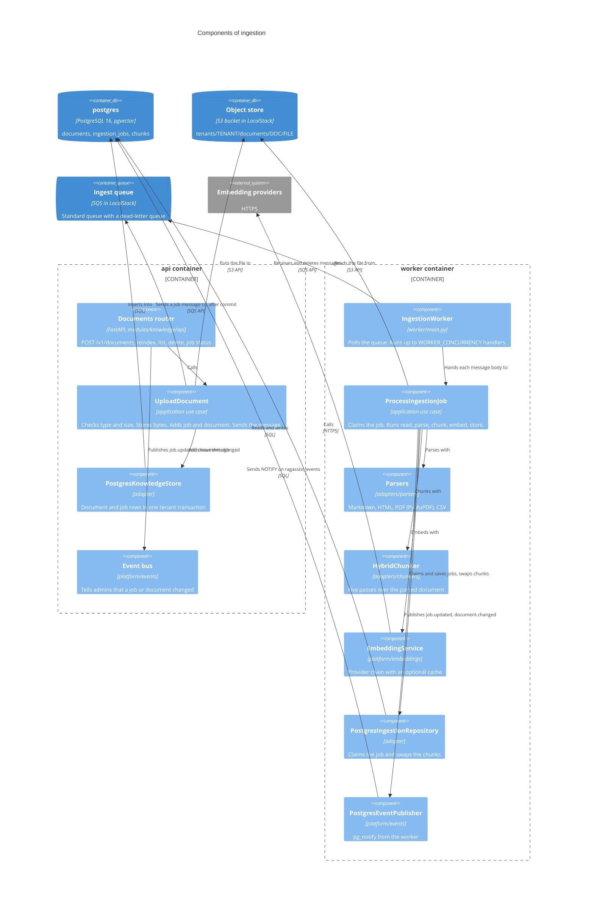
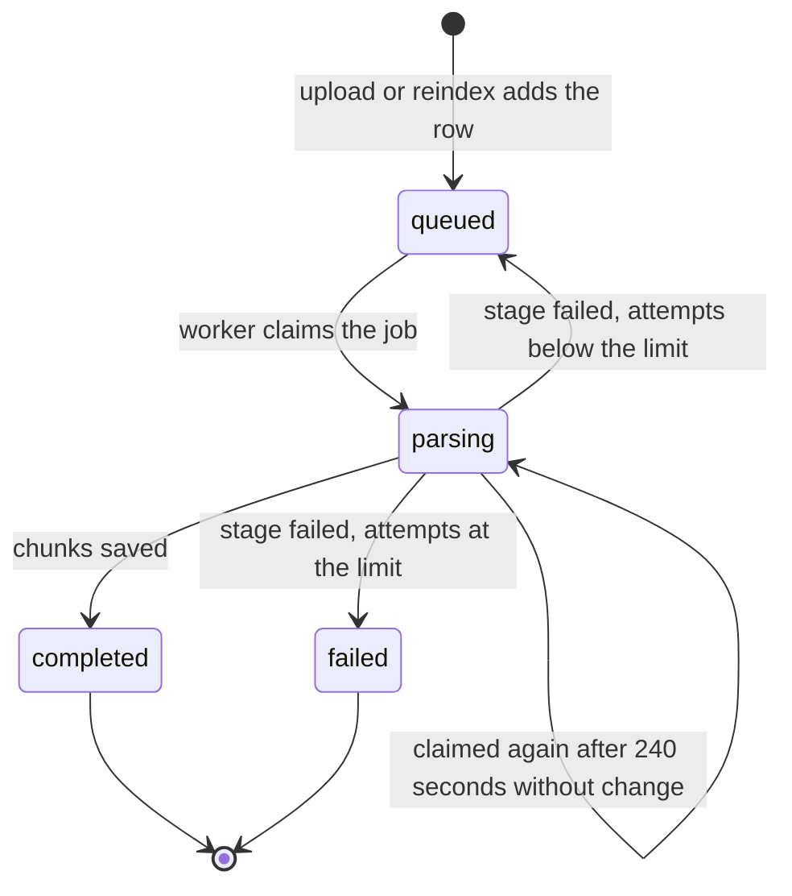
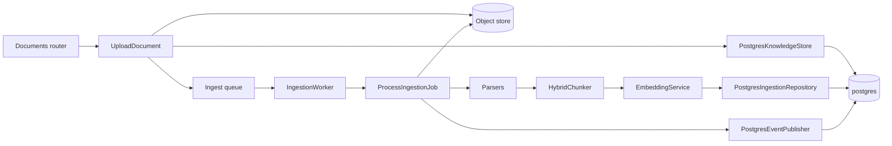

# C4 level 3: components of ingestion

**Type:** Architecture · **Audience:** engineers who change upload, parsing or indexing, operators who debug a stuck document · **Verified against:** `a989287`

**In plain English:** An admin uploads a file. The `api` container stores it, records a job and puts a message on a queue.
The `worker` container takes the message, reads the file, cuts it into passages, turns each passage into numbers (a vector)
and saves them in the database. This page shows the parts on each side of the queue and the life of one job.

**Scope:** the upload path in the `api` container and the processing path in the `worker` container. The page does not show
how the assistant searches the passages. For that see [page 04](04-components-assistant-graph.md) and
[retrieval and chunking](../explanation/retrieval-and-chunking.md). For the choice of the chunker see
[ADR 0003](../adr/0003-hybrid-chunking.md).

## Diagram 1: the two sides of the queue

Look for the queue in the middle. The `api` side is fast and ends when the message is on the queue. The `worker` side does
the slow work. The two sides share no memory. They share the object store, the queue and the database.

**Key:** `Component` = a group of code with one job. `ContainerDb` and `ContainerQueue` = stores that sit outside the two
boundaries. The bucket and the queue names come from settings (`S3_BUCKET_DOCS`, `SQS_QUEUE_INGEST`, `SQS_QUEUE_INGEST_DLQ`).

### In text

| From | Verb | To | Notes |
|---|---|---|---|
| Documents router | calls | `UploadDocument` | Only an `admin` may upload. The router reads the file in parts and stops at the size cap. |
| `UploadDocument` | puts the file in | object store | Key `tenants/<tenant_id>/documents/<document_id>/<safe file name>` |
| `UploadDocument` | adds rows through | `PostgresKnowledgeStore` | One job row and one document row, both `queued` |
| `UploadDocument` | sends a message to | ingest queue | The send waits until the database commit (`DeferredQueue` in `runtime.py`) |
| Documents router | publishes | event bus | `job.updated` and `document.changed` for the tenant |
| `IngestionWorker` | receives from and deletes from | ingest queue | Polls in a loop. Deletes a message on every outcome except `RETRY`. |
| `IngestionWorker` | hands the body to | `ProcessIngestionJob` | Through `handle_for_tenant`, which binds the tenant first |
| `ProcessIngestionJob` | reads from | object store | The key comes from the document row, not from the message |
| `ProcessIngestionJob` | parses, chunks and embeds with | parsers, chunker, embedding service | In this order |
| `PostgresIngestionRepository` | writes to | `postgres` | Replaces the chunks of the document in one tenant scope |
| `PostgresEventPublisher` | notifies | `postgres` | The `api` container listens and sends the event to browsers |

## The upload side

`POST /v1/documents` is in `src/ragassist/modules/knowledge/api/router.py`. It runs these steps in order.

1. Check that the caller is an `admin`. Other roles get `403`.
2. Read the file in parts. A file larger than the cap (`MAX_UPLOAD_BYTES`, 50 MiB) gets `413`. An empty file gets `400`.
3. Find the MIME type. If the browser sends none, or sends `application/octet-stream`, the router guesses it from the file
   name.
4. Run `UploadDocument.execute`. It checks the type and the size again. The allowed types are `text/markdown`, `text/html`,
   `text/csv` and `application/pdf`. Any other type gets `415`.
5. Inside `documents.transaction()`, put the file in the object store, add the job row, add the document row and send the
   message. The queue adapter holds the send until the transaction commits.
6. If a step fails after the file is stored, the use case tries to delete the file again. A failed cleanup is only logged.
7. The router publishes `job.updated` and `document.changed` and answers `202` with the document id, the job id, the object
   key and the status `queued`.

The use case cleans the file name. It keeps the last path part, removes null bytes and the text `..`, and uses `document`
when nothing is left.

The message body has four fields: `job_id`, `tenant_id`, `object_key` and `document_id`. A *reindex* (`POST
/v1/documents/{document_id}/reindex`, admin only) adds a new job row and sends a message with `reindex` set to true. The
worker treats it like any other message. `GET /v1/ingestion-jobs/{job_id}` returns the job status. `GET /v1/documents`
supports `If-None-Match` and answers `304` when the list has not changed. `DELETE /v1/documents/{document_id}` deletes the
document and its object. See the [API reference](../reference/api-endpoints.md).

## The worker side

`ragassist worker` runs `worker/main.py`. `main()` builds every part from the settings and starts `IngestionWorker`.

| Part | What it is | Setting |
|---|---|---|
| Queue | `SQSMessageQueue` on `aioboto3` | `SQS_QUEUE_INGEST` |
| Object store | `S3ObjectStore` | `S3_BUCKET_DOCS` |
| Parsers | One per MIME type: `MarkdownParser`, `HtmlParser`, `PyMuPDFParser` (PDF), `TabularParser` (CSV) | none |
| Chunker | `HybridChunker.from_settings` with `RegexTokenCounter` | `CHUNK_MAX_TOKENS`, `CHUNK_OVERLAP_TOKENS`, `CHUNK_MERGE_PEERS`, `CHUNK_SEMANTIC`, `CHUNK_PARENT_CHILD` |
| Embedder | `build_embedding_service` with the cache service | `EMBEDDING_FALLBACK_CHAIN` and the `CACHE_*` settings |
| Repository | `PostgresIngestionRepository` (or `InMemoryDocumentRepository` when `PERSISTENCE_BACKEND` is `memory`) | `PERSISTENCE_BACKEND` |
| Event publisher | `PostgresEventPublisher` (none with the memory backend) | none |
| Retries | The job is dead-lettered when `attempts` reaches the limit | `WORKER_MAX_RETRIES` |
| Concurrency | The number of handlers at the same time | `WORKER_CONCURRENCY` |
| Poll wait | Seconds to wait for a message | `WORKER_POLL_WAIT_SECONDS` |

The loop receives up to `WORKER_CONCURRENCY` messages. It starts one task for each message. It skips a message whose receipt
it already handles or has marked for retry. It stops receiving while the number of tasks is at the limit. On a stop signal
it waits for the running tasks to finish. The receive call waits at most 1 second (`min(poll_wait_seconds, 1)`).

`handle_for_tenant` reads `tenant_id` from the message body and calls `bind_tenant` on the repository. Every database call
of that handler then runs in the scope of that tenant. The handler calls `unbind_tenant` in a `finally` block.

The Docling parser and chunker files exist in `modules/knowledge/adapters/`. The worker does not use them.

### What `ProcessIngestionJob.handle` does

1. Read the body. A body that is not a JSON object, or has no `job_id` or `tenant_id`, gives `REJECTED`.
2. Load the job. A missing job gives `REJECTED`. A job whose tenant differs from the message tenant gives `REJECTED`.
3. A job with status `completed` gives `DUPLICATE_SKIPPED`.
4. Claim the job with `claim_job`. The call changes the job to `parsing` and adds 1 to `attempts`. It succeeds when the job
   is `queued`, or when the job is `parsing` and has not changed for 240 seconds. If it fails, the result is
   `DUPLICATE_SKIPPED`.
5. Publish `job.updated` and `document.changed`.
6. Load the document row. The object key comes from this row. The key must start with `tenants/<tenant_id>/`. Otherwise the
   stage `object key outside the tenant` fails.
7. Read the file from the object store.
8. Choose the parser from the MIME type of the document.
9. Parse, then chunk, then embed. The embedder is `embed_documents_for` with the tenant, so the cache can skip text that
   it has seen before.
10. Replace the chunks of the document with `replace_chunks`. The call deletes the old chunks and inserts the new ones with
    the full-text value and the vector, all in one tenant scope.
11. Save the job as `completed`, publish the events and return `COMPLETED`.

When a stage fails, `_handle_failure` records the stage name and the exception class (not the text) in the job row. The text
goes to the log only. If `attempts` is at the limit, the job becomes `failed` and the result is `DEAD_LETTERED`. Otherwise
the job goes back to `queued` and the result is `RETRY`.

### Five passes of the chunker

`HybridChunker` (`adapters/chunkers/hybrid_chunker.py`, passes in `passes.py`) cuts a parsed document in five passes:
structure, token, merge, table and context. A parent and child layout is optional. The token count comes from
`RegexTokenCounter`, a rule-based counter. See [ADR 0003](../adr/0003-hybrid-chunking.md).

## Diagram 2: the life of a job

Look for the two ways back to `queued` and for the three end states. A job row only holds the states `queued`, `parsing`,
`completed` and `failed`. The `retrying` arrow is the same row, set back to `queued`.

The same facts in text:

- A new job is `queued`.
- The worker claims it and the status becomes `parsing`. The status stays `parsing` for every stage (read, parse, chunk,
  embed, store). The job row does not record the stage while the job runs.
- A failure sends the job back to `queued` while `attempts` is below `WORKER_MAX_RETRIES`. The message stays on the queue and
  becomes visible again.
- A failure at the limit makes the job `failed`. The worker deletes the message.
- A worker that stops in the middle leaves the job in `parsing`. After 240 seconds another worker can claim it.
- A `completed` job is never claimed again. A second message for it gives `DUPLICATE_SKIPPED`.

The domain also defines the states `chunking`, `embedding` and `indexing` and a table of legal changes
(`LEGAL_JOB_TRANSITIONS`). The worker does not use them. It writes only `queued`, `parsing`, `completed` and `failed`.

The list of documents shows a document status that comes from the job status: `completed` gives `completed`, `failed` gives
`failed`, `queued` gives `queued`, and every other value gives `processing`.

### Outcomes and the message

| Outcome | Meaning | What the worker does with the message |
|---|---|---|
| `COMPLETED` | The chunks are saved | Deletes it |
| `DUPLICATE_SKIPPED` | The job is done or another worker has it | Deletes it |
| `REJECTED` | The body is not valid, the job is missing or the tenant does not match | Deletes it |
| `DEAD_LETTERED` | The job failed at the retry limit | Deletes it |
| `RETRY` | A stage failed and attempts are left | Keeps it. The queue shows it again. |

If the handler raises an error, the worker treats the result as `RETRY`.

## The queue and the object store in LocalStack

`infra/localstack/init.sh` creates one bucket, one ingest queue and one dead-letter queue when LocalStack starts. The
ingest queue has a redrive policy with `maxReceiveCount` 3. The values of `S3_BUCKET_DOCS`, `SQS_QUEUE_INGEST` and
`SQS_QUEUE_INGEST_DLQ` in `.env` must match the names in that script. See [deployment](09-deployment.md).

## Events

The worker publishes `job.updated` and `document.changed` through `PostgresEventPublisher`. That adapter runs
`pg_notify` on the channel `ragassist_events` inside a tenant scope. The `api` container holds one listening connection and
sends each event to the admins of that tenant who have an open `/v1/events` stream. The web app then refreshes the
knowledge list. An event carries ids only (`job_id`, `document_id`), never file content. See
[human handoff and live events](../explanation/human-handoff-and-live-events.md) and
[ADR 0008](../adr/0008-live-events-handoff-and-detached-turns.md).

## Flowchart fallback for diagram 1

## Doc and code notes

- **Parsing and chunking run on the event loop.** `PyMuPDFParser.parse` and `HybridChunker.chunk` are called in the async
  handler without `asyncio.to_thread` or `run_cpu_bound`. `AGENTS.md` section 1.4 requires CPU-bound
  work to run in the bounded executor. A large PDF can block the loop of that worker process. The worker also handles
  several messages in one process.
- **The worker has no stop signal.** `main()` creates a `stop_event` and never sets it. A `SIGTERM` stops the process
  without the graceful drain that `run_until_stopped` supports.
- **`WORKER_VISIBILITY_TIMEOUT_SECONDS` is not used.** The setting exists in `Settings`. The receive call does not pass a
  visibility timeout.
- **The dead-letter queue.** The worker deletes a message on `DEAD_LETTERED`. The queue reaches the dead-letter queue only
  through the redrive policy, after 3 receives.
- **Embeddings can be unavailable.** When the OpenAI call fails and the optional `[ml]` extra is not installed in the
  image, no embedding provider works and the job fails at the stage `embed`. This is a known open limitation. See
  [known limitations](../explanation/known-limitations-and-roadmap.md).

## Related pages

- [Containers](02-containers.md), [components of the api](03-components-api.md) and [dynamic views](08-dynamic-views.md).
- [Retrieval and chunking](../explanation/retrieval-and-chunking.md).
- [Manage the knowledge base](../how-to/manage-the-knowledge-base.md).
- [arc42 section 6: runtime view](../arc42/06-runtime-view.md).
- [ADR 0001](../adr/0001-pgvector-unified-storage.md), [ADR 0003](../adr/0003-hybrid-chunking.md), [ADR 0015](../adr/0015-caching.md).
