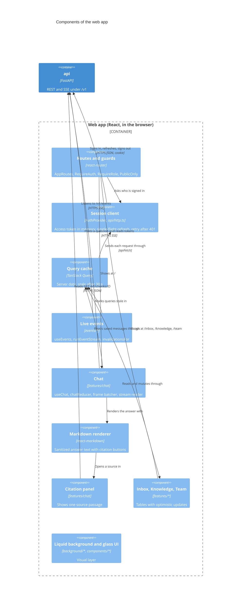
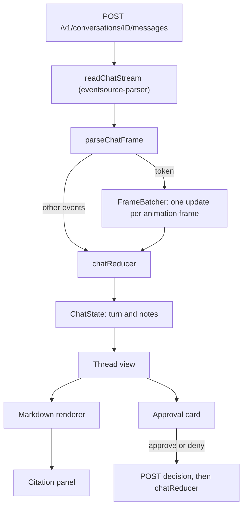
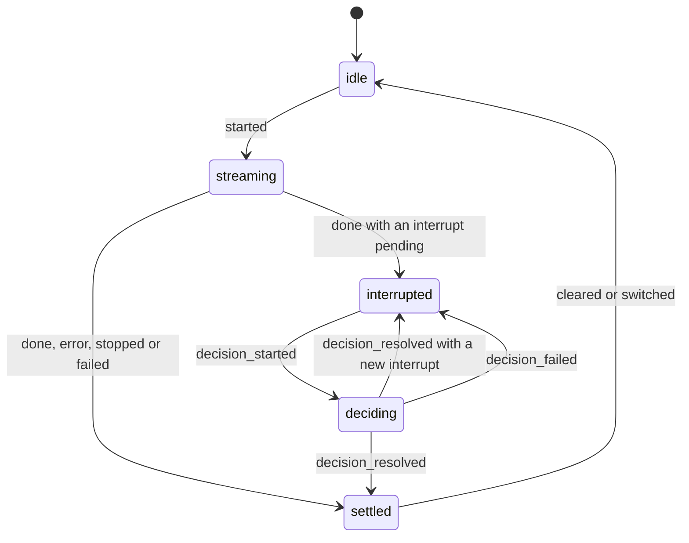
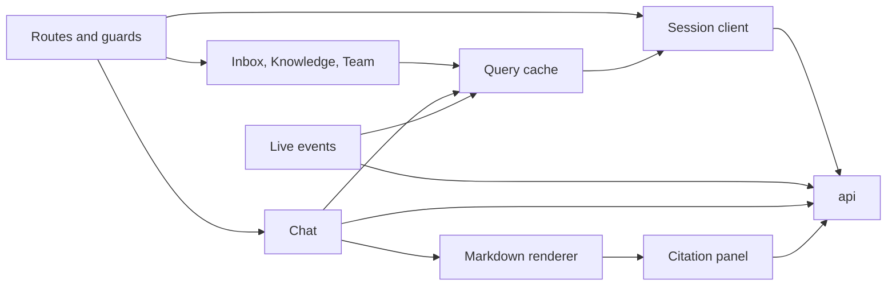

# C4 level 3: components of the web app

**Type:** Architecture · **Audience:** frontend engineers, reviewers of the session and live-event design · **Verified against:** `a989287`

**In plain English:** The web app is a React program that runs in the browser. It keeps a sign-in session in memory, asks the
API for data, listens to a live event stream and shows the chat. This page names the parts of the app and shows how they
connect. It does not show the look of the app. For the look see [ADR 0016](../adr/0016-liquid-redesign.md).

**Scope:** the code in `frontend/src`. The container that serves it is `web` (nginx, see [page 02](02-containers.md) and
[page 09](09-deployment.md)). The page uses terms from the [glossary](../glossary.md): *access token*, *refresh cookie*,
*live event*, *turn*.

## Diagram 1: the parts of the app

Look at the two boxes in the middle: the HTTP client and the query cache. Every screen reads data through the query cache.
Every request goes through the HTTP client, which holds the only copy of the access token. The two streams (live events and
chat) bypass the cache for their own bytes. They write to it only by marking queries as stale.

**Key:** `Component` = a group of source files with one job. The boundary is the app in the browser. `api` is the only
other container.

### In text

| From | Verb | To | Notes |
|---|---|---|---|
| Routes and guards | ask who is signed in | Session client | `RequireAuth` shows the sign-in page for an anonymous visitor. |
| Routes and guards | show | Chat, Inbox, Knowledge, Team | `RequireRole` checks the role against `APP_ROUTES`. |
| Session client | calls | `api` | Sign-in, refresh and sign-out use the refresh cookie. |
| Pages | read and write through | Query cache | Mutations update the cache before the answer arrives. |
| Query cache | sends requests through | Session client | Each request calls `apiFetch`, which adds the bearer token. |
| Live events | listen to | `api` | One stream for the whole session. |
| Live events | mark stale | Query cache | An event holds ids only. The app refetches the data. |
| Chat | posts to and reads from | `api` | The answer arrives as server-sent events. |
| Markdown renderer | opens a source in | Citation panel | The panel loads one chunk. |

## Routes and access

`frontend/src/app/routes.tsx` defines `AppRoutes`. One table in `app/access.ts` (`APP_ROUTES`) drives both the navigation and
the guards, so they cannot disagree.

| Path | Page | Who may open it |
|---|---|---|
| `/` | Chat | `user`, `agent`, `admin` |
| `/inbox` | Inbox | `agent`, `admin` |
| `/knowledge` | Knowledge | `admin` |
| `/team` | Team | `admin` |
| `/sign-in` | Sign in | Anonymous visitors only (`PublicOnly`) |
| `/accept` | Accept an invite | Anyone with a link |
| `/reset-password` | Set a new password | Anyone with a link |
| any other path | Not found | Anyone |

`RequireAuth` wraps the four app pages in `AppShell`. `RequireRole` wraps each page. The guards in
`auth/guards.tsx` only improve the screen. The API checks the role again on every request. See
[roles and permissions](../reference/roles-and-permissions.md).

The invite and reset links carry a one-time secret in the URL fragment (`/accept#token=...`). `auth/fragment-token.ts` reads
it once, removes it from the address bar and keeps it in module memory. The fragment is never sent to a server.

## Providers

`app/providers.tsx` nests four providers from the outside in.

1. `MotionConfig` with `reducedMotion="user"`. Animations follow the system setting.
2. `ThemeProvider`. It holds the light or dark theme.
3. `QueryClientProvider`. The default `staleTime` is 30 000 ms. `refetchOnWindowFocus` is off. A request retries at most 2
   times and never after a `4xx` error.
4. `AuthProvider`. It has four states: `loading`, `anonymous`, `unreachable` and `authenticated`. At start it calls
   `restoreSession`, which calls `refreshSession`.

## The session client

`api/http.ts` and `api/token-store.ts` hold the session.

- **The access token lives in module memory only.** `token-store.ts` never writes it to `localStorage`, `sessionStorage` or
  a cookie. A page reload loses it. The app gets a new one from the refresh cookie.
- **`apiFetch`** adds the bearer token and sends the request. On a `401` it calls `refreshSession` once and repeats the
  request once.
- **`refreshSession`** is single-flight. Two callers at the same time share one request. A Web Lock named
  `ragassist-refresh` also protects it across browser tabs. This matters because the API rotates the refresh token on every
  use and treats a reused token as theft (see [dynamic views](08-dynamic-views.md), scenario 1).
- **`notifySessionLost`** tells every listener registered with `onSessionLost` that the session ended. `AuthProvider` then
  moves to `anonymous`.
- The refresh path is `/v1/auth/refresh`. The cookie is `httpOnly`, so the app code never reads it.

See [accounts, sessions and tokens](../explanation/accounts-sessions-and-tokens.md) and
[ADR 0007](../adr/0007-accounts-and-sessions.md).

## The live event stream

`AppShell` calls `useEvents(true)`. The hook returns a status: `idle`, `connecting`, `connected` or `reconnecting`. The status
shows in the live status mark.

| Part | File | Job |
|---|---|---|
| `useEvents` | `events/use-events.ts` | Starts and stops the stream with the component. Applies the invalidations to the query client. |
| `runEventStream` | `events/event-stream.ts` | Reads `GET /v1/events` with `fetch` and the bearer token. Reconnects with back-off. |
| `invalidationsFor` | `events/invalidation.ts` | Maps one event to the query keys that it makes stale. |

`runEventStream` follows these rules.

- It uses `fetch` and not `EventSource`, because it must send the `Authorization` header.
- It reconnects with exponential back-off from 1 s up to 30 s, with random jitter (`backoffDelay`).
- It treats 45 s without any frame as a dead connection and reconnects. The server sends a ping every 15 s.
- On `429` it waits for the time in `Retry-After`.
- On a `reauth` event it calls `refreshSession` and reconnects at once.
- There is no replay. The first `ready` frame after a break, and every `ready` after the first one, calls `onReconnected`,
  and the app marks every query stale, because events can have been lost. A `missedStart` flag covers a first connection
  that only worked on a later attempt.
- When the refresh fails after a `reauth`, it calls `notifySessionLost` and stops.

`invalidationsFor` maps the events like this.

| Event | Queries marked stale |
|---|---|
| `resync` | All queries |
| `job.updated` | `documents` and `ingestionJob(job_id)` |
| `document.changed` | `documents` |
| `message.created`, `conversation.updated` | `conversation(conversation_id)`, `conversations`, `escalations` |
| `escalation.changed` | `escalations` and `conversation(conversation_id)` |
| `ready`, `reauth`, unknown types | Nothing |

The query keys are in `api/query-keys.ts`: `conversations`, `conversation(id)`, `escalations`, `documents`,
`ingestionJob(id)`, `teamMembers` and `teamInvites`. An event holds ids only. The app refetches through the normal API, which
checks tenant, owner and role again. See [human handoff and live events](../explanation/human-handoff-and-live-events.md)
and [the SSE contract](../api/sse-contract.md).

## Diagram 2: the chat stream

Look for the order of the parts. Bytes enter at the top. Text is batched before it reaches the reducer. The reducer is a
pure function. The view only reads the state.

The same facts in text:

1. `useChat` (`features/chat/use-chat.ts`) sends the question. `readChatStream` (`stream.ts`) reads the response with
   `eventsource-parser`.
2. `parseChatFrame` turns each frame into a typed event: `token`, `reset`, `citation`, `tool_call`, `interrupt`,
   `escalated`, `done` or `error`. It drops a frame of an unknown type or with a bad payload, so a newer server cannot break
   an older app.
3. Token text goes to the frame batcher (`batcher.ts`, `createFrameBatcher`). The batcher hands over the text at most once per
   animation frame. It has three methods: `push`, `flush` and `discard`.
4. `chatReducer` (`turn.ts`) is a pure function. It holds the state of the current turn: the phase, the question, the answer,
   the citations, the tool activity, the pending interrupt, the decision outcome and any error.
5. The server stays the source of truth for saved messages. TanStack Query holds them. The reducer only holds what is not
   saved yet.
6. A `reset` event clears the answer so far. The graph sends it when it regenerates the answer.

The phases of a turn are `idle`, `streaming`, `interrupted`, `deciding` and `settled`.

The same facts in text: a turn starts in `streaming`. A `done` event with the status `interrupted` and a pending interrupt
moves it to `interrupted`. The approval card then shows. A click starts `deciding`. A resolved decision ends in `settled`,
or goes back to `interrupted` when the resumed turn pauses on another action. A failed decision also goes back to
`interrupted` and shows an error, so the person can try again. A stop, a stream error or a network failure ends a
streaming turn in `settled`. Opening another conversation resets everything (`switched`). `cleared` drops the turn and keeps
the notes.

The reducer keeps small notes (`ThreadNote`) for a decision and for a handoff. They stay in the thread after the saved
messages replace the live turn. `isSuperseded` tells the view when the saved messages have caught up, so the live turn can go
away without a visible jump.

## The answer and its sources

- **Markdown renderer** (`features/chat/markdown.tsx`). It uses `react-markdown` with `remark-gfm` and `rehype-sanitize`. It
  allows no raw HTML and no images. It turns a marker such as `[1]` into a citation button.
- **Citation panel** (`features/chat/citation-panel.tsx`). It loads `GET /v1/chunks/{chunk_id}` through TanStack Query. The
  data stays fresh for 5 minutes. The API answers with an `ETag`, so a repeat request can end with `304`.
- **Approval card** (`features/chat/approval-card.tsx`). It shows the tool name and its arguments as rows (`ApprovalRow`) and
  a line with the decision (`DecisionLine`). The buttons send the decision to the API. The API checks that the person owns the
  conversation or is an admin.

## Inbox, Knowledge and Team

These three pages share one pattern: a table, a query for the data and optimistic mutations.

| Page | Folder | Data | Notes |
|---|---|---|---|
| Inbox | `features/inbox` | `escalations` and one conversation | An agent or admin reads a handoff and replies. Live events refresh the list. |
| Knowledge | `features/knowledge` | `documents`, one `ingestionJob` for each running document | `useQueries` follows the jobs. The upload zone checks the type and size before it posts. |
| Team | `features/team` | `teamMembers`, `teamInvites` | Admin only. Shows a one-time link in a dialog after an invite. |

`api/optimistic.ts` has `optimisticTarget` and `useOptimisticMutation`. A mutation changes the cache first. It restores the old
value when the request fails. It marks the query stale when the request ends.

## The look

`src/background` draws the liquid background with WebGL (`liquid.ts`, `liquid-shader.ts`, `liquid-config.ts`). The glass
panels, tables and sheets are in `src/components`. `theme/` holds the theme. ADR 0016 describes the design. Two decisions
are still open: the logo is not chosen, and the content security policy keeps `style-src 'unsafe-inline'`. See
[the web app and design system](../explanation/the-web-app-and-design-system.md), [ADR 0014](../adr/0014-web-delivery.md)
and [the frontend to-do list](../frontend/TODO.md).

## Flowchart fallback for diagram 1

## Related pages

- [Containers](02-containers.md), [code level](07-code-level.md) (the stream reducer) and [dynamic views](08-dynamic-views.md).
- [Frontend structure](../reference/frontend-structure.md) and [develop the frontend](../how-to/develop-the-frontend.md).
- [ADR 0009](../adr/0009-web-app.md), [ADR 0010](../adr/0010-chat-ui.md), [ADR 0011](../adr/0011-admin-screens.md),
  [ADR 0016](../adr/0016-liquid-redesign.md).
