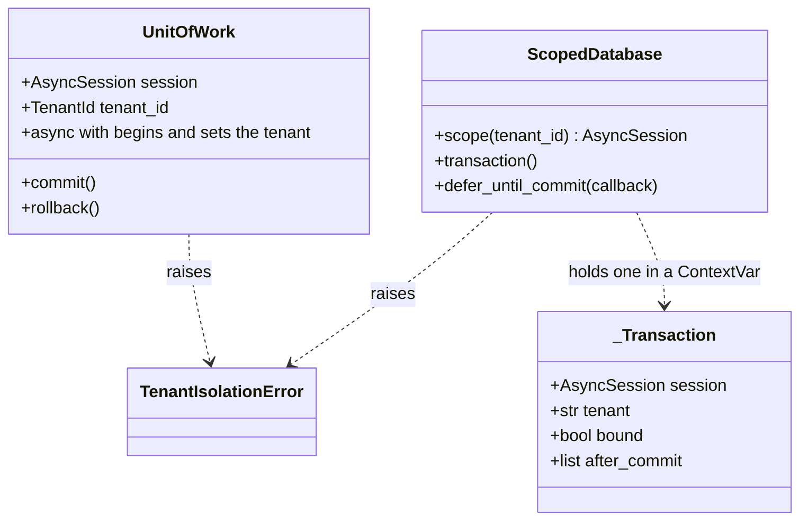
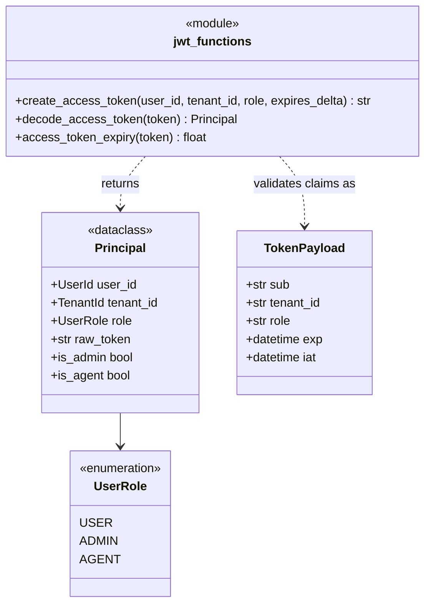
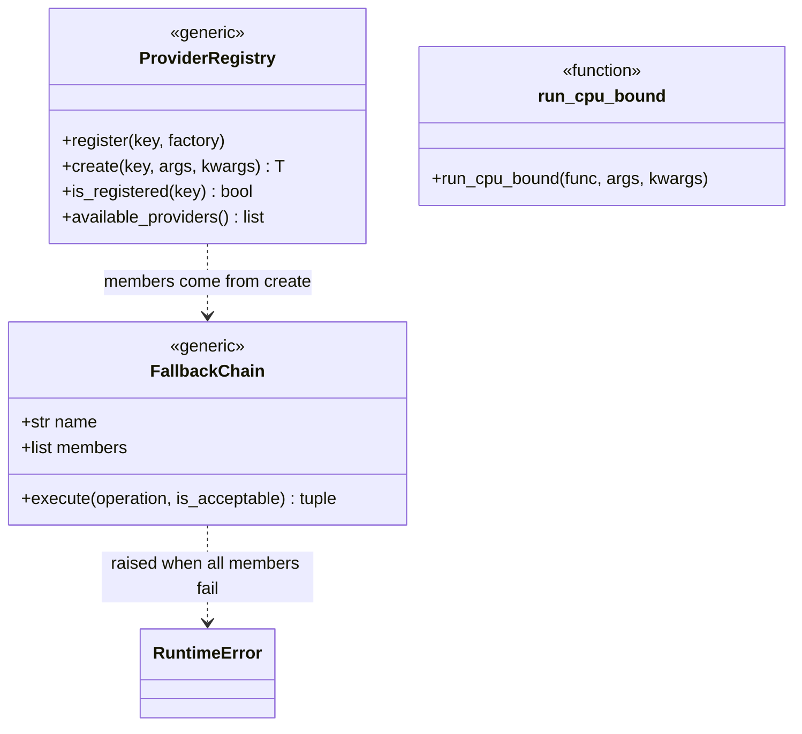
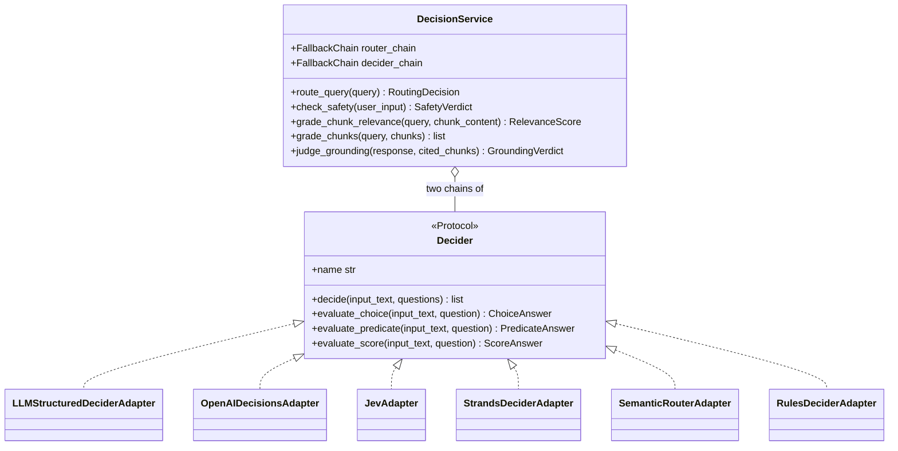
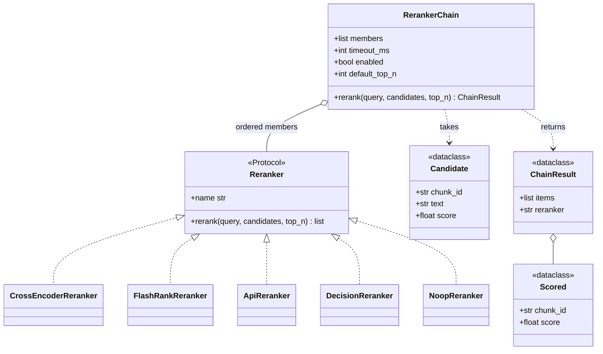
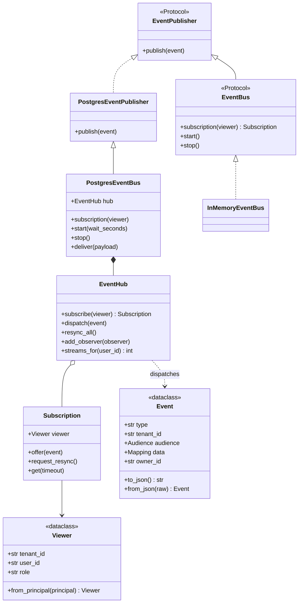
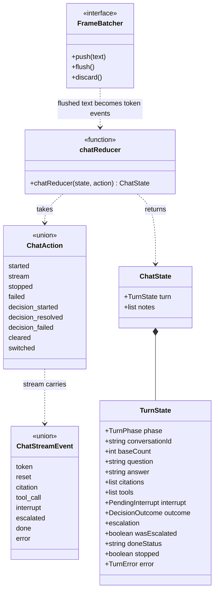

# C4 level 4: code level

**Type:** Architecture · **Audience:** engineers who change a core abstraction, reviewers of isolation and fallback rules · **Verified against:** `a989287`

**In plain English:** This page zooms in to the classes. It covers only the few classes that the rest of the system depends
on. Each class diagram has a short text list under it. You can read the list instead of the picture.

**Scope:** class level. The C4 model says that level 4 is optional and should cover only the important parts. The seven
groups below are the ones that carry a rule: tenant isolation, identity, provider choice and fallback, decisions, reranking,
live events and the chat stream. Names and signatures match the code at the commit above. Private members are left out.

Terms come from the [glossary](../glossary.md): *principal*, *tenant*, *unit of work*, *decider*, *reranker*, *event*.

## 1. Tenant-scoped database access

Look at the two ways to open a tenant context. `UnitOfWork` takes a session and opens one transaction. `ScopedDatabase`
opens a session for each call and can group calls in one transaction. Both run the same statement:
`SELECT set_config('app.tenant_id', :tid, true)`. The third argument `true` makes the setting last only until the end of
the transaction. This is the same effect as `SET LOCAL`.

The same facts in text:

- `UnitOfWork` (`src/ragassist/shared/db/uow.py`) takes a session and a tenant id. On entry it starts a transaction and runs
  `set_config('app.tenant_id', :tid, true)`. With no tenant it sets an empty string. On exit it commits, or rolls back when
  the block raised.
- If the session already has an open transaction, `UnitOfWork.__aenter__` raises `TenantIsolationError`. It never joins a
  transaction that another tenant context may own.
- `ScopedDatabase` (`src/ragassist/shared/db/scoped.py`) takes a session factory. `scope(tenant_id)` yields a session with the
  tenant set. A `None` tenant means system access: only global rows are visible.
- `transaction()` groups several repository calls in one database transaction. It does not nest. A second call raises
  `RuntimeError`. Inside it, a `scope(...)` call reuses the same session. The transaction binds to the first tenant it sees. A
  later `scope` for another tenant raises `TenantIsolationError` ("A transaction cannot span two tenants").
- `defer_until_commit(callback)` runs the callback after a successful commit. With no open transaction it runs the callback
  at once. The upload uses this so the queue message is not visible before the database rows are.
- PostgreSQL then enforces the rows with forced row-level security. See [ADR 0002](../adr/0002-row-level-security.md) and
  [tenant isolation in depth](../explanation/tenant-isolation-defence-in-depth.md).

Doc and code note: the repositories use `ScopedDatabase.scope`. Only the dense and keyword retrievers use `UnitOfWork`.
`AGENTS.md` section 1.3 says that every operation on a tenant table runs in `UnitOfWork`. In the code, `ScopedDatabase`
plays that role for the repositories. Both use the same `set_config` call. The helper functions `tenant_uow` and
`get_tenant_uow` exist, and no code in `src/` calls them. Only tests call `tenant_uow`.

## 2. Identity of a request

Look at which type holds the raw token. `Principal` is what the rest of the code sees. `TokenPayload` is only the shape of
the claims.

The same facts in text:

- `Principal` (`src/ragassist/shared/security/jwt.py`) is a frozen dataclass. It holds the user id, the tenant id, the role and
  the raw token. It has two helper properties, `is_admin` and `is_agent`.
- `UserRole` has three values: `USER`, `ADMIN` and `AGENT`.
- `TokenPayload` is a Pydantic model with the claims `sub`, `tenant_id`, `role`, `exp` and `iat`.
- `decode_access_token` checks the signature and the claims and returns a `Principal`. `create_access_token` signs a new
  token. `access_token_expiry` reads the expiry time, which the event stream uses to send `reauth`.
- The rule in `AGENTS.md`: `tenant_id`, `user_id` and `role` come only from this verified `Principal`. They never come from a
  model output or a tool argument.
- The FastAPI dependencies `get_current_principal` and `require_role(*roles)` are in `shared/security/deps.py`. See
  [page 03](03-components-api.md).

## 3. Provider registry and fallback chain

Look at the two generic classes. `ProviderRegistry` knows how to *create* a provider from a key. `FallbackChain` knows how to
*try* a list of providers in order. The platform services build a chain from a registry and a setting.

The same facts in text:

- `ProviderRegistry` (`src/ragassist/shared/registry.py`) is a generic class. `register` stores a factory under a key.
  `create` calls the factory. `is_registered` and `available_providers` report the keys.
- `FallbackChain` (`src/ragassist/shared/resilience.py`) takes a name and a non-empty list of members. An empty list raises
  `ValueError`.
- `execute(operation, is_acceptable)` calls the operation on each member in order. It moves to the next member when the
  operation raises, or when `is_acceptable` returns false. It returns the result and the member that gave it.
- When every member fails, it raises `RuntimeError`. The error message names the chain and the last error.
- `run_cpu_bound` runs a function in a shared thread pool with 4 workers (thread prefix `ragassist-cpu`). The CPU rerankers,
  the local embedding adapter and the password hash use it.
- The registries in the code: the language models (`openai`, `anthropic`, `openrouter`, `gemini`, `openai_compatible`), the
  embedding providers (`openai`, `openai_compatible`, `sentence_transformers`, with the aliases `ollama` and `local`) and the
  deciders (section 4).

See [provider abstraction and fallbacks](../explanation/provider-abstraction-and-fallbacks.md) and
[the models catalog](../reference/models-catalog.md).

## 4. Deciders

Look at the single port on the left and the six adapter classes on the right. `DecisionService` never names an adapter. It
holds two chains of `Decider` objects.

The same facts in text:

- `Decider` (`src/ragassist/platform/decisions/ports.py`) is a `Protocol` with a `name` property and four methods: `decide` (a
  batch), `evaluate_choice`, `evaluate_predicate` and `evaluate_score`. The question and answer types are frozen dataclasses:
  `ChoiceQuestion`, `PredicateQuestion`, `ScoreQuestion` and their answers.
- `DecisionService` (`platform/decisions/service.py`) takes the settings, a `router_chain` and a `decider_chain`. Each is a
  `FallbackChain` of deciders. Every call has a time limit of `DECIDER_TIMEOUT_MS`. The route choice also needs a confidence of
  at least `DECIDER_MIN_CONFIDENCE`. A less confident answer counts as a failure, and the next decider is asked.
- The five public methods return Pydantic models: `RoutingDecision`, `SafetyVerdict`, `RelevanceScore` and
  `GroundingVerdict`.
- When a whole chain fails, `DecisionService` returns a safe default. `check_safety` and `judge_grounding` fail closed.
  `route_query` returns `rag_search`. `grade_chunk_relevance` returns "relevant".
- `build_decider_registry` registers these keys: `rules`, `semantic_router`, `openai_decisions`, `jev`, `strands_local`,
  `strands`, `llm_structured`, `llm_structured_2` and `llm_structured_3`. The three `llm_structured` keys are one decider for
  each model. At most 3 models (`MAX_LLM_DECIDER_MODELS`) come from the `decider` role first and then the `generator` role.
- `LLMStructuredDeciderAdapter` raises an error when a predicate cannot be answered. It does not invent a verdict.

See [the decision layer](../explanation/the-decision-layer.md), [ADR 0004](../adr/0004-decision-layer.md) and
[page 04](04-components-assistant-graph.md).

## 5. Rerankers

Look at the data types. A `Candidate` goes in. A `ChainResult` with `Scored` items comes out, together with the name of the
member that did the work.

The same facts in text:

- `Reranker` (`src/ragassist/platform/rerank/ports.py`) has a `name` property and `rerank(query, candidates, *, top_n)`. It
  returns a list of `Scored` items, best first.
- `RerankerChain` (`platform/rerank/adapters/reranker_chain.py`) holds the ordered members, a time limit
  (`RERANK_TIMEOUT_MS`), an on/off flag (`RERANK_ENABLED`) and a default `top_n`. With no candidates it returns an empty
  result. When it is off, it returns the first `top_n` candidates unchanged and names the reranker `none`. Otherwise it tries
  each member in order. It stops at a member named `none`, or at the first member that answers in time.
- The CPU adapters (`CrossEncoderReranker`, `FlashRankReranker`) run their model through `run_cpu_bound`.
- `build_reranker_chain` (`platform/rerank/service.py`) builds the members from `RERANKER_CHAIN`. It knows the names `none`,
  `cross_encoder`, `flashrank` and `api`. It skips the name `decision` with a warning, unless a caller passes an instance.

See [ADR 0005](../adr/0005-reranker-chain.md).

## 6. Event bus

Look at the split between a *publisher* and a *bus*. The worker only publishes. The API publishes and also listens. The hub
holds the open streams and applies the audience rule.

The same facts in text:

- `EventPublisher` has one method, `publish(event)`. `EventBus` adds `subscription(viewer)`, `start` and `stop`.
- `PostgresEventPublisher` (`src/ragassist/platform/events/adapters/postgres.py`) runs `SELECT pg_notify(...)` on the channel
  `ragassist_events` inside a tenant scope. The worker uses this class alone.
- `PostgresEventBus` adds one `psycopg` connection that runs `LISTEN`. It probes the connection with `SELECT 1` every 30
  seconds. When the connection is lost it waits (0.5 s, doubling up to 10 s) and reconnects. After a reconnect it calls
  `hub.resync_all()`, because notifications sent in the gap are lost.
- `EventHub` (`platform/events/hub.py`) keeps the open `Subscription` objects. It limits each user to
  `EVENTS_MAX_STREAMS_PER_USER` streams and raises `TooManyStreams` over the limit. `dispatch` calls the observers first and
  then offers the event to each subscription whose viewer may see it (`visible_to`).
- `Subscription` is a bounded queue (`EVENTS_QUEUE_SIZE`). When it is full, it drops its queue and the next `get` returns a
  resync marker, so the browser refetches.
- `Event` (`platform/events/model.py`) checks itself on creation. The type must be one of `job.updated`, `document.changed`,
  `message.created`, `conversation.updated` or `escalation.changed`. The data keys can only be `job_id`, `document_id`,
  `conversation_id` and `ticket_id`, each up to 128 characters. Content cannot enter the channel.
- `visible_to(viewer, event)` checks the tenant first. Then it applies the audience: `ADMINS`, `STAFF` (agents and admins) or
  `OWNER_AND_STAFF`.
- `InMemoryEventBus` (`platform/events/adapters/memory.py`) is the in-process adapter. `platform/events/__init__.py` creates it
  for the memory mode.

See [human handoff and live events](../explanation/human-handoff-and-live-events.md) and
[ADR 0008](../adr/0008-live-events-handoff-and-detached-turns.md).

## 7. Chat stream reducer (web app)

Look at the direction of the arrows. Parsed events and the batcher feed the reducer. The reducer is a pure function from an
old state and an action to a new state.

The same facts in text:

- `chatReducer` (`frontend/src/features/chat/turn.ts`) is a pure function. It takes a `ChatState` and a `ChatAction`.
- `ChatState` holds the current `TurnState` and a list of notes. A note records a decision or a handoff. Notes stay after the
  saved messages replace the live turn.
- `TurnState.phase` is one of `idle`, `streaming`, `interrupted`, `deciding` and `settled`.
- A `stream` action carries one `ChatStreamEvent`. The reducer ignores stream events when the phase is not `streaming`.
- `FrameBatcher` (`frontend/src/features/chat/batcher.ts`) collects token text. It hands the text over at most once for each
  animation frame. `flush` hands over what is waiting (before `done`). `discard` drops it (on reset, stop or unmount).
- The server stays the source of truth for saved messages. The reducer only holds what is not saved yet.

See [page 06](06-components-web-app.md) for the phase diagram.

## Related pages

- [Components of the api](03-components-api.md), [components of the assistant graph](04-components-assistant-graph.md) and
  [components of the web app](06-components-web-app.md).
- [Ports and adapters](../reference/ports-and-adapters.md).
- [arc42 section 5: building block view](../arc42/05-building-block-view.md).
- [Why a modular monolith](../explanation/why-a-modular-monolith.md).
