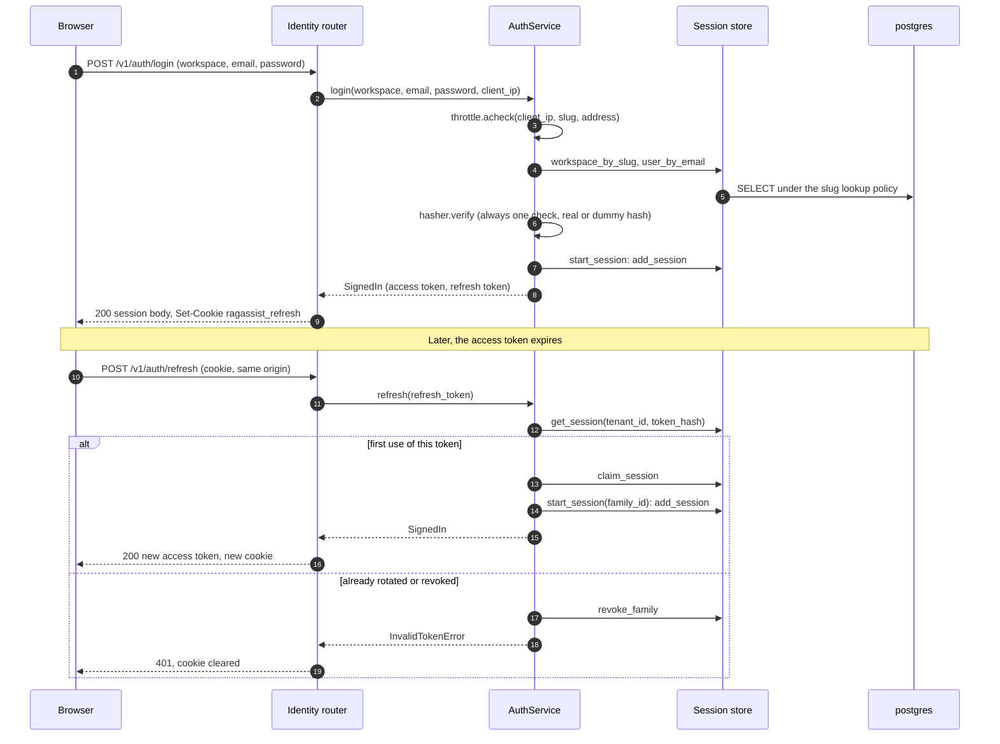
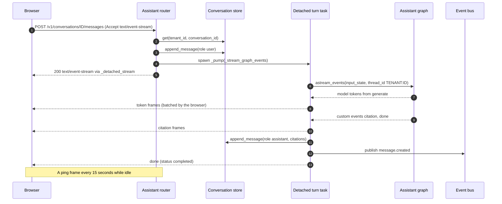
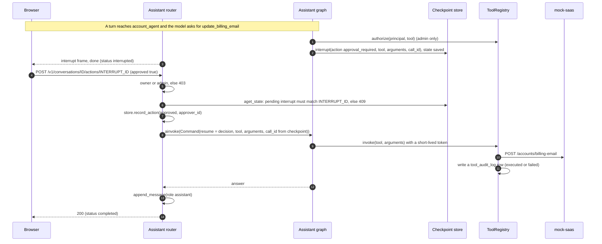
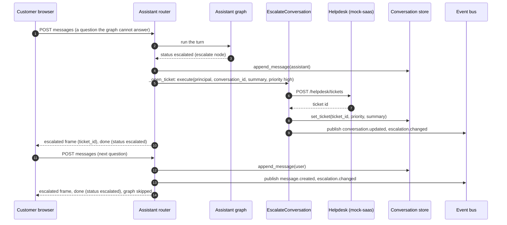
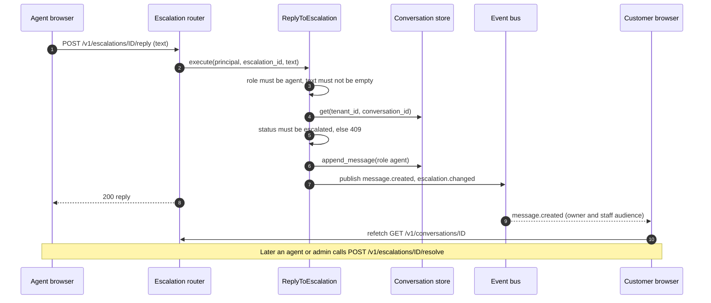
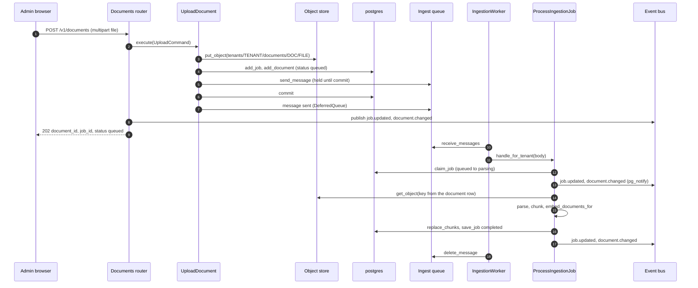
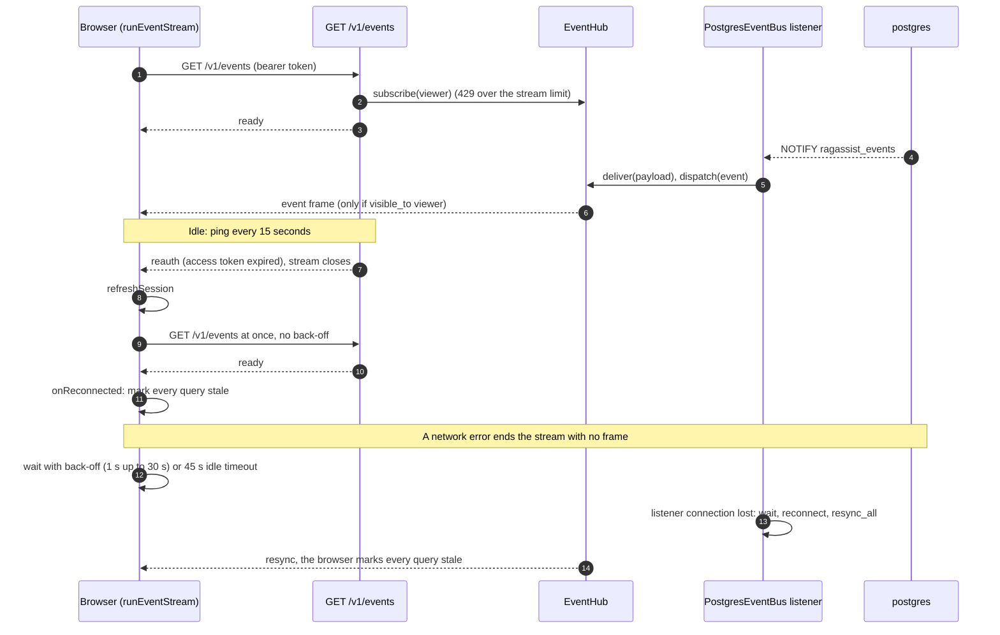
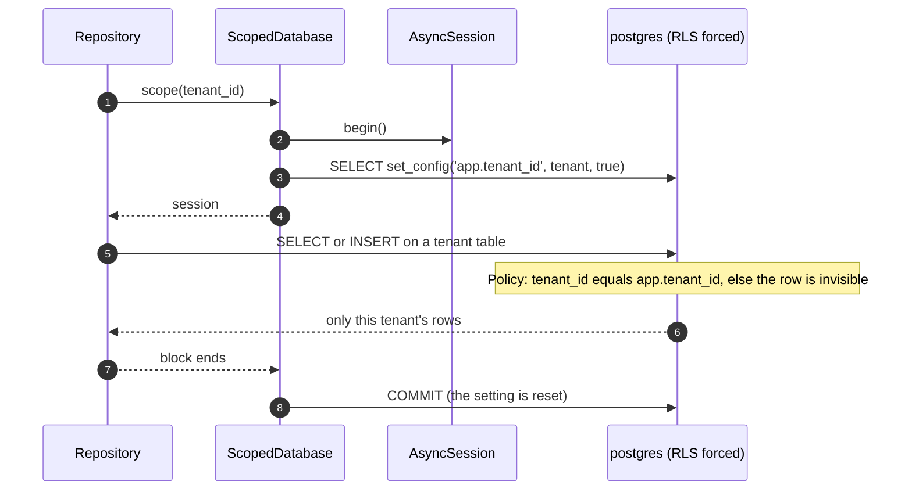

# C4 dynamic views

**Type:** Architecture · **Audience:** engineers who debug a flow end to end, reviewers of the security design · **Verified against:** `a989287`

**In plain English:** A dynamic view shows messages between parts over time. This page has eight of them. Each one follows a
real scenario, such as signing in or asking a question. The arrows use the real route and function names, so you can find
the code.

**Scope:** eight scenarios. Each has a lead-in sentence, a sequence diagram and a numbered list with the same facts. The C4
model allows a sequence diagram for a dynamic view. Terms come from the [glossary](../glossary.md): *access token*,
*refresh cookie*, *turn*, *interrupt*, *live event*, *tenant scope*.

| # | Scenario | Main parts |
|---|---|---|
| 1 | [Sign in and refresh rotation with reuse detection](#1-sign-in-and-refresh-rotation) | browser, `AuthService`, `postgres` |
| 2 | [Ask a question (SSE)](#2-ask-a-question-sse) | browser, assistant router, graph |
| 3 | [Approve a write action](#3-approve-a-write-action) | browser, `decide_action`, graph, `mock-saas` |
| 4 | [Escalation and handoff](#4-escalation-and-handoff) | graph, `EscalateConversation`, helpdesk |
| 5 | [Agent reply](#5-agent-reply) | agent browser, `ReplyToEscalation`, customer browser |
| 6 | [Ingestion](#6-ingestion) | admin browser, `UploadDocument`, worker |
| 7 | [Live events: reconnect and reauth](#7-live-events-reconnect-and-reauth) | browser, `/v1/events`, `PostgresEventBus` |
| 8 | [A tenant-scoped database transaction](#8-a-tenant-scoped-database-transaction) | repository, `ScopedDatabase`, `postgres` |

All routes start with the prefix in `API_V1_PREFIX`. The value in `.env.example` is `/v1`, and this page uses it. See the [endpoint reference](../reference/api-endpoints.md) for the full list.

## 1. Sign in and refresh rotation

Look at the two paths in the refresh. A good refresh gives a new token and marks the old one as used. A replayed token ends
the whole family of sessions. The browser keeps the access token in memory. The refresh token is in an `httpOnly` cookie.

The same facts in text:

1. The browser posts the workspace slug, the email and the password to `POST /v1/auth/login`.
2. `AuthService.login` checks the sign-in throttle for the client address, the workspace and the email. Too many tries give a
   `429`.
3. The store finds the workspace by its slug and then the user by email. The slug lookup uses a narrow database policy,
   because no tenant is known yet (migration 0002).
4. The service always spends one password check. A missing account costs the same as a wrong password, so timing does not
   show which accounts exist. The hash work runs in the bounded CPU pool.
5. On success, `start_session` adds a session row and signs an access token. The refresh token has the form
   `{tenant_id}.{random}`. Only its SHA-256 hash is stored.
6. The router sets the cookie `ragassist_refresh` (`httpOnly`, `SameSite=Strict`, path `/v1/auth`) and returns the session body.
7. `POST /v1/auth/refresh` requires a trusted origin (`require_trusted_origin`). It parses the token and loads the session.
8. If the session was already rotated or revoked, the service revokes the whole family and the router answers `401` with a
   cleared cookie. A replay is treated as theft.
9. If the session is fine, `claim_session` marks it as used. If another request wins that race, the family is revoked.
10. `start_session` with the same `family_id` creates the next session. The router sets the new cookie.
11. An inactive user also ends the family.

See [accounts, sessions and tokens](../explanation/accounts-sessions-and-tokens.md) and
[ADR 0007](../adr/0007-accounts-and-sessions.md).

## 2. Ask a question (SSE)

Look at the detached turn. The graph runs in its own task, so a closed browser tab does not stop it. The answer is saved
even if nobody listens.

The same facts in text:

1. The browser sends the question with `Accept: text/event-stream`. The path holds the conversation id.
2. The router loads the conversation for the tenant of the token. If the conversation belongs to another user, the answer is
   `404`. A JSON request for an unknown conversation also gets `404`. A streamed request for an unknown id creates the
   conversation.
3. The router saves the user message.
4. If the conversation status is `escalated`, the graph is skipped. See scenario 4.
5. Otherwise the router builds `input_state` from `FRESH_TURN_STATE`, the question and the principal without its raw token
   (`_checkpointable`). The graph thread id is `{tenant_id}:{conversation_id}`.
6. `_detached_stream` starts `_pump` as a separate task and returns a queue reader to the response. If the client
   disconnects, the task keeps running to its end.
7. `_run_stream_graph` reads graph events. It sends a `token` frame only for tokens from the nodes in `ANSWER_NODES`
   (`generate` and `account_agent`). A token with `reset` set to true tells the browser to clear the text, because the graph
   is generating again.
8. After the graph ends, the router reads the checkpoint. It sends an `interrupt` frame if the graph waits for approval. It
   sends any citation that it has not sent yet.
9. The router saves the assistant message and publishes `message.created`.
10. If the final status is `escalated`, the router opens a ticket and sends an `escalated` frame (scenario 4).
11. The last frame is `done`, with the conversation id and the status.
12. An error sends one `error` frame with a fixed message. The details go to the log only.
13. A JSON request (`stream` false and no event-stream header) runs the same turn through `_complete_turn`. The route wraps
    the task in `asyncio.shield`, so a cancelled request leaves the turn running.

See [how an answer is made](../explanation/how-an-answer-is-made.md), [page 04](04-components-assistant-graph.md) and
[the SSE contract](../api/sse-contract.md).

## 3. Approve a write action

Look at where the data for the action comes from. The tool name and the arguments that run are read back from the
checkpoint. The browser sends only the decision.

The same facts in text:

1. The `account_agent` node asks a model for a tool call. For a write tool, it first calls `ToolRegistry.authorize`. A caller who
   is not an `admin` gets a "permission denied" answer and no prompt.
2. Otherwise the node calls `interrupt` with `action`, `tool`, `arguments` and `call_id`. LangGraph saves the checkpoint and the
   turn ends with `done` and the status `interrupted`. The router sends an `interrupt` frame before it.
3. The browser shows the approval card. A click sends `POST /v1/conversations/{id}/actions/{interrupt_id}` with `approved`
   and an optional reason.
4. `decide_action` loads the conversation. It answers `404` when the conversation is not visible and `403` when the caller
   is not the owner or an admin.
5. It reads the pending interrupt from the checkpoint. It answers `503` if the state cannot be read. It answers `409` if there
   is no pending interrupt or its id differs from the id in the path.
6. It records the decision (`record_action`) with the approver id.
7. It resumes the graph with `Command(resume=...)`. The payload holds the decision, the tool, the arguments and the call id,
   all read from the checkpoint. The client cannot change them.
8. On approval, the node runs the tool through the registry. The registry wrapper mints a short-lived token for the verified
   principal, calls `mock-saas` and writes a `tool_audit_log` row with the status `executed` or `failed`.
9. On denial, the node skips the tool. The model writes an answer in both cases.
10. If the resumed graph pauses again, the response has the status `interrupted` and the new interrupt. A failure to resume
    answers `502`.
11. Otherwise the router saves the assistant message and returns the answer.

See [approvals and actions](../explanation/approvals-and-actions.md) and
[ADR 0006](../adr/0006-conversation-access-and-approval-binding.md).

## 4. Escalation and handoff

Look at the second message at the end. After the handoff, the graph never runs again. The customer message is only saved
for the agent, until an agent resolves the conversation.

The same facts in text:

1. The graph reaches the `escalate` node. This happens when the router chooses `human_escalation`, when no passage is relevant
   after the retry budget, or when the answer stays ungrounded after the retry budget.
2. `finalize` ends the turn with the status `escalated`.
3. The router saves the answer and calls `_open_ticket`. It returns nothing in the memory mode, because there is no helpdesk.
4. `EscalateConversation.execute` is idempotent. It returns the open ticket when the conversation is already escalated.
5. Otherwise it posts `POST /helpdesk/tickets` to `mock-saas` with a subject, a description (the question, at most 500
   characters), the conversation id and the priority.
6. It saves the ticket id with `set_ticket`, which also sets the status to `escalated`. It publishes `conversation.updated` and
   `escalation.changed`.
7. The browser receives an `escalated` frame with the ticket id and then `done` with the status `escalated`.
8. A later message in an `escalated` conversation skips the graph. The router saves the message, publishes `message.created`
   and `escalation.changed`, and sends the `escalated` frame (if the ticket id is known) and `done`. A JSON request gets an
   empty answer with the route `human_handoff`.
9. A failed ticket call is logged. The answer is already saved, so the turn does not fail.

See [human handoff and live events](../explanation/human-handoff-and-live-events.md) and
[ADR 0008](../adr/0008-live-events-handoff-and-detached-turns.md).

## 5. Agent reply

Look at who sees the reply and how. The customer does not poll. The event stream tells the customer browser to refetch.

The same facts in text:

1. The agent sends the reply to `POST /v1/escalations/{escalation_id}/reply`. The route `.../replies` is an alias. The id is
   the id of the conversation.
2. `ReplyToEscalation.execute` accepts only the role `agent`. An admin gets `403` here. An empty text gives an error.
3. It loads the conversation. A missing conversation gives `404`. A conversation whose status is not `escalated` gives `409`.
4. It saves a message with the role `agent`.
5. It publishes `message.created` (audience: the owner of the conversation and the staff) and `escalation.changed` (audience:
   staff).
6. The event hub sends the event to the owner, if the owner has an open stream. The web app marks `conversation(id)`,
   `conversations` and `escalations` as stale and refetches them.
7. `POST /v1/escalations/{id}/resolve` is open to agents and admins. It sets the status to `resolved`. The next customer message
   then goes to the assistant again.

## 6. Ingestion

Look at the commit in the middle. The queue message leaves only after the database transaction commits. The worker then
cannot read a job row that does not exist yet.

The same facts in text:

1. The admin posts a file to `POST /v1/documents`. The router checks the role, the size (50 MiB) and the type.
2. `UploadDocument.execute` stores the file, adds the job and document rows and queues the message. These steps run in one
   `documents.transaction()`. The queue send waits until the commit. A failure after the file is stored makes the use case
   delete the file again.
3. The router publishes `job.updated` and `document.changed` and answers `202`.
4. The worker receives the message. `handle_for_tenant` binds the tenant, so every database call of the handler runs in that
   tenant scope.
5. `ProcessIngestionJob.handle` claims the job (`queued` to `parsing`). It publishes the events through `pg_notify`.
6. It reads the file with the key from the document row. The key must start with `tenants/<tenant_id>/`.
7. It parses, chunks and embeds the text. It swaps the chunks and saves the job as `completed`.
8. The worker deletes the message on every outcome except `RETRY`.

See [page 05](05-components-ingestion.md) for the states, the outcomes and the failure rules.

## 7. Live events: reconnect and reauth

Look at the two ways a stream ends. The server ends it with `reauth` when the access token expires. A network error ends it
without a frame. In both cases the browser reconnects and then refetches everything, because there is no replay.

The same facts in text:

1. The browser opens `GET /v1/events` with `fetch` and the bearer token. `EventSource` cannot send that header.
2. The route reads the expiry time of the token and builds a `Viewer` from the principal. It subscribes to the hub. If the user
   already has `EVENTS_MAX_STREAMS_PER_USER` streams, the answer is `429` with `Retry-After: 5`.
3. The first frame is `ready`.
4. Another part of the system publishes an event with `pg_notify` on the channel `ragassist_events`. The API listens on one
   connection. `deliver` parses the payload and `EventHub.dispatch` offers it to every subscription that passes `visible_to`.
   The tenant check comes first.
5. When the stream is idle, the server sends a ping frame every 15 seconds.
6. At the token expiry time the server sends `reauth` and closes the stream.
7. The browser calls `refreshSession` and reconnects at once. If the refresh fails, it calls `notifySessionLost` and stops.
8. A queue that overflows, or a listener that reconnects, makes the hub send `resync`. The browser then marks every query
   stale.
9. After any reconnect, the first `ready` calls `onReconnected`, and the browser marks every query stale.
10. A broken connection ends the stream without a frame. The browser waits with exponential back-off, from 1 s up to 30 s, with
    jitter. It also treats 45 s without any frame as a dead connection.

See [page 06](06-components-web-app.md) and [the SSE contract](../api/sse-contract.md).

## 8. A tenant-scoped database transaction

Look at the first statement. No data statement runs before the tenant is set, and the setting disappears at the end of the
transaction. This is what makes a pooled connection safe to reuse for another tenant.

The same facts in text:

1. A repository calls `ScopedDatabase.scope(tenant_id)`. The tenant id comes from the verified principal, or from the
   message that the worker handles (checked against the job row).
2. `scope` opens a session and starts a transaction.
3. The first statement is `SELECT set_config('app.tenant_id', :tid, true)`. The value `true` means *local*. The setting lasts
   until the end of the transaction. This has the same effect as `SET LOCAL`.
4. The repository runs its statements. The tables have forced row-level security. The policy compares `tenant_id` with
   `NULLIF(current_setting('app.tenant_id', true), '')::uuid`. If no tenant is set, a tenant row is invisible.
5. The tables `documents` and `chunks` also allow reads of rows whose `tenant_id` is null (the global rows). The retrievers
   add the same condition in their SQL: `(tenant_id = :tenant_id OR tenant_id IS NULL)`.
6. The commit (or a rollback) ends the transaction. PostgreSQL then discards the local setting, so the next user of the
   connection starts without a tenant.
7. Inside `ScopedDatabase.transaction()`, several `scope` calls share one session. The transaction binds to the first tenant.
   A call for a second tenant raises `TenantIsolationError`.
8. The app role is created with `NOSUPERUSER` and `NOBYPASSRLS` (`infra/postgres/create-app-role.sh`), so these policies apply
   to it. Migrations connect with `DATABASE_ADMIN_URL` (`migrations/env.py`). The `seed` command uses the owner role for the
   tenant and user inserts only.
9. The sign-in lookup is the one place that has no tenant yet. It sets `app.tenant_slug`, and a narrow policy on `tenants` lets
   it read exactly one workspace by its slug.

See [tenant isolation in depth](../explanation/tenant-isolation-defence-in-depth.md),
[ADR 0002](../adr/0002-row-level-security.md), [page 07](07-code-level.md) and the picture in
[the diagrams folder](../diagrams/README.md).

## Related pages

- [Context](01-system-context.md), [containers](02-containers.md) and [components of the api](03-components-api.md).
- [arc42 section 6: runtime view](../arc42/06-runtime-view.md).
- [Tutorials](../tutorials/03-upload-a-document-and-ask-a-question.md) that walk through scenarios 2 and 6.
