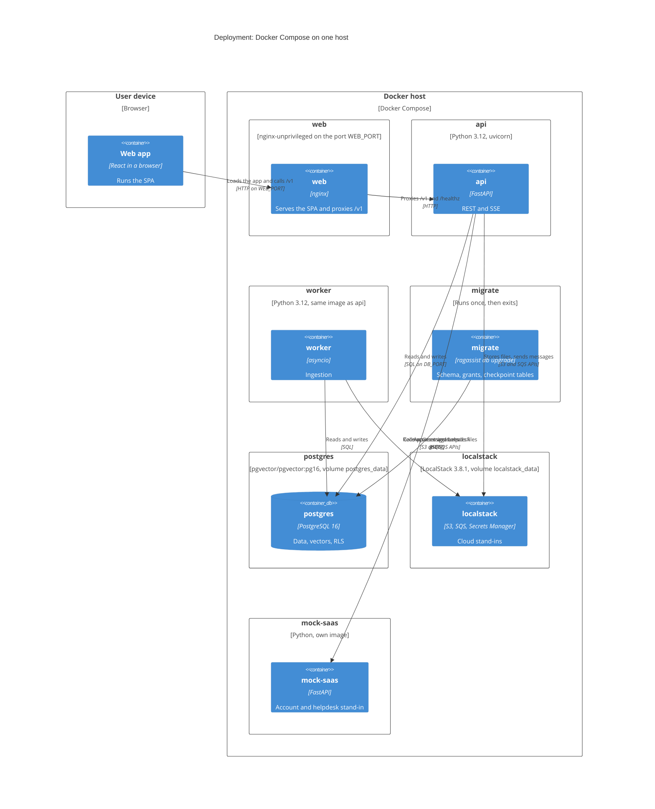
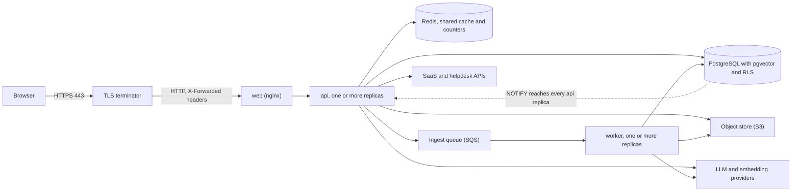
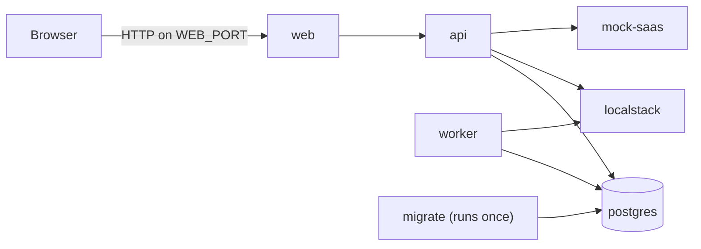

# C4 deployment view

**Type:** Architecture · **Audience:** operators, reviewers of the production plan · **Verified against:** `a989287`

**In plain English:** This page shows where each container runs. Today there is one shape: Docker Compose on one host. The
page also describes what a production shape needs, and it says which parts the repository does not build yet.

**Scope:** the deployment view of the C4 model. It maps the containers of [page 02](02-containers.md) to nodes. The start
order, the health checks and the configuration rules are in [arc42 section 7](../arc42/07-deployment-view.md). This page does
not repeat them. Every host and port comes from `.env`. This page writes placeholders such as `<WEB_PORT>`, `<API_PORT>` and
`<DB_PORT>`.

## Diagram 1: the Compose stack on one host

Look at the single outer node. All containers run on one Docker host. Only `web` is the intended entry point. The API, the
database and the stand-ins are on the Compose network.

**Key:** `Deployment_Node` = a place where software runs. Inside it, `Container` and `ContainerDb` = the C4 containers that
run there. The optional `redis` container is not drawn here. It is in diagram 2.

### In text

| Node | Image | Runs | Needs first |
|---|---|---|---|
| `postgres` | `pgvector/pgvector:pg16` | PostgreSQL with pgvector. The first start runs `init.sql` and `create-app-role.sh`. | none |
| `localstack` | `localstack/localstack:3.8.1` with the services `s3,sqs,secretsmanager` | The stand-ins. It runs `init.sh` at start. | none |
| `mock-saas` | built from `infra/docker/mock_saas.Dockerfile` | The SaaS and helpdesk stand-in | none |
| `redis` | `redis:8.2.11-alpine`, profile `redis` | Optional shared cache. It needs a password and keeps no data on disk. | none |
| `migrate` | the API image | `ragassist db upgrade`. It does not restart. | `postgres` healthy |
| `api` | built from `infra/docker/api.Dockerfile` | `ragassist serve`. It has a health check on `/healthz`. | `migrate` completed, `localstack` and `mock-saas` healthy |
| `web` | built from `infra/docker/web.Dockerfile` on `nginx-unprivileged` | nginx on `<WEB_PORT>`. It has a health check on `/web-healthz`. | `api` healthy. It restarts when `api` is recreated. |
| `worker` | the API image | `ragassist worker` | `migrate` completed, `localstack` healthy |

Facts about the stack:

- The two volumes are `postgres_data` and `localstack_data`.
- The API image needs Python 3.12 (`>=3.12,<3.13`).
- Compose binds `postgres`, `api` and `web` to the loopback address of the host. The ports of `localstack` and `mock-saas` have
  no loopback bind in the file. On a shared host, bind them before you use the stack there.
- The shared `x-app` block in `compose.yaml` fixes five environment values for the containers: the database host, the database port, the
  LocalStack endpoint, the mock-saas base URL and the persistence backend. This is a deployment value in a committed file. It
  is listed in [arc42 section 11](../arc42/11-risks-and-technical-debt.md).
- nginx renders its templates at start. It refuses to start when a required value is missing. The templates are in
  `infra/nginx/templates`.
- The mock-saas service answers `/healthz`, `GET /accounts/overview`, `GET /accounts/subscription`,
  `GET /accounts/invoices`, `POST /accounts/billing-email` and `POST /helpdesk/tickets`.

## What the nginx container does

| Path | Behaviour |
|---|---|
| `/` and unknown paths | The built app. Unknown paths fall back to `index.html`. |
| `/assets/` | Cached as immutable, because the file names carry a content hash |
| `/v1/events` and `POST /v1/conversations/{id}/messages` | Proxied without buffering and without compression. The read timeout is 3600 s. |
| `/v1/documents` | Proxied. The body limit is 52 MiB. The API limits a file to 50 MiB. |
| other `/v1/` paths | Proxied. The body limit is 1 MiB and the read timeout is 120 s. |
| `/healthz` | Proxied to the API |
| `/web-healthz` | Answers `ok` from nginx itself |
| `/docs`, `/openapi.json`, `/metrics` | Not proxied. The API still serves them to callers that reach it directly. |

nginx sets the security headers. The content security policy keeps `style-src 'unsafe-inline'`. This is an open decision. See
[ADR 0014](../adr/0014-web-delivery.md). TLS is not terminated in the container. See the next section.

## Diagram 2: the production shape

The repository ships no cloud template (no Terraform, no Helm chart, no manifest). It ships a Compose file, Dockerfiles and the
two ADRs below. The diagram shows the shape that those documents describe. It is a plan, not a verified setup.

Look at the three differences from Compose. A TLS terminator sits in front of `web`. The cloud services replace the
stand-ins. Redis is shared by every API replica.

The same facts in text:

1. The user reaches a TLS terminator over HTTPS on port 443. The terminator sends plain HTTP to `web`.
2. `web` proxies `/v1` to the API. The API may run as several replicas.
3. The API and the worker use a PostgreSQL server with the `pgvector` extension and the row-level security policies from the
   migrations. The app role must not be a superuser and must have `NOBYPASSRLS`.
4. Files go to an S3 bucket. Ingestion messages go to an SQS queue with a dead-letter queue.
5. With Redis as the cache backend, the cache, the sign-in throttle and the rate limiter are shared by every API replica. See
   [ADR 0015](../adr/0015-caching.md).
6. Live events use `NOTIFY` and `LISTEN` in PostgreSQL. Every API replica listens, so an event published by the worker or by
   one replica reaches the streams on all replicas.
7. The API and the worker call the LLM and embedding providers over HTTPS. Their keys live in the deployment secret store, not
   in git.

What the repository states for this shape:

| Need | Where it is stated |
|---|---|
| Set `AUTH_COOKIE_SECURE=true` outside development. Settings validation refuses to start in staging and production without it. | [arc42 section 7.4](../arc42/07-deployment-view.md), `Settings` |
| Set `WEB_HSTS` and use an `https` address for `WEB_BASE_URL` behind TLS | [ADR 0014](../adr/0014-web-delivery.md) |
| Add `set_real_ip_from` for the terminator and carry its `X-Forwarded-Proto` through | ADR 0014 says this is "not built yet" |
| The signing key must have at least 32 characters outside development and test | `Settings` validation |
| `TRUSTED_PROXY_IPS` lists the proxies whose forwarded headers uvicorn believes | [arc42 section 7.5](../arc42/07-deployment-view.md) |
| Redis must have a password. The Redis URL has no credentials in `.env`. | `Settings` validation, `compose.yaml` |

Unverified: the mapping to a cloud (a managed PostgreSQL service, S3, SQS, a secret store, a container service, a load
balancer) is a plan. No file in the repository builds it and no deployment was run for this page.

Unverified: the claim that several API replicas work together was reasoned from the ADRs and the code, and it was not tested.
Three parts are per process by design. The in-memory cache (when Redis is off), the pending-tool cache of `account_agent` and the
detached turn tasks live in one process. The ADRs and the code treat the first two as hints. A turn that a replica started
finishes on that replica.

Unverified: how to size the worker count. `WORKER_CONCURRENCY` sets the handlers in one worker process. No load test is in the
repository.

## Secrets in this shape

The repository follows one rule: a real value lives only in the git-ignored `.env` or in the secret store of the deployment.
`Settings` has no defaults for secrets or deployment values. `ragassist init-env` writes a working `.env` with random secrets
for local use. The `Settings` class has a field `SECRETS_MANAGER_SECRET_NAME`, and no code calls the Secrets Manager service
today. See [rotate secrets and use the secret guards](../how-to/rotate-secrets-and-use-secret-guards.md).

## Flowchart fallback for diagram 1

## Open items

These limits belong to the deployment. They are listed in [known limitations](../explanation/known-limitations-and-roadmap.md).

- The real-stack end-to-end smoke run is not done.
- When the OpenAI embedding call fails and the optional `[ml]` extra is not installed in the image, no embedding provider
  works inside the container.
- The CSP keeps `style-src 'unsafe-inline'`.
- A clean image build can fail when the `seed/` folder that `api.Dockerfile` copies is not in git (arc42 section 7.6).
- The ports of `localstack` and `mock-saas` have no loopback bind.

## Related pages

- [Containers](02-containers.md), [components of ingestion](05-components-ingestion.md) and
  [components of the web app](06-components-web-app.md).
- [arc42 section 7: deployment view](../arc42/07-deployment-view.md).
- [Deploy the web container](../how-to/deploy-the-web-container.md) and [run the stack locally](../tutorials/01-run-the-stack-locally.md).
- [ADR 0014](../adr/0014-web-delivery.md) and [ADR 0015](../adr/0015-caching.md).
