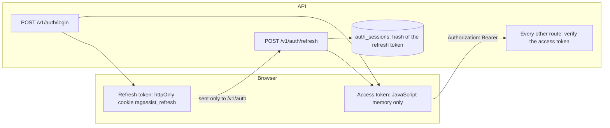

# Accounts, sessions and tokens

**Type:** Explanation · **Audience:** engineers and security reviewers who want to know how sign-in works and why it is built this way · **Verified against:** `a989287`

**In plain English:** A person signs in with a workspace name, an email address and a passphrase. The server gives back
two things: a short-lived access token that proves who the person is, and a longer-lived refresh token that lets the
browser get a new access token without a new sign-in. The two tokens live in different places on purpose. This page
explains why, and what happens when something goes wrong.

## The goal

The product needs three things from its account system:

- Every request must carry a verified [Principal](../glossary.md): the user, the tenant and the role. See
  [tenant isolation in depth](tenant-isolation-defence-in-depth.md).
- A stolen token must do limited harm for a limited time.
- A small team must be able to run it without an email service.

[ADR 0007](../adr/0007-accounts-and-sessions.md) records the decisions.

## Two tokens with two jobs

The diagram shows where each token lives and how they meet. Look for the difference in storage: the access token sits in
the memory of the page, and the refresh token sits in a cookie that page scripts cannot read.

The same facts in text:

| | Access token | Refresh token |
|---|---|---|
| Form | A signed JWT with the claims `sub`, `tenant_id`, `role` and `exp` | `{tenant_id}.{random}` |
| Lifetime | `AUTH_ACCESS_TOKEN_MINUTES` (15 in the sample) | `AUTH_REFRESH_TOKEN_DAYS` (14 in the sample) |
| Where the browser keeps it | A module variable in `frontend/src/api/token-store.ts`. It is never written to storage. | A cookie named `ragassist_refresh`: `HttpOnly`, `SameSite=Strict`, path `/v1/auth` |
| What the server keeps | Nothing. It checks the signature. | A SHA-256 hash of the token in `auth_sessions` |
| Sent with | Every API call | Only calls under `/v1/auth` |

Why this split? A script that runs in the page (for example through a cross-site scripting flaw) can read anything in
`localStorage`. It cannot read an `HttpOnly` cookie. It can still read the access token in memory, but that token expires
in minutes. The long-lived secret is the one that scripts cannot reach. The memory-only access token is lost on a page
reload, so the app asks `/v1/auth/refresh` at start-up to get a new one. [ADR 0009](../adr/0009-web-app.md) and
[ADR 0014](../adr/0014-web-delivery.md) describe the same-origin delivery that makes the `SameSite=Strict` cookie work.

## Signing in

The person gives a workspace slug, an email and a passphrase. The login use case then does the following.

1. It resolves the tenant from the slug. The tenants table is protected by row-level security, so the code uses the narrow
   `tenants_slug_lookup` policy. It exposes one row, and only for the transaction-local value `app.tenant_slug`. Sign-in
   needs this because the tenant is not known before the slug is read.
2. It looks up the user inside that tenant.
3. It checks the passphrase with argon2id. The hash work runs in the bounded executor, so it does not block the event loop.
4. It creates a session row and the two tokens.

Every failure returns the same `401` with the same message. An unknown workspace, an unknown email, a wrong passphrase
and a disabled account look identical. When the user does not exist, the code still hashes the password against a dummy
hash. The time taken is then similar, so an attacker learns nothing from the timing.

### Throttling

Guessing is limited by the settings `AUTH_LOGIN_MAX_FAILURES` (5), `AUTH_LOGIN_MAX_PER_IP` (30) and
`AUTH_LOGIN_WINDOW_SECONDS` (900). The first counts failures for one account. The second counts attempts from one address.
The window is 15 minutes. The counters live in the process, unless `CACHE_BACKEND=redis`. With several API processes and no
Redis, each process counts on its own, so the real limit is higher. The general API limiter is separate: 300 requests per
60 seconds, fixed in the code. See [arc42 section 11](../arc42/11-risks-and-technical-debt.md), risk R4.

## Refreshing and the token family

A refresh token is single-use. Each refresh gives a new token and marks the old one as rotated. The server follows a
rule that is easy to state: **a token that is used twice means a thief**.

- A normal refresh claims the session row and issues the next token in the same family.
- A rotated or revoked token that arrives again is a *replay*. The server then revokes the whole family and writes an
  `auth.refresh_replay` log line. Both the thief and the real user lose the session, and the real user signs in again.
- Two tabs that refresh at the same moment look like a race. The loser of the race revokes the family as well. To avoid
  this for honest tabs, the browser client in `frontend/src/api/http.ts` uses a single-flight refresh and a Web Lock named
  `ragassist-refresh`, so only one tab refreshes at a time.
- A refused refresh clears the cookie, so the browser does not keep sending a dead token.

Two protections guard the cookie routes against cross-site requests. The cookie is `SameSite=Strict`. The routes for
refresh and logout also call `require_trusted_origin`, which accepts a request only when its `Origin` header is in
`CORS_ORIGINS` or equals `WEB_BASE_URL`.

## Why the access token is checked without the database

The function `get_current_principal` reads no database row. It verifies the signature and the claims. This keeps each
request cheap, and the mock SaaS can verify the same token with the shared signing key. The cost is plain. A disabled
user or a changed role keeps working until the access token expires. The short lifetime bounds this. When an admin
disables a member, the server revokes that member's sessions and open links at once, so the member cannot refresh. This
delay is risk R1 in [arc42 section 11](../arc42/11-risks-and-technical-debt.md).

There is one more token lifetime to know. `JWT_ACCESS_TOKEN_EXPIRE_MINUTES` (1440 in the sample) does not apply to
browser sign-in. It sets the lifetime of the developer token (the `ragassist token` command and the `POST /v1/auth/token`
route) and of the short tokens that the runtime mints for tool calls. This second setting is a known debt (D13).

## Invites and reset links without email

The system has no email service. Admins hand over links.

- An admin creates an invite. The response shows a link once. The link has the form `/accept#token=...`.
- The token is in the URL **fragment**. A browser never sends the fragment to a server, so it does not land in server
  logs, proxy logs or `Referer` headers. The page reads it and posts it in the body.
- The token is single-use and expires after `AUTH_INVITE_HOURS` (72). The database keeps only its hash.
- A password reset works the same way. An admin makes a reset link for a member.
- A passphrase must be at least `AUTH_MIN_PASSPHRASE_LENGTH` characters (12). There are no composition rules.

The command line gives the same links. `ragassist workspace create` and `ragassist seed` print one-time links for the first
admin. The [CLI reference](../reference/cli.md) lists the commands, and
[manage team and invites](../how-to/manage-team-and-invites.md) shows the steps.

### Guards that protect the team

- The last active admin cannot be disabled or demoted.
- An admin cannot change their own role or disable themselves.
- Disabling a member ends their sessions and cancels their open links.

## What can go wrong

| Event | What the server does | What the person sees |
|---|---|---|
| Wrong passphrase | Generic `401`, counts a failure | The generic sign-in error |
| Too many failures | `429` | A wait message |
| Access token expires | The next call gets `401`; the client refreshes once and retries | Nothing, normally |
| Refresh token replayed | Revokes the family, logs `auth.refresh_replay` | A new sign-in prompt |
| Member disabled | Revokes sessions; the access token still works until it expires | Signed out within minutes |
| Event stream outlives the token | The stream sends `reauth` at token expiry | The client refreshes and reconnects |

## Trade-offs

| Choice | Benefit | Cost |
|---|---|---|
| Access token in memory | Scripts cannot copy it from storage | A reload needs one refresh call |
| Refresh token in an `HttpOnly` cookie | A script cannot read it | The cookie needs the same-origin setup and `Secure` in production |
| Hash-only server storage | A database leak does not give usable tokens | None that matter |
| Family revocation on replay | A thief is cut off | A race between tabs can sign an honest user out |
| Stateless access check | Fast; the mock SaaS can verify it | A disable takes effect only at expiry |
| Links in place of email | No mail service to run | An admin must deliver the link |

## Alternatives not chosen

- **A server session id on every request.** It would let a disable take effect at once. It would add a database read to
  every call. The ADR chose short tokens instead.
- **Tokens in `localStorage`.** Simple, and readable by any script in the page.
- **A `SECURITY DEFINER` function for the slug lookup.** Forced row-level security still binds the function owner, so
  the function would add a privileged path. The narrow policy is simpler.
- **An email service for invites.** Out of scope. Links shown once are enough for a small team.

## Honest limits

- The default signing algorithm is HS256 with one shared key. Rotating it logs everyone out and needs a coordinated
  restart. See [rotate secrets and use secret guards](../how-to/rotate-secrets-and-use-secret-guards.md).
- The throttle counters are per process without Redis.
- Unverified: this page did not run the replay path against a live stack. The unit and integration tests cover it. See
  [testing strategy](testing-strategy.md).

## Related pages

- [Tenant isolation in depth](tenant-isolation-defence-in-depth.md)
- [Roles and permissions reference](../reference/roles-and-permissions.md)
- [Security controls reference](../reference/security-controls.md)
- [Create a workspace and sign in](../tutorials/02-create-a-workspace-and-sign-in.md)
- [Glossary](../glossary.md)
