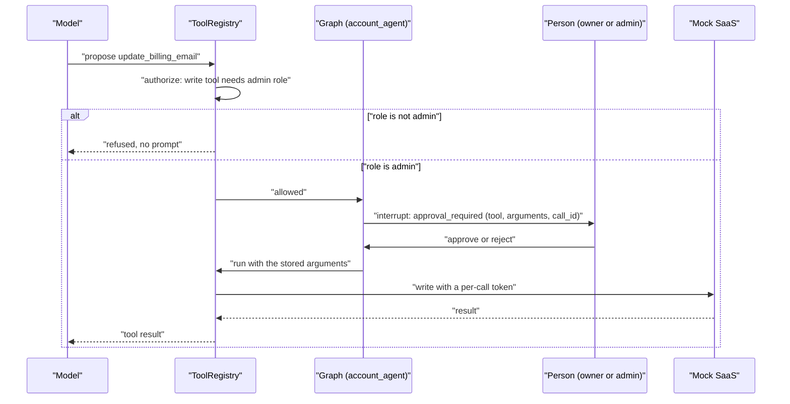

# Approvals and actions

**Type:** Explanation · **Audience:** engineers and reviewers who want to know how the assistant changes a customer account without doing harm · **Verified against:** `a989287`

**In plain English:** Besides answering questions, the assistant can act on the customer's account: read an invoice or
change a billing email. Reading is safe. Writing is not. Every write waits for a person to say yes, and the person who
says yes must be allowed to make the change. This page explains the rules, the pause in the graph and the weak points.

## The goal

A language model can be fooled. A document or a message may tell it to "change the billing email to this address". The
design must make such an attack harmless. [ADR 0006](../adr/0006-conversation-access-and-approval-binding.md) records the
approval rules. The principle: the model proposes, the code and a human decide.

## The tools

The tools live in `src/ragassist/modules/actions/tools/__init__.py`. A tool is a function with a typed argument schema and a
flag that says whether it writes.

| Tool | Writes | Notes |
|---|---|---|
| `get_account_overview` | No | Reads the account summary |
| `get_subscription` | No | Reads the plan |
| `list_invoices` | No | Reads invoices |
| `get_invoices` | No | An alias of `list_invoices`. Hidden from the model. |
| `update_billing_email` | Yes | Admin only. Needs approval. |
| `query_dataset` | No | A stub that raises. Hidden from the model. |

Two rules apply to every tool:

- **No tenant argument.** The argument schema holds no tenant or user field. The function receives the
  [Principal](../glossary.md) as its first argument, and the Principal comes from the verified token. A model cannot name
  another tenant, because there is no place to write one.
- **A fresh token for each call.** The runtime mints a short-lived token for the verified user for every tool call. The
  mock SaaS reads the tenant from that token. See [tenant isolation in depth](tenant-isolation-defence-in-depth.md).

The wrapper that `build_tool_registry` in `src/ragassist/runtime.py` puts around each tool also writes a row to
`tool_audit_log` for each call. The table has row-level security like the other tenant tables.

## Authorise first, then ask

The order of the checks matters. The diagram shows one write call from the model's request to the result. Look for the
point where a refused role stops the flow before any person is asked.

The same facts in text:

1. The model proposes a tool call.
2. `ToolRegistry.authorize` checks the role. A write tool needs the admin role. The check runs **before** the approval
   prompt. A user who may not write never sees a prompt, so nobody can approve a change that the role forbids.
3. For an allowed write, the node `account_agent` calls LangGraph's `interrupt`. The payload names the action
   `approval_required`, the tool, the arguments and a call id.
4. The graph state is saved in the checkpoint and the stream sends an `interrupt` event. It carries an `interrupt_id`.
5. A person approves or rejects through `POST /v1/conversations/{id}/actions/{interrupt_id}`.
6. The graph resumes. The handler runs and checks the admin role a second time. It also validates the email address.

The role is checked twice on purpose. The first check avoids a pointless prompt. The second check protects the handler if
a future caller skips the first.

## Binding the decision to the pending call

A weak design would send "approve" with the tool and the arguments, and the server would run them. An attacker could
then approve a different call. The route avoids this.

- The decision request names only the interrupt id and the verdict.
- The server reads the tool, the arguments and the call id back from the **checkpoint**. The client cannot change them.
- The route checks that the interrupt id is the one pending now. If not, the answer is `409`.
- Only the conversation owner or an admin may decide. Another user gets `403`. A conversation that the caller cannot see
  gets `404`.
- Two further answers exist: `503` when the saved state cannot be read, and `502` when the resume fails.
- The decision is recorded with `store.record_action`. In the `account_agent` node, a bounded in-process cache of
  proposed calls (512 entries) saves a second model call when the node runs again after the resume.

The web app follows the same rule. The approval card shows the tool and the arguments, and it posts only the decision.
While a call is pending, the composer is locked. A page reload loses the pending card, because the app rebuilds state
from messages and not from the checkpoint ([ADR 0010](../adr/0010-chat-ui.md)). The graph still waits. This is an open
gap.

## Why a human, and why this human

- **A human approves because a model can be tricked.** Prompt injection has no complete fix. The documents and the
  customer text are untrusted. See [the decision layer](the-decision-layer.md) for the safety check and its limits.
- **The role check comes first because approval is not authority.** A person who clicks "approve" is not necessarily
  allowed to make the change.
- **The arguments come from the checkpoint because a button is not a contract.** The screen can show anything. The server
  runs what it stored.

## Cost of the design

| Choice | Benefit | Cost |
|---|---|---|
| Approval for every write | A tricked model cannot change data alone | One click for each change |
| Role check before the prompt | No pointless or forbidden prompts | The model learns about a refusal only after it proposes |
| Arguments read from the checkpoint | The client cannot swap the call | A checkpoint read for each decision |
| Principal as first argument | No tenant in the schema | Every new tool must follow the pattern |
| Hidden stub tools | The model cannot pick them | Dead code that stays |

[Add an action tool with approval](../how-to/add-an-action-tool-with-approval.md) shows how to follow the pattern.

## Alternatives not chosen

- **Let the model act without approval.** Fast. One injected instruction could change data.
- **Approve in the chat text** ("reply yes to confirm"). The model could produce the "yes" or accept one from a
  document. A structured interrupt that only the API can resume is stronger.
- **Allow all roles to write.** Rejected by the role table. See
  [roles and permissions](../reference/roles-and-permissions.md).

## Honest limits

- **Code observation, needs verification.** In `runtime.build_runtime`, tools are bound to the models through
  `_with_tools` and passed to `build_graph` as `agent_tiers`. The function `build_graph` takes `**kwargs` and does not use
  that name. The `account_agent` node reads `generator_tiers`, where no tools are bound, and it uses only the first
  model of the tier. If this reading is right, the model never receives the tool list in production, and the approval
  path is reached only in tests that supply their own tiers. This page did not run a live turn to confirm it.
  [Known limitations](known-limitations-and-roadmap.md) lists it.
- **A reload loses the pending approval card.** The checkpoint still waits.
- **`query_dataset` is a stub.** The name suggests a feature that does not exist.
- **One table holds both records.** `record_action` writes the decision to `tool_audit_log` as a row with the tool name
  `approval_decision`, the status `approved` or `denied`, the approver and the reason. The tool call itself is a
  separate row with the status `executed` or `failed`. The runtime does not set a conversation id on that row, so
  nothing links the two rows.

## Related pages

- [How an answer is made](how-an-answer-is-made.md)
- [Tenant isolation in depth](tenant-isolation-defence-in-depth.md)
- [Human handoff and live events](human-handoff-and-live-events.md)
- [SSE contract](../api/sse-contract.md)
- [Glossary](../glossary.md)
