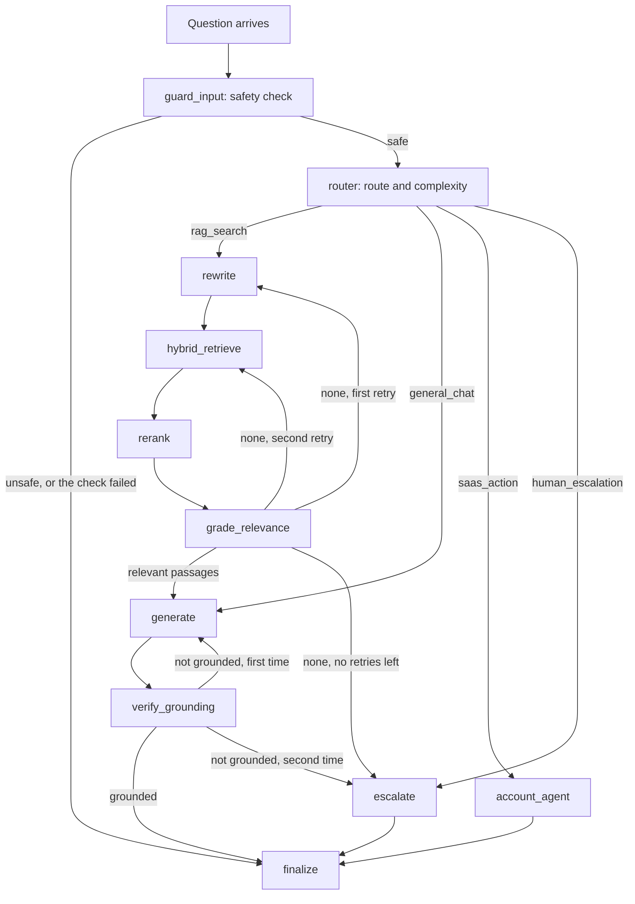

# How an answer is made

**Type:** Explanation · **Audience:** anyone who wants to understand what happens between a question and a cited answer · **Verified against:** `a989287`

**In plain English:** A customer types a question. The assistant first checks that the question is safe. It then decides
what kind of question it is. Most questions go to a search of the company documents. The assistant keeps only the
passages that help, writes an answer from them and checks that the answer matches the passages. If it cannot do this, it
hands the customer to a person. This page tells that story step by step and explains why each step exists.

## The whole turn in one picture

A [turn](../glossary.md) is one question and all the work that produces the answer. The assistant runs a state machine
of 11 nodes. The state machine is a [LangGraph](../glossary.md) graph. The diagram shows the nodes and the arrows
between them. Look for the three exits. A blocked question goes straight to the end. A question for an account action
goes to the account agent. A question that the documents cannot answer ends in an escalation.

The same facts in text. The `guard_input` node runs first. The `router` node picks one of four routes. The route
`rag_search` runs the nodes `rewrite`, `hybrid_retrieve`, `rerank` and `grade_relevance`. Then the node `generate` writes
the answer and the node `verify_grounding` checks it. The route `general_chat` skips the search. The route `saas_action`
goes to `account_agent`. The route `human_escalation` goes to `escalate`. Every path ends in `finalize`. The
[assistant graph reference](../reference/assistant-graph.md) lists the state fields and the edges.

## Before the graph starts

The browser sends the question to `POST /v1/conversations/{id}/messages`. The API does four things before it starts the
graph:

- It verifies the token and builds the [Principal](../glossary.md).
- It loads the conversation for that tenant. It applies the owner rule. A conversation of another user answers `404`.
- It saves the customer message.
- It checks the status. If a human agent owns the conversation (`escalated`), the API does not run the graph. It
  returns the handoff instead. See [human handoff and live events](human-handoff-and-live-events.md).

Then the API builds a fresh state for the turn. The graph saves its state per conversation, so a new turn must not
inherit the answer, the counters or the status of the last turn. The thread id is `{tenant_id}:{conversation_id}`.

The turn then runs in its own task, not in the HTTP request. If the customer presses Stop or closes the tab, the turn
still finishes. It saves the answer and opens the ticket. See [ADR 0008](../adr/0008-live-events-handoff-and-detached-turns.md).

## Step 1: the safety check

The node `guard_input` asks the [decider](../glossary.md) chain one yes-or-no question: does the input contain prompt
injection, a jailbreak or toxic instructions? See [the decision layer](the-decision-layer.md) for how the chain works.

- If the answer is "unsafe", the turn ends with a fixed refusal and the status `blocked`.
- If no decider could answer, the check **fails closed**. The turn ends, but the message does not accuse the customer.
  It says that the check did not run and asks them to try again.
- A repeated question can reuse a real verdict from the [cache](../glossary.md). A failed check is never cached.

## Step 2: the route

The node `router` asks a choice question with four answers: `rag_search`, `saas_action`, `general_chat` and
`human_escalation`. It also scores the complexity of the question from 1 to 5. If the router decider is not sure enough
(below `DECIDER_MIN_CONFIDENCE`), the chain asks the next one. If every decider fails, the route defaults to
`rag_search`. A search is the safest default. It reads documents and changes nothing.

The complexity score picks the model tier for the answer. A score below 2.0 uses the cheap tier. A higher or missing
score uses the strong tier. When the score cannot be measured, the code uses 2.0, which means the strong tier.

## Step 3: find passages

On the route `rag_search`, three nodes run in a row.

- **`rewrite`.** In this code, the node only counts the attempts. On a retry it appends the word "details" to the query.
  It makes no model call. The name suggests more than it does. The [limitations page](known-limitations-and-roadmap.md)
  lists this.
- **`hybrid_retrieve`.** The node asks the retriever for 6 passages. The retriever runs a vector search and a keyword
  search at the same time and joins the two rankings. See [retrieval and chunking](retrieval-and-chunking.md).
- **`rerank`.** The node reorders the passages with the reranker chain and keeps at most 4.

## Step 4: keep only what helps

The node `grade_relevance` asks the decider chain one question for each passage: does this passage help to answer the
question? It keeps the passages that pass.

- If at least one passage passes, the graph goes to `generate`.
- If none passes, the graph retries. The first retry runs `rewrite` and then searches again. The second retry searches
  again without `rewrite`. The code allows at most 3 searches in a turn. After the third empty result, the turn goes
  to `escalate`.
- If a grading call itself fails, the grader keeps the passage. A failed grader must not hide the only source of the
  answer. This is the opposite of the safety check. See [the decision layer](the-decision-layer.md) for the reason.

## Step 5: write the answer

The node `generate` builds the prompt. The first message is a fixed system message. It tells the model to answer only
from the facts, to cite with numbers such as `[1]` and to treat the document text as data, never as instructions. The
passages follow, wrapped in a tag that marks them as untrusted. The question comes last.

The node streams the model output token by token. If the first model fails, it tries the next model of the role chain.
See [provider abstraction and fallbacks](provider-abstraction-and-fallbacks.md).

After the answer is complete, the code reads the `[n]` markers. It maps each number to the n-th passage that it gave to
the model. This builds the [citation](../glossary.md) list. A number that matches no passage is dropped.

The route `general_chat` also uses this node. It has no passages and no citations.

## Step 6: check the answer

The node `verify_grounding` asks the decider chain: is every claim in the answer supported by the passages? The answer
must pass with a probability of at least `ESCALATION_THRESHOLD`.

- If the answer is grounded, the turn goes to `finalize`.
- If not, the node `generate` runs once more. The API tells the browser to discard the first text with a `reset` token
  event. The browser starts again from the next token.
- If the second answer is also not grounded, the turn goes to `escalate`.
- If the check itself cannot run, the verdict is "not grounded". It fails closed.

The step is skipped for `general_chat` and for an answer with no passages.

## The other routes

- **`saas_action`.** The node `account_agent` lets a model call tools on the customer's account. A read tool runs at
  once. A write tool pauses the graph and waits for a person to approve. See
  [approvals and actions](approvals-and-actions.md).
- **`human_escalation` and the retry limits.** The node `escalate` marks the turn as escalated. If an answer already
  exists, it keeps it. Otherwise it writes a short message that a support agent will follow up.

## Step 7: finish

The node `finalize` dispatches a `citation` event and a `done` event. The API relays the citations and reads the status
from the `done` event. Then the API does the end of the turn in a fixed order:

- It saves the assistant message first. The stream stops at the terminal event, so nothing after it would run.
- It publishes `message.created` so that other tabs and agents refetch.
- If the status is `escalated`, it opens a helpdesk ticket and sends an `escalated` event.
- It sends its own `done` event.

The browser sees `token` events, then `citation` events, then `done`. A customer who opens a citation loads the passage
text from `GET /v1/chunks/{id}`. See the [SSE contract](../api/sse-contract.md) for the exact frames.

## What a reader should notice

- **Three checks guard one answer.** The safety check runs before the model sees the text. The relevance grade runs
  before the model writes. The grounding check runs after. Each check can send the turn to a person.
- **Different failures have different defaults.** A failed safety or grounding check refuses. A failed relevance grade
  keeps the passage. A failed route defaults to a search. The rule is to pick the default that does the least harm for
  each question.
- **Most steps are not text generation.** Only `generate` and `account_agent` write text for the customer. The other
  steps use the decider layer, which answers typed questions. This keeps the turn fast and cheap.
- **A repeated question is cheaper.** With the cache on, the second ask of the same question by the same tenant and role
  skips the safety check, the routing and the second search. In a scripted test, 6 model calls became 3
  ([ADR 0015](../adr/0015-caching.md)).
- **One trace shows the turn.** When tracing is on, each turn is one trace with the steps nested inside. See
  [observability and privacy](observability-and-privacy.md).

## Honest limits

- **An answer can stay after a failed grounding check.** When the second answer is also not grounded, the node
  `escalate` keeps the text that already exists. The customer can see that text and also gets an escalation. Unverified:
  this page did not run a live turn to see how the web app shows it.
- **The graph state is the one place that decides a turn.** A bug in a route function changes behaviour for all
  tenants. The graph tests in `tests/graph/` script the models to check each path. See
  [testing strategy](testing-strategy.md).

## Related pages

- [The decision layer](the-decision-layer.md)
- [Retrieval and chunking](retrieval-and-chunking.md)
- [Approvals and actions](approvals-and-actions.md)
- [Assistant graph reference](../reference/assistant-graph.md)
- [C4 components of the assistant graph](../c4/04-components-assistant-graph.md)
- [Glossary](../glossary.md)
