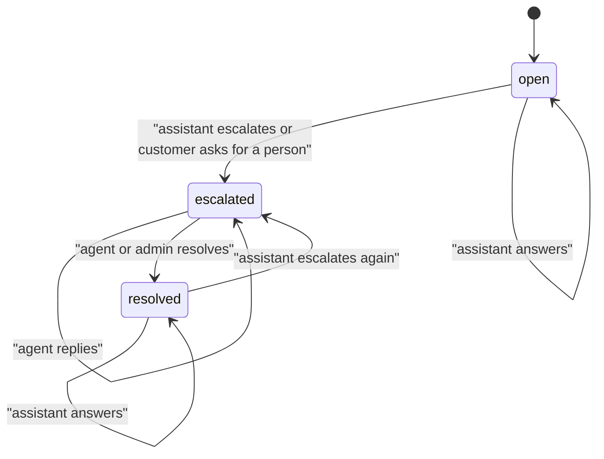
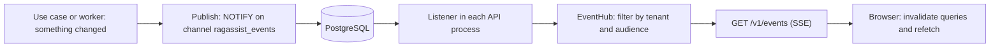

# Human handoff and live events

**Type:** Explanation · **Audience:** engineers and support leads who want to know how a conversation moves from the assistant to a person and how screens stay current · **Verified against:** `a989287`

**In plain English:** When the assistant cannot help, it passes the conversation to a human agent. The agent sees it
in an inbox, replies, and resolves it. All of this must show up on the screens of the customer and the agent without a
page reload. This page explains the handoff states and the small event system that keeps screens fresh.

## The goal

A customer must never be stuck with a bot that cannot help. A support agent must see new work at once. Neither side
should need to refresh a page. [ADR 0008](../adr/0008-live-events-handoff-and-detached-turns.md) records the design.

## The life of a handoff

The diagram shows the conversation states. Look for the loop: a resolved conversation returns to the assistant, and a
later escalation opens a new ticket.

The same facts in text:

- **Open.** The assistant answers every message. This is the status that a new conversation has.
- **Escalated.** A person owns the conversation. The assistant stops answering.
- **Resolved.** The agent closed it. The assistant answers the next customer message. The status stays `resolved` until a
  new escalation sets it to `escalated`.

### How a conversation escalates

Two situations lead to `escalated`. Both end in the `escalate` node of the graph:

- The router picks `human_escalation` because the customer asks for a person.
- The graph runs out of retries: no passage passes the relevance grade after 3 searches, or two answers fail the
  grounding check.

When a turn ends with the status `escalated`, the assistant router calls the `EscalateConversation` use case. The use case
marks the conversation, creates a ticket in the mock helpdesk through `HelpdeskClient` (a `POST` to
`/helpdesk/tickets`) and publishes events. It is idempotent: a second escalation of an already escalated conversation does
nothing new.

### What the customer message does while escalated

When a customer writes in an escalated conversation, the API saves the message, skips the graph and answers with the
handoff. In the streaming route the client receives `escalated` (when the conversation has a ticket id) and then `done`.
In the JSON route it receives the route
`human_handoff`. This avoids two voices in one conversation: the bot and the person.

### What the agent can do

| Action | Who | Rule |
|---|---|---|
| List escalations | Agent, admin | `GET /v1/escalations` returns statuses `escalated` and `resolved` |
| Reply | Agent only | An admin gets `403`. The reply is a message in the conversation. |
| Resolve | Agent, admin | Closes the conversation |

Only the agent role may reply. Each account has one role, so an admin who needs to answer a customer must use an account
with the agent role. This follows the rule set in [roles and permissions](../reference/roles-and-permissions.md).

A caveat for the escalation text: when two grounding checks fail, the node `escalate` keeps the existing answer. The
customer then sees an answer that failed the check and also an escalation. See
[how an answer is made](how-an-answer-is-made.md).

## Why a turn runs detached

A customer can close the tab while the assistant is writing. If the turn lived inside the HTTP request, it would stop.
The answer would be lost, and an escalation would not open its ticket. The API therefore starts each turn in its own
task (`turns.spawn`) and streams the events to the client from a queue. At shutdown, the API waits for running turns
(`drain`). The assistant message is saved before the `done` event, because nothing runs after the stream ends.

## The event system

A live screen needs to know when something changed. The system uses a small bus. The goal is "tell the browser to
refetch", not "send the data".

The same facts in text: a use case publishes an event when it commits a change. PostgreSQL sends it to every process that
listens. Each API process runs a listener and an `EventHub`. The hub filters events by tenant and audience and writes them
to the open streams. The browser receives a small event and refetches the data through the normal API.

### Event types

| Event | Meaning |
|---|---|
| `job.updated` | An ingestion job changed state |
| `document.changed` | A document was added, changed or removed |
| `message.created` | A message was saved |
| `conversation.updated` | A conversation changed (title, status) |
| `escalation.changed` | A handoff opened, got a reply or closed |
| `ready`, `resync`, `reauth` | Per-connection control events |

### Rules that keep the bus safe

- **Ids only.** An event carries a type and ids. The class `Event` allows only keys in `ID_KEYS`. It raises
  `InvalidEvent` for anything else, so message text and personal data cannot ride on the bus. The browser asks the API
  for the content, and the API applies the access rules again.
- **Tenant first, then audience.** Each event names an audience: `admins`, `staff` or `owner_and_staff`. The hub
  delivers it only to the matching users of the same tenant. A plain user never sees an event for a colleague's
  conversation.
- **Bounded queues.** Each connection has a queue of `EVENTS_QUEUE_SIZE` entries (100 in the sample). On overflow the
  hub drops the backlog and sends `resync`. The client then refetches everything.
- **A cap on streams for each user.** `EVENTS_MAX_STREAMS_PER_USER` (5) stops one account from opening unlimited
  connections. The sixth gets `429` with `Retry-After: 5`.
- **Token expiry.** A stream cannot outlive its access token. At expiry the server sends `reauth`, and the client
  refreshes the token and reconnects. See [accounts, sessions and tokens](accounts-sessions-and-tokens.md).
- **No caching.** Auth and event responses use `Cache-Control: no-store`. See [ADR 0015](../adr/0015-caching.md).

### Staying alive

The server sends a heartbeat every 15 seconds. The listener probes the database every 30 seconds. If the connection
drops, it reconnects with back-off between 0.5 and 10 seconds, and it sends `resync` to all streams after it returns,
because it may have missed events.

### Events are not replayed

The bus keeps no history. A client that was offline misses events. The design accepts this because every event only means
"refetch". After a reconnect the client invalidates all its queries, and the screen is correct again. This is simpler
than a replay log, and it costs one wave of refetches after each reconnect.

ADR 0016 records a bug that shows the idea in practice: the first connection after a failed start could leave the
inbox stale. The fix marks that first connection as a missed start, so the client refetches when the stream opens.

## Trade-offs

| Choice | Benefit | Cost |
|---|---|---|
| `LISTEN`/`NOTIFY` in place of a broker | No new system. The API and worker already share the database. | Not durable. A payload limit forces small events. |
| Ids only | No data leak by design | Each event costs a refetch |
| No replay | Simple | A refetch storm after a reconnect |
| One-way SSE in place of WebSocket | Plain HTTP, works behind proxies | Commands go through normal requests |
| A hand-off flag in place of two bots | One voice at a time | The customer cannot ask the assistant while a person owns the chat |

## Alternatives not chosen

- **A message broker** such as Redis streams or a queue service. The ADR rejects it, because the database already
  connects every process.
- **Polling.** Cheap to build. It wastes requests and adds delay.
- **WebSocket.** Two-way, and the product does not need it.

## Honest limits

- The cap on streams for each user is counted per process. It stays per process also when Redis serves the cache (an open
  item in the frontend notes). See [known limitations](known-limitations-and-roadmap.md).
- Unverified: this page did not run two browsers against a live stack to see the events arrive. The unit and security
  tests cover the hub, the audience rules and the isolation. See [testing strategy](testing-strategy.md).

## Related pages

- [Approvals and actions](approvals-and-actions.md)
- [SSE contract](../api/sse-contract.md)
- [Handle an escalation as an agent](../tutorials/04-handle-an-escalation-as-an-agent.md)
- [Roles and permissions reference](../reference/roles-and-permissions.md)
- [Glossary](../glossary.md)
