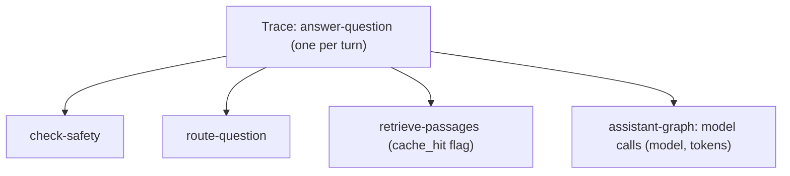

# Observability and privacy

**Type:** Explanation · **Audience:** operators and reviewers who want to know what the system records about a turn and what leaves the deployment · **Verified against:** `a989287`

**In plain English:** When something goes wrong in an assistant, you need to see what it did: which steps ran, which model
answered, how long each took. RagAssist can record each turn as one trace. The record helps with debugging and cost
control. It also means that data leaves the system if you turn the tracing on. This page explains what is recorded, what
is masked and what is not.

## The goal

Operators must answer three questions without guessing:

- Why did this answer look like this? (the steps and the models)
- Where did the time and the money go? (latency and tokens)
- Is the system healthy right now? (metrics)

The rule from `AGENTS.md` is that private data must not leak into these tools through carelessness. This page shows
where the design meets that rule and where it does not. [ADR 0012](../adr/0012-langfuse-tracing.md) records the tracing
design.

## What a trace looks like

Tracing is off by default. `LANGFUSE_TRACING` turns it on. `LANGFUSE_SAMPLE_RATE` sets the share of turns that are
recorded. The Langfuse regions are listed in `.env.example`. The code in `shared/observability/tracing.py` wraps each turn
in one root observation and nests the steps inside it.

The same facts in text: the root observation is `answer-question`. Inside it, the steps are `check-safety`,
`route-question` and `retrieve-passages`. The model calls come from the LangChain callback handler, which nests the
graph run (`assistant-graph`) under the root. The `retrieve-passages` step records whether the result came from the
cache. The `check-safety` and `route-question` steps record which decider answered, so a fall to the `rules` decider is
visible. A decision on a pending approval has its own root, named `decide-action`.

Each trace carries these identifiers:

| Field | Value |
|---|---|
| `session_id` | The conversation id, so all turns of a chat group together |
| `user_id` | The user id |
| tags | `assistant` and the mode |
| metadata | `tenant_id` and `role` |

The tenant is metadata and not a tag. A filter by tenant in the Langfuse screen therefore needs the metadata filter.

[Follow a turn in Langfuse](../tutorials/05-follow-a-turn-in-langfuse.md) shows the screen, and
[configure tracing](../how-to/configure-tracing.md) shows the setup.

## LangSmith

An optional LangSmith client exists. `LANGSMITH_TRACING` enables it. It uses a redacting client, so the same masking
applies. Only one of the two tools is normally needed.

## What the masking does

Two functions in the observability module, `redact` and `mask_otel_spans`, replace credentials with `[REDACTED]`. They
match three kinds of text:

- values under keys with secret-like names (password, secret, token, key)
- JSON Web Tokens and bearer headers
- strings shaped like provider API keys

This is **credential masking**. It stops a leaked key from reaching a trace store.

### What the masking does not do

It does not mask personal data. It does not mask the text of the conversation. When tracing is on, the question, the
retrieved passages and the answer go to the tracing service, because that is how a person debugs a bad answer. If a
customer types a name, an email address or an invoice number, that text is in the trace.

This is a real privacy decision and not an oversight in the docs. Treat it as follows:

- Leave tracing **off** where the data may not leave your boundary.
- Use `LANGFUSE_SAMPLE_RATE` to lower the volume where you need some traces.
- Pick a Langfuse region that matches your data-residency rules, or run Langfuse yourself.
- Tell customers in your own privacy notice that support chats may be processed by the tracing provider.

The same point holds for the model providers. Every question and every passage goes to the provider that runs the model.
Isolation protects stored rows. It does not control what a provider receives. See
[tenant isolation in depth](tenant-isolation-defence-in-depth.md).

Unverified: this page read the masking code and its tests. It did not export a real trace to check for personal data.

## Metrics

The route `/metrics` serves Prometheus text. It is **admin only**. The names include:

- `ragassist_cache_*`: hits and misses for each kind of entry, evictions, expirations, refused values, backend errors
  and live entries. See [ADR 0015](../adr/0015-caching.md).
- `ragassist_llm_input_tokens_total`: tokens sent to models, split by the label `cached`.
- `ragassist_active_requests`: a gauge that the timing middleware sets to 1 at the start of a request and to 0 at the end.
  It is not a true count of requests in flight.
- `http_requests_total` and `http_request_duration_seconds`: requests by method, route template and status, and the
  request duration.

Metrics carry no tenant or user labels in the names listed here. Unverified: this page did not list every label of every
metric.

## Logs

The application logs events as structured lines. Security-relevant events have fixed names. The refresh replay line is
`auth.refresh_replay`. Log lines must not hold credentials. The secret scanner and the hygiene tests check the code and
the tree, and the masking functions cover the observability export. See
[security controls](../reference/security-controls.md).

## Cache headers and privacy

Responses for sign-in, refresh and live events carry `Cache-Control: no-store`. Content responses use an ETag, and the
server checks authorisation **before** it answers `304`. A shared cache therefore cannot hand a private response to
another person. See [ADR 0015](../adr/0015-caching.md).

## Trade-offs

| Choice | Benefit | Cost |
|---|---|---|
| Full conversation text in traces | A person can debug a bad answer | Personal data leaves the deployment |
| Credential masking only | Simple and predictable | No protection for personal data |
| Tracing off by default | Safe by default | Operators must opt in to see anything |
| Sampling | Lower cost and exposure | Some bad turns have no trace |
| Admin-only `/metrics` | No public data | A scraper needs a token |

## Alternatives not chosen

- **Mask all personal data.** It needs a detector with false positives and false negatives. It would also hide what a
  person needs to debug. The project did not build it. It is a candidate for the roadmap.
- **No tracing.** Cheapest. Debugging a wrong answer would rely on logs and memory.
- **Self-hosted tracing only.** A deployment choice. The same code works, and the region setting is only a convenience.

## Honest limits

- Personal data is **not** masked in traces.
- The tenant is not a tag.
- Unverified: the eval reports under `evals/reports/` are not evidence of production quality. The offline mode simulates
  results. See [testing strategy](testing-strategy.md).

## Related pages

- [Observability reference](../reference/observability.md)
- [Configure tracing](../how-to/configure-tracing.md)
- [Follow a turn in Langfuse](../tutorials/05-follow-a-turn-in-langfuse.md)
- [Security controls reference](../reference/security-controls.md)
- [Known limitations and roadmap](known-limitations-and-roadmap.md)
- [Glossary](../glossary.md)
