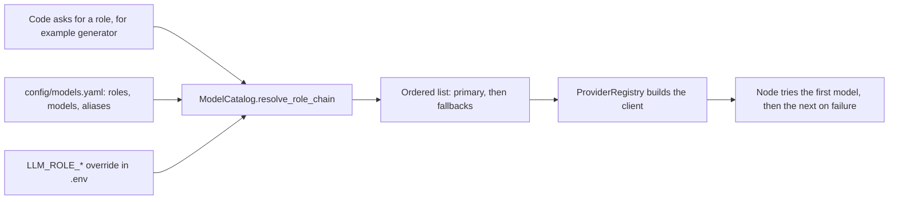

# Provider abstraction and fallbacks

**Type:** Explanation · **Audience:** engineers who want to know why no model name appears in the code and what happens when a provider fails · **Verified against:** `a989287`

**In plain English:** Model providers change their prices, names and uptime all the time. RagAssist therefore never
writes a model name in code. It writes a *role* such as "generator", and a configuration file says which models fill that
role, in order. When the first model fails, the next one answers. This page explains the pieces and one lesson about
retired models.

## The goal

The product must keep working when a provider has an outage, a key is missing or a model is retired. A change of model
must be a change of configuration. `AGENTS.md` section 2 sets the rule: no hardcoded models or keys; everything goes
through `ProviderRegistry` and `FallbackChain`, configured by `config/models.yaml` and environment variables.

## Four ideas

The diagram shows how a role becomes a working model. Look for the two places where the order of models is decided: the
YAML file and the environment override.

The same facts in text:

| Idea | What it means | Where |
|---|---|---|
| **Role** | A named job: `generator`, `rewriter`, `judge`, `decider`, `agent` | `config/models.yaml` |
| **Catalog** | Providers, models, aliases and prices, read from YAML | `ModelCatalog` |
| **Registry** | Builds an adapter by name | `ProviderRegistry` in `shared/registry.py` |
| **Fallback chain** | Tries members in order until one answers | `FallbackChain` in `shared/resilience.py` |

The [models catalog reference](../reference/models-catalog.md) lists the roles and models. The
[configuration reference](../reference/configuration.md) lists the settings.

## The catalog

The file `config/models.yaml` defines five providers: `openai`, `anthropic`, `openrouter`, `gemini` and
`openai_compatible`. Each model has an id, a provider and pricing. Aliases give stable names such as `gen-default` and
`fast-default`, so a role can point at an alias and the alias can move to a new model without editing every role.

At this commit the roles are:

| Role | Primary | Fallbacks |
|---|---|---|
| generator | `gen-default` | `claude-sonnet-5-5`, `gen-openrouter-llama`, `gemini-flash-latest` |
| rewriter, judge, decider | `fast-default` | `claude-haiku-5-5`, `gemini-flash-lite-latest` |
| agent | `gen-default` | `claude-sonnet-5-5`, `gemini-flash-latest` |

Two rules in `resolve_role_chain` matter:

- **An environment override wins.** A setting such as `LLM_ROLE_GENERATOR_PRIMARY` replaces the primary model of the role.
  `LLM_ROLE_GENERATOR_FALLBACKS` replaces the fallbacks. Only the generator has a fallbacks setting. The other roles have
  a primary setting only. An operator can change a role without a code change or a file edit.
- **Optional providers drop out quietly.** A provider marked `skip_when_unconfigured` (the Gemini provider) is removed
  from the **fallbacks** when its key is missing. The primary is never removed, so a missing key for the primary
  stays visible as a failure and not as a silent change.

One more setting changes the whole picture. `OPENAI_COMPATIBLE_MODEL`, when set, forces every role to one custom model.
This serves local servers and gateways. [ADR 0013](../adr/0013-gemini-provider.md) records why Gemini is reached through
its OpenAI-compatible endpoint and not through a second SDK: one fewer dependency and one tool-calling path.

## Where the chain is used

The chain idea appears in four places, each with its own failure rules:

| Use | Members | On total failure |
|---|---|---|
| Answer generation | The role models for `generator` | The node reports an error to the turn |
| Decisions | Deciders (`openai_decisions`, `jev`, `llm_structured`, `rules`, ...) | A safe default for each question. See [the decision layer](the-decision-layer.md) |
| Embeddings | `EMBEDDING_FALLBACK_CHAIN`: `openai`, then `sentence_transformers` | The retriever continues with keyword search. See [retrieval and chunking](retrieval-and-chunking.md) |
| Reranking | `RERANKER_CHAIN`: `cross_encoder`, `flashrank`, `none` | The fused order stays |

The generate node does not use the generic `FallbackChain` class. It loops over the role models itself: it streams from the
first model and, if that call raises, tries the next. The generic class serves the decider and the embedding services.
The reranker has its own class, `RerankerChain`, with the same idea and a time limit (`RERANK_TIMEOUT_MS`).

### What counts as a failure

A member fails when it raises, when it exceeds its time limit or, for deciders, when its answer is not confident enough.
The time limits are settings such as `DECIDER_TIMEOUT_MS`. The chain logs each member that fails. Traces record which
decider answered. An operator can see a silent downgrade.

## The lesson of retired models

Providers retire models. The Claude 3.5 entries in the catalog are retired: a call to them with the same key now gets
`404`. They stay in the YAML only so that an old configuration still resolves to something readable.

This matters for fallbacks. A fallback chain that lists a retired model fails **every time** at that position, and the
failure may stay hidden for months because the primary works. The first outage then finds a broken fallback. Two habits
follow:

- Test fallback members, not only the primary. The live tests in the project exist for this purpose. See
  [testing strategy](testing-strategy.md).
- Prefer aliases and review the catalog on a schedule.

The decision-layer incident has the same root: a member that hides its failure makes the whole chain weak.

## Costs and prices

The catalog carries a price for each model. The code records input tokens in a Prometheus counter and in traces, so
cost per turn can be derived. The `claude-haiku-5-5` entry has a duplicated `pricing:` key in the YAML (debt D12). The YAML
parser keeps the last one, and the earlier value is silently ignored.

## Trade-offs

| Choice | Benefit | Cost |
|---|---|---|
| Roles, not model names | Model change without code change | One more layer to learn |
| Fallbacks across providers | Survives an outage of one vendor | Different models answer differently; a user may see a style change |
| Environment overrides | Fast operator control | Settings drift between environments |
| Quiet drop of optional providers | A missing optional key does not break start-up | A fallback may be absent without a warning to the user |
| An OpenAI-compatible escape hatch | Works with local servers | It forces one model for all roles |

## Alternatives not chosen

- **A router service or gateway** that hides all providers behind one URL. It adds a system to run. The
  `openrouter` and `openai_compatible` providers already allow a gateway when a team wants one.
- **Hardcoded SDK calls in each node.** Simple at first. A provider change would touch every node.
- **One provider only.** The cheapest to operate. It makes an outage a full outage.

## Honest limits

- **Role settings are only partly applied.** The graph builds chat models through `llm.get_chat_model(model_id)` and does
  not pass the temperature or max-token values of the role. Only the decider applies them. Treat those YAML fields as
  advisory for generation. Unverified: this page did not run a call to see the effective values.
- **Embedding fallbacks change the vector space.** A fallback vector is padded or cut to the column size and compared with
  vectors from the first model. Quality drops. See [retrieval and chunking](retrieval-and-chunking.md).
- **The duplicated pricing key** is a small data error with a silent effect.

## Related pages

- [The decision layer](the-decision-layer.md)
- [Retrieval and chunking](retrieval-and-chunking.md)
- [Configure LLM providers and fallbacks](../how-to/configure-llm-providers-and-fallbacks.md)
- [Add an LLM provider](../how-to/add-an-llm-provider.md)
- [Models catalog reference](../reference/models-catalog.md)
- [Glossary](../glossary.md)
