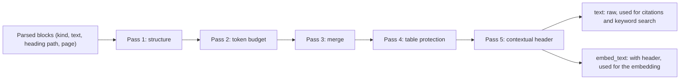

# Retrieval and chunking

**Type:** Explanation · **Audience:** engineers who want to know why documents are cut, searched and ranked the way they are · **Verified against:** `a989287`

**In plain English:** The assistant cannot read a whole document library for each question. Before the question
arrives, the system cuts each document into small pieces called [chunks](../glossary.md). When a question arrives, it
finds the best chunks in two ways at once, joins the two result lists and reorders them with a more careful model. This
page explains why each of these steps exists and what it costs.

## The goal

The answer must come from the company documents and must cite them. That needs two things:

- **Pieces that are the right size.** A piece that is too big hides the useful sentence and wastes the model's context
  window. A piece that is too small loses the meaning around it.
- **A search that does not miss.** Customers write in their own words. Documents use other words. Some questions need
  the exact word, such as an error code. Some need the meaning.

[ADR 0003](../adr/0003-hybrid-chunking.md) records the chunking design. [ADR 0005](../adr/0005-reranker-chain.md) records
the reranker. [ADR 0001](../adr/0001-pgvector-unified-storage.md) records the choice to keep vectors in PostgreSQL.

## Part 1: chunking at ingestion

The worker reads an uploaded document, parses it into blocks and runs the chunker. The parsers keep the structure:
the PDF parser works page by page and records the page number, the Markdown and HTML parsers keep headings, and the CSV
parser turns each row into a block that repeats the header.

Plain splitters cut at a fixed length. They break tables in the middle of a row. They separate a list from its title.
The [HybridChunker](../glossary.md) works in five passes instead. The diagram shows the order. Look for the point where
the text splits into two copies: the raw text for citations and the longer text for embedding.

The same facts in text:

| Pass | What it does | Why |
|---|---|---|
| 1. Structure | Keeps one block for each logical element (paragraph, table, list, code) with its heading path and page. It drops empty blocks. | The structure tells where meaning starts and stops. |
| 2. Token budget | Splits a block that is over `CHUNK_MAX_TOKENS` at sentence boundaries. It splits a single very long sentence by words. It never splits a table here. | A chunk must fit the embedding and the prompt budget. |
| 3. Merge | Joins neighbouring small prose blocks under the same heading while the total stays within the budget. | Tiny chunks lose context. |
| 4. Table protection | Keeps a table whole when it fits. If it does not fit, it splits by rows and repeats the header row in each part. | A row without its header is meaningless. |
| 5. Contextual header | Puts `[Document: <title> \| Section: <breadcrumb>]` before the text that is embedded. The stored text stays raw. | A passage such as "The limit is 5." needs to know what it is about. |

The result has two texts for each chunk. The vector comes from `embed_text`, which has the header. The stored `text`,
the keyword index and the citation use the raw text. The reader of a citation sees the original words and not the
breadcrumb.

The chunk also keeps its heading path and page. These fields make exact citations possible: "Billing FAQ, page 3,
Refunds".

Two optional modes exist and are off by default: `CHUNK_PARENT_CHILD` (large parent chunks with smaller children) and
`CHUNK_SEMANTIC`. The sample `.env.example` keeps both false.

### What the code does differently from the ADR

The honest summary: the five passes are real. Two details differ from the description in the ADR. One setting has no effect.

- **The token counter is an estimate.** The ADR says the exact tokenizer of the model. The worker uses
  `RegexTokenCounter`, which counts words and punctuation marks. The file says this is about 10 to 20 percent above a
  byte-pair count for English. A chunk is therefore a little smaller than the limit. This is safe, and it is not exact.
- **Overlap is not applied.** The setting `CHUNK_OVERLAP_TOKENS` is read and stored in the chunker. No pass uses it.
- **Sentence splitting is a regular expression.** The ADR mentions natural linguistic boundaries. The code splits after
  `.`, `!` and `?` followed by space.

[Known limitations](known-limitations-and-roadmap.md) lists these as gaps.

## Part 2: finding chunks at question time

### Two searches, because each one misses something

The retrieval module runs both searches at the same time for the same tenant.

| Search | How | Good at | Misses |
|---|---|---|---|
| Vector (dense) | The question becomes an embedding. PostgreSQL with pgvector finds the nearest chunk vectors by cosine distance with an HNSW index. | Meaning, paraphrase, other words for the same idea | Exact rare terms, codes and names |
| Keyword (sparse) | PostgreSQL full-text search ranks chunks with `websearch_to_tsquery` and `ts_rank_cd` in the English configuration. An optional ParadeDB BM25 mode exists and falls back to full-text search. | The exact word, a product name, an error code | Synonyms, other languages |

Both searches add the tenant to the query and run inside a [unit of work](../glossary.md). See
[tenant isolation in depth](tenant-isolation-defence-in-depth.md). pgvector filters after an index scan, which can
return too few rows for a selective filter. The retriever turns on `hnsw.iterative_scan` for each query so that the scan
continues until it has enough rows. ADR 0001 explains this.

### Joining the lists with reciprocal rank fusion

The two searches return scores on different scales. A cosine similarity and a text rank cannot be added. The system
joins the **ranks** and not the scores. This method is [RRF](../glossary.md). A chunk scores `1 / (k + rank)` in each
list, and the scores are added. The setting `RETRIEVAL_RRF_K` gives `k` (60 in the sample). A chunk that both searches
rank high wins. A chunk that only one search finds still appears.

If one search fails, the other answers alone. The retriever marks the result as incomplete. An incomplete result is
served once and never stored in the cache. This keeps a short outage from becoming a stale answer for a minute.

### Reordering with a reranker

The first stage is fast and coarse. A [reranker](../glossary.md) reads the question and each candidate together and
gives a better relevance score. It is too slow to run on the whole library, so it runs only on the few candidates.

The setting `RERANKER_CHAIN` lists the rerankers in order. The sample is `cross_encoder,flashrank,none`.

- `cross_encoder` is the most accurate. It needs the optional machine-learning dependencies and works best on a GPU.
- `flashrank` is a small model that runs on a CPU.
- `none` keeps the fused order.

The chain moves to the next member when a member is missing, fails or takes longer than `RERANK_TIMEOUT_MS`. If all fail,
the order from the fusion stays. The heavy models run in a bounded thread pool, so they do not block the event loop.
This design means a machine with no GPU still works. See [ADR 0005](../adr/0005-reranker-chain.md).

### How many chunks

Numbers are small on purpose. The graph node asks for 6 chunks. The rerank node keeps at most 4. The relevance grader
then drops the chunks that do not help. The model sees only a few strong passages. See
[how an answer is made](how-an-answer-is-made.md).

The settings `VECTOR_SEARCH_TOP_K`, `KEYWORD_SEARCH_TOP_K` and `RETRIEVAL_TOP_N` exist in `.env.example`. At this commit
the graph node uses fixed values and does not read the first two. See
[arc42 section 11](../arc42/11-risks-and-technical-debt.md), items D7 and D14.

## Caching and its guard

Repeated questions are common in support. The cache stores query embeddings (1 hour), retrieval results (60 seconds)
and ingestion embeddings (24 hours). Every key holds the tenant. Each tenant has a *corpus version*. A document upload,
re-index or delete replaces it, so old retrieval entries can never be read again. See
[ADR 0015](../adr/0015-caching.md).

## Trade-offs

| Choice | Benefit | Cost |
|---|---|---|
| Five-pass chunking | Whole tables, exact citations, context in each vector | More code than a fixed splitter |
| Header in the embedded text | Better matches for short passages | A longer text to embed |
| Two searches | Fewer misses | Two queries for each question |
| Rank fusion | No score calibration needed | Ignores how much better the top hit is |
| Reranker chain with fallbacks | Works on any hardware | The quality differs by machine, and the active member is visible only in logs |
| PostgreSQL for vectors | One database, one set of isolation rules | A specialised vector store may scale further (ADR 0001) |

## Alternatives that were not chosen

- **A fixed-length splitter.** Simple, and it breaks tables and loses headings. ADR 0003 rejects it.
- **A separate vector database** such as Qdrant. ADR 0001 notes it could give more throughput at a very large scale.
- **Vector search only.** Misses exact terms.
- **Rewriting the question with a model before the search.** The graph has a `rewrite` node, but today it only appends a
  word on a retry. A real rewrite would need a model call. The service class `HybridRetrievalService` can call a
  rewriter, but the graph does not use that class.

## Embeddings and fallbacks: a weak point

The embedding service has a fallback chain: `EMBEDDING_FALLBACK_CHAIN` lists `openai` and then `sentence_transformers` in
the sample. A fallback model makes vectors in another space. The code pads or cuts them to the column size, which
`DimensionProjector` does. A question vector from a fallback model is then compared with corpus vectors from the first
model. The result is poor. The cache never stores a fallback vector, so the error does not spread.

When the first provider fails and the optional `[ml]` extra is not installed, the local model cannot load. The
question embedding then fails. The hybrid retriever continues with the keyword search alone. The project lists this as an
open item: embeddings are unavailable inside the container in that case. Unverified: this page did not run the container
to see the exact behaviour.

## Related pages

- [How an answer is made](how-an-answer-is-made.md)
- [Provider abstraction and fallbacks](provider-abstraction-and-fallbacks.md)
- [Configuration reference](../reference/configuration.md)
- [C4 components of ingestion](../c4/05-components-ingestion.md)
- [Manage the knowledge base](../how-to/manage-the-knowledge-base.md)
- [Glossary](../glossary.md)
