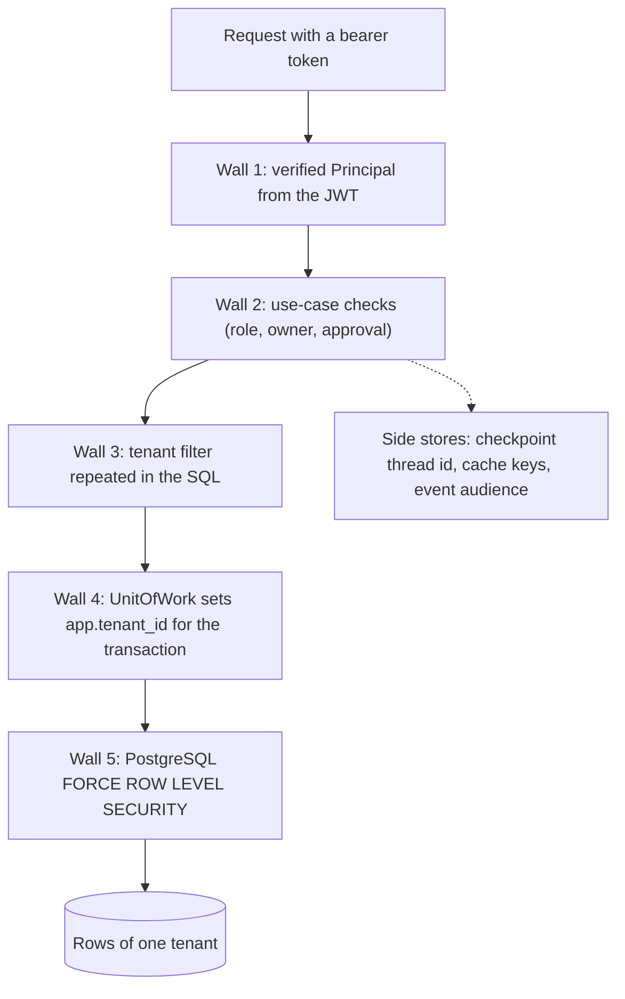

# Tenant isolation in depth

**Type:** Explanation · **Audience:** engineers, security reviewers and operators who ask "how does one customer never see the data of another?" · **Verified against:** `a989287`

**In plain English:** RagAssist serves many customers from one database. Each customer is a [tenant](../glossary.md).
The system does not trust one wall to keep them apart. It builds five walls, one behind the other. Each wall
catches the mistakes that the wall before it can miss. This page explains each wall, what it stops and how the tests
prove it.

## The problem

A multi-tenant assistant has one dangerous failure: tenant A reads a row of tenant B. The cause is rarely an attack.
Usually a developer forgets a `WHERE tenant_id = ...` clause, or a model produces an argument that names another
tenant. One missing filter in one query is enough. [ADR 0002](../adr/0002-row-level-security.md) records this reasoning
and picks the answer: defence in depth. The rule is that no single check carries the whole load.

## The five walls

The diagram shows the path of one request from the top to the data. Look for two facts. First, a request must pass
every wall to reach a row. Second, the side stores (checkpoints, cache, events) have their own guard because the
database policies do not cover them all.

The same facts in text:

| Wall | Where it lives | The rule |
|---|---|---|
| 1. Principal | `src/ragassist/shared/security/jwt.py` | The tenant, the user and the role come only from the verified token. |
| 2. Use-case checks | `src/ragassist/modules/assistant/application/access.py` and the use cases | A person sees only what the role and the owner rule allow. |
| 3. Query filter | The retrievers and the stores | The SQL names the tenant even though the database also enforces it. |
| 4. Unit of work | `src/ragassist/shared/db/uow.py` and `shared/db/scoped.py` | Every query runs inside a transaction that carries the tenant. |
| 5. Row-level security | `migrations/versions/0001_initial_schema.py` and `0002_accounts_sessions_invites.py` | The database hides rows that belong to another tenant, even from a buggy query. |

## Wall 1: the verified Principal

The [Principal](../glossary.md) is a small frozen object with the user id, the tenant id, the role and the raw token. The
function `decode_access_token` builds it. It checks the signature with the `SECRET_KEY` and the algorithm in
`JWT_ALGORITHM`. It requires the claims `exp`, `sub` and `tenant_id`. A token without a role gets the lowest role, `user`.

The rule in `AGENTS.md` section 1.3 says that nothing else may supply these three values. This is the most
important rule against prompt injection. A model can write any text. It cannot change the Principal. The action tools
take the Principal as their first argument, and the argument schema holds no tenant field. See
[approvals and actions](approvals-and-actions.md).

When the assistant calls the mock SaaS, the runtime mints a new token for the verified user on each call (the lifetime
comes from `JWT_ACCESS_TOKEN_EXPIRE_MINUTES`). The mock SaaS reads the tenant from that token. It does not trust the
request body.

**Trade-off.** The token is symmetric (HS256). Every service that verifies it holds the same `SECRET_KEY`. Anyone who
holds the key can create a token for any tenant. The check in `get_current_principal` also reads no database row. A
disabled user keeps a valid token until it expires. [ADR 0007](../adr/0007-accounts-and-sessions.md) accepts this and
keeps the lifetime short (`AUTH_ACCESS_TOKEN_MINUTES`). See [arc42 section 11](../arc42/11-risks-and-technical-debt.md),
risk R1.

## Wall 2: use-case checks inside the tenant

Row-level security separates tenants. It does not separate users of one tenant. A plain user must not read the chat of
a colleague. The module `access.py` holds the rule. A user sees their own conversations. An agent or an admin sees the
conversations of the tenant. A conversation without a recorded owner is open to staff only. Another user's conversation
answers `404`, the same as a conversation that does not exist, so the answer does not confirm that it exists.

Approvals follow the same style. Only the owner or an admin decides on a pending action, and the decision must name the
interrupt that the checkpoint is waiting on. [ADR 0006](../adr/0006-conversation-access-and-approval-binding.md)
has the formal decision.

## Wall 3: the filter in the SQL

The vector and the keyword retrievers add `(tenant_id = :tenant_id OR tenant_id IS NULL)` to their queries. The chunk
reader does the same. The database would enforce the rule anyway. The filter is a second opinion. When a developer
removes the filter by mistake, the wall behind it still holds.

The clause `tenant_id IS NULL` is deliberate. A row with no tenant is a global row, for example shared product
knowledge. Every tenant may read it. A tenant cannot write it. Unverified: no code in `src/` creates a global row at this commit. The `seed` command inserts demo tenants and users only.

## Wall 4: the unit of work

The [unit of work](../glossary.md) is the code block that opens a transaction and sets the tenant before the first
query. The code calls `set_config('app.tenant_id', <id>, true)`. The last argument `true` makes the setting local to
the transaction. It is the function form of `SET LOCAL`. The database forgets the value at commit or rollback.

This detail matters for pooled connections. The pool hands one connection to many requests over time. A session-wide
setting would leak from one tenant to the next. A transaction-local setting cannot.

Two guards sit inside this wall:

- `UnitOfWork` refuses a session that already has an open transaction. Joining it would run this tenant's context on
  work that may belong to another tenant. The code raises `TenantIsolationError` instead.
- `ScopedDatabase` refuses a transaction that spans two tenants. It also gives the repositories one primitive, `scope`,
  so a repository cannot open a session without a tenant.

When no tenant is given, the code sets an empty value. The policies then see a null tenant and match no tenant row.

## Wall 5: row-level security

Every tenant table has row-level security switched on and forced. The migrations create one policy for each table.
The policy compares `tenant_id` with `NULLIF(current_setting('app.tenant_id', true), '')::uuid`. The same expression is
used for the `WITH CHECK` part, so a tenant also cannot write or move a row into another tenant.

Three details make the wall strong:

- **The application role is weak on purpose.** The script `infra/postgres/create-app-role.sh` creates it with
  `NOSUPERUSER NOBYPASSRLS`. It does not own the tables.
- **`FORCE` binds the owner too.** Without it, the table owner would skip the policies. The migrations run under the
  admin URL, and the running application does not.
- **A bad value fails closed.** An empty value matches no row. A value that is not a UUID makes the cast fail, and the
  statement raises an error. Neither case returns rows.

Two policies are exceptions by design. Both are small and both are recorded:

- `documents` and `chunks` have a read policy that also allows `tenant_id IS NULL` (global rows).
- `tenants` has an extra read policy, `tenants_slug_lookup`. It exposes only the row whose slug equals the
  transaction-local setting `app.tenant_slug`. Sign-in needs it because the tenant is not known before the person types
  the workspace slug. The ADR rejected a `SECURITY DEFINER` function, because forced row-level security would bind the
  function owner too and the function would add a privileged code path.

## The stores that RLS does not cover

Three stores hold tenant data outside the policies. Each has its own rule.

**The LangGraph checkpoint.** The checkpointer creates its own tables. They have no row-level security. The migration
says so in its docstring. The guard is the thread id. It has the form `{tenant_id}:{conversation_id}`, so two tenants
cannot collide on one thread. The router also loads the conversation for the tenant, and applies the owner rule, before
it reads or resumes a checkpoint. With the Postgres runtime, the checkpoint holds the Principal without its raw token, so no credential lands in
plain text in the database. The module `thread_guard.py` has helpers for this. The router builds the id inline and does
not call them. See [arc42 section 11](../arc42/11-risks-and-technical-debt.md), item D9.

**The cache.** Every key contains the tenant id, and the role when the result depends on who asks. The variable part
is a keyed hash. [ADR 0015](../adr/0015-caching.md) explains the rule. In short, a cache that crosses a tenant is worse
than no cache.

**The live events.** An event carries only a type and ids. The hub filters by tenant first and by audience second. The
client refetches through the normal API, which enforces the walls again. See
[human handoff and live events](human-handoff-and-live-events.md).

## What each wall stops

| Failure | Wall that stops it |
|---|---|
| A forged or edited token | 1 (signature check) |
| A model that names another tenant in a tool argument | 1 (the schema has no tenant field and the Principal fills it) |
| A user who opens a colleague's chat by guessing its id | 2 (`404`) |
| A developer who forgets the tenant filter in a new query | 4 and 5 (the unit of work and the policy) |
| A developer who forgets to use a unit of work | 5 (no tenant set means no rows) |
| A pooled connection that keeps the last tenant | 4 (the setting is transaction-local) |
| An update that moves a row to another tenant | 5 (`WITH CHECK`) |
| A mistake in a repository that runs as the table owner | 5 (`FORCE`) |
| A checkpoint read for a conversation of another tenant | The namespaced thread id and the conversation check |

## What the walls do not stop

- A stolen signing key. Rotate it and treat old tokens as lost.
- A valid token after a disable. It works until it expires.
- A person in the same tenant with the right role. The walls separate tenants, and the role rules separate people.
- Text that goes to a model provider or to a trace service. Isolation is about stored rows. See
  [observability and privacy](observability-and-privacy.md).

## How the tests prove it

The project treats isolation as a measured property. The tests sit in several tiers. See
[testing strategy](testing-strategy.md) for the tiers.

| Test | What it proves |
|---|---|
| `tests/integration/test_rls_and_uow.py` | On a real PostgreSQL, for the tables that the ORM knows (`tenants` and `users`): a tenant selects only its rows, counts only its rows, sees nothing without a context and sees nothing for a garbage value. It cannot move, update or delete rows of another tenant. Pooled connections do not leak the tenant. The application role is not privileged. Row-level security is forced. |
| `tests/integration/test_identity_postgres.py` | Sessions and invites are visible only inside their tenant. The slug policy resolves one workspace and cannot list workspaces. The slug setting does not outlive its transaction. |
| `tests/integration/test_conversation_store_postgres.py`, `test_chunk_repository_postgres.py`, `test_retrieval_postgres.py` | The conversation store, the chunk reader and both retrievers return nothing from another tenant. Global rows stay visible. |
| `tests/security/test_leak_gate.py` | Each scenario plants a canary string in tenant A and reads everything that tenant B can observe. The gate fails the build on any leak. The target is zero. |
| `tests/security/test_cache_isolation.py` and `test_event_isolation.py` | No cache hit crosses a tenant or a role. No event reaches another tenant or another user. |
| `tests/security/test_route_auth_sweep.py` | Routes refuse bad credentials. |
| `tests/unit/shared/test_uow.py` | The unit of work commits, rolls back, and refuses an open transaction. |

Unverified: the generic table matrix covers only `tenants` and `users`. The other tenant tables rely on the store-level
tests above. This page did not check whether those tests prove forced row-level security for every one of them.

## Alternatives that were not chosen

- **Application filters only.** Cheap, and one missing clause leaks data. ADR 0002 rejects it.
- **One database or one schema for each tenant.** Strong separation, but migrations, pools and vector indexes multiply.
  No ADR compares it. This is an analysis and not a recorded decision.
- **A separate vector store.** [ADR 0001](../adr/0001-pgvector-unified-storage.md) keeps vectors in PostgreSQL. The
  same policies then protect the vectors. A second store would need its own isolation.

## Related pages

- [Why a modular monolith](why-a-modular-monolith.md)
- [Accounts, sessions and tokens](accounts-sessions-and-tokens.md)
- [Security controls reference](../reference/security-controls.md)
- [Data model reference](../reference/data-model.md)
- [arc42 section 8, cross-cutting concepts](../arc42/08-crosscutting-concepts.md)
- [Glossary](../glossary.md)
