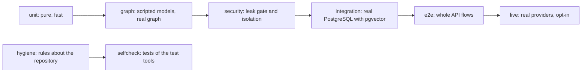

# Testing strategy

**Type:** Explanation · **Audience:** engineers and testers who want to know how the test suite is organised and what a green run proves · **Verified against:** `a989287`

**In plain English:** The test suite is more than a pile of checks. It has tiers that run at different cost. It has
fake models that make graph tests repeatable. It has rules about the repository itself, such as "no secret in the tree".
And it has tests that test the tests. This page explains the design and says what a green run does and does not prove.

## The goal

The project is a multi-tenant system with a language model in the middle. Two risks dominate: a data leak between tenants
and an assistant that misbehaves in ways that no assert on a string can catch. The suite answers the first with
database-backed tests and a leak gate. It answers the second with scripted models and checked paths. The owner of the
tests is a tester who works apart from the team that writes the features. That is why the tests stand on contracts and
specs and not on the implementation.

## The tiers

The diagram shows the tiers by cost. Look for the line between tests that need nothing and tests that need a database or a
provider key.

The counts below are test definitions in the source at this commit. A parametrised test runs more than once, so the
number of cases differs.

| Tier | Folder | Files | Tests | What it checks |
|---|---|---|---|---|
| Unit | `tests/unit/` | 92 | 1129 | Functions and use cases, with fakes |
| Graph | `tests/graph/` | 11 | 79 | Each path of the assistant graph with scripted models |
| Security | `tests/security/` | 12 | 128 | Leak gate, cache and event isolation, route auth sweep |
| Integration | `tests/integration/` | 7 | 76 | Real PostgreSQL: row-level security, stores, retrievers |
| End to end | `tests/e2e/` | 4 | 146 | API flows through the application |
| Hygiene | `tests/hygiene/` | 12 | 132 | Rules about the repository |
| Self-check | `tests/selfcheck/` | 3 | 31 | The test tools themselves |
| Live | `tests/live/` | 2 | 9 | Real providers. Opt-in. |

Markers in `pyproject.toml` name the tiers. The [run the tests how-to](../how-to/run-the-tests.md) shows the commands. The
project rule is to run the tests that relate to a change and let CI run the full suite.

## Fakes, contracts and specs

Three ideas give the suite its shape.

**Fakes, not mocks.** `tests/fakes/` holds working in-memory versions of the ports: the chat model, the decider, the
stores, the embeddings, the reranker. A *scripted* model returns the replies a test writes in advance. A graph test can then walk the router
down any path: safe or unsafe, no passage, two failed groundings, an approval. The graph is real, and the models are
fakes. See [how an answer is made](how-an-answer-is-made.md).

**Contract suites.** `tests/support/contracts/` has one suite for each port. A new adapter inherits the suite in a few
lines, and the fake runs the same suite. If the fake and the real adapter differ, a contract test fails. This stops the
fake from drifting into a comfortable lie. The test `tests/selfcheck/test_contract_teeth.py` plants broken adapters and
checks that the contract catches them.

**A spec map.** `tests/support/specs/map.py` links each requirement to tests. An entry can be marked `PENDING` (the
feature is not there yet) or `DRIFT` (code and spec disagree). With `RAGASSIST_STRICT_PENDING=1`, which CI sets, a pending
entry whose test starts to pass fails the run, so the map cannot go stale.

## The leak gate

The tenant-isolation tests live in two places. The integration tests prove the database rules on a real PostgreSQL.
The security tests prove the application behaviour. The central test is `tests/security/test_leak_gate.py`: each
scenario plants a canary string in tenant A, then reads everything that tenant B can observe. Any hit fails the build. A self-test
proves that the detector does fail on a planted leak. A scenario whose code is not written yet is skipped and listed in a
pending report. The target is zero. See
[tenant isolation in depth](tenant-isolation-defence-in-depth.md) for the table of what each test proves, including the
limit that the generic matrix covers only `tenants` and `users`.

## Rules about the repository

The hygiene tier turns written rules into checks. This keeps `AGENTS.md` from decaying into advice.

| Test | Rule it enforces |
|---|---|
| `test_architecture` | Layer borders, using an AST checker. It first proves the checker on a planted violation. |
| `test_env_example` | `.env.example` matches `settings.py` |
| `test_no_leaked_defaults` | No credential-shaped defaults in settings |
| `test_no_secrets_committed` | No secret in the tree |
| `test_repo_files` | `.gitignore`, `.dockerignore` and line-ending files stay in sync |
| `test_web_delivery` | The web container and nginx rules |
| `test_no_tautological_tests` | A test must be able to fail |
| `test_quality_gates` | CI contains the gates that the docs promise |
| `test_defect_registry`, `test_spec_map`, `test_testing_doc` | The test bookkeeping stays honest |
| `test_mock_saas_is_standalone` | The mock SaaS imports nothing from the main package |

The secret rule has four layers: git hooks, CI, a hygiene test and the server-side scanner of the host. See
[rotate secrets and use secret guards](../how-to/rotate-secrets-and-use-secret-guards.md).

## Tests of the tests

A test that cannot fail is worse than no test. The suite includes several guards:

- The architecture checker is run against a planted bad import before it checks the real tree.
- The contract suites have a "teeth" test.
- `test_no_tautological_tests` looks for tests that assert nothing real.
- A network guard in the root `conftest.py` blocks outbound network calls in tests. A test that needs the network must say so
  with `@pytest.mark.network`.

## Live tests and the injection corpus

Live tests call real providers. They run only with `--run-live` and `RAGASSIST_LIVE_*` settings, so a normal run never
spends money. The prompt-injection corpus runs on the `rules` decider with floors for detection, and a live test holds a
model-backed decider to a floor of 0.95. See [the decision layer](the-decision-layer.md). The floors are measured on a
fixed corpus. They are not a promise about unseen attacks.

## The defect registry

The tester keeps a registry, `DEFECTS` in `tests/support/defects.py`. A test that asserts the specified behaviour, but fails against today's code, carries
the `@defect("DEFECT-nn")` marker. This is a strict expected failure with a reason. When the team fixes the bug, the test
passes unexpectedly, and strict mode turns that into a failure, which tells the tester to remove the marker.
At this commit the registry is **empty**. The baseline in `docs/testing.md` (70 expected failures, 1903 passed, dated
2026-11-09) is therefore out of date. See [testing](../testing.md) and
[known limitations](known-limitations-and-roadmap.md).

## CI

The workflow in `.github/workflows/ci.yml` runs, in order, the secret scan, then the blocking lint of tests and scripts
(`ruff check tests scripts`) and the layer lint (`lint-imports`). Lint and type checks on `src` are advisory. The unit
tier and the integration tier (with a real pgvector PostgreSQL) run next. Coverage is measured, and its gate is advisory:
the measured value was 82.4 percent against a minimum of 85. A nightly job runs a flake check. The frontend job is
suspended unless `RUN_FRONTEND_CI` is `true`. See [CI and quality gates](../reference/ci-and-quality-gates.md).

## What a green run proves

- The layer borders hold, the checker works, and the contracts bite.
- A tenant cannot read another tenant's rows through the paths that the tests cover.
- Each graph path behaves as scripted when the models behave as scripted.
- No secret-shaped text is in the tree.

## What a green run does not prove

- **That real models behave well.** Scripted models test the plumbing. Quality needs live tests and human review.
- **That the evals show quality.** `python -m evals.runner --offline` is a deterministic *simulation*. Some cases get
  hard-coded perfect scores, and others get scores computed from gold labels. The perfect scores in
  `evals/reports/eval_summary.md` are not evidence of real quality.
- **That the real stack works end to end.** A smoke run on the real stack with the new web app is still open. The
  frontend end-to-end tests use a mocked API.
- **That the frontend job ran.** It is suspended by default.
- **That every table has a forced-RLS proof.** The generic matrix covers two tables.

## Trade-offs

| Choice | Benefit | Cost |
|---|---|---|
| Fakes with contracts | Fast, repeatable graph tests | The contracts must be kept up to date |
| A leak gate with canaries | Measures the property that matters most | Each new surface needs a scenario |
| Repository rules as tests | Rules cannot decay | The hygiene tier needs care when files move |
| Opt-in live tests | No surprise cost | Provider regressions show up late |
| Separate tester and implementers | Independent view | A defect registry and a spec map to keep |

## Alternatives not chosen

- **Mock libraries on each call.** Fast to write and tied to the implementation. Fakes with contracts survive refactors.
- **Live models in every run.** Realistic and costly, and the results vary.
- **Coverage as the main goal.** A number is easy to game. The project keeps the gate advisory and relies on the
  property tests.

## Related pages

- [Run the tests](../how-to/run-the-tests.md)
- [Testing](../testing.md)
- [CI and quality gates](../reference/ci-and-quality-gates.md)
- [Tenant isolation in depth](tenant-isolation-defence-in-depth.md)
- [Why a modular monolith](why-a-modular-monolith.md)
- [Glossary](../glossary.md)
