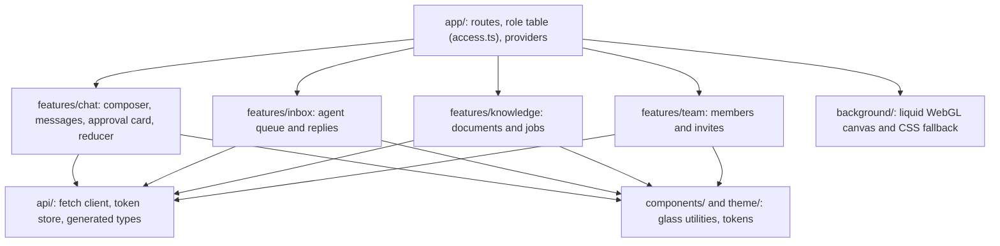

# The web app and its design system

**Type:** Explanation · **Audience:** frontend engineers and designers who want to know why the web app is built this way · **Verified against:** `a989287`

**In plain English:** The web app is a single-page React application. It talks to the same API as any other client. It
keeps its token in memory, reads the answer stream with plain `fetch`, and looks like frosted glass over a calm
monochrome background. This page explains the choices behind the structure, the streaming state machine and the look.

## The goal

Three people use the app: a customer who chats, a support agent who works an inbox, and an admin who manages documents and
the team. Each needs only a few screens. The app must feel fast while an answer streams, stay readable on any
background and keep working when the live-event stream drops. The decisions are in [ADR 0009](../adr/0009-web-app.md),
[ADR 0010](../adr/0010-chat-ui.md), [ADR 0011](../adr/0011-admin-screens.md), [ADR 0014](../adr/0014-web-delivery.md) and
[ADR 0016](../adr/0016-liquid-redesign.md).

## How it is delivered

The browser loads the app and the API from the **same origin**. An nginx container (the unprivileged image) serves the
built files and forwards the API paths to the backend. Three consequences follow ([ADR 0014](../adr/0014-web-delivery.md)):

- No cross-origin setup is needed for the app itself.
- The `SameSite=Strict` refresh cookie works. See [accounts, sessions and tokens](accounts-sessions-and-tokens.md).
- Security headers come from one place. The content security policy still allows `style-src 'unsafe-inline'`, an open item
  (risk R11) because of inline styles.

[Deploy the web container](../how-to/deploy-the-web-container.md) shows the steps.

## Structure in one picture

The diagram shows the layers of the frontend. Look for the shape: each feature uses the shared `api` and component
layers, and the `app` layer ties the features together. The diagram is simplified. The source also has `auth`, `events`,
`pages` and `lib` folders.

The same facts in text: `app/` holds the routes and one role table. Each feature folder owns its screens. All of them
use the `api/` client and the shared UI. The [frontend structure reference](../reference/frontend-structure.md) lists the
folders.

### One role table

The file `app/access.ts` is the single place that says which role sees which screen. Chat is open to every role. The inbox
is for agents and admins. Knowledge and Team are for admins. Routes and the navigation both read this table, so a screen
cannot appear in the menu and stay unguarded, or the other way round. The server still enforces the rules. The table only
shapes the interface. See [roles and permissions](../reference/roles-and-permissions.md).

## Streaming: a pure reducer

The answer arrives as server-sent events over `fetch`. The browser `EventSource` cannot send an `Authorization` header, so
the app reads the response body itself and parses frames with the `eventsource-parser` library.

The chat state lives in a **pure reducer**, `features/chat/turn.ts`. It takes the current state and one event and returns
the next state. It has five phases: `idle`, `streaming`, `interrupted` (an approval is pending), `deciding` (the
decision is sent) and `settled`. A pure function is easy to test: the unit tests feed it event lists and check the
result. See the [SSE contract](../api/sse-contract.md) for the events.

Token events arrive faster than a screen can paint. A **frame batcher** collects tokens and applies them once for each
animation frame. The page then renders at most 60 times a second, however fast the model writes.

Three behaviours follow from the contract:

- A `reset` event clears the partial answer, because the server regenerates after a failed grounding check.
- An `interrupt` event stores the pending approval. When `done` arrives with the status `interrupted`, the phase becomes
  `interrupted` and the composer locks. The approval card posts only the decision.
  See [approvals and actions](approvals-and-actions.md).
- After a reload, a pending approval card is gone. The app rebuilds from stored messages and not from the checkpoint. This is
  an accepted gap in ADR 0010.

## Live updates

A second stream (`/v1/events`) tells the app when to refetch. The app uses TanStack Query and invalidates the matching
queries on each event. After a reconnect it invalidates everything. See
[human handoff and live events](human-handoff-and-live-events.md).

## The design system

The look is called *liquid glass*. The design tokens and utilities live in `frontend/src/index.css`.

| Part | What it is | Why |
|---|---|---|
| Tokens | Monochrome colours in `oklch` with zero chroma | One neutral base. Contrast is easy to reason about. |
| Glass utilities | `glass-thin`, `glass-regular`, `glass-thick` with blur of 10, 24 and 40 px | Three depths for chrome, cards and dialogs |
| Per-theme fills | Different fill and brightness for light and dark | Text stays readable in both |
| Solid fallbacks | Used under `@supports` checks and `prefers-reduced-transparency` | A browser or user without blur still gets a solid surface |
| Row styles | `row-hover`, `row-selected`, `sticky-glass` | Clear selection in tables and headers |
| Background | A WebGL liquid canvas under `src/background/`, and a CSS `.ambient` fallback | Calm movement. A static fallback when WebGL is not available |
| Fonts | Geist Sans and Geist Mono, plus Instrument Serif for display text. All self-hosted in `public/fonts`. | No third-party font request |

### The brightness budget

Frosted glass is only readable when the background stays within a known brightness range. The file `liquid-config.ts`
sets a brightness **budget** for the liquid background. A test, `src/theme/contrast.test.ts`, takes the budget and checks
the text contrast against the worst case. A designer who makes the background brighter breaks the test and not the
readability. This is the main reason to prefer a budget to a promise.

### Accessibility

- The solid fallback for `prefers-reduced-transparency` removes blur.
- The background has a static fallback and respects the reduced-motion preference.
- Unverified: this page did not run a full audit of keyboard order or screen-reader labels. The end-to-end tests check
  main flows only.

## Tests

The frontend has 23 unit test files (Vitest) and 12 end-to-end spec files (Playwright) in `frontend/tests/e2e`. The end-to-end
tests run against a **mocked API**, not the real stack. The CI job for the frontend is suspended unless the repository
variable `RUN_FRONTEND_CI` is `true`. See [testing strategy](testing-strategy.md) and
[CI and quality gates](../reference/ci-and-quality-gates.md).

## Trade-offs

| Choice | Benefit | Cost |
|---|---|---|
| Token in memory | Scripts cannot copy it from storage | A reload needs a refresh call |
| `fetch` stream, not `EventSource` | Can send headers | More code for parsing and retry |
| Pure reducer | Easy to test, few bugs | Events must be modelled up front |
| Same-origin nginx | Simple cookies and headers | The API and the app deploy together |
| Glass over a WebGL canvas | A distinct look | GPU cost. Needs the budget test and fallbacks |
| Mocked end-to-end tests | Fast and stable | They do not prove the real stack works |

## Alternatives not chosen

- **A server-rendered framework.** The app sits behind sign-in and talks to an existing API. ADR 0009 saw no gain.
- **`localStorage` for tokens.** Readable by any script. See the accounts page.
- **A WebSocket.** The product needs one-way events only.
- **An opaque, flat theme.** Simpler and safer for contrast. The team chose the glass look and added a budget test and
  fallbacks to control the risk.

## Open items

These items are open at this commit. [Known limitations and roadmap](known-limitations-and-roadmap.md) repeats them.

- **No real-stack smoke run** of the redesigned pages. The mocked end-to-end tests pass. A run against the live stack is
  still owed.
- **The logo is not chosen.** Three concepts sit in `docs/frontend/logo-concepts/`.
- **Performance numbers** for the new pages and for real low-end devices are not measured.
- **Tuning left:** `staleTime` and prefetching for queries.
- **Dropped for now:** the refraction effect and the edge fade.
- **No list virtualisation.** Long tables render every row.
- **CSP `style-src 'unsafe-inline'`** stays (risk R11).
- **The per-user event cap** is per process when Redis serves the cache.

A documentation mismatch: ADR 0016 names the display font as Geist Serif. The code and `package.json` use Instrument Serif,
and ADR 0009 also says Instrument Serif. This page follows the code.

## Related pages

- [Frontend structure reference](../reference/frontend-structure.md)
- [Develop the frontend](../how-to/develop-the-frontend.md)
- [C4 components of the web app](../c4/06-components-web-app.md)
- [Frontend TODO](../frontend/TODO.md)
- [Glossary](../glossary.md)
