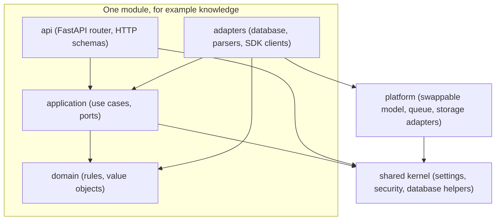

# Why a modular monolith

**Type:** Explanation · **Audience:** engineers and reviewers who want to know why the code has this shape · **Verified against:** `a989287`

**In plain English:** RagAssist is one program, not many small services. Inside, it is cut into modules with strict
borders and into layers that point inward. This page explains why that shape fits the product, how tests enforce it
and what the team did not choose.

## The short answer

RagAssist runs as one API process and one worker process. Both come from the same Python package, `ragassist`. The code
inside the package is not a pile of files. It has two kinds of border:

- **Vertical borders** between feature areas. Each area is a [module](../glossary.md#terms) (a bounded context).
- **Horizontal borders** between layers inside a module. The rule is that dependencies point inward.

The result is a [modular monolith](../glossary.md#terms) with a [hexagonal](../glossary.md#terms) layout. You get most
of the benefit of separate services (clear ownership, small interfaces) without the cost of a network between them.

## What the layout looks like

The diagram shows the dependency direction. An arrow means "may import". Look for two facts. First, nothing points out of
`domain`. Second, `adapters` and `api` both point at `application`, never the other way.

The same facts in text:

- `domain` imports no other layer of its module and no framework or SDK.
- `application` imports `domain`, the `shared` kernel and the public surface of `platform` (its `ports` and `service`
  modules). It never imports its own `adapters` or `api`.
- `adapters` implement the ports. `api` calls `application` through dependency injection.
- `shared` imports neither `modules` nor `platform`. `platform` never imports `modules`.

## The modules

The package has six modules in `src/ragassist/modules/`:

| Module | Job |
|---|---|
| `identity` | Sign-in, sessions, invites, team management |
| `knowledge` | Upload, parse, chunk, embed and index documents |
| `retrieval` | Hybrid search and passage lookup |
| `assistant` | Conversations, the graph, streaming, approvals |
| `actions` | Tools that act on a customer account |
| `escalation` | Tickets, agent replies, resolve |

Next to the modules sit the `platform` layer and the `shared` kernel. The `platform` layer holds the parts that change
with the market: model providers, embeddings, rerankers, deciders, the queue, the object store, the event bus and the
cache. The `shared` kernel holds what every layer needs, such as settings, the JWT principal and the database helpers.

## Why not many services

No ADR records a comparison with microservices. The points below are an analysis of the product, not a recorded decision.

**One database does a lot of work.** [ADR 0001](../adr/0001-pgvector-unified-storage.md) puts documents, vectors,
conversations, audit rows and LangGraph checkpoints in one PostgreSQL. [ADR 0002](../adr/0002-row-level-security.md) then
uses row-level security as the last wall between tenants. A split into services would split the data too. Each service
would need its own copy of the tenant rules. One database, one set of policies, is easier to get right.

**Most calls are local.** A turn passes through a guard, a router, retrieval, a reranker, a grader, a generator and a
grounding check. In one process these are function calls. Across services each step would add a network hop, a timeout
and a partial-failure case. The turn already has enough of those from the model providers.

**One team can hold it in mind.** The code base is small enough for one team. Separate deployments would add pipelines,
versioned contracts and distributed tracing. The product does not need them yet.

**The worker shows the escape route.** The ingestion worker is already a second process. It runs the same code as the
API, but it reads from a queue. This is the pattern a future split would follow. A module that talks to the rest only
through ports and events can leave the process later without a rewrite.

## Why layers that point inward

The hexagonal rule has one purpose: protect the rules of the business from the tools around them.

- **Tools change faster than rules.** The project already supports five model providers and three embedding providers,
  and it has six decider adapters. See [provider abstraction and fallbacks](provider-abstraction-and-fallbacks.md).
  When a provider changes, only an adapter changes.
- **Tests get cheap.** A use case that depends on a `Protocol` runs in a unit test with a fake. The repository keeps
  fakes in `tests/fakes/` and contract suites for nine ports in `tests/support/contracts/`. A new adapter inherits the
  contract with a few lines.
- **Security rules stay in one place.** Tenant and role checks live in `application` and in the shared kernel. An
  adapter cannot skip them by accident, because the use case calls the adapter and not the other way round.

## How tests enforce the borders

A rule that only lives in a document decays. RagAssist turns the rules of `AGENTS.md` section 1 into tests.

- **A layering checker** in `tests/support/architecture.py` reads every Python file with the `ast` module. It does not
  import or run the code. It reports eight kinds of violation, for example `domain-no-frameworks`,
  `application-points-inward`, `module-isolation`, `kernel-independence` and `platform-below-modules`.
- **The checker is tested first.** `tests/hygiene/test_architecture.py` plants a bad import in a temporary tree and
  checks that the checker catches it. Only then does it run the checker on `src/`. A green result therefore means
  something.
- **One `import-linter` contract** in `pyproject.toml` forbids the domain packages from importing `ragassist.main` and
  `ragassist.container`. CI runs `lint-imports`, and a hygiene test checks that CI does so.

At commit `a989287` the checker reports no violation on the source tree. The documentation team confirmed this by running
the checker function against `src/`.

## What the layout does not give you

Be honest about the limits:

- **The `import-linter` contract is narrow.** `AGENTS.md` says that `import-linter` enforces the inward rule. In fact
  the full rule set lives in the hygiene test. The contract in `pyproject.toml` covers a small part.
- **Two modules depend on each other.** The `assistant` router calls the `escalation` use case. The `escalation` router
  imports the conversation store of `assistant`. Both imports go to `application`, so the checker allows them. They still
  form a cycle between two bounded contexts. See [arc42 section 11](../arc42/11-risks-and-technical-debt.md), risk R9.
- **Some rules are only promised.** `AGENTS.md` asks that CPU-bound work runs in the bounded executor. Some of it does
  not yet (the PDF parser, the chunker and the token counter run inline). See
  [known limitations and roadmap](known-limitations-and-roadmap.md).
- **A monolith shares fate.** A memory leak or a crash in one module hurts all modules of that process. The worker is
  separate, so a heavy ingestion job does not slow the chat API.

## What was considered and rejected elsewhere

The ADRs do record several smaller choices against alternatives. They show the same habit: prefer the simpler tool that
the product already has.

| Alternative | Rejected for | Source |
|---|---|---|
| A separate vector database such as Qdrant | One more system to run and to isolate. PostgreSQL with pgvector is enough at this scale. | [ADR 0001](../adr/0001-pgvector-unified-storage.md) |
| A message broker for live events | The database is already shared by the API and the worker, so `LISTEN`/`NOTIFY` is enough. | [ADR 0008](../adr/0008-live-events-handoff-and-detached-turns.md) |
| A `SECURITY DEFINER` function for slug lookup | Forced row-level security still binds the function owner. It would add a privileged code path. | [ADR 0007](../adr/0007-accounts-and-sessions.md) |
| A server-rendered web framework | The whole app sits behind sign-in and talks to an existing API. | [ADR 0009](../adr/0009-web-app.md) |
| A second Gemini SDK | It would add a dependency and a second tool-calling path. | [ADR 0013](../adr/0013-gemini-provider.md) |

## When to split

A split becomes sensible when one of these facts is true. This is advice and not a plan.

- One module needs a different scaling profile, for example retrieval under heavy load.
- A team owns a module and needs its own release rhythm.
- A module needs a different trust boundary, for example the actions that call customer systems.

The borders make that possible. Keep them clean, and the cost of a split stays low.

## Related pages

- [Tenant isolation in depth](tenant-isolation-defence-in-depth.md)
- [Ports and adapters reference](../reference/ports-and-adapters.md)
- [arc42 section 5, building blocks](../arc42/05-building-block-view.md)
- [C4 containers](../c4/02-containers.md)
- [Glossary](../glossary.md)
