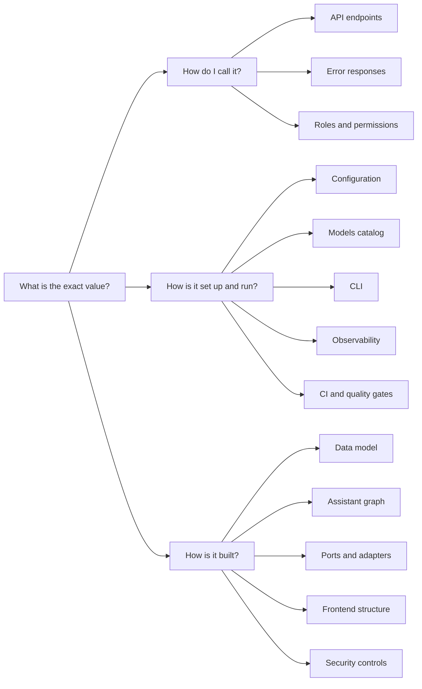

# Reference

**Type:** Reference · **Audience:** anyone who needs to look up a fact about RagAssist · **Verified against:** `a989287`

**In plain English:** This folder holds the reference pages. A reference page is dry and complete. It lists facts in
tables and does not teach or argue. Each page below answers one kind of "what is the exact value?" question. If you
want to learn by doing, go to the [tutorials](../tutorials/01-run-the-stack-locally.md). If you want to finish a task,
go to the [how-to guides](../how-to/troubleshoot-common-problems.md). If you want to know why, go to the
[explanations](../explanation/why-a-modular-monolith.md).

## The pages

### The API and its rules

| Page | What it lists |
|---|---|
| [API endpoints](api-endpoints.md) | Every HTTP route: method, path, who may call it, the request, the answer and the status codes. It also compares the code with `docs/api/openapi.json`. |
| [Error responses](error-responses.md) | The error body shapes, every status code and message, the 401 versus 403 versus 404 rules, validation errors, rate limiting and `429`. |
| [Roles and permissions](roles-and-permissions.md) | A matrix of `user`, `agent` and `admin` against every route group, every event and every web app page. |

### Configuration and operation

| Page | What it lists |
|---|---|
| [Configuration](configuration.md) | Every setting that the API and the worker read, grouped by area, with type, requirement and allowed values. |
| [Models catalog](models-catalog.md) | The content of `config/models.yaml`: providers, models, aliases, roles, fallback chains and the `LLM_ROLE_*` overrides. |
| [Command-line interface](cli.md) | Every `ragassist` command with its options and output. |
| [Observability](observability.md) | What the system reports about itself: logs, metrics and traces. |
| [CI and quality gates](ci-and-quality-gates.md) | The checks that run in continuous integration and the quality gates. |

### Data and code structure

| Page | What it lists |
|---|---|
| [Data model](data-model.md) | Every table, column, key and row-level security policy, with an ER diagram and the checkpoint tables. |
| [Assistant graph](assistant-graph.md) | The nodes, edges, state and routes of the LangGraph assistant. |
| [Ports and adapters](ports-and-adapters.md) | Each port, the adapters that implement it and the chain that selects them. |
| [Frontend structure](frontend-structure.md) | The folders, routes, state handling and scripts of the web app. |
| [Security controls](security-controls.md) | The security controls of the system and where the code implements them. |

## Where each reference page fits

The next diagram groups the pages by the question that they answer. Look at the three groups on the right: every page
sits in one group.

In words: pages about calling the system are the API endpoints, the error responses and the roles. Pages about setting
up and running it are the configuration, the models catalog, the CLI, the observability page and the CI page. Pages about
how it is built are the data model, the assistant graph, the ports and adapters, the frontend structure and the security
controls.

## Other reference material

- [OpenAPI schema](../api/openapi.json) and the [SSE contract](../api/sse-contract.md) for the stream formats.
- [Architecture decision records](../adr/README.md) for the reasons behind a rule.
- [Testing](../testing.md) for the test tiers and the coverage gates.
- [Glossary](../glossary.md) for the words that this project uses.
- [Writing style](../contributing/writing-style.md) for the rules that every page follows.

## Rules for this folder

1. A reference page holds facts. It does not hold steps or opinions.
2. Each fact comes from the code, a migration, a test, a configuration file or an ADR. A fact that the author could not
   check starts with `Unverified:`.
3. A page never shows a secret, a deployment value or a key-shaped text. It names the setting instead.
4. When the code changes, update the page and its `Verified against` commit in the same change.
