# API endpoints

**Type:** Reference · **Audience:** developers who call or change the HTTP API · **Verified against:** `a989287`

**In plain English:** This page lists every HTTP route of the RagAssist API. For each route it gives the method, the
path, who may call it, what to send, what comes back and which status codes it can return. Use it to look up a fact.
It does not teach how to call the API. For the format of the answer stream, read the
[SSE contract](../api/sse-contract.md).

## 1. Conventions

- The API prefix is `/v1`. The setting `API_V1_PREFIX` sets it (see [configuration](configuration.md)). Every route
  below uses `/v1`, except `/healthz`, `/metrics` and the interactive documentation pages.
- Request and response bodies are JSON, with two exceptions: the upload route uses `multipart/form-data`, and the two
  stream routes answer with `text/event-stream`.
- A **tenant** is one customer workspace. The API reads the tenant, the user and the role from the signed access
  token only. No route takes a tenant id or a role in the body, except the development token route
  (see [glossary](../glossary.md) and [security controls](security-controls.md)).
- An error answers with a JSON body `{"detail": ...}`. See [error responses](error-responses.md) for every shape.
- Every route except the exempt ones counts against the per-client rate limit. See
  [error responses, section 6](error-responses.md#6-rate-limiting-and-429).
- Source of truth for this page: the routers under `src/ragassist/` and the file `docs/api/openapi.json`. The two
  agree (section 9).

### Authentication kinds

| Kind | What the caller sends | Routes that use it |
|---|---|---|
| **Public** | Nothing | `/healthz`, `POST /v1/auth/login`, `POST /v1/auth/invites/accept`, the documentation pages |
| **Bearer** | Header `Authorization: Bearer <access token>` | All other routes, unless noted |
| **Cookie and Origin** | The `ragassist_refresh` cookie and an `Origin` header that the API trusts | `POST /v1/auth/refresh`, `POST /v1/auth/logout` |
| **Dev secret** | Header `X-Dev-Auth-Secret` with the value of `DEV_AUTH_SECRET` | `POST /v1/auth/token` |

The three roles are `user`, `agent` and `admin`. A route marked "any signed-in role" accepts all three. For the full
matrix, read [roles and permissions](roles-and-permissions.md).

## 2. Route summary

The column "Served by" names the source file under `src/ragassist/`. The column "In OpenAPI" says whether
`docs/api/openapi.json` lists the route.

| Method | Path | Authentication and role | Served by | In OpenAPI |
|---|---|---|---|---|
| GET | `/healthz` | Public | `main.py` | Yes |
| GET | `/metrics` | Bearer, `admin` | `shared/observability/metrics.py` | Yes |
| POST | `/v1/auth/login` | Public | `modules/identity/api/router.py` | Yes |
| POST | `/v1/auth/refresh` | Cookie and Origin | `modules/identity/api/router.py` | Yes |
| POST | `/v1/auth/logout` | Cookie and Origin | `modules/identity/api/router.py` | Yes |
| GET | `/v1/auth/me` | Bearer, any signed-in role | `modules/identity/api/router.py` | Yes |
| POST | `/v1/auth/invites/accept` | Public | `modules/identity/api/router.py` | Yes |
| POST | `/v1/auth/token` | Dev secret | `modules/identity/api/router.py` | Yes |
| GET | `/v1/team/members` | Bearer, `admin` | `modules/identity/api/team_router.py` | Yes |
| PATCH | `/v1/team/members/{user_id}` | Bearer, `admin` | `modules/identity/api/team_router.py` | Yes |
| POST | `/v1/team/members/{user_id}/reset-link` | Bearer, `admin` | `modules/identity/api/team_router.py` | Yes |
| GET | `/v1/team/invites` | Bearer, `admin` | `modules/identity/api/team_router.py` | Yes |
| POST | `/v1/team/invites` | Bearer, `admin` | `modules/identity/api/team_router.py` | Yes |
| DELETE | `/v1/team/invites/{invite_id}` | Bearer, `admin` | `modules/identity/api/team_router.py` | Yes |
| POST | `/v1/documents` | Bearer, `admin` | `modules/knowledge/api/router.py` | Yes |
| GET | `/v1/documents` | Bearer, any signed-in role | `modules/knowledge/api/router.py` | Yes |
| DELETE | `/v1/documents/{document_id}` | Bearer, `admin` | `modules/knowledge/api/router.py` | Yes |
| POST | `/v1/documents/{document_id}/reindex` | Bearer, `admin` | `modules/knowledge/api/router.py` | Yes |
| GET | `/v1/ingestion-jobs/{job_id}` | Bearer, any signed-in role | `modules/knowledge/api/router.py` | Yes |
| POST | `/v1/conversations` | Bearer, any signed-in role | `modules/assistant/api/router.py` | Yes |
| GET | `/v1/conversations` | Bearer, any signed-in role | `modules/assistant/api/router.py` | Yes |
| GET | `/v1/conversations/{conversation_id}` | Bearer, owner or staff | `modules/assistant/api/router.py` | Yes |
| POST | `/v1/conversations/{conversation_id}/messages` | Bearer, owner or staff | `modules/assistant/api/router.py` | Yes |
| POST | `/v1/conversations/{conversation_id}/actions/{interrupt_id}` | Bearer, owner or `admin` | `modules/assistant/api/router.py` | Yes |
| GET | `/v1/escalations` | Bearer, `agent` or `admin` | `modules/escalation/api/router.py` | Yes |
| POST | `/v1/escalations/{escalation_id}/reply` | Bearer, `agent` | `modules/escalation/api/router.py` | Yes |
| POST | `/v1/escalations/{escalation_id}/replies` | Bearer, `agent` | `modules/escalation/api/router.py` | Yes |
| POST | `/v1/escalations/{escalation_id}/resolve` | Bearer, `agent` or `admin` | `modules/escalation/api/router.py` | Yes |
| GET | `/v1/chunks/{chunk_id}` | Bearer, any signed-in role | `modules/retrieval/api/router.py` | Yes |
| GET | `/v1/events` | Bearer, any signed-in role | `platform/events/router.py` | Yes |
| GET | `/docs`, `/redoc`, `/openapi.json` | Public | FastAPI built-in (`main.py` sets `docs_url` and `redoc_url`) | No |

"Owner or staff" means: the user who opened the conversation, or any `agent` or `admin` of the same tenant. "Staff"
means `agent` and `admin`. See [roles and permissions](roles-and-permissions.md).

The following diagram shows the path of one request through the layers. Look for the order: the middleware runs
first, then the authentication dependency, then the role check, then the tenant-scoped lookup.

```mermaid
flowchart LR
    C[Client] --> M1[RequestTimingMiddleware]
    M1 --> M2[NoStoreMiddleware]
    M2 --> M3[RateLimitMiddleware]
    M3 --> M4[CORSMiddleware]
    M4 --> R[Router and route handler]
    R --> A[get_current_principal<br/>verifies the access token]
    A --> RC[Role check<br/>require_role or inline check]
    RC --> L[Tenant-scoped lookup<br/>row-level security]
    L --> O[Response]
```

In words: `main.py` adds four middleware layers. A request meets them from the outside in: timing, then the
`Cache-Control: no-store` layer for sign-in and event routes, then the rate limiter, then CORS. The route then
verifies the token, checks the role, and reads data inside a transaction that carries the tenant id.

## 3. Auth and system routes

### `GET /healthz`

- **Auth:** none. The rate limiter skips this path.
- **Success:** `200` with `{"status": "ok", "app": "<APP_NAME>"}`.
- **Errors:** none defined.

### `GET /metrics`

- **Auth:** Bearer. Role `admin` only.
- **Success:** `200`, content type `text/plain; version=0.0.4; charset=utf-8`. The body is Prometheus text format.
- **Errors:** `401` (no or bad token), `403` with `Administrator role required`.
- **Notes:** The rate limiter skips this path. The route is registered always. No code at this commit reads
  `PROMETHEUS_METRICS_ENABLED` (see [configuration, section 21](configuration.md#21-settings-that-no-code-reads)).
  The web container does not proxy this path (see [deployment view](../arc42/07-deployment-view.md)).

### `POST /v1/auth/login`

- **Auth:** none.
- **Request body:** `LoginRequest` with `workspace` (the workspace slug, at most 100 characters), `email` (at most 254)
  and `password` (at most 1024).
- **Success:** `200` with `SessionOut`: `access_token`, `token_type` (always `bearer`), `expires_in` (seconds),
  `user` and `workspace`. The response also sets the cookie `ragassist_refresh` (section 8).
- **Errors:** `401` `Invalid workspace, email or password.` (the same text for every cause), `429` with `Retry-After`
  (too many attempts), `422` (invalid body).
- **Notes:** The API throttles sign-in per account and per client address (`AUTH_LOGIN_*` settings, ADR 0007).

### `POST /v1/auth/refresh`

- **Auth:** the `ragassist_refresh` cookie and a trusted `Origin` header. The origin must be in `CORS_ORIGINS` or equal
  to the origin of `WEB_BASE_URL`.
- **Request body:** none.
- **Success:** `200` with `SessionOut` and a new, rotated cookie.
- **Errors:** `403` `Cross-origin request refused.` (missing or untrusted `Origin`), `401` `Not signed in.` (no
  cookie), `401` `Session expired. Sign in again.` (the cookie is expired, revoked or already used; the response
  also clears the cookie).
- **Notes:** A cookie that was already rotated ends the whole session family (ADR 0007). The origin check runs before
  the cookie is read, so a refused request does not spend the token.

### `POST /v1/auth/logout`

- **Auth:** the cookie and a trusted `Origin` header. The cookie is optional.
- **Request body:** none.
- **Success:** `204`. The response clears the cookie. The API revokes the session family when the cookie is valid.
- **Errors:** `403` `Cross-origin request refused.`

### `GET /v1/auth/me`

- **Auth:** Bearer, any signed-in role.
- **Success:** `200` with `MeOut`: `user` and `workspace`.
- **Errors:** `401` `Your account is no longer active.` (the user is missing or disabled), `401` (bad token).

### `POST /v1/auth/invites/accept`

- **Auth:** none. The one-time token in the body is the credential.
- **Request body:** `AcceptRequest` with `token` (at most 200 characters) and `password` (at most 1024).
- **Success:** `200` with `SessionOut` and the refresh cookie. An invite creates the account. A reset link changes the
  password of an existing account and ends all its sessions.
- **Errors:** `401` `This link is invalid or has expired.` (unknown, used, revoked or expired), `401`
  `Invalid or expired link.` (the token is malformed), `422` with a plain-text `detail` for a password that breaks the
  policy (at least `AUTH_MIN_PASSPHRASE_LENGTH` characters, at most 128, not equal to the email address), `422`
  (invalid body).

### `POST /v1/auth/token` (development only)

- **Auth:** header `X-Dev-Auth-Secret`. The value must equal `DEV_AUTH_SECRET`.
- **Request body:** `TokenRequest` with `user_id` (UUID), `tenant_id` (UUID) and `role` (`user`, `admin` or `agent`).
- **Success:** `200` with `TokenResponse`: `access_token`, `token_type`, `user_id`, `tenant_id` and `role`. The token
  lives `JWT_ACCESS_TOKEN_EXPIRE_MINUTES` minutes.
- **Errors:** `403` `Development token issuance is disabled in this environment` (when `APP_ENV` is not
  `development` or `test`), `403` `A valid X-Dev-Auth-Secret header is required`, `422`.
- **Notes:** This route is the only one where the caller chooses the tenant and the role. See ADR 0007, decision 12.

## 4. Team routes

All team routes need the role `admin`. They act on the tenant of the calling admin. A caller with another role gets
`403` `User role '<role>' is not permitted for this action.` The server stores only the hash of a link. A route that
creates a link returns it once, in the field `url`.

### `GET /v1/team/members`

- **Success:** `200` with a list of `MemberOut`: `id`, `email`, `role`, `status` and `has_password`. The list is sorted
  by email.

### `PATCH /v1/team/members/{user_id}`

- **Request body:** `MemberPatch` with optional `role` and optional `status`. The `status` value is `active` or
  `disabled`.
- **Success:** `200` with `MemberOut`.
- **Errors:** `404` `No such member.`, `409` `You cannot change your own role or status.`, `409`
  `A workspace needs at least one active administrator.`, `422` (invalid body).
- **Notes:** A change to `disabled` revokes the refresh sessions and the pending links of that user at once. An
  access token that exists already stays valid until it expires.

### `POST /v1/team/members/{user_id}/reset-link`

- **Request body:** none.
- **Success:** `201` with `IssuedLinkOut`: `invite_id`, `kind` (`reset`), `email`, `role`, `url` and `expires_at`.
- **Errors:** `404` `No such member.`
- **Notes:** The API revokes earlier links of that user first.

### `GET /v1/team/invites`

- **Success:** `200` with a list of `InviteOut`: `id`, `kind`, `email`, `role`, `expires_at` and `created_at`. The list
  holds the pending invitations and reset links.

### `POST /v1/team/invites`

- **Request body:** `InviteRequest` with `email` (at most 254 characters) and `role` (`user`, `agent` or `admin`).
- **Success:** `201` with `IssuedLinkOut` (`kind` is `invite`).
- **Errors:** `409` `That address already has an account in this workspace.`, `409`
  `That address already has a pending invite.`, `422` `Enter a valid email address.`, `422` (invalid body).
- **Notes:** The link is `<WEB_BASE_URL>/accept#token=<token>`. It lives `AUTH_INVITE_HOURS` hours.

### `DELETE /v1/team/invites/{invite_id}`

- **Success:** `204`.
- **Errors:** `404` `No such pending invite.`

## 5. Knowledge routes (documents and ingestion)

### `POST /v1/documents`

- **Auth:** Bearer. Role `admin` only. The handler checks the role before it reads the file content.
- **Request body:** `multipart/form-data` with one file in the field `file`.
- **Limits:** The API reads at most 50 MiB (`MAX_UPLOAD_BYTES`). The web container accepts 52 MiB at the proxy.
  The accepted content types are `text/markdown`, `text/html`, `text/csv` and `application/pdf`. When the client
  sends no type or `application/octet-stream`, the API guesses the type from the file name.
- **Success:** `202` with `DocumentUploadResponse`: `document_id`, `job_id`, `object_key` and `status` (`queued`).
- **Errors:** `403` `Admin role required to upload documents`, `400` `File content cannot be empty (0 bytes).`, `413`
  (file too large), `415` `MIME type '<type>' is not supported`, `422` (no file in the body).
- **Notes:** The worker ingests the file later. Follow the job with `GET /v1/ingestion-jobs/{job_id}` or the
  `job.updated` event. The route publishes `job.updated` and `document.changed`.

### `GET /v1/documents`

- **Auth:** Bearer, any signed-in role. The list holds the documents of the caller's tenant only.
- **Query:** `limit` (1 to 100) and `offset` (0 or more).
- **Success:** `200` with `DocumentListResponse`: `items` (`DocumentSummary`) and `total`. A `DocumentSummary` has
  `document_id`, `tenant_id`, `filename`, `content_type`, `file_size_bytes`, `status`, `error_message`, `created_at`
  and `updated_at`. The `status` is `queued`, `processing`, `completed` or `failed`.
- **Caching:** The response has an `ETag`, `Cache-Control: private, no-cache` and `Vary: Authorization`. A request with
  a matching `If-None-Match` header gets `304` with no body. See the [SSE contract](../api/sse-contract.md) and ADR 0015.
- **Errors:** `401`, `422` (bad `limit` or `offset`).

### `DELETE /v1/documents/{document_id}`

- **Auth:** Bearer. Role `admin` only.
- **Success:** `200` with `{"deleted": true, "document_id": "<id>"}`. The route deletes the stored file and the
  document row. The chunks of the document go with the row (the foreign key uses `ON DELETE CASCADE`). The route
  publishes `document.changed`.
- **Errors:** `403` `Admin role required to delete documents`, `404` `Document not found` (also for a document of
  another tenant).

### `POST /v1/documents/{document_id}/reindex`

- **Auth:** Bearer. Role `admin` only.
- **Success:** `200` with `{"document_id": "<id>", "job_id": "<id>", "status": "queued"}`. The route queues a new
  ingestion job and publishes `job.updated` and `document.changed`.
- **Errors:** `403` `Admin role required to re-index documents`, `404` `Document not found`.

### `GET /v1/ingestion-jobs/{job_id}`

- **Auth:** Bearer, any signed-in role. The job must belong to the caller's tenant.
- **Success:** `200` with `IngestionJobResponse`: `job_id`, `document_id`, `tenant_id`, `status`, `attempts`,
  `chunks_created`, `tokens_indexed`, `error_message` and `created_at`. The `status` is `queued`, `parsing`,
  `chunking`, `embedding`, `indexing`, `completed` or `failed`.
- **Errors:** `404` `Ingestion job not found`.

## 6. Conversation routes

A conversation belongs to the user who opened it. A user with the role `user` sees only their own conversations. An
`agent` or `admin` sees every conversation of the tenant. A conversation that has no recorded owner is visible to staff
only (ADR 0006).

### `POST /v1/conversations`

- **Auth:** Bearer, any signed-in role.
- **Request body:** optional `CreateConversationRequest` with `title` and `metadata`. The default title is
  `New Conversation`. The API accepts `metadata` but does not store or use it.
- **Success:** `201` with `ConversationResponse`: `conversation_id` (a new UUID string), `tenant_id`, `title`,
  `status` (`open`), `messages_count` (0), `created_at` and `updated_at`.
- **Errors:** `401`, `422`.

### `GET /v1/conversations`

- **Query:** `limit` (1 to 100) and `offset` (0 or more).
- **Success:** `200` with `{"items": [ConversationResponse], "total": <number>}`. A `user` gets their own
  conversations. Staff get the whole tenant.
- **Errors:** `401`, `422`.

### `GET /v1/conversations/{conversation_id}`

- **Success:** `200` with `ConversationDetailResponse`: `conversation_id`, `tenant_id`, `title`, `status`, `messages`,
  `created_at` and `updated_at`. Each message is an object with `role` (`user`, `assistant` or `agent`), `text`,
  `citations`, `user_id` and `created_at`. The Postgres store also adds `route` and `model_used`.
- **Errors:** `404` `Conversation not found`. The same answer covers a missing conversation, a conversation of another
  tenant and a conversation of another user.

### `POST /v1/conversations/{conversation_id}/messages`

- **Request body:** `SendMessageRequest` with `content` (string) and optional `stream` (boolean).
- **Two answer modes:** The API streams when the header `Accept` contains `text/event-stream` or when `stream` is
  `true`. Otherwise it answers with JSON.
- **Success, JSON mode:** `200` with `MessageResponse`: `conversation_id`, `answer`, `citations`, `route`, `status`
  and `interrupt`. The values of `status` include `completed`, `escalated` and `interrupted`. The OpenAPI file does not
  describe this body (section 9).
- **Success, stream mode:** `200` with `text/event-stream`. The events are `token`, `citation`, `tool_call`,
  `interrupt`, `escalated`, `done` and `error`. Read the [SSE contract](../api/sse-contract.md) for the frames.
- **Errors:** `404` `Conversation not found`, `422`. In JSON mode, an unknown `conversation_id` gives `404`. In stream
  mode, an unknown id creates a new conversation with that id, owned by the caller.
- **Notes:**
  - The turn runs in a task that is separate from the request. If the client disconnects, the answer is still saved.
  - While the conversation has the status `escalated`, the assistant does not answer. The API saves the message and
    returns the handoff result (`route` is `human_handoff`, `status` is `escalated`).
  - The route publishes `message.created`. It also publishes `escalation.changed` during a handoff.

### `POST /v1/conversations/{conversation_id}/actions/{interrupt_id}`

- **Purpose:** Approve or deny a write action that the assistant paused on.
- **Auth:** Bearer. Only the conversation owner or an `admin` may decide.
- **Request body:** `ActionDecisionRequest` with `approved` (boolean), optional `reason` and optional `feedback`.
- **Success:** `200` with `ActionDecisionResponse`: `conversation_id`, `interrupt_id`, `approved`, `status`, `answer`
  and `interrupt`. The `status` is `resumed`, or `interrupted` when the graph paused again.
- **Errors:** `404` `Conversation not found` (missing, or another user's conversation for a plain user), `403`
  `Only the conversation's owner or an admin can decide this action`, `409` `There is no pending action with this id`,
  `502` `The action could not be completed`, `503` `The pending action could not be verified`, `422`.
- **Notes:** The tool and its arguments come from the stored interrupt. The request cannot change them (ADR 0006).

## 7. Escalation, retrieval and event routes

### `GET /v1/escalations`

- **Auth:** Bearer. Roles `agent` and `admin`.
- **Query:** `limit` (1 to 100) and `offset` (0 or more).
- **Success:** `200` with `EscalationListResponse`: `items` and `total`. An item has `escalation_id` (the conversation
  id), `tenant_id`, `status` (`escalated` or `resolved`), `summary`, `priority`, `created_at` and `updated_at`.
- **Errors:** `403` `Only agents or admins can list escalations`.

### `POST /v1/escalations/{escalation_id}/reply`

### `POST /v1/escalations/{escalation_id}/replies`

- **Auth:** Bearer. Role `agent` only. An `admin` gets `403`.
- **Request body:** `EscalationReplyRequest` with `text`. The API trims the text.
- **Success:** `200` with `EscalationReplyResponse`: `role` (`agent`), `text`, `user_id` and `created_at`. The API
  saves the reply as a message of the conversation and publishes `message.created` and `escalation.changed`.
- **Errors:** `400` `Reply text cannot be empty or whitespace only`, `403` (the role is not `agent`), `404`
  `Conversation '<id>' not found`, `409` `This conversation is not escalated.`
- **Notes:** The path `replies` is an alias of `reply`. Both call the same handler. The empty-text check runs before
  the role check.

### `POST /v1/escalations/{escalation_id}/resolve`

- **Auth:** Bearer. Roles `agent` and `admin`.
- **Success:** `200` with `EscalationResolveResponse`: `escalation_id`, `status` (`resolved`) and `resolved_at`. The
  next customer message goes to the assistant again.
- **Errors:** `403` `Only agents or admins can resolve an escalation`, `404` `Escalation not found`, `409`
  `This conversation is not escalated.`

### `GET /v1/chunks/{chunk_id}`

- **Auth:** Bearer, any signed-in role.
- **Success:** `200` with `ChunkResponse`: `chunk_id`, `document_id`, `document_title`, `title`, `text`, `page`
  (null when the source has no pages), `heading_path` and `is_global`. A user may read a chunk of their tenant and a
  global chunk (shared knowledge).
- **Caching:** The response has an `ETag`, `Cache-Control: private, max-age=<CACHE_HTTP_MAX_AGE_SECONDS>` (or
  `private, no-cache` when that value is 0) and `Vary: Authorization`. A matching `If-None-Match` gets `304`. The
  `304` comes after authentication and the tenant-scoped lookup.
- **Errors:** `404` `Chunk not found`. The same answer covers an unknown id and a chunk of another tenant.

### `GET /v1/events`

- **Auth:** Bearer, any signed-in role. A browser `EventSource` cannot send the header, so use a reader built on
  `fetch`.
- **Success:** `200` with `text/event-stream`. The events are `ready`, `job.updated`, `document.changed`,
  `message.created`, `conversation.updated`, `escalation.changed`, `resync` and `reauth`. The payloads hold ids only.
  Read the [SSE contract](../api/sse-contract.md) for the audience of each event.
- **Errors:** `429` `Too many open event streams` with `Retry-After: 5` (limit: `EVENTS_MAX_STREAMS_PER_USER` for
  each user in each API process), `401`.
- **Notes:** The rate limiter skips this path. The server ends the stream with `reauth` when the access token
  expires. The response has `Cache-Control: no-store`.

## 8. The refresh cookie

| Property | Value |
|---|---|
| Name | `ragassist_refresh` |
| `HttpOnly` | Yes |
| `SameSite` | `Strict` |
| `Path` | `<API_V1_PREFIX>/auth` |
| `Secure` | The value of `AUTH_COOKIE_SECURE` |
| Lifetime | `AUTH_REFRESH_TOKEN_DAYS` days |

Routes that set the cookie: `login`, `refresh` and `invites/accept`. Routes that clear it: `logout`, and `refresh`
when it refuses the cookie. See [accounts, sessions and tokens](../explanation/accounts-sessions-and-tokens.md) and
[ADR 0007](../adr/0007-accounts-and-sessions.md).

## 9. Code and OpenAPI file compared

The check: the author compared the routes in the routers with the operations in `docs/api/openapi.json` at commit
`a989287`. Both list the same 30 operations (method and path). No automated test or CI step compares the two. The CI
step "API types match" compares the generated TypeScript types with the file only. Unverified: that the request and
response schemas in the file match the code field by field.

| Item | In the code | In the OpenAPI file |
|---|---|---|
| Routes under `/v1`, `/healthz` and `/metrics` | 30 operations | The same 30 |
| `/docs`, `/redoc`, `/openapi.json` | Served by FastAPI | Not listed (FastAPI does not list them) |
| 200 body of `POST .../messages` | `MessageResponse` (JSON) or a stream | No schema |
| 200 body of `DELETE /v1/documents/{id}` and `POST .../reindex` | A plain object | No schema |
| 200 body of `GET /v1/conversations` | `{"items", "total"}` | No schema |
| Error statuses | See the sections above | Only some: login (`401`, `429`), accept (`401`, `422`), events (`429`) and the standard `422` |
| `If-None-Match`, `ETag`, `304` | Implemented on two routes | Not declared (by design, so the generated types stay stable) |
| Field `metadata` of `CreateConversationRequest` | Accepted, not used | Listed |
| `MessageResponse` model | Defined in `modules/assistant/api/router.py` | Not referenced by any route |

## 10. Related pages

- [Error responses](error-responses.md) for the body shapes and the 401, 403 and 404 rules.
- [Roles and permissions](roles-and-permissions.md) for the role matrix.
- [SSE contract](../api/sse-contract.md) for the stream formats.
- [Data model](data-model.md) for the tables behind these routes.
- [Configuration](configuration.md) for the settings named on this page.
- [ADR 0006](../adr/0006-conversation-access-and-approval-binding.md),
  [ADR 0007](../adr/0007-accounts-and-sessions.md), [ADR 0008](../adr/0008-live-events-handoff-and-detached-turns.md)
  and [ADR 0015](../adr/0015-caching.md).
