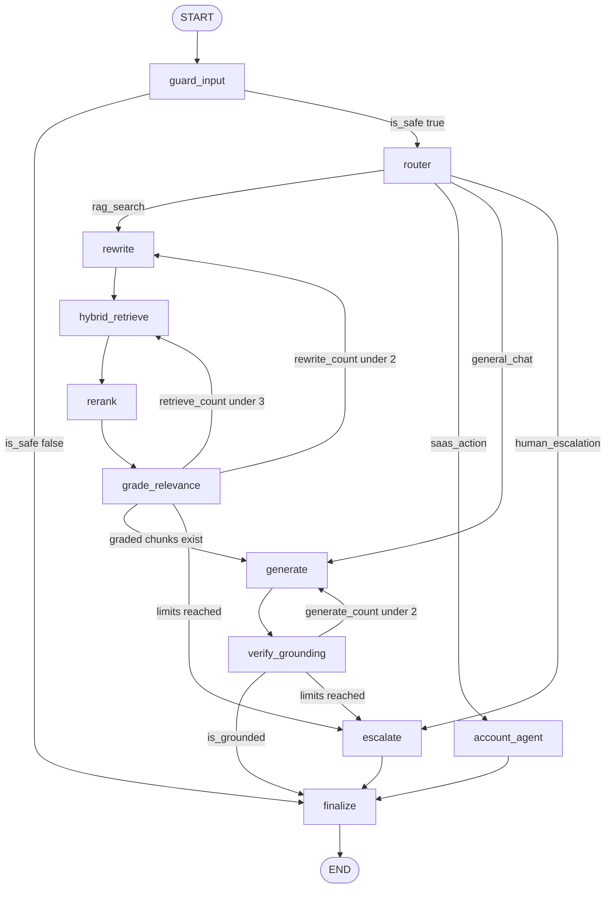
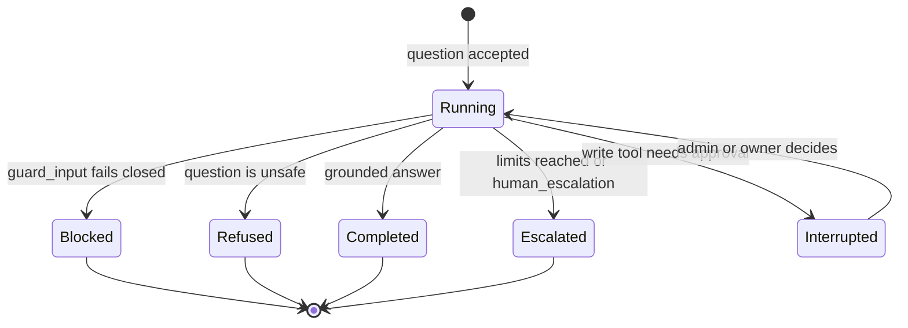

# Assistant graph

**Type:** Reference · **Audience:** engineers who change or debug the assistant · **Verified against:** `a989287`

**In plain English:** The assistant answers each question by running a LangGraph graph with 11 nodes. This page lists
every node, every edge, every loop limit, and the state that moves between the nodes. It also lists the checkpoint rules
and the events that the graph sends to the browser.

The code is in `src/ragassist/modules/assistant/graph/`. The graph builder is `builder.py`. The state types are in
`state.py`. Terms such as *Decider*, *Principal* and *thread* are in the [glossary](../glossary.md).

## 1. Graph at a glance

The next diagram shows every node and every edge. Read it from `START` to `END`. The two loops are `grade_relevance` back
to `rewrite` or `hybrid_retrieve`, and `verify_grounding` back to `generate`.

Text equivalent of the diagram:

1. The graph starts at `guard_input`.
2. `guard_input` goes to `router` when the question is safe. It goes to `finalize` when the question is not safe.
3. `router` picks one of four routes: `rag_search`, `saas_action`, `general_chat` or `human_escalation`.
4. The `rag_search` route runs `rewrite`, `hybrid_retrieve`, `rerank` and `grade_relevance` in this order.
5. `grade_relevance` goes to `generate` when at least one graded chunk exists. Otherwise it loops or escalates (section 4).
6. `generate` always goes to `verify_grounding`.
7. `verify_grounding` goes to `finalize` when the answer is grounded. Otherwise it loops or escalates (section 4).
8. `account_agent` and `escalate` go to `finalize`.
9. `finalize` goes to `END`.

## 2. Nodes

The graph has 11 nodes. `NODE_NAMES` in `builder.py` lists them in this order.

| Node | Job | Writes to state | Decision source |
|---|---|---|---|
| `guard_input` | Checks that the question is safe | `is_safe`, `decider_used`, and for an unsafe question `answer`, `status` | `check_safety` on the Decider chain |
| `router` | Picks the route and the model tier. Resets the per-turn counters | `route`, `complexity`, `decider_used`, counters | `route_query` and a complexity score on the Decider chain |
| `rewrite` | Builds the search query | `current_query`, `rewrite_count` | Rule in the node. No model call |
| `hybrid_retrieve` | Finds chunks by vector and keyword search | `retrieved_chunks`, `retrieve_count` | `retriever` port |
| `rerank` | Orders the chunks again and keeps the best | `reranked_chunks` | `reranker` port |
| `grade_relevance` | Keeps only the chunks that answer the question | `graded_chunks` | `grade_chunk_relevance` on the Decider chain |
| `generate` | Writes the answer with `[n]` citation markers | `answer`, `citations`, `generate_count`, `model_used` | Model from the `generator_tiers` |
| `verify_grounding` | Checks that the answer follows from the chunks | `is_grounded`, `grounding_score` | Grounding check on the Decider chain |
| `account_agent` | Calls the account tools for the signed-in user | `answer`, `tool_calls`, `model_used` | Tool-bound model and `ToolRegistry` |
| `escalate` | Hands the turn to a human agent | `escalated`, `status`, `answer` | None |
| `finalize` | Sends the `citation` and `done` events and sets the final status | `status` | None |

### 2.1 `guard_input`

- The node calls `check_safety` through the `DecisionService`.
- When the verdict contains the marker `safety_check_error`, the node fails closed. It sets the answer to a message that
  says the safety check could not run, and it sets `status` to `blocked`.
- When the verdict says the question is unsafe, the node sets a fixed refusal message. It sets `status` to `blocked` here too.
- The node caches a verdict only when a real Decider produced it. A verdict from the `fallback_default` provider is never
  cached. The cache class is `VerdictCache` (see [ADR 0015](../adr/0015-caching.md)).

### 2.2 `router`

- The node asks `route_query` on the router Decider chain (`ROUTER_DECIDER_CHAIN`). It asks a `ScoreQuestion` (complexity)
  on the main Decider chain (`DECIDER_CHAIN`).
- The default route is `rag_search`. The `DecisionService` returns this route with provider `fallback_default` when the
  chain fails.
- The default complexity is `2.0` when the score fails.
- The model tier is `cheap` when the complexity is below `2.0`. Otherwise it is `strong`.
- The node resets the counters, the chunk lists and `escalated`, and it sets `decider_used`.

### 2.3 `rewrite`

- The first rewrite keeps the question as the query.
- Each later rewrite appends the word ` details` to the query.

### 2.4 `hybrid_retrieve` and `rerank`

- `hybrid_retrieve` asks for the top 6 hits (`_TOP_K = 6`). It cuts the text in the trace to 600 characters.
- When the cache is on, the node looks up the `RetrievalResultCache` first. It stores only complete results.
- `rerank` keeps `min(len(chunks), 4)` chunks. It reads the `items` field of a `ChainResult`.
- The reranker chain and its adapters are in [Ports and adapters](ports-and-adapters.md).

### 2.5 `grade_relevance`

The node calls `grade_chunk_relevance` once for each reranked chunk. The `DecisionService` treats a failed check as
*relevant*, so a Decider outage does not remove all context.

### 2.6 `generate`

- The node tries each model of the chosen tier in order. It raises the last error when all models fail.
- Two fixed system prompts exist: `SYSTEM_PROMPT_GROUNDED` and `SYSTEM_PROMPT_CHAT`. They are fixed text so that a
  provider can cache the prompt prefix (see [ADR 0015](../adr/0015-caching.md)).
- The node wraps each passage in an `<untrusted_document_context>` block.
- The node reads the `[n]` markers in the answer and builds the `citations` list.
- A `UsageTally` records the metric `ragassist_llm_input_tokens_total` with the label `cached`.

### 2.7 `verify_grounding`

- The node sets `is_grounded` to true and `grounding_score` to `1.0` when the route is `general_chat`.
- It does the same when no graded chunks exist.
- Otherwise it asks the grounding check. The `DecisionService` treats a failed check as not grounded.

### 2.8 `account_agent`

The node runs the account tools. Section 6 describes the approval flow.

### 2.9 `escalate`

- The node sets `escalated` to true and `status` to `escalated`.
- It keeps an existing answer. When no answer exists, it uses the fixed message "I have escalated your request to a
  support agent who will follow up shortly."

### 2.10 `finalize`

The node sends the custom events `citation` and then `done`. When `status` is empty, it sets `escalated` or
`completed`.

## 3. Routes

| Route | Meaning | First node after `router` |
|---|---|---|
| `rag_search` | Answer from the knowledge base. This is the default | `rewrite` |
| `saas_action` | Read or change account data | `account_agent` |
| `general_chat` | Greeting or small talk. No retrieval | `generate` |
| `human_escalation` | The user asks for a person | `escalate` |

## 4. Loop limits

The limits live in the routing functions `route_after_grade` and `route_after_grounding`. They are in the node modules `grade_relevance_node.py` and `verify_grounding_node.py`. `builder.py` only registers them.

| Loop | Counter | Rule | Result at the limit |
|---|---|---|---|
| Rewrite | `rewrite_count` | Allowed while the count is below 2 | At most 2 rewrites |
| Retrieve | `retrieve_count` | Allowed while the count is below 3 | At most 3 retrievals |
| Generate | `generate_count` | Allowed while the count is below 2 | At most 2 generations |

The order inside `grade_relevance` is fixed. The node checks for graded chunks first. Then it checks the rewrite limit.
Then it checks the retrieve limit. When all limits are used, the graph goes to `escalate`.

The next diagram shows the life cycle of one turn as the `status` and the phase that the browser sees. Read it as a
summary of the outcomes.

Text equivalent of the diagram:

- A turn starts in `Running`.
- It ends as `Blocked` when the safety check fails. It ends as `Refused` when the question is unsafe. In both cases
  `finalize` runs next.
- It ends as `Completed` when the answer is grounded or when the route is `general_chat` or `account_agent`.
- It ends as `Escalated` when a loop limit is reached or when the route is `human_escalation`.
- It pauses in `Interrupted` when `account_agent` meets a write tool. The turn resumes after a decision (section 6).

Note on names: `Running`, `Interrupted`, `Refused` and `Completed` are labels for this page. The graph stores the
values `blocked`, `escalated` and `completed` in `status`. The graph has no stored value for a refusal. The API
reports `interrupted` in the `done` event when the graph pauses.

## 5. State

`AssistantState` is a `TypedDict` with `total=False`. All fields are optional.

| Field | Meaning |
|---|---|
| `question` | The text from the user |
| `principal` | The signed-in `Principal`. The `raw_token` field is blank in the checkpoint when a runtime is active |
| `conversation_id` | The conversation id |
| `route`, `complexity` | The router result |
| `is_safe` | The guard result |
| `current_query` | The query that the retrieval uses |
| `rewrite_count`, `retrieve_count`, `generate_count` | The loop counters |
| `retrieved_chunks`, `reranked_chunks`, `graded_chunks` | The chunk lists at each step |
| `answer`, `citations` | The answer and its citations |
| `is_grounded`, `grounding_score` | The grounding result |
| `escalated`, `status` | The outcome |
| `model_used`, `decider_used` | The providers that ran, for the trace |
| `tool_calls` | The tool calls of the turn |
| `error` | An error text, or none |

`Citation` and `AnswerWithCitations` are Pydantic models in the same package.

### 5.1 Fresh turn state

A conversation keeps one checkpoint for all its turns. Without a reset, the answer of turn 1 would leak into turn 2.
The constant `FRESH_TURN_STATE` in `src/ragassist/modules/assistant/api/router.py` clears the per-turn fields. The API
merges it into the input of every turn, together with `question`, `principal` and `conversation_id`.

| Field | Reset value |
|---|---|
| `answer`, `status`, `current_query` | empty text |
| `citations`, `tool_calls`, `retrieved_chunks`, `reranked_chunks`, `graded_chunks` | empty list |
| `escalated` | false |
| `error` | none |
| `rewrite_count`, `retrieve_count`, `generate_count` | 0 |

The `router` node also resets the counters, the lists and `escalated`. The test
`tests/unit/modules/assistant/test_fresh_turn_state.py` covers the reset.

## 6. Approval of write tools

The node `account_agent` binds the tools of the `ToolRegistry` to the model. It handles each tool call in this order.

1. An unknown tool name returns an error `ToolMessage`.
2. The node asks whether the tool is a write tool. When this check raises an error, the node fails closed and treats the
   tool as a write tool.
3. A read tool runs at once.
4. For a write tool, `ToolRegistry.authorize` checks the role first. A non-admin user gets "Permission denied" and the
   graph does not pause.
5. An admin write call runs `interrupt()` with this payload: `action` (value `approval_required`), `tool`, `arguments`
   and `call_id`. The graph pauses. The API sends an `interrupt` event.

The decision arrives at `POST /conversations/{id}/actions/{interrupt_id}`. The handler `decide_action` works in this
order.

| Check | Result |
|---|---|
| The conversation is not visible to the caller | 404 |
| The caller is neither the owner nor an admin | 403 |
| The checkpoint state cannot be read | 503 |
| The `interrupt_id` does not match the pending interrupt | 409 |
| The graph fails to resume | 502 |

After the checks, the handler records the action and resumes the graph with `Command(resume=...)`. The resume payload
holds `decision`, `interrupt_id`, `feedback`, `tool`, `arguments` and `call_id`.

The graph executes the call that the checkpoint holds. It does not execute the arguments from the resume payload.
When the regenerated call differs from the checkpointed call, the node logs the warning
`assistant.regenerated_call_differs`. This rule is the *approval binding* of
[ADR 0006](../adr/0006-conversation-access-and-approval-binding.md).

The module keeps pending calls in a bounded `OrderedDict` named `_PENDING_TOOL_CALLS`. The key is
`{tenant_id}:{conversation_id}`. The limit is `MAX_PENDING_TOOL_CALLS`, which is 512. The function
`clear_pending_tool_call` removes one entry.

The tools and the roles are in [Roles and permissions](roles-and-permissions.md). The steps to add a tool are in
[Add an action tool with approval](../how-to/add-an-action-tool-with-approval.md).

## 7. Threads and checkpoints

- The LangGraph `thread_id` is `{tenant_id}:{conversation_id}`. The assistant router builds it inline from the
  `Principal`.
- Before the router reads a checkpoint, it loads the conversation from the store with `store.get(tenant, conversation_id)`
  and applies `_visible_conversation`. The API answers 404 when the conversation is missing or not visible.
- `can_access_conversation` and `can_decide_action` in `application/access.py` hold the owner rules. A user sees only
  their own conversations. Staff (agent and admin) see all. Only the owner or an admin may decide an action.
- `thread_guard.py` defines `namespaced_thread_id` and `ensure_thread_access`, which raises `ThreadAccessDenied`. Only
  tests call them (`tests/e2e/test_tier3_isolation.py`, `tests/e2e/test_tier4_production.py` and
  `tests/graph/test_interrupts_and_tenancy.py`). Production
  code does not call them. See [Code observations](#9-code-observations).
- The checkpoint serializer (`serde.py`) allows only the classes `Principal`, `UserRole` and `Hit`. The in-memory saver
  is `MemorySaver(serde=checkpoint_serde())`. The PostgreSQL saver is `AsyncPostgresSaver`.
- `runtime.py` builds the PostgreSQL checkpointer on a psycopg pool. It fails on the Windows Proactor event loop.
- The test `tests/graph/test_checkpoint_serde.py` checks the allow-list. The test `tests/graph/test_approval_binding.py`
checks the approval binding. The test class `TestCheckpointCarriesNoBearerToken`
  in `tests/security/test_audit_regressions.py` checks that the checkpoint carries no bearer token.

## 8. Events to the browser

The graph runs detached from the HTTP request. The helpers `turns.spawn` and `turns.drain` start and finish a turn. The
SSE stream reads the graph events through `astream_events`.

| SSE event | Source |
|---|---|
| `token` | Model output of the nodes in `ANSWER_NODES` (`generate` and `account_agent`). A `reset` flag tells the browser to clear the text |
| `citation` | Custom event from `finalize`. The API also reads the checkpoint state and sends each citation once |
| `tool_call` | The LangChain events `on_tool_start` and `on_tool_end`. Unverified: `account_agent` calls `ToolRegistry.invoke` directly, so a run may not emit them |
| `interrupt` | The API reads the pending interrupt from the checkpoint after the pause |
| `escalated` | The API sends it after it opens the helpdesk ticket for a turn with status `escalated` |
| `done` | The API sends it last. Its `status` comes from `finalize`, or is `interrupted` after a pause |
| `error` | A failure in the turn |

`ALLOWED_EVENTS` also holds the name `source`. The stream sends a heartbeat every 15 seconds. The full wire format is in
the [SSE contract](../api/sse-contract.md).

`AssistantCompiledGraph` wraps the compiled graph. It removes the first `on_chain_start` event that LangGraph names
`LangGraph`, so the stream shows only the nodes.

## 9. Code observations

These facts come from the code at `a989287`. They are not decisions. Each one is a gap that a maintainer can close.

1. `runtime.py` passes `agent_tiers` to `build_graph`. The builder takes the argument in `**kwargs` and ignores it. The
   `account_agent` node uses `generator_tiers`. The tool-bound models from the `agent` role are not used.
2. The escalated answer after two ungrounded generations is the last ungrounded text. The `escalate` node keeps an
   existing answer.
3. The complexity scale differs between adapters. The `rules` adapter returns `3.0`. The `semantic_router` adapter returns
   `0.5`. The `llm_structured` adapter asks for a value from 0 to 1. The tier cut-off is `2.0`.
4. `thread_guard.py` is not used by production code (section 7).

## 10. Sources

- `src/ragassist/modules/assistant/graph/builder.py`, `state.py`, `serde.py` and the node modules.
- `src/ragassist/modules/assistant/api/router.py` and `application/access.py`.
- [ADR 0004](../adr/0004-decision-layer.md), [ADR 0006](../adr/0006-conversation-access-and-approval-binding.md),
  [ADR 0008](../adr/0008-live-events-handoff-and-detached-turns.md) and [ADR 0015](../adr/0015-caching.md) name the
  decisions behind the graph. Unverified: this page did not re-read ADR 0004 and ADR 0008 in full.
- Related reference pages: [API endpoints](api-endpoints.md), [Error responses](error-responses.md) and
  [Configuration](configuration.md).
