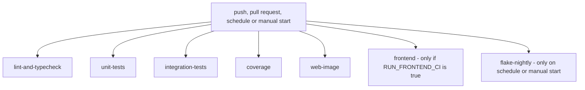

# CI and quality gates

**Type:** Reference · **Audience:** engineers who change the pipeline or fix a red build · **Verified against:** `a989287`

**In plain English:** One GitHub Actions workflow checks every push and every pull request. This page lists each job,
what it runs, and whether a failure blocks the merge. It also lists the local hooks, the lint and test settings and the
coverage policy.

The workflow file is `.github/workflows/ci.yml`. The test layout is in [Testing](../testing.md). The steps to run the
tests are in [Run the tests](../how-to/run-the-tests.md). Terms are in the [glossary](../glossary.md).

## 1. Triggers

| Trigger | Value |
|---|---|
| `push` | Branch `main` |
| `pull_request` | Target branch `main` |
| `schedule` | Cron `0 3 * * *` (every day) |
| `workflow_dispatch` | Manual start |

## 2. Jobs at a glance

The next diagram shows the jobs. Read the first row as the checks that run for every push and pull request. The two
jobs in the second row run only under a condition.

Text equivalent of the diagram: the seven jobs run in parallel. The workflow has no `needs:` key, so no job waits for
another job. `frontend` runs only when
the repository variable `RUN_FRONTEND_CI` is `true`. `flake-nightly` runs only on the schedule or on a manual start.

## 3. Job details

| Job | Blocks a merge | Main steps |
|---|---|---|
| `lint-and-typecheck` | Yes, except the advisory step | Secret scan, tests lint, import-linter, advisory source lint |
| `unit-tests` | Yes | `pytest tests/unit -v --cov=src/ragassist` |
| `integration-tests` | Yes | Throwaway PostgreSQL, `pytest tests/hygiene`, then `pytest tests/integration tests/security` |
| `coverage` | Yes, except the advisory gate | Coverage run, advisory policy check |
| `frontend` | Yes when it runs | `npm ci`, lint, type check, API type check, unit tests, Playwright |
| `web-image` | Yes | Build the web image, check nginx, check the headers |
| `flake-nightly` | Not a merge check | Ten random-order runs |

The column "Blocks a merge" means that a failure fails the workflow run. Unverified: which jobs the repository sets as required checks. The workflow file does not say.

Python is 3.12. The Python jobs install with `uv pip install --system -e ".[dev]"`.

### 3.1 `lint-and-typecheck`

1. **Secret scan (blocking).** The job fetches the full history (`fetch-depth: 0`). It runs
   `scripts/check_secrets.py --all`. On a pull request it also runs `--range <base>..<head>`, so it scans every commit
   of the pull request.
2. **Lint tests and tooling (blocking).** The job runs `ruff check tests scripts`, `ruff format --check tests` and
   `lint-imports`.
3. **Lint and type-check production code (advisory).** The step has `continue-on-error: true`. It runs
   `ruff check src services evals`, `ruff format --check src services evals` and `mypy src`. The backlog of findings in
   `src/` is reported but does not block a merge. A comment in the workflow says to turn `continue-on-error` off when
   the backlog is clear.

### 3.2 `integration-tests`

- The job sets `RAGASSIST_STRICT_PENDING=1`.
- It starts a throwaway PostgreSQL service from the `pgvector/pgvector:pg16` image. It generates the password at run
  time and masks it in the log. It passes the admin connection through `TEST_DATABASE_ADMIN_URL`.
- It runs `pytest tests/hygiene -v` and then `pytest tests/integration tests/security -v`.
- It uploads the `reports/` folder, also when a test fails.

### 3.3 `coverage`

- The job sets `RAGASSIST_STRICT_PENDING=1`.
- It runs `pytest tests/unit tests/graph tests/security tests/hygiene tests/selfcheck` with `--cov=src/ragassist`,
  `--cov-branch` and `--cov-report=json:coverage.json`.
- It then runs `python tests/gates/check_coverage.py --report coverage.json`. This step is advisory
  (`continue-on-error: true`). A workflow comment records the measured value of 82.4 percent against the minimum of
  85 percent. The policy numbers are not lowered.

### 3.4 `frontend`

The job runs only when `vars.RUN_FRONTEND_CI == 'true'`. It is suspended while the UI changes. The job runs in
`frontend/` on Node 22.

Steps: `npm ci`, `npm run lint`, `npm run typecheck`, `npm run api:check`, `npm test`,
`npx playwright install --with-deps chromium`, `npm run e2e`. On a failure it uploads the Playwright report. See
[Frontend structure](frontend-structure.md).

### 3.5 `web-image`

The job builds `infra/docker/web.Dockerfile`. It runs `nginx -t` with the `WEB_*` values from `.env.example`. It starts
the container and checks these facts:

- The Content Security Policy header is present.
- The `Cache-Control` header is correct.
- The `X-Content-Type-Options` header is `nosniff`.
- The container sends no HSTS header with the default values.
- Files under `/assets/` are `immutable`.
- A missing asset and the path `/.env` both return 404.

On a failure it prints the container log. See [ADR 0014](../adr/0014-web-delivery.md).

### 3.6 `flake-nightly`

The job runs on the schedule or on a manual start only. It runs `bash scripts/flake_check.sh 10`. The script runs the
suites `tests/unit`, `tests/graph`, `tests/security`, `tests/hygiene` and `tests/selfcheck` with random seeds. The aim is
to find order-dependent and flaky tests.

## 4. Local hooks

| Hook | Runs | When |
|---|---|---|
| `.githooks/pre-commit` | `scripts/check_secrets.py --staged` | Before each commit |
| `.githooks/pre-push` | `scripts/check_secrets.py --push` | Before each push |

Enable the hooks once for each clone with `git config core.hooksPath .githooks`. Do not bypass them with `--no-verify`.
The rules are in `AGENTS.md` section 3.8. The details of the scanner are in
[Security controls](security-controls.md#10-secret-scanning).

## 5. Tool settings (`pyproject.toml`)

| Tool | Setting |
|---|---|
| ruff | Line length 100. Target `py312`. Rules `E`, `F`, `W`, `I`, `N`, `UP`, `B`, `C4`, `SIM`, `TCH`. Ignore `B008`. Extra ignores for `tests` and `evals` |
| mypy | Strict, with `disallow_untyped_defs` and `ignore_missing_imports` |
| pytest | `addopts = "-ra -q --strict-markers"`, `asyncio_mode = auto`, `timeout = 30`, `pythonpath = ["src", ".", "tests"]` |
| coverage | `branch = true` |
| poe tasks | `up`, `down`, `logs`, `lint`, `format`, `typecheck`, `test` (`pytest tests/unit`), `test-all` |

### 5.1 Pytest markers

`--strict-markers` is on, so an unknown marker fails the run. The markers are `unit`, `integration`, `graph`,
`security`, `e2e`, `hygiene`, `eval`, `gpu`, `slow`, `defect`, `network`, `live`, `real_assistant_graph`, `pending` and
`selfcheck`. The test collector applies a tier marker from the folder name.

Live tests run only with `--run-live` or with `RAGASSIST_LIVE=1`.

### 5.2 Test folders

| Folder | Content |
|---|---|
| `tests/unit` | Fast tests with fakes |
| `tests/integration` | Tests against a real PostgreSQL, including RLS |
| `tests/graph` | Assistant graph flows |
| `tests/security` | Isolation, authorisation and abuse tests |
| `tests/e2e` | End-to-end tests. No CI job runs this folder |
| `tests/hygiene` | Repository rules as tests |
| `tests/selfcheck` | Tests of the test tools |
| `tests/live` | Tests against real providers. No CI job runs this folder |
| `tests/gates` | The coverage policy and its checker |
| `tests/fakes`, `tests/factories`, `tests/support`, `tests/data` | Helpers and data |

### 5.3 Shared fixtures

`tests/conftest.py` sets up a hermetic run:

- It builds the environment from `.env.example` and adds generated secrets.
- It sets `PERSISTENCE_BACKEND=memory`.
- It blocks outside network access.
- It gives each test a fresh rate limiter, event bus and cache.
- It builds an offline assistant graph.
- It resets the mock SaaS.

## 6. Coverage policy

The policy is in `tests/gates/coverage_policy.json`. The checker is `tests/gates/check_coverage.py`.

| Scope (key in the policy file) | Minimum |
|---|---|
| Overall (`overall_min`) | 85 percent |
| `ragassist/shared/` | 95 percent |
| `ragassist/platform/` | 90 percent |
| `ragassist/modules/` | 90 percent |

The checker reads the JSON report of a run with `--cov-branch`. It applies three rules:

1. Each group has a hard minimum once the group has code.
2. The overall coverage has a minimum.
3. A ratchet file, `tests/gates/coverage_baseline.json`, stores the last accepted values. A group may not fall below
   its baseline by more than the tolerance of 0.5 points. Run the checker with `--update-baseline` to lock in a gain.

A group with no statements is pending. It never fails the gate.

## 7. Hygiene tests

The folder `tests/hygiene` turns repository rules into tests. The integration job and the `coverage` job run it.

| Test file | Rule that it checks |
|---|---|
| `test_architecture.py` | The layering rules of `AGENTS.md` section 1, from the import graph |
| `test_defect_registry.py` | Each defect marker names a registered defect. Each registered defect has a test |
| `test_env_example.py` | `.env.example` matches `Settings` (`AGENTS.md` section 3.1) |
| `test_repo_files.py` | Ignore files, line endings and editor settings (`AGENTS.md` sections 3.2 and 3.3) |
| `test_no_leaked_defaults.py` | The old development credentials never return (`AGENTS.md` section 3.7) |
| `test_no_secrets_committed.py` | No tracked file holds a credential-shaped value. Uses the same scanner as the hooks |
| `test_quality_gates.py` | The coverage ratchet, the flake script, the CI wiring and the report plumbing |
| `test_spec_map.py` | The planned-symbol map is well formed |
| `test_testing_doc.py` | `docs/testing.md` follows its generated appendix |
| `test_web_delivery.py` | The nginx templates, the Dockerfile and the compose file (ADR 0014). Needs no Docker daemon |
| `test_mock_saas_is_standalone.py` | `services/mock_saas` does not import the app |
| `test_no_tautological_tests.py` | Each test module reaches product code |

### 7.1 Layering checks

Two tools check the layering.

- `lint-imports` (import-linter) runs one contract. It forbids the domain layers from importing `ragassist.main` or
  `ragassist.container`. This contract is weaker than the rules in `AGENTS.md`.
- `tests/hygiene/test_architecture.py` uses `tests/support/architecture.py`. It enforces these rules:
  `domain-no-frameworks`, `domain-points-inward`, `application-no-frameworks`, `application-points-inward`,
  `application-uses-platform-adapters`, `module-isolation`, `kernel-independence` and `platform-below-modules`.

## 8. Reports

The tests write reports to `reports/`. The folder is git-ignored (`/reports/`).

| File | Writer |
|---|---|
| `reports/pending.md` | The pending-test report |
| `reports/defects.md` | The defect registry |
| `reports/leak_gate.json` | `tests/security/test_leak_gate.py` |
| `reports/injection.json` | `tests/security/test_injection_corpus.py` |

The integration job uploads this folder as an artifact.

## 9. Code observations

1. `tests/e2e` and `tests/live` run in no CI job.
2. The `frontend` job is gated and currently suspended.
3. The coverage gate is advisory. The measured coverage of 82.4 percent is below the 85 percent minimum.
4. The advisory step runs `ruff` and `mypy` on `src/`. A failure there does not fail the job.
5. `docs/testing.md` is out of date. It still describes many suites as pending.
6. The `import-linter` configuration holds one contract only (section 7.1).

## 10. Open limits

- A real-stack end-to-end smoke run has not been done.
- The frontend job needs the variable `RUN_FRONTEND_CI` before it runs.
