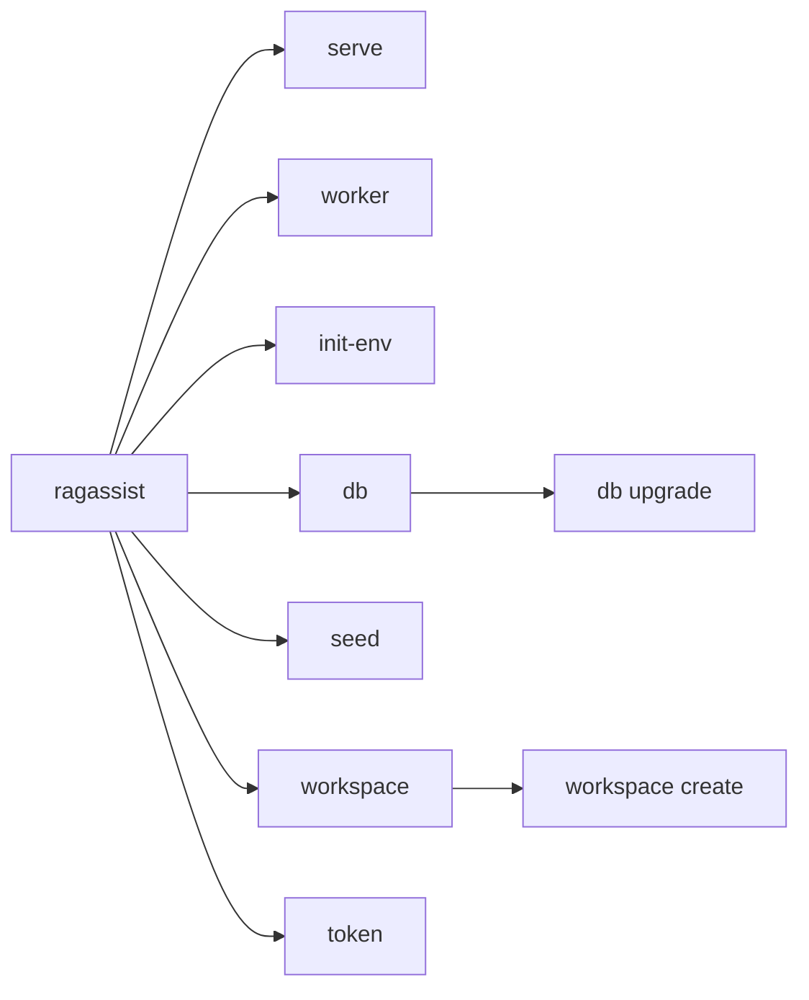

# Command-line interface

**Type:** Reference · **Audience:** developers and operators who run RagAssist from a terminal · **Verified against:** `a989287`

**In plain English:** The `ragassist` command starts the API, starts the worker, prepares the database and creates
accounts and tokens. This page lists every command with its options and its output. Use it to look up a flag. To
learn how to start the whole stack, follow the tutorial
[run the stack locally](../tutorials/01-run-the-stack-locally.md).

## 1. Ways to run the command

The code is in `src/ragassist/cli/main.py` and `src/ragassist/cli/ops.py`. It uses the library Typer.

| Way | Command | When it works |
|---|---|---|
| Installed script | `ragassist <command>` | After you install the package (`pyproject.toml` defines the script `ragassist` as `ragassist.cli.main:app`) |
| Python module | `python -m ragassist.cli.main <command>` | Always, when the package is importable. The file `main.py` calls the Typer app when it runs as a module. |

- The script `ragassist` may not be on your `PATH`. A virtual environment that you did not activate, or a package that
  you did not install, gives "command not found". Use the module form in that case.
- The form `python -m ragassist` does not work. The package `ragassist` has no `__main__.py` file.
- `ragassist` with no command prints the help text. Each command also answers `--help`.
- Every command except `init-env` reads the settings (`.env` and the environment). A missing required setting stops the
  command and the error names the setting. See [configuration](configuration.md).

The following diagram shows the commands as a tree. Look at the two groups `db` and `workspace`: each has one
sub-command.



In words: `serve`, `worker`, `init-env`, `seed` and `token` are single commands. `db upgrade` and `workspace create` are
sub-commands.

## 2. Command summary

| Command | What it does | Needs a database | Database role used |
|---|---|---|---|
| `ragassist serve` | Runs the HTTP and SSE API server | Only when `PERSISTENCE_BACKEND=postgres` | Application role |
| `ragassist worker` | Runs the ingestion worker | Yes, unless `PERSISTENCE_BACKEND=memory` | Application role |
| `ragassist init-env` | Writes a working `.env` from the template | No | None |
| `ragassist db upgrade` | Applies the migrations and creates the checkpoint tables | Yes | Owner role |
| `ragassist seed` | Creates the demo tenants and users and prints set-password links | Yes | Owner role for the rows, application role for the links |
| `ragassist workspace create` | Creates a workspace and its first administrator | Yes | Application role |
| `ragassist token` | Prints a signed access token for local tests | No | None |

The application role is `DB_APP_USER`. The owner role is `DB_ADMIN_USER`. See
[data model, section 2](data-model.md#2-the-two-database-roles).

## 3. `ragassist serve`

Runs the FastAPI application `ragassist.main:app` with uvicorn.

| Option | Short | Default | Meaning |
|---|---|---|---|
| `--host` | `-h` | A value that binds all network interfaces | The interface that the server binds |
| `--port` | `-p` | A number defined in the code. Run `ragassist serve --help` to see it. | The port that the server binds |
| `--reload` | None | Off | Restarts the server when a source file changes |

Behaviour:

- The log level comes from `LOG_LEVEL` (lower-cased).
- The command turns on `proxy_headers`. uvicorn believes `X-Forwarded-For` and `X-Forwarded-Proto` only from the peers
  in `TRUSTED_PROXY_IPS`. An empty value means loopback only. See [ADR 0014](../adr/0014-web-delivery.md).
- On Windows the command selects the selector event loop, because `psycopg` (the LangGraph checkpointer) cannot run on
  the default Proactor loop. Start the API with this command on Windows. Another start method can fail with a
  `RuntimeError` that names the loop.
- With `PERSISTENCE_BACKEND=postgres` the API starts the full runtime at start-up. See
  [configuration, section 4](configuration.md#4-database-and-row-level-security).
- The command prints the uvicorn log. It does not print its own result line.

## 4. `ragassist worker`

Runs the ingestion worker. The worker reads the queue `SQS_QUEUE_INGEST`, parses and chunks each document, creates the
embeddings and indexes the chunks. The command has no options. It runs until you stop it. The module form
`python -m ragassist.worker.main` does the same.

The settings `WORKER_CONCURRENCY`, `WORKER_MAX_RETRIES` and `WORKER_POLL_WAIT_SECONDS` control the worker. See
[configuration, section 17](configuration.md#17-ingestion-worker).

## 5. `ragassist init-env`

Creates a working `.env` from `.env.example`.

| Option | Short | Default | Meaning |
|---|---|---|---|
| `--output` | `-o` | `.env` | The file to create |
| `--template` | None | `.env.example` | The template to start from |
| `--force` | None | Off | Replaces the output file when it exists |

Behaviour:

1. The command finds the required settings that are blank in the template. These are the secrets.
2. It copies every line of the template. It keeps all existing values.
3. For each blank required secret, it writes a random value. The value of `SECRET_KEY` has 48 random bytes in URL-safe
   text. The value of `AWS_SECRET_ACCESS_KEY` has 20 random characters in upper-case hexadecimal. Every other blank
   secret has 24 random bytes in URL-safe text.
4. It writes the file and sets the permissions to owner-only where the platform allows it.

With the shipped template, the blank required secrets are `SECRET_KEY`, `DB_APP_PASSWORD`, `DB_ADMIN_PASSWORD`,
`DEV_AUTH_SECRET`, `AWS_ACCESS_KEY_ID` and `AWS_SECRET_ACCESS_KEY`. The optional keys stay blank.

Output:

```text
Wrote <output>. Generated: <names of the generated settings>.
Set OPENAI_API_KEY (or OPENAI_COMPATIBLE_*) in it before using the assistant.
```

The command prints names, never values. When the output file exists and you did not pass `--force`, the command prints
the error and "Use --force to replace it." to the error stream and exits with code `1`.

> **WARNING.** `--force` replaces the file without a backup. You lose every value that you set by hand. Never commit
> `.env`. See [rotate secrets and use the secret guards](../how-to/rotate-secrets-and-use-secret-guards.md).

## 6. `ragassist db upgrade`

Applies the database schema.

1. The command runs Alembic `upgrade head` with `alembic.ini` and the folder `migrations` of the **current directory**.
   Run the command from the repository root.
2. It connects with `DATABASE_ADMIN_URL` (the owner role). It lets `AsyncPostgresSaver.setup()` create the LangGraph
   checkpoint tables.
3. It grants `SELECT`, `INSERT`, `UPDATE` and `DELETE` on all tables, and `USAGE` and `SELECT` on all sequences, in the
   schema `public` to the application role.

The command has no options. It prints `Database is up to date.` when it finishes. It stops with a Typer error when
`DB_APP_USER` is not a plain identifier (a letter or underscore, then letters, digits or underscores, at most 63
characters). The command is safe to run again. See [data model](data-model.md).

## 7. `ragassist seed`

Creates two demo workspaces and one account for each role in each of them. The command has no options.

| Demo workspace | Slug | Name |
|---|---|---|
| First | `acme` | Acme Corp |
| Second | `globex` | Globex Inc |

- The tenant ids are fixed values in the code. They match the accounts of the mock SaaS service, so the account tools
  resolve for these tenants.
- Each workspace gets an `admin`, an `agent` and a `user`. The email address is `<role>@<slug>.example.com`.
- The user ids are stable. The command derives them from the slug and the role, so `seed` and `token` agree.
- The command inserts with `ON CONFLICT DO NOTHING`. A second run changes no row.
- The accounts have no password. The command prints one set-password link for each account. Each link works once and
  lives `AUTH_INVITE_HOURS` hours.

Output (shape only):

```text
<slug>: tenant <tenant id> with admin, agent and user
...
Set each account's password with its one-time link (valid for AUTH_INVITE_HOURS hours):
  <slug>  <email>  <link>
...
For API testing without a password: ragassist token --tenant acme --role admin
```

> **WARNING.** The command prints one-time links to the terminal. Anyone who sees a link can set the password of that
> account. Do not run `seed` on a shared system or in a CI log that other people read.

## 8. `ragassist workspace create`

Creates a workspace and its first administrator. The administrator has no password yet.

| Option | Required | Meaning |
|---|---|---|
| `--name` | Yes | The display name of the workspace |
| `--slug` | Yes | The text that people type at sign-in. Use lower-case letters, digits and hyphens, 2 to 63 characters, not starting with a hyphen. |
| `--admin-email` | Yes | The email address of the first administrator |

Output on success:

```text
Workspace '<slug>' created (<workspace id>).
Give the administrator this link; it is shown once and works once:
<link>
```

The link has the form `<WEB_BASE_URL>/accept#token=<token>`. On a domain error (for example a slug that exists, a
slug or an email address that is not valid), the command prints the message to the error stream and exits with code `1`.
A missing required option is a Typer usage error with exit code `2`.

## 9. `ragassist token`

Prints a signed access token. Use it to call the API without a password.

| Option | Short | Default | Meaning |
|---|---|---|---|
| `--tenant` | `-t` | `acme` | A tenant UUID, or `acme` or `globex` |
| `--role` | `-r` | `user` | `user`, `agent` or `admin` |
| `--user-id` | None | The seeded demo user | A user UUID |
| `--minutes` | None | `0` | The lifetime in minutes. The value `0` means `JWT_ACCESS_TOKEN_EXPIRE_MINUTES`. |

- The command prints only the token, on one line. Send it as `Authorization: Bearer <token>`.
- A tenant value that is neither a UUID nor a demo slug is a usage error (exit code `2`).
- The token carries the tenant, the user and the role that you give. The command does not check that the user or the
  tenant exists.

> **WARNING.** The command signs a token for any tenant and any role. It does not check `APP_ENV` and it does not compare
> `DEV_AUTH_SECRET`. Anyone who can read the `SECRET_KEY` of a deployment can run it. Keep `.env` private, and never use
> a production key on a shared machine.

## 10. Other command-line tools

These tools are not part of the `ragassist` command.

| Tool | Command | Purpose |
|---|---|---|
| Secret scanner | `python scripts/check_secrets.py` with one of `--staged`, `--push`, `--range <revision range>` or `--all` | Blocks a commit or a push that holds a key, a token or a password. The git hooks and CI run it. See [rotate secrets and use the secret guards](../how-to/rotate-secrets-and-use-secret-guards.md). |
| Evaluation runner | `python -m evals.runner` with the options `--dataset`, `--offline` and `--output-dir` | Runs the golden dataset evaluation. See [testing strategy](../explanation/testing-strategy.md). |

## 11. Related pages

- [Configuration](configuration.md) for the settings that the commands read.
- [Data model](data-model.md) for what `db upgrade` and `seed` create.
- [Tutorial: run the stack locally](../tutorials/01-run-the-stack-locally.md).
- [Tutorial: create a workspace and sign in](../tutorials/02-create-a-workspace-and-sign-in.md).
- [How to run the tests](../how-to/run-the-tests.md).
- [ADR 0007](../adr/0007-accounts-and-sessions.md) for the account and link rules.
