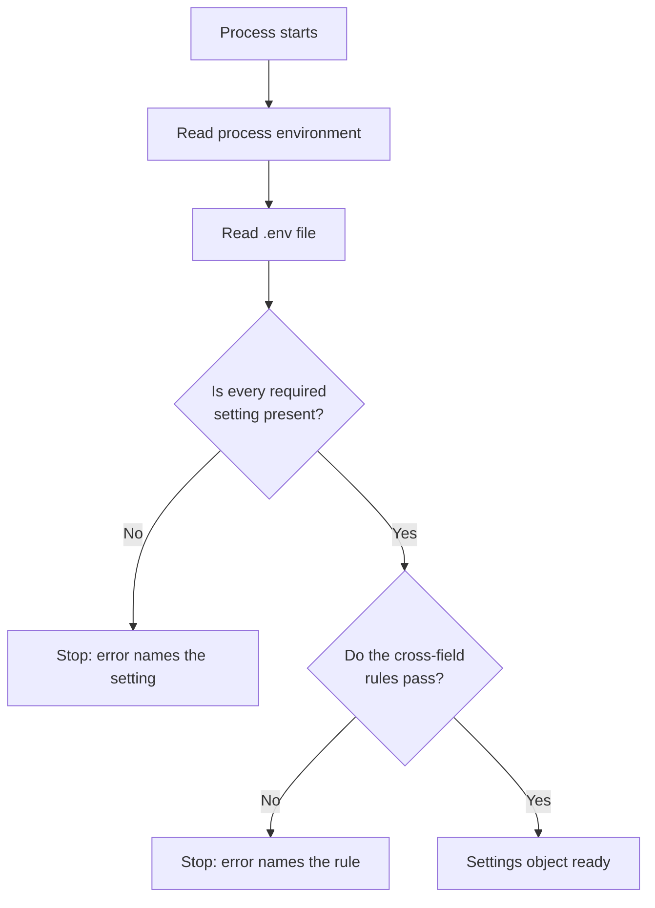

# Configuration

**Type:** Reference · **Audience:** operators and developers who set up or change a RagAssist deployment · **Verified against:** `a989287`

**In plain English:** This page lists every setting that the RagAssist API and worker read. For each setting it gives
the name, the type, whether it is required, what it controls and the values that are allowed. Settings come from the
environment or from a file named `.env`. The page never shows a secret and never shows a deployment value such as a
host or a port.

## 1. How settings load

- The class `Settings` in `src/ragassist/shared/config/settings.py` defines every setting. It uses pydantic-settings.
- A setting with no default is **required**. If it is missing, the process stops at start-up and the error names the
  setting.
- A setting with an empty-string default is **optional**. An empty value means "not configured". Only optional API
  keys and optional overrides have such a default.
- The code defines **no default** for a credential, a connection detail or a deployment value (`AGENTS.md`, section 3,
  rule 7).
- The class reads the process environment and the file `.env` in the working directory. Unknown names are ignored. By
  the pydantic-settings rule, a real environment variable wins over a line in `.env`.
- The file `.env.example` is the template. It holds a safe value for every non-secret setting and a blank for every
  secret. The column "Template" below quotes the template for tuning settings only.
- The command `ragassist init-env` copies `.env.example` to `.env` and fills the blank required secrets with random
  values. It never overwrites an existing file unless you pass `--force`. See [CLI](cli.md).
- `Settings.__repr__` and `Settings.model_dump_json` mask the secret fields, so a logged settings object does not leak
  them. The masked names are `SECRET_KEY`, `DEV_AUTH_SECRET`, `DB_APP_PASSWORD`, `DB_ADMIN_PASSWORD`, `DATABASE_URL`,
  `DATABASE_ADMIN_URL`, `AWS_ACCESS_KEY_ID`, `AWS_SECRET_ACCESS_KEY`, `OPENAI_API_KEY`, `ANTHROPIC_API_KEY`,
  `OPENROUTER_API_KEY`, `GEMINI_API_KEY`, `OPENAI_COMPATIBLE_API_KEY`, `TYPESAFE_API_KEY`, `OPENAI_DECISIONS_API_KEY`,
  `LANGSMITH_API_KEY`, `LANGFUSE_SECRET_KEY` and `CACHE_REDIS_PASSWORD`.

The following diagram shows where a value comes from. Look for the two ways that a start-up can fail.

In words: the process reads the environment, then `.env`. It stops if a required setting is missing. It stops again if a
cross-field rule fails (section 2).

## 2. Cross-field rules

| Rule | Where |
|---|---|
| When `DATABASE_URL` is empty, the code builds it from `DB_HOST`, `DB_PORT`, `DB_NAME`, `DB_APP_USER` and `DB_APP_PASSWORD`. The code percent-encodes the user and the password. | `Settings._build_database_urls` |
| When `DATABASE_ADMIN_URL` is empty, the code builds it from the same parts with `DB_ADMIN_USER` and `DB_ADMIN_PASSWORD`. | `Settings._build_database_urls` |
| When `CACHE_ENABLED` is true and `CACHE_BACKEND` is `redis`, `CACHE_REDIS_URL` is required. | `Settings._check_redis_cache_settings` |
| `CACHE_REDIS_URL` must not carry credentials. Use `CACHE_REDIS_PASSWORD`. | `Settings._check_redis_cache_settings` |
| When `APP_ENV` is `staging` or `production`, `AUTH_COOKIE_SECURE` must be true. | `Settings._require_secure_cookie_over_tls` |
| When `APP_ENV` is `staging` or `production`, `SECRET_KEY` must have at least 32 characters (after trimming) and must not start with `change`, `dev-` or `your-` (any case). | `Settings._reject_weak_signing_key` |

## 3. Application

| Name | Type and requirement | Controls | Allowed values or range | Template | ADR |
|---|---|---|---|---|---|
| `APP_NAME` | `str`, required | The FastAPI title and the `app` field of `GET /healthz` | Any text | A project name | None |
| `APP_ENV` | `str`, required | The environment. Gates the development token route, the secure-cookie rule, the signing-key rule, JSON log format (`production`), the Langfuse environment label, and the in-memory fallbacks of the object store and queue (`test`) | `development`, `test`, `staging`, `production` | `development` | [0007](../adr/0007-accounts-and-sessions.md) |
| `DEBUG` | `bool`, required | No code reads it (section 21) | `true` or `false` | `true` | None |
| `LOG_LEVEL` | `str`, required | The log level of the API and of uvicorn (lower-cased for uvicorn) | No validation in `Settings`. Use a standard level name such as `DEBUG`, `INFO`, `WARNING` or `ERROR`. | `INFO` | None |
| `API_V1_PREFIX` | `str`, required | The prefix of every versioned route, the path of the refresh cookie (`<prefix>/auth`), the no-store paths and the rate-limit exemption for the event stream | A path that starts with `/` | `/v1` | None |
| `SECRET_KEY` | `str`, required, secret, at least 16 characters | The key that signs access tokens. It also feeds the cache key hash. The mock SaaS reads the same key from its environment to verify tokens. | See section 2 for staging and production | Blank. `init-env` generates it. | [0007](../adr/0007-accounts-and-sessions.md), [0015](../adr/0015-caching.md) |
| `ALLOWED_HOSTS` | `list[str]`, required | No code reads it (section 21) | A JSON array of strings | A JSON array | None |
| `CORS_ORIGINS` | `list[str]`, required | The origins that the CORS middleware allows (with credentials). Also the trusted origins for the `Origin` check on `refresh` and `logout`. | A JSON array of origins | Local development origins | [0007](../adr/0007-accounts-and-sessions.md), [0009](../adr/0009-web-app.md) |

## 4. Database and row-level security

| Name | Type and requirement | Controls | Allowed values or range | Template | ADR |
|---|---|---|---|---|---|
| `DB_HOST` | `str`, required | Host in the built database URLs | A host name | Deployment value, set in `.env` | [0001](../adr/0001-pgvector-unified-storage.md) |
| `DB_PORT` | `int`, required | Port in the built database URLs | A port number | Deployment value, set in `.env` | [0001](../adr/0001-pgvector-unified-storage.md) |
| `DB_NAME` | `str`, required | Database name | A database name | Deployment value, set in `.env` | [0001](../adr/0001-pgvector-unified-storage.md) |
| `DB_APP_USER` | `str`, required | The restricted application role. Row-level security binds it. The migrations and the CLI accept only a plain SQL identifier. | `[A-Za-z_][A-Za-z0-9_]*` (the CLI allows up to 63 characters) | Deployment value, set in `.env` | [0002](../adr/0002-row-level-security.md) |
| `DB_APP_PASSWORD` | `str`, required, secret, at least 8 characters | Password of the application role | Any text, 8 characters or more | Blank. `init-env` generates it. | [0002](../adr/0002-row-level-security.md) |
| `DB_ADMIN_USER` | `str`, required | The owner role. Used by Alembic, `ragassist db upgrade`, `ragassist seed` and the database container. | A role name | Deployment value, set in `.env` | [0002](../adr/0002-row-level-security.md) |
| `DB_ADMIN_PASSWORD` | `str`, required, secret, at least 8 characters | Password of the owner role | Any text, 8 characters or more | Blank. `init-env` generates it. | [0002](../adr/0002-row-level-security.md) |
| `DATABASE_URL` | `str`, optional (empty) | A full URL for the application role. It replaces the built URL (managed databases). | An asyncpg SQLAlchemy URL, or empty | Empty | [0001](../adr/0001-pgvector-unified-storage.md) |
| `DATABASE_ADMIN_URL` | `str`, optional (empty) | A full URL for the owner role. It replaces the built URL. | An asyncpg SQLAlchemy URL, or empty | Empty | [0001](../adr/0001-pgvector-unified-storage.md) |
| `DB_POOL_SIZE` | `int`, required | Size of the SQLAlchemy pool. The checkpoint pool uses half of it, with a minimum of 4. | Whole number above 0 | `20` | None |
| `DB_MAX_OVERFLOW` | `int`, required | Extra connections above the pool size | Whole number, 0 or more | `10` | None |
| `DB_POOL_TIMEOUT` | `float`, required | Seconds to wait for a pooled connection | Number above 0 | `30.0` | None |
| `PERSISTENCE_BACKEND` | `str`, required | `postgres` starts the real runtime: Postgres stores, the LangGraph checkpointer, the assistant graph and the events listener. `memory` keeps in-process stores and a canned assistant reply. | `memory`, `postgres` | `postgres` | [0001](../adr/0001-pgvector-unified-storage.md) |

## 5. Security and JWT

| Name | Type and requirement | Controls | Allowed values or range | Template | ADR |
|---|---|---|---|---|---|
| `JWT_ALGORITHM` | `str`, required | The signing algorithm of access tokens. The key is a shared secret, so use an HMAC algorithm that PyJWT supports. | An HMAC algorithm name (for example `HS256`) | `HS256` | [0007](../adr/0007-accounts-and-sessions.md) |
| `JWT_ACCESS_TOKEN_EXPIRE_MINUTES` | `int`, required | Lifetime of tokens that the development token route and `ragassist token` issue. Sign-in uses `AUTH_ACCESS_TOKEN_MINUTES`. | Whole number above 0 | `1440` | [0007](../adr/0007-accounts-and-sessions.md) |
| `DEV_AUTH_SECRET` | `str`, required, secret, at least 16 characters | The value of the header `X-Dev-Auth-Secret` that the development token route needs | Any text, 16 characters or more | Blank. `init-env` generates it. | [0007](../adr/0007-accounts-and-sessions.md) |

## 6. Sign-in

| Name | Type and requirement | Controls | Allowed values or range | Template | ADR |
|---|---|---|---|---|---|
| `AUTH_ACCESS_TOKEN_MINUTES` | `int`, required | Lifetime of the access token that login and refresh return | 1 or more | `15` | [0007](../adr/0007-accounts-and-sessions.md) |
| `AUTH_REFRESH_TOKEN_DAYS` | `int`, required | Lifetime of the refresh cookie and of the refresh session | 1 or more | `14` | [0007](../adr/0007-accounts-and-sessions.md) |
| `AUTH_INVITE_HOURS` | `int`, required | How long an invite or reset link stays valid | 1 or more | `72` | [0007](../adr/0007-accounts-and-sessions.md) |
| `AUTH_MIN_PASSPHRASE_LENGTH` | `int`, required | Minimum password length. The maximum is fixed at 128. | 8 or more | `12` | [0007](../adr/0007-accounts-and-sessions.md) |
| `AUTH_COOKIE_SECURE` | `bool`, required | Sends the refresh cookie over HTTPS only. Must be true in staging and production. | `true` or `false` | `false` | [0007](../adr/0007-accounts-and-sessions.md) |
| `AUTH_LOGIN_MAX_FAILURES` | `int`, required | Failed sign-in attempts for each account inside the window | 1 or more | `5` | [0007](../adr/0007-accounts-and-sessions.md) |
| `AUTH_LOGIN_MAX_PER_IP` | `int`, required | Sign-in attempts for each client address inside the window | 1 or more | `30` | [0007](../adr/0007-accounts-and-sessions.md) |
| `AUTH_LOGIN_WINDOW_SECONDS` | `int`, required | Length of the sign-in throttle window | 1 or more | `900` | [0007](../adr/0007-accounts-and-sessions.md) |
| `WEB_BASE_URL` | `str`, required | The public origin of the web app. The API builds invite and reset links from it. It is also a trusted origin for the `Origin` check. | An origin such as `https://<your-host>` | Deployment value, set in `.env` | [0007](../adr/0007-accounts-and-sessions.md), [0014](../adr/0014-web-delivery.md) |
| `TRUSTED_PROXY_IPS` | `str`, optional (empty) | The peers whose `X-Forwarded-For` and `X-Forwarded-Proto` uvicorn believes. `ragassist serve` passes it to uvicorn. Empty means the uvicorn default (loopback only). | Comma-separated addresses or CIDR networks | Loopback plus private ranges | [0014](../adr/0014-web-delivery.md) |

## 7. AWS and LocalStack

| Name | Type and requirement | Controls | Allowed values or range | Template | ADR |
|---|---|---|---|---|---|
| `AWS_REGION` | `str`, required | The region of the S3 and SQS clients | A region name | Deployment value, set in `.env` | None |
| `USE_LOCALSTACK` | `bool`, required | When true, the S3 and SQS clients use `LOCALSTACK_ENDPOINT`, and the runtime creates the bucket and the queues at start-up when they are missing | `true` or `false` | `true` | None |
| `LOCALSTACK_ENDPOINT` | `str`, required | The endpoint of LocalStack | A URL | Deployment value, set in `.env` | None |
| `AWS_ACCESS_KEY_ID` | `str`, required, secret, 1 character or more | Access key of the AWS clients. LocalStack accepts any non-empty pair. | Non-empty | Blank. `init-env` generates it. | None |
| `AWS_SECRET_ACCESS_KEY` | `str`, required, secret, 1 character or more | Secret key of the AWS clients | Non-empty | Blank. `init-env` generates it. | None |
| `S3_BUCKET_DOCS` | `str`, required | The bucket that holds uploaded documents | A bucket name | Deployment value, set in `.env` | [0003](../adr/0003-hybrid-chunking.md) |
| `SQS_QUEUE_INGEST` | `str`, required | The ingestion queue. The API sends jobs to it and the worker reads it. | A queue name | Deployment value, set in `.env` | [0003](../adr/0003-hybrid-chunking.md) |
| `SQS_QUEUE_INGEST_DLQ` | `str`, required | The dead-letter queue. The runtime creates it on LocalStack. No other code reads the name. | A queue name | Deployment value, set in `.env` | [0003](../adr/0003-hybrid-chunking.md) |
| `SECRETS_MANAGER_SECRET_NAME` | `str`, required | No code reads it (section 21) | Any text | A path-like name | None |

## 8. Mock SaaS

| Name | Type and requirement | Controls | Allowed values or range | Template | ADR |
|---|---|---|---|---|---|
| `MOCK_SAAS_BASE_URL` | `str`, required | The base URL of the account and helpdesk service that the assistant tools call | A URL | Deployment value, set in `.env` | [0006](../adr/0006-conversation-access-and-approval-binding.md) |
| `MOCK_SAAS_TIMEOUT_SECONDS` | `float`, required | Timeout of the HTTP client for that service | Number above 0 | `10.0` | None |

## 9. Model providers

For the model list, the aliases and the roles, read [models catalog](models-catalog.md). A provider without a key is
described there.

| Name | Type and requirement | Controls | Allowed values or range | Template | ADR |
|---|---|---|---|---|---|
| `MODELS_CONFIG_PATH` | `str`, required | The path of the model catalog file | A file path | `config/models.yaml` | [0013](../adr/0013-gemini-provider.md) |
| `OPENAI_API_KEY` | `str`, optional (empty), secret | The key of the `openai` provider. It is also the fallback key of the OpenAI Decisions decider and of the OpenAI embeddings. | A provider key, or empty | Blank | None |
| `OPENAI_BASE_URL` | `str`, optional (empty) | A base URL for the OpenAI embeddings adapter. The OpenAI chat adapter does not read it. `get_settings` removes a blank `OPENAI_BASE_URL` from the process environment, because the OpenAI SDK reads that variable itself and takes an empty value as an address (PR 31). | A URL, or empty | Blank | None |
| `ANTHROPIC_API_KEY` | `str`, optional (empty), secret | The key of the `anthropic` provider | A provider key, or empty | Blank | None |
| `OPENROUTER_API_KEY` | `str`, optional (empty), secret | The key of the `openrouter` provider | A provider key, or empty | Blank | None |
| `GEMINI_API_KEY` | `str`, optional (empty), secret | The key of the `gemini` provider. With an empty key, Gemini models are skipped where they are fallbacks. | A provider key, or empty | Blank | [0013](../adr/0013-gemini-provider.md) |
| `GEMINI_BASE_URL` | `str`, required | The OpenAI-compatible endpoint of Gemini | A URL | The public Gemini endpoint | [0013](../adr/0013-gemini-provider.md) |
| `OPENAI_COMPATIBLE_BASE_URL` | `str`, required | The endpoint of the `openai_compatible` provider (Ollama, vLLM and similar). Also used by the OpenAI-compatible embeddings. | A URL | Deployment value, set in `.env` | None |
| `OPENAI_COMPATIBLE_API_KEY` | `str`, optional (empty), secret | The key for that endpoint. Some servers ignore it. | A key, or empty | Blank | None |
| `OPENAI_COMPATIBLE_MODEL` | `str`, optional (empty) | When set, every LLM role uses this one model on the OpenAI-compatible endpoint. The runtime adds a catalog entry with a context window of 32768 and an output limit of 2048. | A model name of that endpoint, or empty | Blank | None |
| `OPENAI_COMPATIBLE_EMBEDDING_MODEL` | `str`, required | The embedding model that the OpenAI-compatible endpoint serves | A model name | A local embedding model | None |

The runtime stops with an error if it cannot build any chat model for a role. Set at least one provider key, or set
`OPENAI_COMPATIBLE_MODEL`.

## 10. LLM role overrides

These optional settings override the choice in `config/models.yaml`. An empty value means "use the file". Each value is a
model key or an alias from the catalog. Read [models catalog, section 5](models-catalog.md#5-how-the-settings-override-a-role)
for the exact rules.

| Name | Type and requirement | Controls | Allowed values or range | ADR |
|---|---|---|---|---|
| `LLM_ROLE_GENERATOR_PRIMARY` | `str`, optional (empty) | Primary model of the `generator` role | A model key or alias | [0004](../adr/0004-decision-layer.md) |
| `LLM_ROLE_GENERATOR_FALLBACKS` | `str`, optional (empty) | The fallback list of the `generator` role. It replaces the list in the file. | Comma-separated model keys or aliases | [0004](../adr/0004-decision-layer.md) |
| `LLM_ROLE_REWRITER_PRIMARY` | `str`, optional (empty) | Primary model of the `rewriter` role | A model key or alias | [0004](../adr/0004-decision-layer.md) |
| `LLM_ROLE_AGENT_PRIMARY` | `str`, optional (empty) | Primary model of the `agent` role | A model key or alias | [0004](../adr/0004-decision-layer.md) |
| `LLM_ROLE_JUDGE_PRIMARY` | `str`, optional (empty) | Primary model of the `judge` role. No code path uses the `judge` role at this commit (section 21). | A model key or alias | [0004](../adr/0004-decision-layer.md) |
| `LLM_ROLE_DECIDER_FALLBACK` | `str`, optional (empty) | Primary model of the `decider` role (the name says "fallback", the code sets the primary) | A model key or alias | [0004](../adr/0004-decision-layer.md) |

## 11. Embeddings and vector search

| Name | Type and requirement | Controls | Allowed values or range | Template | ADR |
|---|---|---|---|---|---|
| `EMBEDDING_PROVIDER` | `str`, required | No code reads it. The test suite checks that it heads the default chain (section 21). | `openai`, `openai_compatible`, `sentence_transformers` | `openai` | [0001](../adr/0001-pgvector-unified-storage.md) |
| `EMBEDDING_MODEL` | `str`, required | The model of the OpenAI embeddings adapter | A model name | `text-embedding-3-small` | [0001](../adr/0001-pgvector-unified-storage.md) |
| `EMBEDDING_DIMENSION` | `int`, required | The vector size that the service expects. The `chunks.embedding` column is fixed at 1536 dimensions in migration `0001`. | Whole number. Use 1536 with the shipped schema. | `1536` | [0001](../adr/0001-pgvector-unified-storage.md) |
| `EMBEDDING_BATCH_SIZE` | `int`, required | Texts for each embedding call | Whole number above 0 | `64` | None |
| `EMBEDDING_TIMEOUT_SECONDS` | `float`, required | Timeout of one embedding call | Number above 0 | `15.0` | None |
| `EMBEDDING_FALLBACK_CHAIN` | `str`, required | The ordered list of embedding providers. The service tries them in order. | Comma-separated: `openai`, `openai_compatible`, `sentence_transformers`, and the aliases `ollama` (same as `openai_compatible`) and `local` (same as `sentence_transformers`). An unknown name is skipped with a warning. An empty result falls back to `openai`. | `openai,sentence_transformers` | [0001](../adr/0001-pgvector-unified-storage.md) |
| `SENTENCE_TRANSFORMERS_MODEL` | `str`, required | The local model of the `sentence_transformers` provider. It needs the optional extra `ml` (`torch` and `sentence-transformers`). | A model name | `all-MiniLM-L6-v2` | [0001](../adr/0001-pgvector-unified-storage.md) |
| `SENTENCE_TRANSFORMERS_DEVICE` | `str`, required | No code reads it (section 21) | `auto` and similar | `auto` | None |
| `VECTOR_SEARCH_TOP_K` | `int`, required | No code reads it (section 21) | Whole number | `30` | None |
| `VECTOR_SEARCH_ITERATIVE_SCAN` | `str`, required | The pgvector `hnsw.iterative_scan` mode that the vector retriever sets for each query | `off`, `relaxed_order`, `strict_order` | `relaxed_order` | [0001](../adr/0001-pgvector-unified-storage.md) |

## 12. Keyword search

| Name | Type and requirement | Controls | Allowed values or range | Template | ADR |
|---|---|---|---|---|---|
| `KEYWORD_SEARCH_BACKEND` | `str`, required | The keyword retriever backend. With `paradedb` the retriever falls back to `fts` when the ParadeDB query fails. | `fts` (native Postgres), `paradedb` (the code also accepts `bm25` as an alias) | `fts` | [0001](../adr/0001-pgvector-unified-storage.md) |
| `KEYWORD_SEARCH_TOP_K` | `int`, required | No code reads it (section 21) | Whole number | `30` | None |

## 13. Hybrid retrieval and reranker chain

| Name | Type and requirement | Controls | Allowed values or range | Template | ADR |
|---|---|---|---|---|---|
| `RETRIEVAL_RRF_K` | `int`, required | The constant `k` of reciprocal rank fusion | Whole number above 0 | `60` | [0005](../adr/0005-reranker-chain.md) |
| `RETRIEVAL_TOP_N` | `int`, required | How many passages the reranker keeps | Whole number above 0 | `6` | [0005](../adr/0005-reranker-chain.md) |
| `RERANK_ENABLED` | `bool`, required | Turns the reranker chain on or off | `true` or `false` | `true` | [0005](../adr/0005-reranker-chain.md) |
| `RERANKER_CHAIN` | `str`, required | The ordered reranker list. A member that fails to load is skipped. An empty result falls back to the no-op reranker. | Comma-separated: `cross_encoder`, `flashrank`, `api`, `none`. An unknown name is skipped with a warning. | `cross_encoder,flashrank,none` | [0005](../adr/0005-reranker-chain.md) |
| `RERANK_CROSS_ENCODER_MODEL` | `str`, required | The model of the `cross_encoder` member | A model name | `BAAI/bge-reranker-v2-m3` | [0005](../adr/0005-reranker-chain.md) |
| `RERANK_FLASHRANK_MODEL` | `str`, required | The model of the `flashrank` member | A model name | `ms-marco-TinyBERT-L-2-v2` | [0005](../adr/0005-reranker-chain.md) |
| `RERANK_TIMEOUT_MS` | `int`, required | Time limit of the reranker chain, in milliseconds | Whole number above 0 | `1500` | [0005](../adr/0005-reranker-chain.md) |

> **CAUTION.** The `api` member reads the names `RERANK_API_BASE_URL`, `RERANK_API_KEY` and `RERANK_API_MODEL` with
> `getattr`. These names are not fields of `Settings`, and `Settings` ignores unknown names. The member therefore uses
> the values that the code fixes. You cannot configure it through `.env`. The `decision` reranker adapter exists, but
> `build_reranker_chain` does not create it from a name. The name `noop` is not accepted. Use `none`.

## 14. Chunking

| Name | Type and requirement | Controls | Allowed values or range | Template | ADR |
|---|---|---|---|---|---|
| `CHUNK_STRATEGY` | `str`, required | No code reads it (section 21) | `hybrid`, `docling_hybrid`, `recursive`, `semantic` | `hybrid` | [0003](../adr/0003-hybrid-chunking.md) |
| `CHUNK_MAX_TOKENS` | `int`, required | The maximum tokens in a chunk | Whole number above 0 | `512` | [0003](../adr/0003-hybrid-chunking.md) |
| `CHUNK_OVERLAP_TOKENS` | `int`, required | The chunker stores the value. No pass of the hybrid chunker applies an overlap at this commit (section 21). | Whole number, 0 or more | `64` | [0003](../adr/0003-hybrid-chunking.md) |
| `CHUNK_MERGE_PEERS` | `bool`, required | Merges adjacent prose blocks under the same heading path while they fit in `CHUNK_MAX_TOKENS` | `true` or `false` | `true` | [0003](../adr/0003-hybrid-chunking.md) |
| `CHUNK_SEMANTIC` | `bool`, required | Asks for the semantic refinement. `HybridChunker.from_settings` passes no embedder, and the constructor refuses `semantic=True` without one. With `true`, the worker fails at start-up. Keep it `false`. | `true` or `false` | `false` | [0003](../adr/0003-hybrid-chunking.md) |
| `CHUNK_PARENT_CHILD` | `bool`, required | Builds parent chunks (3 times the maximum tokens) and child chunks | `true` or `false` | `false` | [0003](../adr/0003-hybrid-chunking.md) |

## 15. Decisions

| Name | Type and requirement | Controls | Allowed values or range | Template | ADR |
|---|---|---|---|---|---|
| `DECIDER_CHAIN` | `str`, required | The ordered decider list for safety, relevance and grounding checks. An unknown name is skipped with a warning. An empty result falls back to `rules`. | Comma-separated: `openai_decisions`, `jev`, `strands_local` (alias `strands`), `semantic_router`, `rules`, `llm_structured`, `llm_structured_2`, `llm_structured_3` | `openai_decisions,jev,llm_structured,llm_structured_2,rules` | [0004](../adr/0004-decision-layer.md) |
| `ROUTER_DECIDER_CHAIN` | `str`, required | The ordered decider list for the route choice (`rag_search`, `saas_action`, `general_chat`, `human_escalation`) | The same names as `DECIDER_CHAIN` | `semantic_router,openai_decisions,llm_structured,llm_structured_2,rules` | [0004](../adr/0004-decision-layer.md) |
| `DECIDER_MIN_CONFIDENCE` | `float`, required | The least confidence that the router chain accepts from a member. A lower answer moves to the next member. | 0.0 to 1.0 | `0.70` | [0004](../adr/0004-decision-layer.md) |
| `DECIDER_TIMEOUT_MS` | `int`, required | The time limit for each decider call, in milliseconds. A value that is too small makes every member time out. | Whole number above 0 | `8000` | [0004](../adr/0004-decision-layer.md) |
| `ESCALATION_THRESHOLD` | `float`, required | In the code, the least grounding probability that counts as "grounded" for a generated answer | 0.0 to 1.0 | `0.65` | [0004](../adr/0004-decision-layer.md) |
| `TYPESAFE_API_KEY` | `str`, optional (empty), secret | The key of the `jev` decider | A key, or empty | Blank | [0004](../adr/0004-decision-layer.md) |
| `OPENAI_DECISIONS_API_KEY` | `str`, optional (empty), secret | The key of the `openai_decisions` decider. When empty, the decider uses `OPENAI_API_KEY`. | A key, or empty | Blank | [0004](../adr/0004-decision-layer.md) |
| `STRANDS_DECIDER_ENDPOINT` | `str`, required | The HTTP endpoint of the `strands_local` decider | A URL | Deployment value, set in `.env` | [0004](../adr/0004-decision-layer.md) |

Notes:

- The names `llm_structured`, `llm_structured_2` and `llm_structured_3` each use one model. The service takes the
  models from the `decider` role chain, then the `generator` role chain, without repeats, up to 3 models.
- A chain without `rules` has no deterministic last resort. A safety check that cannot run then refuses the question.
- See [the decision layer](../explanation/the-decision-layer.md).

## 16. Observability

| Name | Type and requirement | Controls | Allowed values or range | Template | ADR |
|---|---|---|---|---|---|
| `LANGSMITH_TRACING` | `bool`, required | Turns LangSmith tracing on. It also needs `LANGSMITH_API_KEY`. | `true` or `false` | `false` | [0012](../adr/0012-langfuse-tracing.md) |
| `LANGSMITH_API_KEY` | `str`, optional (empty), secret | The LangSmith key | A key, or empty | Blank | [0012](../adr/0012-langfuse-tracing.md) |
| `LANGSMITH_PROJECT` | `str`, required | The LangSmith project name | Any text | A project name | [0012](../adr/0012-langfuse-tracing.md) |
| `LANGSMITH_ENDPOINT` | `str`, required | The LangSmith API URL | A URL | The public LangSmith endpoint | [0012](../adr/0012-langfuse-tracing.md) |
| `LANGFUSE_TRACING` | `bool`, required | Turns Langfuse tracing on. With a missing key, the API logs `tracing.disabled` and traces nothing. | `true` or `false` | `false` | [0012](../adr/0012-langfuse-tracing.md) |
| `LANGFUSE_PUBLIC_KEY` | `str`, optional (empty) | The Langfuse public key | A key, or empty | Blank | [0012](../adr/0012-langfuse-tracing.md) |
| `LANGFUSE_SECRET_KEY` | `str`, optional (empty), secret | The Langfuse secret key | A key, or empty | Blank | [0012](../adr/0012-langfuse-tracing.md) |
| `LANGFUSE_BASE_URL` | `str`, required | The Langfuse server URL. It decides where trace data goes. | A URL | The EU cloud endpoint | [0012](../adr/0012-langfuse-tracing.md) |
| `LANGFUSE_SAMPLE_RATE` | `float`, required | The share of turns to trace | 0.0 to 1.0 | `1.0` | [0012](../adr/0012-langfuse-tracing.md) |
| `PROMETHEUS_METRICS_ENABLED` | `bool`, required | No code reads it (section 21) | `true` or `false` | `true` | None |

> **WARNING.** With Langfuse tracing on, the conversation text and the retrieved passages go to the Langfuse project.
> The API redacts tokens, keys and passwords before the export. Choose the region and the project with care. See
> [observability](observability.md) and [observability and privacy](../explanation/observability-and-privacy.md).

## 17. Ingestion worker

| Name | Type and requirement | Controls | Allowed values or range | Template | ADR |
|---|---|---|---|---|---|
| `WORKER_CONCURRENCY` | `int`, required | Messages that the worker processes at the same time | Whole number above 0 | `4` | [0003](../adr/0003-hybrid-chunking.md) |
| `WORKER_MAX_RETRIES` | `int`, required | The attempts after which a failing job is dead-lettered (`ProcessIngestionJob.max_retries`) | Whole number, 0 or more | `3` | [0003](../adr/0003-hybrid-chunking.md) |
| `WORKER_VISIBILITY_TIMEOUT_SECONDS` | `int`, required | No code reads it (section 21) | Whole number | `120` | None |
| `WORKER_POLL_WAIT_SECONDS` | `int`, required | The poll wait of the worker loop. The loop passes at most 1 second as the wait of one queue read. | Whole number, 0 or more | `10` | [0003](../adr/0003-hybrid-chunking.md) |

## 18. Live events stream

| Name | Type and requirement | Controls | Allowed values or range | Template | ADR |
|---|---|---|---|---|---|
| `EVENTS_MAX_STREAMS_PER_USER` | `int`, required | Concurrent `GET /v1/events` streams for each user in each API process. More streams get `429`. | 1 or more | `5` | [0008](../adr/0008-live-events-handoff-and-detached-turns.md) |
| `EVENTS_QUEUE_SIZE` | `int`, required | Events that the server queues for each stream. When a slow client overflows the queue, the client gets `resync`. | 1 or more | `100` | [0008](../adr/0008-live-events-handoff-and-detached-turns.md) |

## 19. Cache

Every setting in this section belongs to [ADR 0015](../adr/0015-caching.md). Every cache entry has a time to live and a
bound.

| Name | Type and requirement | Controls | Allowed values or range | Template |
|---|---|---|---|---|
| `CACHE_ENABLED` | `bool`, required | The main switch. When false, every lookup is a miss and nothing is stored. | `true` or `false` | `true` |
| `CACHE_BACKEND` | `str`, required | `memory`: one cache for each process. `redis`: one shared Redis. Redis also shares the sign-in throttle, the rate limiter and the event stream cap between API replicas. | `memory`, `redis` | `memory` |
| `CACHE_KEY_PREFIX` | `str`, required | The first segment of every key. It lets several environments share one Redis. | At least 1 character from `A-Z`, `a-z`, `0-9`, `_`, `-` | A short name |
| `CACHE_MAX_ENTRIES` | `int`, required | The most entries that the in-memory adapter holds | 1 or more | `10000` |
| `CACHE_MAX_VALUE_BYTES` | `int`, required | The largest size of one stored value, in bytes | 1 or more | `262144` |
| `CACHE_EMBEDDING_QUERY_TTL_SECONDS` | `int`, required | Time to live of a query embedding | 1 or more | `3600` |
| `CACHE_EMBEDDING_DOCUMENT_TTL_SECONDS` | `int`, required | Time to live of a chunk embedding | 1 or more | `86400` |
| `CACHE_RETRIEVAL_TTL_SECONDS` | `int`, required | Time to live of a retrieval result | 1 or more | `60` |
| `CACHE_DECISION_TTL_SECONDS` | `int`, required | Time to live of a safety or router verdict | 1 or more | `300` |
| `CACHE_CORPUS_VERSION_TTL_SECONDS` | `int`, required | Time to live of the corpus version token of a tenant | 1 or more | `86400` |
| `CACHE_HTTP_MAX_AGE_SECONDS` | `int`, required | The `max-age` of `Cache-Control: private` on `GET /v1/chunks/{chunk_id}`. The value 0 turns `max-age` off (`private, no-cache`). | 0 or more | `60` |
| `CACHE_REDIS_URL` | `str`, optional (empty) | The Redis URL. Required when the backend is `redis`. It must not hold credentials. | A URL without credentials, or empty | Empty |
| `CACHE_REDIS_PASSWORD` | `str`, optional (empty), secret | The Redis password | A password, or empty | Blank |
| `CACHE_REDIS_TIMEOUT_SECONDS` | `float`, required | Timeout of a Redis call | Above 0 | `1.0` |

## 20. Variables for compose and nginx only

These names are in `.env.example` but are not fields of `Settings`. The compose file and the web container read them.
The web container refuses to start when a required value is missing. See the
[deployment view](../arc42/07-deployment-view.md) and [ADR 0014](../adr/0014-web-delivery.md).

| Name | Used by | Controls |
|---|---|---|
| `WEB_PORT` | Compose and nginx | The port nginx listens on in the container and the loopback port that compose publishes. Use 1024 or higher. |
| `WEB_SERVER_NAME` | nginx | The nginx `server_name`. The value `_` answers any host name. |
| `WEB_API_UPSTREAM` | nginx | The API as `host:port`, as the web container sees it |
| `WEB_HSTS` | nginx | The `Strict-Transport-Security` header value. Empty sends no header. Set it only behind HTTPS, together with `AUTH_COOKIE_SECURE=true`. |

The database container also reads `DB_*` names, and compose adds its own overrides for the services. The template says
that compose overrides `DB_HOST` for the services.

## 21. Settings that no code reads

At commit `a989287`, a search of `src/`, `migrations/`, `services/`, `infra/`, `scripts/` and `compose.yaml` finds no
read of these settings, except where the table says otherwise. They are declared and required, so the process still
needs a value. Changing them has no effect on the application today.

| Name | What the template implies | Note |
|---|---|---|
| `DEBUG` | A debug switch | Only `compose.yaml` sets a variable with this name for another container |
| `ALLOWED_HOSTS` | Allowed host names | No trusted-host middleware is installed |
| `SECRETS_MANAGER_SECRET_NAME` | A secret name in a secrets manager | No code calls a secrets manager |
| `EMBEDDING_PROVIDER` | The primary embedding provider | The chain `EMBEDDING_FALLBACK_CHAIN` decides the order. A unit test checks that the first chain member equals this value. |
| `SENTENCE_TRANSFORMERS_DEVICE` | The device of the local model | The adapter does not read it |
| `VECTOR_SEARCH_TOP_K` | The number of vector hits | The caller of the retriever chooses the number |
| `KEYWORD_SEARCH_TOP_K` | The number of keyword hits | The caller of the retriever chooses the number |
| `CHUNK_STRATEGY` | The chunker | The worker always builds the hybrid chunker |
| `PROMETHEUS_METRICS_ENABLED` | A switch for `/metrics` | The route is always registered |
| `WORKER_VISIBILITY_TIMEOUT_SECONDS` | The SQS visibility timeout | No code passes it to the queue |
| `CHUNK_OVERLAP_TOKENS` | The overlap between chunks | `HybridChunker` stores the value, but no pass uses it. This row is a different kind of case: other code reads the setting, and the value then has no effect. |

The role `judge` of `config/models.yaml` is also unused. See [models catalog](models-catalog.md).

## 22. Related pages

- [CLI](cli.md) for `ragassist init-env`.
- [Models catalog](models-catalog.md) for `config/models.yaml`.
- [Rotate secrets and use the secret guards](../how-to/rotate-secrets-and-use-secret-guards.md).
- [Configure LLM providers and fallbacks](../how-to/configure-llm-providers-and-fallbacks.md).
- [Configure tracing](../how-to/configure-tracing.md).
- [Security controls](security-controls.md).
