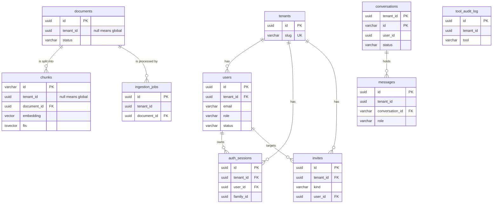

# Data model

**Type:** Reference · **Audience:** developers and operators who read, query or change the database · **Verified against:** `a989287`

**In plain English:** This page lists every table that RagAssist creates in PostgreSQL. For each table it gives the
columns, the keys and the row-level security (RLS) policy. It says which tables belong to one tenant and which rows
all tenants can read. It also shows how the LangGraph checkpoint tables are kept apart for each tenant. Use it to look
up a fact. To learn why the design looks like this, read
[tenant isolation in depth](../explanation/tenant-isolation-defence-in-depth.md) and
[ADR 0002](../adr/0002-row-level-security.md).

## 1. Where the schema comes from

| Source | Creates | Run by |
|---|---|---|
| `migrations/versions/0001_initial_schema.py` (revision `0001`) | The extension `vector`, the tables `tenants`, `users`, `documents`, `ingestion_jobs`, `chunks`, `conversations`, `messages` and `tool_audit_log`, their indexes, and all row-level security policies | `ragassist db upgrade` (Alembic) |
| `migrations/versions/0002_accounts_sessions_invites.py` (revision `0002`, head) | The columns `password_hash` and `status` on `users`, the tables `auth_sessions` and `invites`, the policy `tenants_slug_lookup` | `ragassist db upgrade` (Alembic) |
| `AsyncPostgresSaver.setup()` of the package `langgraph-checkpoint-postgres` | The four LangGraph checkpoint tables (section 6) | `ragassist db upgrade`, after Alembic |
| `infra/postgres/init.sql` | The extensions `vector` and `uuid-ossp` on a new database volume | The database container |
| `infra/postgres/create-app-role.sh` | The restricted application role | The database container |

- The command `ragassist db upgrade` runs both steps and then grants `SELECT`, `INSERT`, `UPDATE` and `DELETE` on all
  tables, and `USAGE` and `SELECT` on all sequences, to the application role. See [CLI](cli.md).
- Migration `0001` is the only one that creates the extension `vector`. Each migration grants all privileges on all
  tables and sequences in the schema `public` to the application role when that role exists.
- The migrations read the name of the application role from `DB_APP_USER`. They accept only a plain SQL identifier. See
  [configuration](configuration.md#4-database-and-row-level-security).
- Migration `0001` has a `downgrade` that drops its tables. Migration `0002` has a `downgrade` that removes its
  additions.
- With `PERSISTENCE_BACKEND=memory` the API keeps the same data in process memory and uses no table.

## 2. The two database roles

| Role | Setting | Properties | Used for |
|---|---|---|---|
| Application role | `DB_APP_USER` | Not a superuser. No `BYPASSRLS`. Not the owner of the tables. | The API and the worker. RLS binds this role. |
| Owner role | `DB_ADMIN_USER` | The owner of the tables. | The migrations, `ragassist db upgrade`, `ragassist seed` and the database container. |

> **WARNING.** RLS protects data only when the connection uses the application role. A role that is a superuser or has
> `BYPASSRLS` ignores every policy on this page. Never give the application role those properties.

## 3. How a tenant is selected

Every policy compares a column with this expression. The migrations call it `CURRENT_TENANT`:

```sql
NULLIF(current_setting('app.tenant_id', true), '')::uuid
```

- The API sets `app.tenant_id` with `SELECT set_config('app.tenant_id', :tid, true)`. The third argument `true` makes the
  setting local to the transaction. The effect equals `SET LOCAL app.tenant_id`.
- Two classes do this: `UnitOfWork` in `src/ragassist/shared/db/uow.py` and `ScopedDatabase.scope` in
  `src/ragassist/shared/db/scoped.py`. The repositories use `ScopedDatabase`.
- When the setting is missing or empty, the expression returns `NULL`. A comparison with `NULL` is never true, so the
  query sees no row. The design fails closed.
- `UnitOfWork` refuses to start on a session that already has an open transaction. `ScopedDatabase` refuses a transaction
  that spans two tenants (`TenantIsolationError`).
- The value of `app.tenant_id` comes from the verified token of the caller. See
  [security controls](security-controls.md).

The following diagram shows the tables and their keys. Look at the foreign keys: only the tables that have a `tenants`
parent in the diagram declare a foreign key to `tenants`. The other tables carry a `tenant_id` column without a foreign
key, and row-level security keeps them apart.



In words: a tenant has users, refresh sessions and invites. A user owns refresh sessions, and a reset link targets a
user. A document has chunks and ingestion jobs. A conversation has messages. The table `tool_audit_log` stands alone.
The diagram omits some columns. Sections 4 and 5 list all of them.

## 4. Tenant scope and policies

All tables below have `ENABLE ROW LEVEL SECURITY` and `FORCE ROW LEVEL SECURITY`. `FORCE` makes the policies apply to
the table owner too. Each policy name is `<table>_tenant_isolation` unless the table says otherwise. A policy of kind
`FOR ALL` applies to `SELECT`, `INSERT`, `UPDATE` and `DELETE`. The clause `USING` filters the rows that a statement
can see or change. The clause `WITH CHECK` checks the rows that a statement writes.

| Table | Scoped by | Policies | Rows visible to a tenant |
|---|---|---|---|
| `tenants` | `id` | `tenants_tenant_isolation` (`FOR ALL`, `id = CURRENT_TENANT`, same `WITH CHECK`) and `tenants_slug_lookup` (`FOR SELECT`, `slug = app.tenant_slug`) | Its own row |
| `users` | `tenant_id` | `users_tenant_isolation` (`FOR ALL`) | Its own users |
| `documents` | `tenant_id`, can be null | `documents_read` (`FOR SELECT`, `tenant_id IS NULL OR tenant_id = CURRENT_TENANT`) and `documents_write` (`FOR ALL`, `tenant_id = CURRENT_TENANT`) | Its own documents and the global documents |
| `ingestion_jobs` | `tenant_id` | `ingestion_jobs_tenant_isolation` (`FOR ALL`) | Its own jobs |
| `chunks` | `tenant_id`, can be null | `chunks_read` (`FOR SELECT`, same rule as `documents_read`) and `chunks_write` (`FOR ALL`, `tenant_id = CURRENT_TENANT`) | Its own chunks and the global chunks |
| `conversations` | `tenant_id` | `conversations_tenant_isolation` (`FOR ALL`) | Its own conversations |
| `messages` | `tenant_id` | `messages_tenant_isolation` (`FOR ALL`) | Its own messages |
| `tool_audit_log` | `tenant_id` | `tool_audit_log_tenant_isolation` (`FOR ALL`) | Its own audit rows |
| `auth_sessions` | `tenant_id` | `auth_sessions_tenant_isolation` (`FOR ALL`) | Its own sessions |
| `invites` | `tenant_id` | `invites_tenant_isolation` (`FOR ALL`) | Its own invites |

Facts about the policies:

- **Ten tables, one scope each.** Every table above is tenant-scoped. The LangGraph tables in section 6 are not.
- **Global rows.** A row in `documents` or `chunks` with `tenant_id` set to `NULL` is a global row (shared
  knowledge). Every tenant can read it. The write policy needs `tenant_id = CURRENT_TENANT`, and that is never true for
  `NULL`. The application role therefore cannot create, change or delete a global row. Only a role that bypasses RLS
  can. No command in `src/ragassist/cli` inserts a global row at this commit: `ragassist seed` writes tenants and users
  only. The API route `GET /v1/chunks/{chunk_id}` returns `is_global: true` for such a row. See
  [API endpoints](api-endpoints.md#get-v1chunkschunk_id).
- **Slug lookup.** At sign-in the tenant is not known yet. The policy `tenants_slug_lookup` shows exactly the row whose
  `slug` equals the transaction-local setting `app.tenant_slug`. The identity store sets that setting for the lookup
  only. A caller can resolve one slug but cannot list the workspaces. See
  [ADR 0007](../adr/0007-accounts-and-sessions.md), decision 9.
- **No `SECURITY DEFINER` function.** The schema has no function with `SECURITY DEFINER`. ADR 0007 rejected that
  design, because `FORCE ROW LEVEL SECURITY` binds the function owner too, and a function would add a privileged code
  path. The policy `tenants_slug_lookup` replaces it.
- Each repository query also names `tenant_id` in its `WHERE` clause. The policy is the second guard, not the only one.

## 5. Tables and columns

Types are the PostgreSQL types of the migrations. The mark "PK" means primary key. The mark "FK" means foreign key.

### `tenants`

| Column | Type | Notes |
|---|---|---|
| `id` | `uuid` | PK |
| `name` | `varchar(255)` | Not null |
| `slug` | `varchar(100)` | Not null, unique. The text that people type at sign-in. |
| `created_at` | `timestamptz` | Not null, default `now()` |

### `users`

| Column | Type | Notes |
|---|---|---|
| `id` | `uuid` | PK |
| `tenant_id` | `uuid` | Not null. FK to `tenants(id)`, `ON DELETE CASCADE`. |
| `email` | `varchar(255)` | Not null. The API stores it in lower case. |
| `role` | `varchar(50)` | Not null, default `user`. Values in use: `user`, `agent`, `admin`. No check constraint. |
| `created_at` | `timestamptz` | Not null, default `now()` |
| `password_hash` | `text` | Added by `0002`. Null until the person sets a password. The hash uses argon2id. |
| `status` | `varchar(20)` | Added by `0002`. Not null, default `active`. Check: `active` or `disabled`. |

Indexes: `ix_users_tenant_id` on `tenant_id`, `ix_users_email` on `email`, and the unique index `uq_users_tenant_email`
on `(tenant_id, lower(email))`. An address names one account in each workspace.

### `documents`

| Column | Type | Notes |
|---|---|---|
| `id` | `uuid` | PK |
| `tenant_id` | `uuid` | Null means a global document. No foreign key. |
| `title` | `varchar(512)` | Not null |
| `filename` | `varchar(512)` | Not null |
| `content_type` | `varchar(100)` | Not null |
| `file_size_bytes` | `bigint` | Not null, default 0 |
| `object_key` | `text` | Not null. The key of the file in the object store. |
| `content_hash` | `varchar(64)` | Not null, default empty |
| `status` | `varchar(20)` | Not null, default `queued`. Values written by the code: `queued`, `processing`, `completed`, `failed`. |
| `error_message` | `text` | Null unless the job failed |
| `created_by` | `uuid` | No foreign key. The code at this commit does not write it, so it stays null. |
| `created_at`, `updated_at` | `timestamptz` | Not null, default `now()` |

Index: `ix_documents_tenant_id` on `(tenant_id, created_at DESC)`.

### `ingestion_jobs`

| Column | Type | Notes |
|---|---|---|
| `id` | `uuid` | PK |
| `tenant_id` | `uuid` | Not null. No foreign key. |
| `document_id` | `uuid` | Not null. FK to `documents(id)`, `ON DELETE CASCADE`, `DEFERRABLE INITIALLY DEFERRED`. |
| `status` | `varchar(20)` | Not null, default `queued`. Values: `queued`, `parsing`, `chunking`, `embedding`, `indexing`, `completed`, `failed`. |
| `attempts` | `integer` | Not null, default 0 |
| `chunks_created` | `integer` | Not null, default 0 |
| `tokens_indexed` | `integer` | Not null, default 0 |
| `error_message` | `text` | |
| `started_at`, `completed_at` | `timestamptz` | |
| `created_at`, `updated_at` | `timestamptz` | Not null, default `now()` |

The foreign key is deferred because the upload use case inserts the job before the document, inside one transaction.
Indexes: `ix_ingestion_jobs_document` on `document_id`, `ix_ingestion_jobs_tenant` on `tenant_id`.

### `chunks`

| Column | Type | Notes |
|---|---|---|
| `id` | `varchar(64)` | PK. A text id, not a `uuid`. |
| `tenant_id` | `uuid` | Null means a global chunk. No foreign key. |
| `document_id` | `uuid` | Not null. FK to `documents(id)`, `ON DELETE CASCADE`. |
| `text` | `text` | Not null. The passage that the user reads. |
| `embed_text` | `text` | The text that the embedding model received. |
| `heading_path` | `jsonb` | Default `[]`. The headings above the passage. |
| `page` | `integer` | Null when the source has no pages |
| `title` | `varchar(255)` | Default empty |
| `embedding` | `vector(1536)` | The dense vector. The size is fixed in the migration. See `EMBEDDING_DIMENSION` in [configuration](configuration.md#11-embeddings-and-vector-search). |
| `fts` | `tsvector` | The text search vector |
| `chunk_index` | `integer` | The position in the document |
| `token_count` | `integer` | |
| `created_at` | `timestamptz` | Not null, default `now()` |

Indexes: `ix_chunks_tenant_id`, `ix_chunks_document_id`, `ix_chunks_fts` (`GIN` on `fts`) and `ix_chunks_embedding`
(`HNSW` on `embedding` with `vector_cosine_ops`). When a document is deleted, its chunks and its jobs are deleted with
it.

### `conversations`

| Column | Type | Notes |
|---|---|---|
| `tenant_id` | `uuid` | Not null. Part of the PK. No foreign key. |
| `id` | `varchar(100)` | Not null. Part of the PK. The conversation id that the API shows. |
| `user_id` | `uuid` | The owner. A null value means no recorded owner. Only staff can reach such a conversation. |
| `title` | `varchar(255)` | Not null, default `New Conversation` |
| `status` | `varchar(30)` | Not null, default `open`. Values written by the code: `open`, `escalated`, `resolved`. |
| `ticket_id` | `varchar(100)` | The helpdesk ticket, set on escalation |
| `priority` | `varchar(20)` | Set on escalation |
| `summary` | `text` | Set on escalation |
| `created_at`, `updated_at` | `timestamptz` | Not null, default `now()` |

The primary key is `(tenant_id, id)`.

### `messages`

| Column | Type | Notes |
|---|---|---|
| `id` | `uuid` | PK |
| `tenant_id` | `uuid` | Not null |
| `conversation_id` | `varchar(100)` | Not null. With `tenant_id`, FK to `conversations(tenant_id, id)`, `ON DELETE CASCADE`. |
| `role` | `varchar(20)` | Not null. Values written by the code: `user`, `assistant`, `agent`. |
| `text` | `text` | Not null |
| `citations` | `jsonb` | Not null, default `[]` |
| `user_id` | `uuid` | The author, when known |
| `route` | `varchar(40)` | The route that the graph chose |
| `model_used` | `varchar(120)` | The model that wrote the answer |
| `decider_used` | `varchar(60)` | The decider that gave the verdict |
| `created_at` | `timestamptz` | Not null, default `now()`. The code writes `clock_timestamp()`, so two messages of one transaction do not tie. |

Index: `ix_messages_conversation` on `(tenant_id, conversation_id, created_at)`.

> **NOTE.** The graph puts `route`, `model_used` and `decider_used` in its state. The code that saves a message in
> `src/ragassist/modules/assistant/api/router.py` does not pass them on. For messages that this code saves, the three
> columns stay null at this commit.

### `tool_audit_log`

| Column | Type | Notes |
|---|---|---|
| `id` | `uuid` | PK |
| `tenant_id` | `uuid` | Not null |
| `conversation_id` | `varchar(100)` | |
| `user_id` | `uuid` | |
| `tool` | `varchar(100)` | Not null. The tool name, or `approval_decision` for a human decision. |
| `arguments` | `jsonb` | Not null, default `{}`. Secret-looking keys are replaced by `***REDACTED***` before the insert. |
| `result` | `jsonb` | |
| `status` | `varchar(20)` | Not null. Values written by the code: `executed`, `failed`, `approved`, `denied`. |
| `approver_id` | `uuid` | The user who decided, for an `approval_decision` row |
| `reason` | `text` | The failure text, or the feedback of the human |
| `created_at` | `timestamptz` | Not null, default `now()` |

Index: `ix_tool_audit_log_tenant` on `(tenant_id, created_at DESC)`. The code only appends rows. See
[approvals and actions](../explanation/approvals-and-actions.md).

### `auth_sessions`

One row for each refresh token. The table stores the SHA-256 of the random part of the token, never the token.

| Column | Type | Notes |
|---|---|---|
| `id` | `uuid` | PK |
| `tenant_id` | `uuid` | Not null. FK to `tenants(id)`, `ON DELETE CASCADE`. |
| `user_id` | `uuid` | Not null. FK to `users(id)`, `ON DELETE CASCADE`. |
| `family_id` | `uuid` | Not null. All tokens of one sign-in share it. |
| `token_hash` | `char(64)` | Not null, unique (`uq_auth_sessions_token_hash`) |
| `expires_at` | `timestamptz` | Not null |
| `rotated_at` | `timestamptz` | Set when the token was exchanged for a new one |
| `revoked_at` | `timestamptz` | Set when the session ended |
| `created_at` | `timestamptz` | Not null, default `now()` |

Indexes: `ix_auth_sessions_user` on `(tenant_id, user_id)` and `ix_auth_sessions_family` on `family_id`. A token that
is presented after rotation ends the whole family. See
[accounts, sessions and tokens](../explanation/accounts-sessions-and-tokens.md).

### `invites`

One row for each invite link or password-reset link. The table stores only the hash of the token.

| Column | Type | Notes |
|---|---|---|
| `id` | `uuid` | PK |
| `tenant_id` | `uuid` | Not null. FK to `tenants(id)`, `ON DELETE CASCADE`. |
| `kind` | `varchar(10)` | Not null. Check: `invite` or `reset`. |
| `email` | `varchar(255)` | Not null |
| `role` | `varchar(50)` | Not null, default `user`. The role of the new account (invite). |
| `user_id` | `uuid` | FK to `users(id)`, `ON DELETE CASCADE`. Set for a reset link. |
| `token_hash` | `char(64)` | Not null, unique (`uq_invites_token_hash`) |
| `created_by` | `uuid` | The admin who issued the link. No foreign key. |
| `expires_at` | `timestamptz` | Not null |
| `accepted_at` | `timestamptz` | Set when the link was spent |
| `revoked_at` | `timestamptz` | Set when the link was revoked |
| `created_at` | `timestamptz` | Not null, default `now()` |

Indexes: `ix_invites_tenant` on `(tenant_id, created_at DESC)`, and the partial unique index `uq_invites_pending_email`
on `(tenant_id, lower(email))` where `kind = 'invite'` and the invite is neither accepted nor revoked. A workspace has at
most one pending invite for each address.

## 6. The LangGraph checkpoint tables

The package `langgraph-checkpoint-postgres` creates four tables when `ragassist db upgrade` calls
`AsyncPostgresSaver.setup()`. The names and columns below come from version 3.2.0 of the package, as installed in the
developer environment. Unverified: the same names in other versions of the package.

| Table | Key columns | Holds |
|---|---|---|
| `checkpoint_migrations` | `v` | The version of the checkpoint schema |
| `checkpoints` | `thread_id`, `checkpoint_ns`, `checkpoint_id` | One row for each saved state of a graph run (`checkpoint` and `metadata` as `jsonb`) |
| `checkpoint_blobs` | `thread_id`, `checkpoint_ns`, `channel`, `version` | The values of the state channels (`bytea`) |
| `checkpoint_writes` | `thread_id`, `checkpoint_ns`, `checkpoint_id`, `task_id`, `idx` | The pending writes of a run (`bytea`) |

How the tables stay apart for each tenant:

1. **No tenant column and no RLS.** The four tables have no `tenant_id` column. No migration enables row-level security
   on them. PostgreSQL itself does not separate the tenants here.
2. **A namespaced thread id.** The API builds the `thread_id` as `{tenant_id}:{conversation_id}`
   (`src/ragassist/modules/assistant/api/router.py`). The tenant id comes from the verified token. The same
   conversation id in two tenants gives two different thread ids.
3. **A check on the `conversations` row first.** Before the API reads or writes a checkpoint, it loads the
   conversation with the tenant-scoped store. RLS hides the row of another tenant, so a foreign id gives `404` before
   any checkpoint access. See [error responses](error-responses.md#4-the-401-403-and-404-rules-for-tenant-data).
4. **Helper for tests.** `ensure_thread_access` and `namespaced_thread_id` in
   `src/ragassist/modules/assistant/application/thread_guard.py` express the same rule. At this commit, only the tests
   call `ensure_thread_access`. The routers use the store lookup described in step 3.
5. **No bearer token in the checkpoint.** The state stores the principal without its raw token. The tool calls make a
   short-lived token for each call. See [security controls](security-controls.md).
6. **Grants.** `ragassist db upgrade` grants `SELECT`, `INSERT`, `UPDATE` and `DELETE` on these tables to the
   application role.

> **CAUTION.** Because the checkpoint tables have no RLS, a bug that builds a `thread_id` without the tenant prefix
> could read another tenant's state. Every code path must build the id with the tenant from the token.

## 7. Other stores

| Store | What it holds | Setting | Notes |
|---|---|---|---|
| Object store (S3, or LocalStack) | The uploaded files. The column `documents.object_key` points to each file. | `S3_BUCKET_DOCS` | The database does not isolate it. The upload use case builds each key as `tenants/<tenant id>/documents/<document id>/<file name>`. |
| Queue (SQS, or LocalStack) | Ingestion messages with `job_id`, `tenant_id`, `document_id` and `object_key` | `SQS_QUEUE_INGEST` | The worker reads it. |
| Event channel | Change notices, ids only | None | A PostgreSQL `LISTEN` and `NOTIFY` channel named `ragassist_events`. No table. See [ADR 0008](../adr/0008-live-events-handoff-and-detached-turns.md). |
| Cache | Embeddings, retrieval results and verdicts | `CACHE_BACKEND` | In process memory, or Redis. Not the database. See [ADR 0015](../adr/0015-caching.md). |

## 8. Related pages

- [Configuration](configuration.md) for `DB_*`, `DATABASE_URL`, `PERSISTENCE_BACKEND` and `EMBEDDING_DIMENSION`.
- [CLI](cli.md) for `ragassist db upgrade` and `ragassist seed`.
- [Roles and permissions](roles-and-permissions.md) for who may read or change which rows through the API.
- [ADR 0001](../adr/0001-pgvector-unified-storage.md), [ADR 0002](../adr/0002-row-level-security.md) and
  [ADR 0007](../adr/0007-accounts-and-sessions.md).
- [How to add a database migration with RLS](../how-to/add-a-database-migration-with-rls.md).
