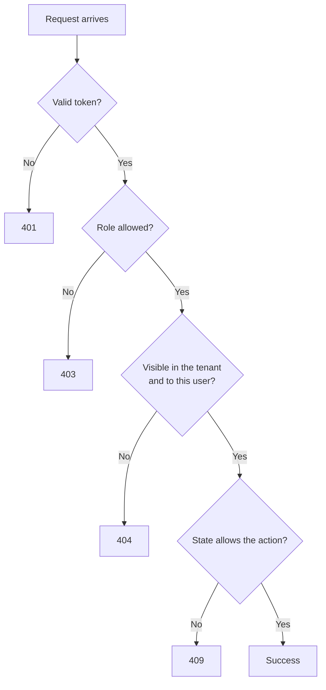

# Error responses

**Type:** Reference · **Audience:** developers who call the API or add routes · **Verified against:** `a989287`

**In plain English:** This page lists the shapes of the errors that the RagAssist API returns. It lists each status
code, the text of the main messages and the rules that choose between `401`, `403` and `404` for tenant data. It also
describes the rate limit and the `429` answer. Use it to decide how a client must react to an error.

## 1. Body shapes

The API has five error shapes. Most errors use the first one.

| # | Shape | Used for | Content type |
|---|---|---|---|
| 1 | `{"detail": "<message>"}` | Errors that the route raises (`HTTPException`), including `401`, `403`, `404`, `409` | `application/json` |
| 2 | `{"detail": [{"type", "loc", "msg", "input", "ctx"}, ...]}` | Validation errors that FastAPI raises (`422`) | `application/json` |
| 3 | `{"detail": "Too Many Requests: Rate limit exceeded"}` | The rate limiter (`429`) | `application/json` |
| 4 | Plain text `Internal Server Error` | An unhandled exception (`500`) | `text/plain` |
| 5 | An SSE frame `event: error` | A failure inside an open answer stream | `text/event-stream` |

Facts about the shapes:

- The field `detail` is a string in shape 1. A client must not assume that `detail` is always a string, because shape 2
  makes it a list.
- The `input` field in shape 2 can echo the value that failed validation. Do not send secrets in a field that can
  fail validation.
- The API has no custom exception handler. FastAPI and Starlette produce shapes 1, 2 and 4.
- A `304` answer has no body (section 7).
- A `204` answer has no body.

Example of shape 1:

```json
{"detail": "Conversation not found"}
```

Example of shape 2 (a missing field):

```json
{"detail": [{"type": "missing", "loc": ["body", "content"], "msg": "Field required", "input": {}}]}
```

### Two kinds of `422`

| Kind | Where it comes from | `detail` |
|---|---|---|
| Schema validation | FastAPI checks the body, the query or the path against the model (for example `limit` above 100, a missing field, a bad UUID, a `status` that is not `active` or `disabled`) | A list (shape 2) |
| Domain validation | The identity code rejects a value: an invalid email address (`Enter a valid email address.`) or a password that breaks the policy (`Use at least <n> characters.`) | A string (shape 1) |

### Errors inside a stream

A stream answers `200` before it knows the result. A failure after that point arrives as an event, not as a status.

```text
event: error
data: {"code": "internal_error", "message": "An error occurred while processing the request."}
```

The message is sanitised. It never holds a stack trace or a secret. After an `error` event, the turn is lost: the API
does not save a partial answer. Read the [SSE contract](../api/sse-contract.md) for the frame format.

## 2. Status codes

| Code | Meaning in this API | Typical source |
|---|---|---|
| `200` | Success | Most routes |
| `201` | Created | `POST /v1/conversations`, `POST /v1/team/invites`, `POST /v1/team/members/{user_id}/reset-link` |
| `202` | Accepted for later work | `POST /v1/documents` |
| `204` | Success with no body | `POST /v1/auth/logout`, `DELETE /v1/team/invites/{invite_id}` |
| `304` | The caller's cached copy is current | `GET /v1/chunks/{chunk_id}`, `GET /v1/documents` |
| `400` | The request is understood but empty or invalid | Empty upload, empty agent reply |
| `401` | No valid credential | Missing, bad or expired token; wrong sign-in; bad link or cookie |
| `403` | A credential exists but the role or origin is not allowed | Role checks, the origin check, the development token |
| `404` | The resource does not exist for this caller | Tenant data lookups |
| `409` | The state of the resource blocks the action | Last admin, self change, no pending action, not escalated |
| `413` | The upload is too large | `POST /v1/documents` |
| `415` | The upload type is not accepted | `POST /v1/documents` |
| `422` | The input fails validation | Any route with a body, a query or a path parameter |
| `429` | Too many requests or too many streams | Rate limiter, sign-in throttle, events stream cap |
| `500` | An unhandled error | Any route |
| `502` | The approved action failed while the graph resumed | `POST .../actions/{interrupt_id}` |
| `503` | The checkpoint could not be read | `POST .../actions/{interrupt_id}` |

## 3. Messages by status

The tables give the text that the code raises. Text in angle brackets changes with the request.

### 401

| Message | Raised when |
|---|---|
| `Not authenticated` | The `Authorization` header is missing or has no token (see the note below) |
| `Invalid or expired authentication token: <reason>` | The token is malformed, has a wrong signature, is expired, or lacks `exp`, `sub` or `tenant_id`. The response has `WWW-Authenticate: Bearer`. |
| `Invalid workspace, email or password.` | Sign-in failed. The text is the same for an unknown workspace, an unknown email, a disabled account, an account with no password and a wrong password. |
| `Not signed in.` | `POST /v1/auth/refresh` has no cookie |
| `Session expired. Sign in again.` | The refresh cookie is unknown, expired, revoked or already used. The response clears the cookie. |
| `This link is invalid or has expired.` | An invite or reset link is unknown, used, revoked or expired |
| `Invalid or expired link.` | The token of a link or of the refresh cookie is malformed (it does not have the form `<tenant id>.<random part>`) |
| `Your account is no longer active.` | `GET /v1/auth/me` for a missing or disabled user |

> **NOTE.** The text and the status for a missing `Authorization` header come from the installed FastAPI version. With
> FastAPI 0.162.2 (read in the developer environment) the answer is `401` `Not authenticated`. Older FastAPI versions
> answer `403`. `pyproject.toml` allows FastAPI 0.115.0 or newer. Unverified: the answer with every allowed version.

### 403

| Message | Raised when |
|---|---|
| `User role '<role>' is not permitted for this action.` | A route that uses `require_role` (all team routes) refuses the role |
| `Admin role required to upload documents` | A non-admin calls `POST /v1/documents` |
| `Admin role required to delete documents` | A non-admin calls `DELETE /v1/documents/{document_id}` |
| `Admin role required to re-index documents` | A non-admin calls `POST .../reindex` |
| `Administrator role required` | A non-admin calls `GET /metrics` |
| `Only agents or admins can list escalations` | A `user` calls `GET /v1/escalations` |
| `Role '<role>' is not allowed to reply as an agent` | A caller who is not an `agent` replies to an escalation. The text of `<role>` is the enum name, for example `UserRole.ADMIN`. |
| `Only agents or admins can resolve an escalation` | A `user` calls `POST .../resolve` |
| `Only the conversation's owner or an admin can decide this action` | An `agent` who does not own the conversation decides an action |
| `Cross-origin request refused.` | `refresh` or `logout` has no `Origin` header, or the origin is not trusted |
| `Development token issuance is disabled in this environment` | `APP_ENV` is not `development` or `test` |
| `A valid X-Dev-Auth-Secret header is required` | The development secret is missing or wrong |

### 404

| Message | Raised when |
|---|---|
| `Conversation not found` | The conversation is missing, belongs to another tenant, or belongs to another user (for a plain user) |
| `Document not found` | The document is missing or belongs to another tenant |
| `Ingestion job not found` | The job is missing or belongs to another tenant |
| `Chunk not found` | The chunk is missing or belongs to another tenant |
| `Conversation '<id>' not found` | An agent replies to an unknown or foreign escalation |
| `Escalation not found` | A caller resolves an unknown or foreign escalation |
| `No such member.` | An admin targets an unknown user of the tenant |
| `No such pending invite.` | An admin revokes an unknown or spent invite |

### 400, 409, 413, 415, 502 and 503

| Code | Message | Raised when |
|---|---|---|
| `400` | `File content cannot be empty (0 bytes).` | The uploaded file has no bytes |
| `400` | `Reply text cannot be empty or whitespace only` | The agent reply is blank |
| `409` | `You cannot change your own role or status.` | An admin changes their own role or status |
| `409` | `A workspace needs at least one active administrator.` | The change would remove the last active admin |
| `409` | `That address already has an account in this workspace.` | An invite targets an address that has an account |
| `409` | `That address already has a pending invite.` | A second invite targets the same address |
| `409` | `There is no pending action with this id` | The `interrupt_id` is not the one the conversation waits on |
| `409` | `This conversation is not escalated.` | A reply or resolve targets a conversation that is not `escalated` |
| `413` | `File exceeds the 50 MB limit.` | The upload is over 50 MiB (the text says MB, the limit is 50 MiB) |
| `415` | `MIME type '<type>' is not supported` | The type is not `text/markdown`, `text/html`, `text/csv` or `application/pdf` |
| `502` | `The action could not be completed` | Resuming the graph after approval failed |
| `503` | `The pending action could not be verified` | The API could not read the checkpoint |

## 4. The 401, 403 and 404 rules for tenant data

The API follows one set of rules so that an error never confirms that another tenant's data exists.

1. **No valid token gives `401`.** Every route that needs a token checks it first. The check does not look at the
   tenant data.
2. **A valid token with a wrong role gives `403`.** The role comes from the token. The `403` tells the caller only that
   their role is not enough. The role check runs before the lookup, so a wrong role gets `403` even for an id that
   does not exist.
3. **A resource that the caller may not see gives `404`.** This covers an unknown id, a resource of another tenant and
   a conversation of another user. The `404` text is the same in all three cases.
4. **A resource that the caller may see but may not change gives `403`.** The only case is the approval of an action:
   an `agent` who can read a conversation but does not own it gets `403`.
5. **A state conflict gives `409`.** The API checks the state after the role and the lookup.

The following diagram shows the usual order of the checks. Look for the point where each status code can leave the
flow.



In words: first the token, then the role, then the lookup, then the state. Two routes change the order:

- **Approve an action** (`POST .../actions/{interrupt_id}`): the lookup comes before the role. A user who is not the owner
  gets `404`. An `agent` who is not the owner gets `403`. An `admin` passes. Then the API checks the pending action
  (`409`, `503`).
- **Agent reply** (`POST .../reply`): the empty-text check (`400`) comes before the role check (`403`).

Why a `404` for another tenant: row-level security hides the rows of other tenants, so the lookup finds nothing. The
route cannot tell "missing" from "foreign". See [tenant isolation in depth](../explanation/tenant-isolation-defence-in-depth.md)
and the [data model](data-model.md).

A `304` follows the same rule. The API answers `304` only after it authenticated the caller and loaded the resource for
the caller's tenant. A `304` never confirms that a resource exists to someone who may not read it.

## 5. Validation errors

- FastAPI answers `422` with shape 2 for a body that does not match the model. The `loc` list starts with `body`,
  `query`, `path`, `header` or `cookie`.
- Limits that the routes declare: `limit` from 1 to 100, `offset` 0 or more, `workspace` at most 100 characters, `email`
  at most 254, `password` at most 1024, `token` at most 200.
- Path ids of team routes are UUIDs. A value that is not a UUID gives `422`.
- Path ids of conversation, document, job, chunk and escalation routes are plain strings. An unknown value gives `404`,
  not `422`.
- Sign-in does not use `422` for a wrong password. It uses `401`.
- A password policy error uses `422` with a string `detail`. The limits are: at least `AUTH_MIN_PASSPHRASE_LENGTH`
  characters, at most 128 characters, and not equal to the email address.

## 6. Rate limiting and 429

The API has three sources of `429`.

| Source | Scope | Body | `Retry-After` |
|---|---|---|---|
| Rate limiter (`RateLimitMiddleware`) | Each client address, all routes except the exempt ones | Shape 3 | Seconds until the oldest request leaves the window (at least 1) |
| Sign-in throttle | Each account (failed attempts) and each client address (all attempts) on `POST /v1/auth/login` | `{"detail": "Too many attempts. Try again later."}` | Seconds until an attempt is allowed |
| Events stream cap | Each user, each API process | `{"detail": "Too many open event streams"}` | `5` |

### The rate limiter

- The limit is 300 requests in a window of 60 seconds for each client address. The numbers are fixed in
  `src/ragassist/shared/security/rate_limiter.py`. No setting changes them.
- The key is the client address that the server sees. Behind the web container, uvicorn trusts the forwarded address only
  from the peers in `TRUSTED_PROXY_IPS`.
- The exempt paths are `/healthz`, `/metrics`, `/docs`, `/redoc`, `/openapi.json` and `<API_V1_PREFIX>/events`.
- Every answer on a non-exempt path carries `X-RateLimit-Limit`, `X-RateLimit-Remaining` and `X-RateLimit-Reset`. A
  `429` from the limiter carries the same three headers and `Retry-After`.
- With `CACHE_BACKEND=redis` (and `CACHE_ENABLED=true`) the limiter counts in Redis, in a fixed window, so that API
  replicas share the count. `X-RateLimit-Reset` is then the whole window, an upper bound. When Redis is not
  reachable, each process counts for itself (a sliding window). See [ADR 0015](../adr/0015-caching.md).
- The in-process table holds at most 50,000 client keys. The oldest keys leave first.

### The sign-in throttle

- Two limits apply: `AUTH_LOGIN_MAX_FAILURES` failed attempts for each account, and `AUTH_LOGIN_MAX_PER_IP` attempts for
  each client address, both inside `AUTH_LOGIN_WINDOW_SECONDS` seconds.
- Only failures count against an account. A successful sign-in clears the account count.
- Keys are hashes. The table holds at most 20,000 keys.
- See [ADR 0007](../adr/0007-accounts-and-sessions.md) and [configuration](configuration.md).

## 7. Conditional requests (304)

- `GET /v1/chunks/{chunk_id}` and `GET /v1/documents` return an `ETag`. A request with `If-None-Match` that matches gets
  `304` with the same `ETag`, `Cache-Control` and `Vary` headers and no body. The match is weak: a `W/` prefix is
  ignored, a comma list works, and `*` matches.
- Routes under `<API_V1_PREFIX>/auth` and the route `<API_V1_PREFIX>/events` answer `Cache-Control: no-store` and
  `Pragma: no-cache`, also on errors. The middleware removes an `ETag` from those answers.

## 8. Related pages

- [API endpoints](api-endpoints.md) for the route list.
- [Roles and permissions](roles-and-permissions.md) for who may call what.
- [Security controls](security-controls.md) for the controls behind these rules.
- [Observability](observability.md) for how a `500` shows in logs and metrics.
- [Troubleshoot common problems](../how-to/troubleshoot-common-problems.md) for fixes.
- [ADR 0006](../adr/0006-conversation-access-and-approval-binding.md) for the access and approval rules.
