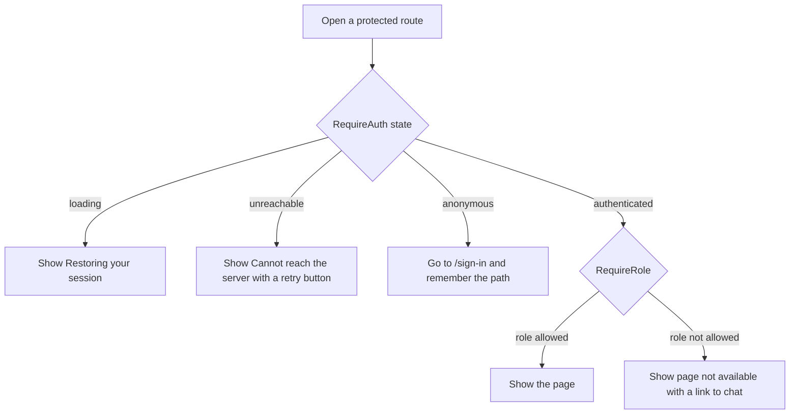
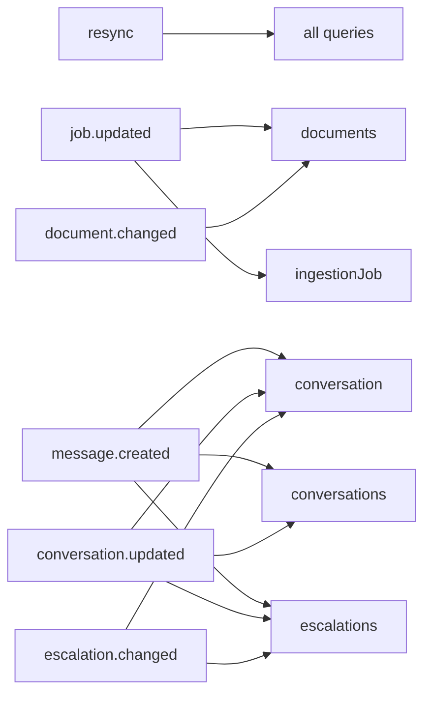
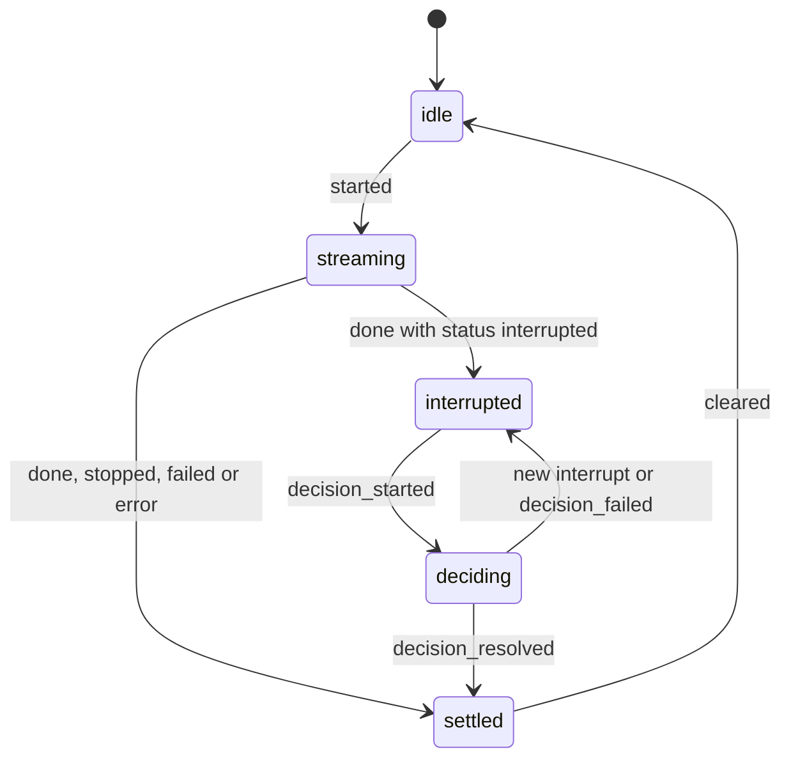

# Frontend structure

**Type:** Reference · **Audience:** engineers who change the web app · **Verified against:** `a989287`

**In plain English:** The web app is a React single-page app in `frontend/`. This page lists its folders, routes, route
guards, data keys, live-event rules, scripts and tests. Use it to find where a thing lives before you change it.

The design decisions are in [ADR 0009](../adr/0009-web-app.md), [ADR 0010](../adr/0010-chat-ui.md),
[ADR 0011](../adr/0011-admin-screens.md), [ADR 0014](../adr/0014-web-delivery.md) and
[ADR 0016](../adr/0016-liquid-redesign.md). The open work list is in the [frontend TODO](../frontend/TODO.md). The
steps to work on the app are in [Develop the frontend](../how-to/develop-the-frontend.md).

## 1. Stack

| Part | Package and version in `package.json` |
|---|---|
| UI library | React 19.3.1 |
| Router | react-router 8.5.0 |
| Server state | TanStack Query 5.104.5 |
| Styling | Tailwind 4.3.3 |
| Build tool | vite 8.3.5 |
| Unit tests | vitest 5.0.5 |
| End-to-end tests | Playwright 1.64.1 |
| Other | eventsource-parser, react-markdown, rehype-sanitize, remark-gfm, motion, radix-ui, cmdk, fontsource fonts |

The app needs Node 22 or later (`engines.node` is `>=22`).

## 2. Folders under `frontend/src/`

| Folder | Content |
|---|---|
| `api` | HTTP client (`http.ts`), the token store (`token-store.ts`), generated types (`schema.d.ts`), query keys |
| `app` | Router, route table (`access.ts`), providers, `QueryClient` setup |
| `auth` | Session state, `RequireAuth`, `RequireRole`, `PublicOnly` |
| `background` | The liquid canvas background (ADR 0016) |
| `components` | Shared components. `components/ui` holds the base controls |
| `events` | The live event stream, the invalidation map, `useEvents` |
| `features/auth` | Sign-in, accept-invite and reset-password forms |
| `features/chat` | Chat thread, turn state, stream parser, Markdown view, passages |
| `features/inbox` | The escalation inbox for staff |
| `features/knowledge` | Document list, upload and ingestion jobs |
| `features/team` | Members and invites |
| `lib` | Small helpers |
| `pages` | The `NotFoundPage` only. The other route pages are in `features/*` |
| `test` | Test setup (`setup.ts`) and helpers |
| `theme` | Light and dark theme tokens |

`src/api/schema.d.ts` is generated. Do not edit it. See section 8.

## 3. Routes and guards

The route table is `APP_ROUTES` in `src/app/access.ts`.

| Path | Page | Roles that may open it |
|---|---|---|
| `/` | Chat | user, agent, admin |
| `/inbox` | Inbox | agent, admin |
| `/knowledge` | Knowledge | admin |
| `/team` | Team | admin |
| `/sign-in` | Sign in | Public. `PublicOnly` redirects a signed-in user |
| `/accept` | Accept an invite | Public. `PublicOnly` does not wrap it, so a signed-in user can open it |
| `/reset-password` | Reset a password | Public. `PublicOnly` does not wrap it, so a signed-in user can open it |
| `*` | `NotFoundPage` | Anyone |

The next diagram shows how a request for a protected route passes the guards. Read it from top to bottom.

Text equivalent of the diagram:

- `RequireAuth` has four states: `loading`, `unreachable`, `anonymous` and `authenticated`.
- In `loading`, it shows the status page "Restoring your session".
- In `unreachable`, it shows a status page with a "Try again" button. The user stays signed in.
- An anonymous visitor goes to `/sign-in`. The guard stores the requested path so that sign-in can return to it.
- An authenticated user reaches `RequireRole`. It compares the role with the table above.
- A user without the role sees the status page "This page is not available to your role". The page links back to the
  chat. The guard does not redirect.
- `PublicOnly` wraps the `/sign-in` route only. It sends a signed-in user to `landingPath(role, from)`.

The role check in the browser is a convenience. The API enforces the roles (see [Security controls](security-controls.md)
and [Roles and permissions](roles-and-permissions.md)).

## 4. Session and token

- The access token lives in module memory only (`token-store.ts`). The app never writes it to `localStorage`.
- The refresh token is an `httpOnly` cookie that the browser sends to the API. The script cannot read it.
- `http.ts` adds the bearer header. When a request returns 401, it refreshes once and retries once. The refresh is
  single-flight and uses a Web Lock, so several tabs do not refresh at the same time.
- The Markdown view of the chat (`features/chat/markdown.tsx`) uses `react-markdown` with `rehype-sanitize` and
  `remark-gfm`. It does not use `rehype-raw`. It disallows the `img` element. Links open with
  `target="_blank"` and `rel="noopener noreferrer"`. The test is `markdown.test.tsx`.

## 5. Server state (TanStack Query)

`QueryClient` defaults:

| Option | Value |
|---|---|
| `staleTime` | 30 seconds |
| `refetchOnWindowFocus` | false |
| `retry` | Only for transient failures, at most 2 times |

Query keys:

| Key | Value |
|---|---|
| conversations | `["conversations"]` |
| conversation(id) | `["conversations", id]` |
| escalations | `["escalations"]` |
| documents | `["documents"]` |
| ingestionJob(id) | `["ingestion-jobs", id]` |
| teamMembers | `["team", "members"]` |
| teamInvites | `["team", "invites"]` |
| `passageKey(chunkId)` | `["chunks", chunkId]` (defined in `features/chat/api.ts`) |

## 6. Live events

The app opens one event stream. `useEvents` owns it. The stream is `fetch` based and parsed with `eventsource-parser`,
so it can send the bearer header.

Reconnect rules:

- The backoff starts at 1 second and grows to 30 seconds, with jitter.
- The stream is idle after 45 seconds without data. The client then reconnects.
- On HTTP 429 the client waits for the `Retry-After` time.
- On `reauth` the client refreshes the token and reconnects.
- After every reconnect, `useEvents` invalidates all queries.

The next diagram shows which event refreshes which query. Read each arrow as "invalidates".

Text equivalent of the diagram (`events/invalidation.ts`):

| Event | Queries that it invalidates |
|---|---|
| `resync` | All |
| `job.updated` | `documents` and `ingestionJob(job_id)` |
| `document.changed` | `documents` |
| `message.created` | `conversation(id)`, `conversations` and `escalations` |
| `conversation.updated` | `conversation(id)`, `conversations` and `escalations` |
| `escalation.changed` | `escalations` and `conversation(id)` |
| `ready`, `reauth` and unknown events | None |

The event payloads hold ids only. The wire format is in the [SSE contract](../api/sse-contract.md).

## 7. Chat turn state

The chat reads the answer stream of one turn. The parser in `features/chat` knows the events `token`, `reset`,
`citation`, `tool_call`, `interrupt`, `escalated`, `done` and `error`.

The reducer in `turn.ts` holds the state of a turn.

| Part | Values |
|---|---|
| Phases | `idle`, `streaming`, `interrupted`, `deciding`, `settled` |
| Actions | `started`, `stream`, `stopped`, `failed`, `decision_started`, `decision_resolved`, `decision_failed`, `cleared`, `switched` |
| `ThreadNote` kinds | `decision`, `handoff` |
| Helpers | `savedMessagesExpected`, `isSuperseded` |

The next diagram shows the phases. Read it as the life cycle of one turn in the browser.

Text equivalent of the diagram (`turn.ts`):

- `started` moves the turn from `idle` to `streaming`.
- Stream events apply only while the phase is `streaming`.
- A `done` event with the status `interrupted` and a pending interrupt moves the turn to `interrupted`. Any other `done`
  moves it to `settled`. An `error` event also moves it to `settled`.
- `stopped` and `failed` move a `streaming` turn to `settled`.
- `decision_started` moves an `interrupted` turn to `deciding`.
- `decision_resolved` moves a `deciding` turn to `settled`, or back to `interrupted` when the resumed graph raises a new
  interrupt. `decision_failed` moves it back to `interrupted` with an error.
- `cleared` returns the turn to `idle`. `switched` resets the whole chat state to its initial state.

A frame batcher joins stream updates so that the UI re-renders once for each animation frame. The URL parameter
`c` (`CONVERSATION_PARAM`) holds the open conversation id.

## 8. Scripts and generated files

| Script | Command | Job |
|---|---|---|
| `dev` | vite | Dev server. Proxies `/v1` and `/healthz` to `API_PROXY_TARGET` |
| `build` | `tsc --noEmit && vite build` | Type check and build |
| `preview` | vite preview | Serves the build |
| `lint` | `eslint .` | Lint |
| `typecheck` | `tsc --noEmit` | Type check |
| `test` | `vitest run` | Unit tests |
| `test:watch` | vitest | Unit tests in watch mode |
| `e2e` | `playwright test` | End-to-end tests |
| `api:types` | `openapi-typescript ../docs/api/openapi.json -o src/api/schema.d.ts` | Generates the types |
| `api:check` | `node scripts/check-api-types.mjs` | Fails when the types are out of date |

`docs/api/openapi.json` is the source of the API types. The steps to refresh it are in
[Regenerate API types and OpenAPI](../how-to/regenerate-api-types-and-openapi.md).

## 9. Environment variables

| Variable | Use |
|---|---|
| `API_PROXY_TARGET` | Required for `dev`. The vite proxy target for `/v1` and `/healthz` |
| `PLAYWRIGHT_WEB_PORT` | Optional. The port of the preview server in the end-to-end tests |
| `E2E_SCREENSHOT_DIR` | Optional. The folder for capture specs |
| `CI` | Set by the CI runner |

`frontend/.env.example` holds the template. Put the value in your own `.env`, never in a committed file.

## 10. Tests

| Kind | Where | Notes |
|---|---|---|
| Unit | `src/**/*.test.ts` and `src/**/*.test.tsx` | vitest with jsdom. Setup file `src/test/setup.ts` |
| End to end | `frontend/tests/e2e/` | Playwright. Four projects: desktop and phone, each in light and dark |

The Playwright specs are `accept`, `admin-screens`, `chat`, `inbox`, `knowledge`, `layout`, `liquid-capture`,
`role-gating`, `screens`, `session`, `sign-in` and `team`, and mock helpers. Playwright serves the app with
`npm run build && npx vite preview`. The `frontend` job in CI runs them (see [CI and quality gates](ci-and-quality-gates.md)).
That job is currently gated by the repository variable `RUN_FRONTEND_CI`.

## 11. Open limits

- The logo is not chosen. Concepts are in `docs/frontend/logo-concepts`.
- The nginx Content Security Policy keeps `style-src 'unsafe-inline'`. The decision is open (see
  [Security controls](security-controls.md)).
- A real-stack end-to-end smoke run has not been done.
- The `frontend` CI job is suspended while the UI changes.
