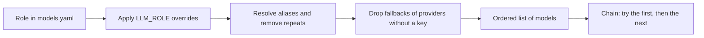

# Models catalog

**Type:** Reference · **Audience:** operators and developers who choose, add or debug language models · **Verified against:** `a989287`

**In plain English:** The file `config/models.yaml` lists the language models that RagAssist can use. It also says
which model does which job, and which model takes over when the first one fails. This page lists the content of that
file at this commit and explains how the settings `LLM_ROLE_*` change it. Use it to look up a model, an alias or a
role. To change the models, follow
[configure LLM providers and fallbacks](../how-to/configure-llm-providers-and-fallbacks.md).

## 1. The file and how it loads

- The path comes from the setting `MODELS_CONFIG_PATH` (see [configuration](configuration.md#9-model-providers)).
- The class `ModelCatalog` in `src/ragassist/platform/llm/catalog.py` loads the file with `yaml.safe_load`. The classes
  in `src/ragassist/platform/llm/catalog_models.py` validate it.
- A missing file stops the start-up with `FileNotFoundError`.
- The file has four top-level sections: `providers`, `models`, `aliases` and `roles`. The key `version` is `"1.0"`.
- The entries under `models`, and their `pricing` and `capabilities`, reject an unknown key (`extra="forbid"`). The
  `default_params` of a model, the `providers` and the `roles` ignore an unknown key.
- A provider adapter reads its API key from the settings, never from the file. The file names the setting.
- All names on this page match the file. The prices are the values in the file at this commit. They are in USD for 1
  million tokens. See section 8.

The following diagram shows how a role becomes a list of models. Look at the three steps between the role and the list.

In words: the code reads the role, replaces the primary model or the fallbacks when a setting says so, turns aliases
into model keys, removes repeats, removes fallback models of an optional provider that has no key, and then uses the
models in order.

## 2. Providers

| Provider key | Adapter | Key setting | Endpoint | Timeout in file | Skipped without key |
|---|---|---|---|---|---|
| `openai` | `openai` | `OPENAI_API_KEY` | The OpenAI default of the client library | 30.0 seconds | No |
| `anthropic` | `anthropic` | `ANTHROPIC_API_KEY` | The Anthropic default of the client library | 30.0 seconds | No |
| `openrouter` | `openrouter` | `OPENROUTER_API_KEY` | A fixed public OpenRouter address in the adapter | 45.0 seconds | No |
| `gemini` | `gemini` | `GEMINI_API_KEY` | `GEMINI_BASE_URL` | 60.0 seconds | **Yes** (`skip_when_unconfigured: true`) |
| `openai_compatible` | `openai_compatible` | `OPENAI_COMPATIBLE_API_KEY` | `OPENAI_COMPATIBLE_BASE_URL` | 60.0 seconds | No |

Facts about the provider fields:

- The loader reads these fields: `adapter`, `api_key_env`, `base_url`, `base_url_env`, `default_headers`,
  `timeout_seconds` and `skip_when_unconfigured`.
- At this commit, only `api_key_env` and `skip_when_unconfigured` change what the code does. Both are read by
  `ModelCatalog.is_model_configured`. The adapters take the key and the endpoint from `Settings`, and the OpenRouter
  adapter fixes its address and headers in code. No code reads `timeout_seconds`, `base_url`, `base_url_env` or
  `default_headers` of a provider. Changing them in the file has no effect.
- The adapters are registered in `create_default_llm_registry` in `src/ragassist/platform/llm/service.py`. The
  Gemini adapter uses the OpenAI-compatible endpoint of Google (no extra SDK). See
  [ADR 0013](../adr/0013-gemini-provider.md).
- To add a provider, see [add an LLM provider](../how-to/add-an-llm-provider.md).

## 3. Models

The column "Context" is `context_window`. The column "Max output" is `max_output_tokens`. The column "Price" is
`input_cost_per_mtok` / `output_cost_per_mtok`. The column "Temp" is `default_params.temperature`.

| Model key | Provider | API model name | Context | Max output | Price (USD per 1M tokens) | Temp |
|---|---|---|---|---|---|---|
| `gpt-4o` | `openai` | `gpt-4o` | 128000 | 4096 | 2.50 / 10.00 | 0.1 |
| `gpt-4o-mini` | `openai` | `gpt-4o-mini` | 128000 | 16384 | 0.15 / 0.60 | 0.0 |
| `claude-sonnet-5-5` | `anthropic` | `claude-sonnet-5-5` | 1000000 | 128000 | 2.00 / 10.00 | 0.1 |
| `claude-haiku-5-5` | `anthropic` | `claude-haiku-5-5` | 1000000 | 128000 | 0.10 / 0.50 | 0.0 |
| `claude-3-5-sonnet` | `anthropic` | `claude-3-5-sonnet-20241022` | 200000 | 8192 | 3.00 / 15.00 | 0.1 |
| `claude-3-5-haiku` | `anthropic` | `claude-3-5-haiku-20241022` | 200000 | 8192 | 0.80 / 4.00 | 0.0 |
| `claude-3-haiku` | `anthropic` | `claude-3-haiku-20240307` | 200000 | 4096 | 0.25 / 1.25 | 0.0 |
| `openrouter-llama-3.1-70b` | `openrouter` | `meta-llama/llama-3.1-70b-instruct` | 131072 | 4096 | 0.40 / 0.40 | 0.1 |
| `openrouter-mistral-large` | `openrouter` | `mistralai/mistral-large-2407` | 128000 | 4096 | 2.00 / 6.00 | 0.1 |
| `gemini-flash-latest` | `gemini` | `gemini-flash-latest` | 1048576 | 65536 | 0.75 / 3.75 | 0.1 |
| `gemini-flash-lite-latest` | `gemini` | `gemini-flash-lite-latest` | 1048576 | 65536 | 0.30 / 2.50 | 0.0 |
| `gemini-pro-latest` | `gemini` | `gemini-pro-latest` | 1048576 | 65536 | 2.00 / 12.00 | 0.1 |
| `gemini-3.8-flash` | `gemini` | `gemini-3.8-flash` | 1048576 | 65536 | 0.75 / 3.75 | 0.1 |
| `gemini-3.5-flash-lite` | `gemini` | `gemini-3.5-flash-lite` | 1048576 | 65536 | 0.30 / 2.50 | 0.0 |
| `local-llama-3.1-8b` | `openai_compatible` | `llama3.1:8b` | 32768 | 4096 | 0.00 / 0.00 | 0.0 |

Capabilities in the file:

| Model keys | `tool_calling` | `json_mode` | `vision` | `logprobs` | `streaming` |
|---|---|---|---|---|---|
| `gpt-4o`, `gpt-4o-mini` | true | true | true | true | true |
| `claude-sonnet-5-5`, `claude-haiku-5-5`, `claude-3-5-sonnet` | true | true | true | false | true |
| `claude-3-5-haiku`, `claude-3-haiku` | true | true | false | false | true |
| `openrouter-llama-3.1-70b`, `openrouter-mistral-large` | true | false | false | false | true |
| The five `gemini-*` models | true | true | true | false | true |
| `local-llama-3.1-8b` | true | true | false | false | true |

Notes from the comments in the file:

- **Claude 5.5 models.** A comment says the maintainers verified on 2026-11-10 with the project key that both models
  report an input limit of 1,000,000 tokens and an output limit of 128,000 tokens. The price of `claude-haiku-5-5` is
  the tier for prompts up to 100k tokens. The comment lists a higher price for longer prompts (0.50 / 2.50) and says
  the lower tier is stored because the prompts are short.
- **Retired Claude 3.5 models.** A comment says the same key gets a not-found answer for `claude-3-5-sonnet-20241022`
  and `claude-3-5-haiku-20241022`. The entries stay only so that old configurations still resolve. Do not use them as
  new choices.
- **Gemini aliases move.** The `-latest` names are moving pointers that the vendor changes with each release. The
  limits and prices in the file are those of the model that each alias points to at the time of writing.
  Unverified: the file says the vendor documents do not name the model that `gemini-flash-latest` and
  `gemini-flash-lite-latest` point to today. Use `gemini-3.8-flash` or `gemini-3.5-flash-lite` for a fixed model.
- **Gemini prices.** The file notes a scheduled price change for `gemini-3.8-flash` on 2027-01-01. For
  `gemini-pro-latest`, the stored price is the tier for prompts up to 200k tokens. The file lists a higher tier above
  that size.
- **Duplicate key in the file.** The entry `claude-haiku-5-5` has the key `pricing` twice, with the same values. YAML
  loaders accept this and keep the last one, so the result is correct. Remove one copy when you edit the file.

## 4. Aliases and roles

### Aliases

An alias is a short name for a model key. `ModelCatalog.resolve_model_id` follows aliases. It rejects a loop with
`ValueError`. It rejects an unknown name with `KeyError` and lists the available names.

| Alias | Model key |
|---|---|
| `gen-default` | `gpt-4o` |
| `gen-openrouter-llama` | `openrouter-llama-3.1-70b` |
| `fast-default` | `gpt-4o-mini` |
| `claude-sonnet` | `claude-sonnet-5-5` |
| `claude-haiku` | `claude-haiku-5-5` |
| `gemini-flash` | `gemini-flash-latest` |
| `gemini-flash-lite` | `gemini-flash-lite-latest` |
| `gemini-pro` | `gemini-pro-latest` |
| `gen-gemini` | `gemini-flash-latest` |

The match for a model key or an alias is exact and case-sensitive. The code removes spaces at both ends.

### Roles

A **role** is a job. It has a primary model and an ordered list of fallback models. The file defines five roles. The
column "Chain" shows the models in order after the code resolves the aliases, when every provider has a key.

| Role | Primary | Fallbacks in the file | Chain | `temperature` | `max_tokens` |
|---|---|---|---|---|---|
| `generator` | `gen-default` | `claude-sonnet-5-5`, `gen-openrouter-llama`, `gemini-flash-latest` | `gpt-4o`, `claude-sonnet-5-5`, `openrouter-llama-3.1-70b`, `gemini-flash-latest` | 0.1 | 2048 |
| `rewriter` | `fast-default` | `claude-haiku-5-5`, `gemini-flash-lite-latest` | `gpt-4o-mini`, `claude-haiku-5-5`, `gemini-flash-lite-latest` | 0.0 | 512 |
| `agent` | `gen-default` | `claude-sonnet-5-5`, `gemini-flash-latest` | `gpt-4o`, `claude-sonnet-5-5`, `gemini-flash-latest` | 0.0 | 4096 |
| `judge` | `fast-default` | `claude-haiku-5-5`, `gemini-flash-lite-latest` | `gpt-4o-mini`, `claude-haiku-5-5`, `gemini-flash-lite-latest` | 0.0 | 1024 |
| `decider` | `fast-default` | `claude-haiku-5-5`, `gemini-flash-lite-latest` | `gpt-4o-mini`, `claude-haiku-5-5`, `gemini-flash-lite-latest` | 0.0 | 256 |

What each role does in the code:

| Role | Used by | Notes |
|---|---|---|
| `generator` | The `strong` tier of the answer step, in `src/ragassist/runtime.py` | The answer step uses this tier for a question of higher complexity. |
| `rewriter` | The `cheap` tier of the answer step. `runtime.py` also builds the `cheap` tool-bound models of the account agent from it. | The answer step uses this tier for a question of low complexity. |
| `agent` | The `strong` tool-bound models of the account agent, built in `src/ragassist/runtime.py` | Tool calling for account questions. `build_graph` ignores them at this commit (see below). |
| `decider` | The model-based deciders `llm_structured`, `llm_structured_2` and `llm_structured_3` | See [the decision layer](../explanation/the-decision-layer.md). The role also supplies the temperature of those deciders. |
| `judge` | Nothing | No code path builds a model for this role at this commit. |

Facts about the role fields:

- Only the `temperature` of the `decider` role changes behaviour. The runtime builds the other roles with the default
  temperature of each model (the column "Temp" in section 3).
- No code reads `max_tokens` of a role. The runtime passes no limit, so each model uses its own `max_output_tokens`. The
  code comment for the deciders says why: Gemini counts thinking tokens against the limit, and a cut-off reply is not
  valid JSON.
- The model-based deciders take their models from the `decider` chain, then from the `generator` chain, without repeats,
  up to 3 models (`MAX_LLM_DECIDER_MODELS`). With all keys set, the three models are `gpt-4o-mini`, `claude-haiku-5-5`
  and `gemini-flash-lite-latest`. With `GEMINI_API_KEY` empty, they are `gpt-4o-mini`, `claude-haiku-5-5` and `gpt-4o`.
- The graph uses the answer-step tiers described in [the assistant graph](assistant-graph.md).

## 5. How the settings override a role

The settings `LLM_ROLE_*` replace parts of a role without a change to the file. An empty or blank value means "use the
file". The method is `ModelCatalog.resolve_role_chain`.

| Setting | Role | What it replaces |
|---|---|---|
| `LLM_ROLE_GENERATOR_PRIMARY` | `generator` | The primary model |
| `LLM_ROLE_GENERATOR_FALLBACKS` | `generator` | The whole list of fallbacks. Give a comma-separated list. |
| `LLM_ROLE_REWRITER_PRIMARY` | `rewriter` | The primary model |
| `LLM_ROLE_AGENT_PRIMARY` | `agent` | The primary model |
| `LLM_ROLE_JUDGE_PRIMARY` | `judge` | The primary model |
| `LLM_ROLE_DECIDER_FALLBACK` | `decider` | The primary model (the name says "fallback", the code sets the primary) |

Rules:

1. Each value is a model key or an alias from the catalog. An unknown name raises `KeyError` that lists the available
   names, and the start-up stops.
2. The chain is the primary, then the fallbacks. An override replaces only the part that it names.
3. The code resolves aliases to model keys and removes repeats. The first occurrence stays.
4. The code then removes each fallback whose provider is optional and has no key (section 6). The first model of the
   chain stays always.
5. Only `generator` has a setting for the fallbacks. The other roles keep the fallbacks of the file.

**The setting `OPENAI_COMPATIBLE_MODEL`.** When it is not empty, `catalog_for` in `src/ragassist/runtime.py` adds the
model key `custom-default`. That model uses the provider `openai_compatible`, the API model name from the setting, a
context window of 32768 and a maximum output of 2048. The code then sets all six `LLM_ROLE_*` settings to
`custom-default`. Every role has a chain of one model. The settings in `.env` do not change, only the copy in memory.

## 6. A provider without a key

Two mechanisms exist.

| Mechanism | Providers | Effect |
|---|---|---|
| `skip_when_unconfigured: true` | `gemini` only | When `GEMINI_API_KEY` is empty, `resolve_role_chain` removes Gemini models from the **fallbacks** of every role. No request pays for a call that must fail. A Gemini model that is the **primary** stays. |
| The marker key | `openai`, `anthropic`, `openrouter`, `openai_compatible`, and `gemini` as a primary | The adapter builds the model with the text `unconfigured` as the key (`UNCONFIGURED_KEY` in `src/ragassist/shared/config/settings.py`). The provider rejects the request. The fallback mechanism then moves to the next model. The marker is not a credential. |

The runtime also protects the start-up. `_role_models` builds each model of a chain. It logs a warning
`runtime.model_unavailable` for a model that raises an error at construction, and it skips that model. When no model of
a role can be built, the runtime raises `RuntimeError` and the API does not start. The message names the provider keys
and `OPENAI_COMPATIBLE_MODEL` as the fix.

## 7. How a chain runs

- **The answer step.** The step builds the list of models of its tier. It tries them in order. It moves to the next
  model when a call raises an error. When every model fails, it raises the last error. The code is in
  `src/ragassist/modules/assistant/graph/nodes/generate_node.py`. The name of the model that answered is stored as
  `model_used` in the graph state.
- **The account agent.** The runtime binds the tool schemas to each model of the `agent` role and links the models with LangChain
  `with_fallbacks`. It passes them to `build_graph` as `agent_tiers`. `build_graph` takes `agent_tiers`
  in `**kwargs` and ignores it. The node `account_agent` uses the first model of `generator_tiers` (see
  [assistant graph, section 9](assistant-graph.md#9-code-observations)).
- **The deciders.** Each model-based decider holds one model. The decider chain (`DECIDER_CHAIN`) moves from one decider
  to the next. The code sets the LangChain retry count of these models to 1 (`DECIDER_MODEL_MAX_RETRIES`). A larger count
  would use more time than `DECIDER_TIMEOUT_MS`, and the next decider would get no turn.
- **A failed check.** A model-based decider whose predicate or score call fails raises an error. It does not invent a
  verdict, so the chain moves to the next decider. A failed routing choice returns a low-confidence answer that the
  confidence gate rejects. See [ADR 0004](../adr/0004-decision-layer.md).
- The generic class `FallbackChain` in `src/ragassist/shared/resilience.py` tries members in order and raises
  `RuntimeError` when all fail.

## 8. Pricing and where the numbers come from

- The prices in section 3 are the values in `config/models.yaml`. This page does not hold other prices.
- The comments in the file name the sources. For the Claude 5.5 models, the comment cites the public pricing page of
  Anthropic, read on 2026-11-10. For the Gemini models, the comment cites the model and pricing pages of Google, checked
  on 2026-11-10. [ADR 0013](../adr/0013-gemini-provider.md) lists the same sources and its own list of unverified
  facts. Prices change. Check the vendor page before you rely on a number.
- The class `ModelCatalog` can return the price of a model (`get_pricing`, `resolve_pricing`) and the adapters expose
  it. No code outside `src/ragassist/platform/llm/` reads a price at this commit. The application computes and
  reports no cost. The same holds for the fields `context_window` and `capabilities`: only the adapters and the tests
  read them.
- `resolve_pricing` matches a name in four steps: an alias or a model key or an API model name, then a text match inside
  the provider, then a family word (`mini`, `haiku`, `sonnet`, `llama`, `mistral`), and then the first model of the
  provider. When no provider is given and the name matches nothing, the result is the price of the first model of the file.
- The platform tracks the input tokens that a provider served from its prompt cache. It counts them in the metric
  `ragassist_llm_input_tokens_total`. See [observability](observability.md).

## 9. Related pages

- [Configuration](configuration.md) for `MODELS_CONFIG_PATH`, the keys and the `LLM_ROLE_*` settings.
- [Configure LLM providers and fallbacks](../how-to/configure-llm-providers-and-fallbacks.md).
- [Add an LLM provider](../how-to/add-an-llm-provider.md).
- [Provider abstraction and fallbacks](../explanation/provider-abstraction-and-fallbacks.md).
- [Ports and adapters](ports-and-adapters.md).
- [ADR 0004](../adr/0004-decision-layer.md) and [ADR 0013](../adr/0013-gemini-provider.md).
