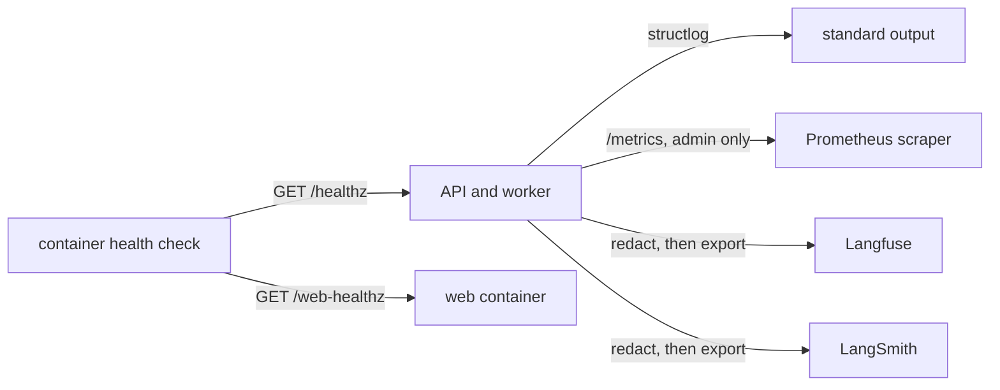
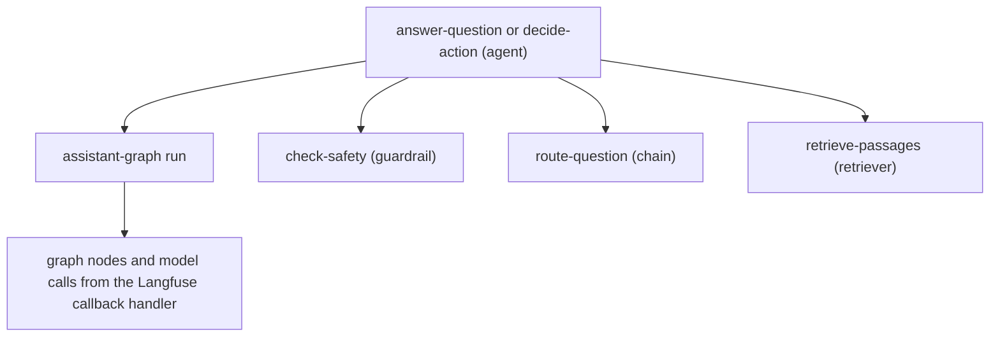

# Observability

**Type:** Reference · **Audience:** engineers and operators who read logs, metrics and traces · **Verified against:** `a989287`

**In plain English:** The system writes logs with structlog, serves Prometheus metrics to admins, and can send one trace
for each assistant turn to Langfuse or LangSmith. This page lists the health checks, the log format, every metric, the
trace layout and the redaction rules. Tracing is off by default.

Decisions are in [ADR 0012](../adr/0012-langfuse-tracing.md) (tracing) and [ADR 0015](../adr/0015-caching.md) (cache
metrics). The steps to turn on tracing are in [Configure tracing](../how-to/configure-tracing.md). Settings are in
[Configuration](configuration.md). Terms are in the [glossary](../glossary.md).

## 1. Overview

The next diagram shows where each signal goes. Read each arrow as "sends data to".

Text equivalent of the diagram:

- The API and the worker write logs to standard output.
- A scraper reads `/metrics` from the API. The route needs an admin token.
- The API sends traces to Langfuse or LangSmith when you turn them on. The code removes secrets before it sends.
- Container health checks call `/healthz` on the API and on the mock SaaS. They call `/web-healthz` on the web container.

## 2. Health checks

| Check | Served by | Answer |
|---|---|---|
| `GET /healthz` | The API (`main.py`) | `{"status": "ok", "app": <APP_NAME>}` |
| `GET /web-healthz` | The nginx web container (`infra/nginx/templates/default.conf.template`) | HTTP 200 with the text `ok`. It does not depend on the API |
| `GET /healthz` | The mock SaaS service | A success answer |

The compose file uses these routes in the container health checks. The API and mock SaaS checks run a Python
`urllib` request from inside the container. The web check runs `wget`. The API check does not test the database or any
other dependency. It tells only that the process answers.

## 3. Logging

`configure_logging` in `src/ragassist/shared/observability/logging.py` sets up structlog. The API calls it in
`create_app` with `LOG_LEVEL` and the format flag.

| Item | Value |
|---|---|
| Format | JSON when `APP_ENV` is `production`. Console output otherwise |
| Output | Standard output |
| Processors | `merge_contextvars`, logger name, level, positional arguments, ISO timestamp, stack info, `exc_info` |
| Level | `LOG_LEVEL` |

The code has no request-id middleware. No code calls `bind_contextvars`, so a log line has no request id.

### 3.1 Event names

Log events use a dotted name. The prefixes in the code are:

| Prefix or name | Source |
|---|---|
| `auth.refresh_replay` | A refresh token is reused. The session family is revoked |
| `assistant.*` | The assistant graph and its API, for example `assistant.regenerated_call_differs` |
| `decision_service.*` | The decision layer |
| `cache.*` | The cache |
| `events.*` | The live event bus |
| `runtime.*` | Start and stop of the PostgreSQL runtime |
| `worker.*` | The ingestion worker |
| `llm.usage` | Token use of one model call |
| `tracing.enabled`, `tracing.disabled`, `langsmith.enabled` | Tracing set-up |
| `keyword_retriever.paradedb_failed_falling_back_to_fts` | The ParadeDB query failed. The retriever used full-text search |

### 3.2 Secrets in logs

`Settings.__repr__` and `model_dump_json` mask secret fields. The `AuditLog` of the action tools masks the keys in
`SECRET_KEYS`. The test `tests/security/test_secrets_in_logs.py` checks that secrets do not appear in logs. See
[Security controls](security-controls.md#9-redaction).

## 4. Metrics

`setup_observability` in `src/ragassist/shared/observability/metrics.py` adds the metrics middleware and the `/metrics`
route. The registry is `SimplePrometheusRegistry`.

### 4.1 `/metrics`

- The route needs a JWT with the role `admin`. Any other role gets 403.
- The rate limiter skips `/metrics`.
- The nginx web container does not proxy `/metrics`.
- Every response carries the header `X-Process-Time`.

### 4.2 HTTP metrics

| Metric | Labels | Notes |
|---|---|---|
| `http_requests_total` | `method`, `handler`, `status` | `handler` is the route template. An unknown route uses `unmatched`. A cancelled request uses status `499` |
| `http_request_duration_seconds` | none | Declared as a histogram. The registry keeps a count and a sum only. It has no buckets |
| `ragassist_active_requests` | none | A gauge. See section 8 |

### 4.3 Model metrics

| Metric | Labels | Notes |
|---|---|---|
| `ragassist_llm_input_tokens_total` | `cached` | Input tokens of generation calls. `cached` tells whether the provider read the prompt from its cache. `UsageTally` writes it |

### 4.4 Cache metrics

| Metric | Type | Labels | Meaning |
|---|---|---|---|
| `ragassist_cache_requests_total` | counter | `kind`, `result` (`hit` or `miss`) | Cache lookups by kind of entry and result |
| `ragassist_cache_evictions_total` | counter | `backend` | Entries dropped to stay inside the size bound |
| `ragassist_cache_expirations_total` | counter | `backend` | Entries removed because their TTL passed |
| `ragassist_cache_rejected_total` | counter | `backend` | Values refused for exceeding the size limit |
| `ragassist_cache_errors_total` | counter | `backend` | Backend failures. The cache treats them as misses |
| `ragassist_cache_entries` | gauge | `backend` | Live entries in the cache |

The collector in `src/ragassist/platform/cache/metrics.py` sets these values from the cache statistics when the route is
scraped. The setting `PROMETHEUS_METRICS_ENABLED` exists in `settings.py`, but no code in `src` reads it.

## 5. Tracing with Langfuse

Tracing is off by default. Code in `src/ragassist/shared/observability/tracing.py`.

### 5.1 When tracing is on

| Condition | Result |
|---|---|
| `LANGFUSE_TRACING` is false | `Tracing()` with no client. No SDK import, no callback, no cost |
| `LANGFUSE_TRACING` is true and a key is missing | A `tracing.disabled` warning. Tracing stays off |
| `LANGFUSE_TRACING` is true and both keys are set | Tracing is on |

The keys are `LANGFUSE_PUBLIC_KEY` and `LANGFUSE_SECRET_KEY`. Their values live in `.env` only. Other settings:
`LANGFUSE_BASE_URL` and `LANGFUSE_SAMPLE_RATE`. The client sets `environment` to `APP_ENV`.

### 5.2 Trace layout

The next diagram shows the nesting of one traced turn. Read it from the root to the children.

Text equivalent of the diagram:

- Each turn has one root observation of type `agent`. The name is `answer-question` for a question. The name is
  `decide-action` for an approval decision.
- The `mode` is `stream` or `json` for a question, and `approval` for a decision.
- The Langfuse callback handler adds the graph run with the name `assistant-graph`. It nests the nodes and the model
  calls under the root.
- The code adds three child observations for work outside LangChain: `check-safety` (type `guardrail`), `route-question`
  (type `chain`) and `retrieve-passages` (type `retriever`). The retrieval observation records `cache_hit`, `hits` and
  `attempt`.

Attributes of the root:

| Attribute | Value |
|---|---|
| `trace_name` | The root name |
| `session_id` | The conversation id |
| `user_id` | The user UUID |
| `tags` | `assistant` and the mode |
| `metadata` | `tenant_id` and `role` |
| Input | The question |
| Output | The answer. Small string facts such as route and status go in the metadata |

The tenant id is metadata and not a tag, so it does not create a tag for each tenant.

### 5.3 Flush at shutdown

`shutdown_tracing` runs in the application lifespan. It flushes and closes the client in a thread (`asyncio.to_thread`),
because the flush blocks. The lifespan first drains the running turns, then flushes the traces, then stops the runtime
and the cache.

## 6. Tracing with LangSmith

`configure_langsmith` runs in the lifespan. LangSmith is on only when `LANGSMITH_TRACING` is true and
`LANGSMITH_API_KEY` is set. Otherwise the function calls `langsmith.configure(enabled=False)`.

The client uses `hide_inputs`, `hide_outputs` and `hide_metadata`, all set to `redact`. Other settings:
`LANGSMITH_ENDPOINT` and `LANGSMITH_PROJECT`.

## 7. Redaction

Every exported value passes through `redact()` first. The graph input carries the signed-in `Principal`, which holds the
bearer token, so the rule is strict.

| Rule | Effect |
|---|---|
| Secret key names | A value under a key such as `raw_token`, `token`, `access_token`, `refresh_token`, `id_token`, `bearer`, `password`, `passphrase`, `secret`, `secret_key`, `client_secret`, `api_key`, `apikey`, `authorization`, `cookie`, `set_cookie`, `x_api_key` or `x_dev_auth_secret` becomes `[REDACTED]` |
| Secret-shaped values | Text that looks like a JWT, a bearer header value, an `sk-` or `pk-` key, a LangSmith key or a Google key becomes `[REDACTED]` |
| Containers | The function walks dicts, lists, tuples, dataclasses and Pydantic models |
| Langfuse export | `mask_otel_spans` redacts every attribute whose name starts with `langfuse.` before export |

Key names are compared in lower case, and `-` counts as `_`. The tests are in
`tests/unit/shared/observability/test_tracing.py`.

## 8. Code observations

1. The gauge `ragassist_active_requests` is set to 1 at the start of a request and to 0 at the end. It is not a true
   count of concurrent requests.
2. The duration metric has a count and a sum only. A scraper cannot compute a percentile from it.
3. No request id appears in the logs (section 3).
4. The `/healthz` check does not test the database or the queue.
5. The setting `PROMETHEUS_METRICS_ENABLED` is not read in `src`.

## 9. Related pages

- [Security controls](security-controls.md) for redaction and the `/metrics` rule.
- [Assistant graph](assistant-graph.md) for the nodes that the traces show.
- [Troubleshoot common problems](../how-to/troubleshoot-common-problems.md) for log-based checks.
