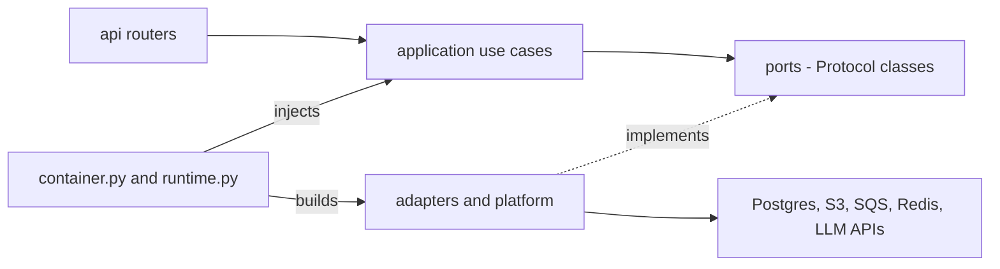

# Ports and adapters

**Type:** Reference · **Audience:** engineers who add or replace an adapter · **Verified against:** `a989287`

**In plain English:** A *port* is a Python `Protocol` that names what the application needs. An *adapter* is a class that
does the work with a real library or service. This page lists every port, its methods, its adapters and the setting that
picks the adapter. Use it to find the right file before you change a provider.

The layering rules are in `AGENTS.md` and in [Why a modular monolith](../explanation/why-a-modular-monolith.md). In short:
`domain/` and `application/` know only ports. `adapters/` and `platform/` hold the adapters. The two composition roots
wire adapters to ports. Terms are in the [glossary](../glossary.md).

## 1. Composition roots

Two files build the objects of the application.

| File | When it runs | What it builds |
|---|---|---|
| `src/ragassist/container.py` | In-memory mode (tests and local use without a database) | In-memory stores and the offline pieces |
| `src/ragassist/runtime.py` | When `PERSISTENCE_BACKEND` is `postgres` | The database pools, the checkpointer, the stores, the graph and the event listener |

The next diagram shows the direction of the dependencies. Read it from left to right. The application layer calls a port.
The composition root gives it an adapter.

Text equivalent of the diagram:

- The API calls use cases in the `application` layer.
- The use cases depend on ports only.
- Adapters in `adapters/` and `platform/` implement the ports and call the outside systems.
- `container.py` and `runtime.py` build the adapters and inject them into the use cases.

The `import-linter` contract and the layering test that guard this rule are in
[CI and quality gates](ci-and-quality-gates.md).

## 2. Port catalogue

The next table lists every port in the code. The sections after it give the detail.

| Port | Defined in | Adapters | Selected by |
|---|---|---|---|
| `ChatModelProvider` | `platform/llm/ports.py` | OpenAI, Anthropic, OpenRouter, Gemini, OpenAI-compatible | `config/models.yaml`, `LLM_ROLE_*` |
| `EmbeddingProvider` | `platform/embeddings` | openai, openai_compatible, sentence_transformers | `EMBEDDING_FALLBACK_CHAIN` |
| `Decider` | `platform/decisions/ports.py` | jev, openai_decisions, strands_local, semantic_router, rules, llm_structured | `DECIDER_CHAIN`, `ROUTER_DECIDER_CHAIN` |
| `Reranker` | `platform/rerank/ports.py` | cross_encoder, flashrank, api, decision, none | `RERANKER_CHAIN` |
| `ObjectStore` | `platform/storage/ports.py` | `S3ObjectStore`, `InMemoryObjectStore` (in `platform/storage/s3_adapter.py`) | `USE_LOCALSTACK`, AWS settings |
| `MessageQueue` | `platform/storage/ports.py` | `SQSMessageQueue`, `InMemoryMessageQueue` (in `platform/queue/sqs_adapter.py`) | `USE_LOCALSTACK`, AWS settings |
| `EventPublisher` and `EventBus` | `platform/events` | `InMemoryEventBus`, `PostgresEventBus`, `PostgresEventPublisher` | `PERSISTENCE_BACKEND` |
| `Cache` | `platform/cache` | `InMemoryCache`, `RedisCache`, `NullCache` | `CACHE_ENABLED`, `CACHE_BACKEND` |
| `SharedCounters` | `shared/counters.py` | `CacheCounters` | Redis cache backend |
| `PasswordHasher` | `modules/identity/application/ports.py` | `Argon2PasswordHasher` | `build_identity` in `wiring.py` |
| `IdentityStore` | `modules/identity/application/ports.py` | `PostgresIdentityStore`, `InMemoryIdentityStore` | `PERSISTENCE_BACKEND` |
| `Parser` | `modules/knowledge/domain` | Markdown, HTML, PyMuPDF, Tabular, Docling | MIME type in the worker |
| `Chunker` | `modules/knowledge/domain` | `HybridChunker`, `RecursiveChunker`, `DoclingHybridChunker` | Worker code |
| `HelpdeskPort` | `modules/escalation/application` | `HelpdeskClient` | Container |
| `RetrievalService` and `ChunkReader` | `modules/retrieval/application` | `DefaultRetrievalService`, `PostgresChunkRepository`, `InMemoryChunkRepository` | `PERSISTENCE_BACKEND` |
| Conversation store | `modules/assistant/application` | `InMemoryConversationStore`, `PostgresConversationStore` | `get_conversation_store` |
| Action tools | `modules/actions` | `ToolRegistry`, `SaaSClient`, `PostgresAuditRepository` | Container |

## 3. Chat models (`ChatModelProvider`)

| Item | Value |
|---|---|
| Members | `name`, `get_capabilities`, `get_pricing`, `build_chat_model`, `get_chat_model` |
| Adapters | `OpenAIAdapter`, `AnthropicAdapter`, `OpenRouterAdapter`, `GeminiAdapter`, `OpenAICompatibleAdapter` |
| Registry | `create_default_llm_registry` returns a `ProviderRegistry` |
| Catalogue | `ModelCatalog` reads `config/models.yaml` |
| Roles | `generator`, `rewriter`, `agent`, `judge`, `decider` |
| Overrides | `LLM_ROLE_*` settings and `OPENAI_COMPATIBLE_MODEL` |

- `LLMService` builds a model for a role and walks the models of that role in order. This is a `FallbackChain`
  (`shared/resilience.py`).
- A model entry can set `skip_when_unconfigured`. The Gemini entries use it, so a missing key skips them.
- `OPENAI_COMPATIBLE_MODEL` lets `runtime.catalog_for` add a model with the key `custom-default`.
- The model list and the roles are in [Models catalog](models-catalog.md). The steps to add a provider are in
  [Add an LLM provider](../how-to/add-an-llm-provider.md). Provider choice is in
  [Configure LLM providers and fallbacks](../how-to/configure-llm-providers-and-fallbacks.md).

### 3.1 Bounded executor for CPU work

`run_cpu_bound` in `shared/resilience.py` runs CPU-bound work off the event loop. It uses a `ThreadPoolExecutor` with
`max_workers=4` and the thread prefix `ragassist-cpu`. The rule is in `AGENTS.md` section 1.4.

## 4. Embeddings (`EmbeddingProvider`)

| Item | Value |
|---|---|
| Members | `name`, `dimension`, `embed_documents`, `embed_query`, `as_langchain_embeddings` |
| Adapters | `openai`, `openai_compatible` (alias `ollama`), `sentence_transformers` (alias `local`) |
| Chain | `EMBEDDING_FALLBACK_CHAIN`. The `.env.example` value is `openai,sentence_transformers` |
| Dimension | `EMBEDDING_DIMENSION` |
| Service | `EmbeddingService` with `embed_query_for` and `embed_documents_for` |

- `EmbeddingService` caches vectors. It caches only the vectors of the first provider in the chain (see
  [ADR 0015](../adr/0015-caching.md)).
- `DimensionProjector` (`platform/embeddings/projector.py`) aligns a vector with the database dimension. The default
  target is 1536. A shorter vector gets zero padding. A longer vector gets truncation. Both cases normalise the result.
- The `sentence_transformers` adapter needs the optional `[ml]` extra. When the OpenAI call fails and the extra is not
  installed, embeddings are not available in the container (see the open limits in section 12).

## 5. Deciders (`Decider`)

| Item | Value |
|---|---|
| Members | `name`, `decide`, `evaluate_choice`, `evaluate_predicate`, `evaluate_score` |
| Question types | `ChoiceQuestion`, predicate questions and `ScoreQuestion` |
| Service | `DecisionService` in `platform/decisions/service.py` |

| Adapter name | Notes |
|---|---|
| `jev` | `JevAdapter`. Hardcodes its endpoint (see section 11) |
| `openai_decisions` | `OpenAIDecisionsAdapter`. Hardcodes a model name and the OpenAI base URL (see section 11) |
| `strands_local` (alias `strands`) | Strands local decider. Uses an HTTP client |
| `semantic_router` | Low-latency intent classification. Returns the complexity score `0.5` |
| `rules` | Rule-based heuristics, no network call. Returns the complexity score `3.0` |
| `llm_structured`, `llm_structured_2`, `llm_structured_3` | One adapter for each model. The ids come from the `decider` role chain, then the `generator` chain |

Settings:

| Setting | Meaning |
|---|---|
| `DECIDER_CHAIN` | Chain for safety, grading and grounding. The `.env.example` value is `openai_decisions,jev,llm_structured,llm_structured_2,rules` |
| `ROUTER_DECIDER_CHAIN` | Chain for the router. The `.env.example` value is `semantic_router,openai_decisions,llm_structured,llm_structured_2,rules` |
| `DECIDER_MIN_CONFIDENCE` | The router chain moves to the next adapter when a route verdict has a lower confidence. The other checks do not use it |
| `DECIDER_TIMEOUT_MS` | Time limit for one adapter |
| `ESCALATION_THRESHOLD` | In the code, the least grounding probability that counts as "grounded" |

`MAX_LLM_DECIDER_MODELS` is 3. It is a code constant, so only three `llm_structured` adapters exist.
`DECIDER_MODEL_MAX_RETRIES` is also a code constant. Its value is 1. It sets the retries of each LLM decider.

### 5.1 What the `DecisionService` does when every adapter fails

| Question | Result |
|---|---|
| Safety check | Fails closed. The verdict carries `safety_check_error` |
| Route | `rag_search`, with provider `fallback_default` |
| Chunk relevance | Relevant |
| Grounding check | Not grounded |

The `llm_structured` adapter behaves like this: `evaluate_predicate` and `evaluate_score` raise on a failure.
`evaluate_choice` falls back to the first choice with confidence `0.5`. The rule that the decision layer comes first is
in [ADR 0004](../adr/0004-decision-layer.md). The steps to add an adapter are in
[Add a Decider or reranker](../how-to/add-a-decider-or-reranker.md).

## 6. Rerankers (`Reranker`)

| Item | Value |
|---|---|
| Members | `name`, `rerank(query, candidates, *, top_n)` |
| Data types | `Candidate`, `Scored`, `ChainResult` |
| Chain | `RerankerChain`. The `.env.example` value of `RERANKER_CHAIN` is `cross_encoder,flashrank,none` |
| Settings | `RERANKER_CHAIN`, `RERANK_ENABLED`, `RERANK_TIMEOUT_MS`, `RETRIEVAL_TOP_N` |

| Adapter name | Class | Notes |
|---|---|---|
| `cross_encoder` | cross-encoder adapter | Local model. Runs in the bounded executor. Needs `torch` or the weights |
| `flashrank` | FlashRank adapter | ONNX model. Runs in the bounded executor |
| `api` | `ApiReranker` | Posts to `{base_url}/rerank` with `model`, `query`, `documents` and `top_n`. Reads `results[].index` and `relevance_score` |
| `decision` | `DecisionReranker` | Scores each candidate with a two-level `ScoreQuestion` on the Decider chain |
| `none` | `NoopReranker` | Keeps the input order |

- `build_reranker_chain` builds only `cross_encoder`, `flashrank`, `api` and `none`. The name `decision` is not
  buildable from the chain string. See section 11.
- The `RERANK_API_*` values are read with `getattr` on the settings. They are not fields of `Settings`.
- The decision is in [ADR 0005](../adr/0005-reranker-chain.md).

## 7. Storage and queue

| Port | Methods | Adapters |
|---|---|---|
| `ObjectStore` | `put_object`, `get_object`, `delete_object` | `S3ObjectStore`, `InMemoryObjectStore` |
| `MessageQueue` | `send_message`, `receive_messages`, `delete_message` | `SQSMessageQueue`, `InMemoryMessageQueue` |

- The container picks S3 and SQS when `USE_LOCALSTACK` is set or when `AWS_ACCESS_KEY_ID` is set. Otherwise it uses the
  in-memory adapters.
- `DeferredQueue` in `runtime.py` sends a message only after the database transaction commits.
- The object key of an upload is `tenants/{tenant_id}/documents/{id}/{name}`.

## 8. Events

| Item | Value |
|---|---|
| Ports | `EventPublisher` and `EventBus` (`publish`, `subscription`, `start`, `stop`) |
| Helper | `publish_safely` |
| Adapters | `InMemoryEventBus`, `PostgresEventBus` (LISTEN and NOTIFY), `PostgresEventPublisher` (used by the worker) |
| Selector | `get_event_bus` chooses by `active_runtime()` |
| Fan-out | `EventHub`, `Subscription`, `TooManyStreams` |

The event payload carries ids only. The bus filters events by tenant, owner and role before it sends them. See
[ADR 0008](../adr/0008-live-events-handoff-and-detached-turns.md) and the [SSE contract](../api/sse-contract.md).

## 9. Cache and counters

| Port | Methods | Adapters |
|---|---|---|
| `Cache` | `backend`, `get`, `set`, `delete`, `delete_prefix`, `incr`, `stats`, `aclose` | `InMemoryCache`, `RedisCache`, `NullCache` |
| `SharedCounters` | `incr`, `peek`, `reset` | `CacheCounters` (only with Redis) |

`build_cache` picks the adapter from `CACHE_ENABLED` and `CACHE_BACKEND`. `SharedCounters` lets the rate limiter and the
login throttle share counts between processes. Without Redis, each process counts alone. See
[ADR 0015](../adr/0015-caching.md).

## 10. Identity, knowledge, retrieval and actions

| Area | Port and members | Adapters |
|---|---|---|
| Passwords | `PasswordHasher` | `Argon2PasswordHasher` |
| Accounts and sessions | `IdentityStore` | `PostgresIdentityStore`, `InMemoryIdentityStore` |
| Parsing | `Parser` | `MarkdownParser`, `HtmlParser`, `PyMuPDFParser`, `TabularParser`, `DoclingParser` |
| Chunking | `Chunker` | `HybridChunker`, `RecursiveChunker`, `DoclingHybridChunker` |
| Helpdesk | `HelpdeskPort` | `HelpdeskClient` |
| Retrieval | `RetrievalService`, `ChunkReader` | `DefaultRetrievalService`, `PostgresChunkRepository`, `InMemoryChunkRepository` |
| Account actions | `ToolRegistry`, `ToolSpec`, `ApprovalPolicy`, `AuditLog` | `SaaSClient`, `PostgresAuditRepository` |

- `build_identity` in `modules/identity/wiring.py` chooses the identity adapters.
- The worker maps four MIME types: `text/markdown`, `text/html`, `application/pdf` and `text/csv`. `DoclingParser` needs
  the `docling` package.
- `HybridChunker.from_settings` reads the `CHUNK_*` settings. The decision is in
  [ADR 0003](../adr/0003-hybrid-chunking.md).
- The keyword retriever has two backends. `KEYWORD_SEARCH_BACKEND` defaults to `fts` (PostgreSQL full-text search). The
  values `paradedb` and `bm25` use ParadeDB. When the ParadeDB query fails, the retriever logs
  `keyword_retriever.paradedb_failed_falling_back_to_fts` and uses `fts`.
- `default_tools` registers `get_account_overview`, `get_subscription`, `list_invoices`, `get_invoices` (an alias),
  `update_billing_email` (a write tool) and `query_dataset` (a stub). `runtime.py` hides `query_dataset` and
  `get_invoices` through `HIDDEN_TOOLS`.

## 11. Code observations

These facts come from the code at `a989287`. They are gaps against the rules in `AGENTS.md`, not decisions.

1. `container.py` calls `ModelCatalog.from_yaml`. The class has only `load_from_yaml`. The `AttributeError` is caught, and
   the container falls back to a hardcoded `build_chat_model("gpt-4o-mini")`.
2. `platform/decisions/service.py` registers an `llm_structured` fallback with the hardcoded model `gpt-4o-mini` when no
   `llm_service` is given.
3. `OpenAIDecisionsAdapter` hardcodes a model name and the OpenAI base URL. `JevAdapter` hardcodes its endpoint. Both
   break the "no hardcoded models" rule.
4. `build_reranker_chain` cannot build the `decision` reranker from a chain string.
5. `config/models.yaml` has a duplicated `pricing:` key in the entry `claude-haiku-5-5`.
6. The settings `EMBEDDING_PROVIDER` and `CHUNK_STRATEGY` exist in `settings.py`, but no code in `src` reads them. The
   worker uses `HybridChunker` directly. The embedding chain comes from `EMBEDDING_FALLBACK_CHAIN`.
7. The three observations about the graph and the Deciders (the ignored `agent_tiers` argument and the complexity
   scales) are in [Assistant graph](assistant-graph.md#9-code-observations).

## 12. Open limits

- Embeddings are not available in the container when the OpenAI call fails and the optional `[ml]` extra is not
  installed.
- Unverified: a real-stack end-to-end smoke run. The [known limitations](../explanation/known-limitations-and-roadmap.md) page says it is still owed.

## 13. Related pages

- [Configuration](configuration.md) for each setting.
- [Data model](data-model.md) for the tables behind the stores.
- [Security controls](security-controls.md) for tenant isolation in the stores.
