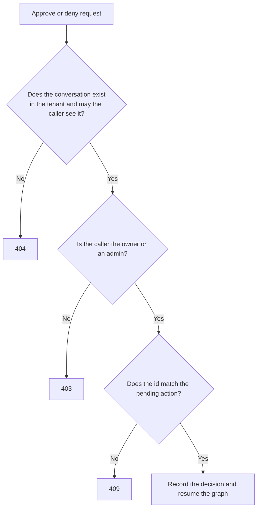

# Roles and permissions

**Type:** Reference · **Audience:** developers, administrators and reviewers who need to know who may do what · **Verified against:** `a989287`

**In plain English:** Every person in a workspace has one of three roles: `user`, `agent` or `admin`. This page lists
what each role may do in the API and in the web app. It also lists the rules about who owns a conversation. Only an
`agent` can reply to a customer in the inbox. Use this page to look up a permission. To learn why the rules look like
this, read [accounts, sessions and tokens](../explanation/accounts-sessions-and-tokens.md) and
[human handoff and live events](../explanation/human-handoff-and-live-events.md).

## 1. The roles

| Role | Who it is | Value in the token |
|---|---|---|
| `user` | A customer. The person asks questions and sees only their own conversations. | `user` |
| `agent` | A member of the support staff. The person reads every conversation of the workspace and answers escalated ones. | `agent` |
| `admin` | A workspace administrator. The person manages the team and the knowledge base and reads every conversation. | `admin` |

Facts about roles:

- **One role for each person.** A person has one role in one workspace. The same email address can exist in another
  workspace with another role.
- **Staff.** The code calls `agent` and `admin` together **staff** (`STAFF_ROLES` in
  `src/ragassist/modules/assistant/application/access.py`).
- **No hierarchy.** The roles are not levels. An `admin` cannot do everything that an `agent` can do. Only an `agent` can
  reply to an escalation (section 5).
- **The role comes from the token.** The API reads the role from the signed access token (`UserRole` in
  `src/ragassist/shared/security/jwt.py`). A request body never carries a role. The only route where a caller picks the
  role is the development token route (section 4).
- **A token without a role claim** gets the role `user`. A token with an unknown role value is rejected with `401`.
- **A role change does not reach an open token at once.** An access token keeps its role until it expires
  (`AUTH_ACCESS_TOKEN_MINUTES`). A refresh issues a token with the new role. See
  [ADR 0007](../adr/0007-accounts-and-sessions.md), decision 11.
- **How a person gets a role.** An admin sets the role in an invite (`POST /v1/team/invites`) or changes it
  (`PATCH /v1/team/members/{user_id}`). `ragassist workspace create` makes the first `admin`. `ragassist seed` makes one
  account for each role. See [CLI](cli.md).

## 2. The API by role

The marks in the table: **Yes** means the role may call the route. **No** means the API answers `403`. **Own** means the
role may use the route for its own data only. **Public** means no token is needed. For the details of each route, read
[API endpoints](api-endpoints.md).

### System and sign-in

| Route | Anonymous | `user` | `agent` | `admin` |
|---|---|---|---|---|
| `GET /healthz` | Public | Yes | Yes | Yes |
| `GET /docs`, `/redoc`, `/openapi.json` | Public | Yes | Yes | Yes |
| `GET /metrics` | No (`401`) | No | No | Yes |
| `POST /v1/auth/login` | Public | Yes | Yes | Yes |
| `POST /v1/auth/invites/accept` | Public | Yes | Yes | Yes |
| `POST /v1/auth/refresh` | Cookie and trusted `Origin` | Yes | Yes | Yes |
| `POST /v1/auth/logout` | Cookie and trusted `Origin` | Yes | Yes | Yes |
| `GET /v1/auth/me` | No (`401`) | Yes | Yes | Yes |
| `POST /v1/auth/token` | Needs `X-Dev-Auth-Secret` and `APP_ENV` of `development` or `test` | Not role-based | Not role-based | Not role-based |

### Team

| Route | `user` | `agent` | `admin` |
|---|---|---|---|
| `GET /v1/team/members` | No | No | Yes |
| `PATCH /v1/team/members/{user_id}` | No | No | Yes (not for self) |
| `POST /v1/team/members/{user_id}/reset-link` | No | No | Yes |
| `GET /v1/team/invites` | No | No | Yes |
| `POST /v1/team/invites` | No | No | Yes |
| `DELETE /v1/team/invites/{invite_id}` | No | No | Yes |

All team routes use `require_role(UserRole.ADMIN)`. They act on the tenant of the calling admin. An admin cannot change
their own role or status. The last active admin cannot be demoted or disabled.

### Knowledge (documents and ingestion)

| Route | `user` | `agent` | `admin` |
|---|---|---|---|
| `POST /v1/documents` | No | No | Yes |
| `GET /v1/documents` | Yes | Yes | Yes |
| `DELETE /v1/documents/{document_id}` | No | No | Yes |
| `POST /v1/documents/{document_id}/reindex` | No | No | Yes |
| `GET /v1/ingestion-jobs/{job_id}` | Yes | Yes | Yes |
| `GET /v1/chunks/{chunk_id}` | Yes | Yes | Yes |

- All three roles can read the document list, a job and a chunk of their own tenant. A chunk may also be a global chunk.
  Only an admin can add, delete or re-index a document.
- The document list shows the whole tenant to every role. It has no owner filter.

### Conversations and messages

| Route | `user` | `agent` | `admin` |
|---|---|---|---|
| `POST /v1/conversations` | Yes | Yes | Yes |
| `GET /v1/conversations` | Own | All of the tenant | All of the tenant |
| `GET /v1/conversations/{conversation_id}` | Own | Yes | Yes |
| `POST /v1/conversations/{conversation_id}/messages` | Own | Yes | Yes |
| `POST /v1/conversations/{conversation_id}/actions/{interrupt_id}` | Own | Own | Yes |

A conversation that the role may not see gives `404`, the same answer as for a missing conversation. The approval route
gives `403` to an `agent` who can see the conversation but does not own it.

### Escalations (the inbox)

| Route | `user` | `agent` | `admin` |
|---|---|---|---|
| `GET /v1/escalations` | No | Yes | Yes |
| `POST /v1/escalations/{escalation_id}/reply` | No | Yes | **No** |
| `POST /v1/escalations/{escalation_id}/replies` | No | Yes | **No** |
| `POST /v1/escalations/{escalation_id}/resolve` | No | Yes | Yes |

**Only an agent can reply.** The use case `ReplyToEscalation` in `src/ragassist/modules/escalation/application/__init__.py`
accepts only the role `agent`. Any other role, an `admin` included, gets `403` with the text
`Role '<role>' is not allowed to reply as an agent`, where `<role>` is the enum name, for example `UserRole.ADMIN`. The web app agrees: the reply box works only for the role `agent`,
and an `admin` sees "Only support agents can reply." (`canSendReply` in `frontend/src/features/inbox/inbox-logic.ts`).
Both an `agent` and an `admin` can list and resolve escalations.

### Events

| Route | `user` | `agent` | `admin` |
|---|---|---|---|
| `GET /v1/events` | Yes | Yes | Yes |

The server filters each event by tenant and role before it writes the event to the stream:

| Event | Sent to |
|---|---|
| `ready`, `resync`, `reauth` | The connection that holds the stream |
| `job.updated`, `document.changed` | Admins of the tenant |
| `message.created`, `conversation.updated` | The owner of the conversation, and the agents and admins of the tenant |
| `escalation.changed` | Agents and admins of the tenant |

The code is `visible_to` in `src/ragassist/platform/events/model.py`. An event carries ids only. See the
[SSE contract](../api/sse-contract.md).

## 3. Rules for conversations

The functions are in `src/ragassist/modules/assistant/application/access.py`. Row-level security keeps tenants apart.
These rules apply inside one tenant.

| Question | `user` | `agent` | `admin` |
|---|---|---|---|
| Which conversations does a list show? | The conversations that the user opened | Every conversation of the tenant | Every conversation of the tenant |
| May the role read the history and post a message? | In its own conversations | In every conversation | In every conversation |
| May the role approve or deny a paused write action? | In its own conversations | In its own conversations | In every conversation |
| What does a conversation without an owner allow? | Nothing (`404`) | Read and post | Read, post and decide |

The following diagram shows the checks of the approval route. Look at the order: first the visibility check, then the
decision right, then the pending action.

In words: a caller who may not see the conversation gets `404`. A caller who sees it but is neither the owner nor an
admin gets `403`. A wrong `interrupt_id` gets `409`. A correct request records the decision and resumes the graph.

Other facts:

- **A message from staff.** When an `agent` or an `admin` posts a message in another person's conversation, the
  assistant runs with the identity of the person who posts. The stored message has the `user_id` of that person.
- **Stream mode creates a conversation.** When a caller streams a message to an unknown conversation id, the API
  creates a conversation with that id. The caller becomes the owner.
- **While a conversation is escalated,** the assistant does not answer. The message is saved for the agent. See
  [human handoff and live events](../explanation/human-handoff-and-live-events.md).

## 4. Special routes

| Route | Rule |
|---|---|
| `POST /v1/auth/token` | A development helper. The caller sends `user_id`, `tenant_id` and `role` in the body. The route works only when `APP_ENV` is `development` or `test`, and only with the header `X-Dev-Auth-Secret` equal to `DEV_AUTH_SECRET`. Otherwise it answers `403`. |
| `POST /v1/auth/refresh`, `POST /v1/auth/logout` | The credential is the `ragassist_refresh` cookie. The request needs an `Origin` header that is in `CORS_ORIGINS` or equals the origin of `WEB_BASE_URL`. Otherwise the API answers `403`. |
| `POST /v1/auth/invites/accept` | The one-time token in the body is the credential. |

## 5. Tools that change data

The assistant can call account tools through the mock SaaS service. The tool registry checks the role.

| Tool | Kind | Who may run it | Approval |
|---|---|---|---|
| `get_account_overview` | Read | Any role | No |
| `get_subscription` | Read | Any role | No |
| `list_invoices` | Read | Any role | No |
| `update_billing_email` | Write | `admin` only | Yes. The conversation owner or an admin decides. |

- The code checks the role of a write tool **before** it asks a human to approve. When a `user` or an `agent` asks for a
  write action, the model receives "Permission denied" and the person sees no approval card.
- The approval binds to the stored tool call. The tool and its arguments come from the paused checkpoint, never from the
  request of the approver. See [ADR 0006](../adr/0006-conversation-access-and-approval-binding.md) and
  [approvals and actions](../explanation/approvals-and-actions.md).
- In the Postgres runtime, the registry also hides two names from the model: `query_dataset` (a stub) and `get_invoices` (an alias of
  `list_invoices`).

## 6. The web app by role

One table in `frontend/src/app/access.ts` drives both the navigation and the route guards. The guard shows a plain
"This page is not available to your role" page when a role opens a route that it may not use.

| UI route | Page | `user` | `agent` | `admin` | Who else |
|---|---|---|---|---|---|
| `/sign-in` | Sign in | Redirected to the app | Redirected to the app | Redirected to the app | Anonymous visitors |
| `/accept` | Spend an invite link | Yes | Yes | Yes | Anyone with a link |
| `/reset-password` | Spend a reset link | Yes | Yes | Yes | Anyone with a link |
| `/` | Chat | Yes | Yes | Yes | |
| `/inbox` | Inbox | No | Yes | Yes | |
| `/knowledge` | Knowledge | No | No | Yes | |
| `/team` | Team | No | No | Yes | |
| Any other path | Not found page | Yes | Yes | Yes | |

- A visitor who is not signed in is sent to `/sign-in` when they open a route behind the guard. After sign-in, the app
  sends the person to the page that they asked for when their role allows it, and to `/` otherwise.
- Inside the inbox, the reply box works only for the role `agent` (section 2).
- The web app hides what a role cannot use, but the hiding is not a security control. The API checks the role again on
  every request. See [frontend structure](frontend-structure.md).

## 7. How to read a refusal

| Status | Meaning here |
|---|---|
| `401` | No valid token, or a bad sign-in |
| `403` | A valid token, but the role (or the `Origin`, or the development secret) is not enough |
| `404` | The resource does not exist for this caller. This includes another tenant's data and another user's conversation. |
| `409` | The state blocks the action, for example a conversation that is not escalated |

See [error responses](error-responses.md#4-the-401-403-and-404-rules-for-tenant-data) for the order of the checks.

## 8. Related pages

- [API endpoints](api-endpoints.md) and [error responses](error-responses.md).
- [Security controls](security-controls.md).
- [Data model](data-model.md) for the tenant isolation of the tables.
- [Manage team and invites](../how-to/manage-team-and-invites.md).
- [Handle an escalation as an agent](../tutorials/04-handle-an-escalation-as-an-agent.md).
- [ADR 0006](../adr/0006-conversation-access-and-approval-binding.md) and
  [ADR 0007](../adr/0007-accounts-and-sessions.md).
