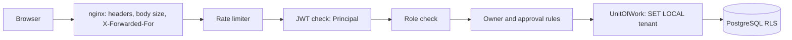

# Security controls

**Type:** Reference · **Audience:** engineers, reviewers and security auditors · **Verified against:** `a989287`

**In plain English:** This page lists every security control in the code, where it lives and which test proves it. It
covers sign-in, tenant isolation, the approval of write actions, rate limits, uploads, the web container headers,
redaction and the secret scanner. It states facts. It does not argue for a design.

For the reasons behind the design, read [Tenant isolation: defence in depth](../explanation/tenant-isolation-defence-in-depth.md),
[ADR 0002](../adr/0002-row-level-security.md), [ADR 0006](../adr/0006-conversation-access-and-approval-binding.md),
[ADR 0007](../adr/0007-accounts-and-sessions.md) and [ADR 0014](../adr/0014-web-delivery.md). Roles are in
[Roles and permissions](roles-and-permissions.md). Error codes are in [Error responses](error-responses.md). Terms are in the
[glossary](../glossary.md).

## 1. Layers of defence

The next diagram shows the order of the checks for one request. Read it from the browser to the database. Each box can
refuse the request on its own.

Text equivalent of the diagram:

1. nginx sets the security headers, limits the body size and overwrites `X-Forwarded-For`.
2. The rate limiter counts requests for each client address.
3. The JWT check builds the `Principal` from a verified token.
4. The role check compares the role with the route.
5. The owner and approval rules check the conversation and the pending action.
6. The `UnitOfWork` sets the tenant for the database transaction.
7. PostgreSQL row-level security (RLS) filters the rows, even if the application code is wrong.

## 2. Identity of the caller

| Control | Where | Test |
|---|---|---|
| The JWT decoder pins the algorithms. It requires `exp`, `sub` and `tenant_id`. The role defaults to `user` | `decode_access_token` in `shared/security` | `tests/unit/shared/test_jwt.py` |
| `Principal` is a frozen dataclass with `user_id`, `tenant_id`, `role` and `raw_token` | `shared/security` | `tests/unit/shared/test_security_deps.py` |
| `get_current_principal` reads the bearer header with `HTTPBearer`. A bad token gives 401. A missing header gives 401 or 403, by FastAPI version | `shared/security` | `test_security_deps.py` |
| `require_role` checks the role of the `Principal` | `shared/security` | `test_security_deps.py` |

`tenant_id`, `user_id` and `role` come only from the verified token. The model output and the tool arguments never set
them (`AGENTS.md` section 1.3).

## 3. Tenant isolation in the database

| Control | Detail |
|---|---|
| `UnitOfWork` (`src/ragassist/shared/db/uow.py`) | Refuses a session that already has an open transaction. Runs `set_config('app.tenant_id', :tid, true)`, which is the same as `SET LOCAL`, inside the transaction |
| `ScopedDatabase.scope` | Raises `TenantIsolationError` when one transaction spans two tenants. Offers `defer_until_commit` |
| RLS policies | Each table runs `ENABLE` and `FORCE ROW LEVEL SECURITY`. The policy `<table>_tenant_isolation` compares `tenant_id` with `app.tenant_id`. It covers `users`, `ingestion_jobs`, `conversations`, `messages` and `tool_audit_log` (migration 0001) and `auth_sessions` and `invites` (migration 0002). The table `tenants` has `tenants_tenant_isolation`, which compares `id` |
| Shared content | `documents` and `chunks` have a read policy (`<table>_read`) that also allows `tenant_id IS NULL`. Their write policy (`<table>_write`) allows only the current tenant |
| Slug lookup | The policy `tenants_slug_lookup` lets sign-in read the tenant row for the slug in the setting `app.tenant_slug`, before a tenant id is set |
| Application role | The database role of the application is `NOSUPERUSER` and `NOBYPASSRLS`. The script is `infra/postgres/create-app-role.sh` |

The migrations are `migrations/versions/0001_initial_schema.py` and
`migrations/versions/0002_accounts_sessions_invites.py`. The table list is in
[Data model](data-model.md). The steps to add a table are in
[Add a database migration with RLS](../how-to/add-a-database-migration-with-rls.md).

Tests: `tests/integration/test_rls_and_uow.py` (needs PostgreSQL) and `tests/unit/shared/test_uow.py`.

## 4. Conversation and action rules

| Rule | Where |
|---|---|
| A user sees only their own conversations. Staff (agent and admin) see all conversations in the tenant | `can_access_conversation` in `modules/assistant/application/access.py` |
| Only the owner or an admin may decide a pending action | `can_decide_action` in the same file |
| A conversation that the caller cannot see gives 404, not 403 | `_visible_conversation` in the assistant router |
| LangGraph `thread_id` is `{tenant_id}:{conversation_id}` | Assistant router |
| A write tool refuses a non-admin caller with "Permission denied", before the graph asks for approval | `ToolRegistry.authorize` |
| A write tool pauses the graph until a person decides | `account_agent`, `interrupt()` |
| The graph runs the checkpointed call, not the arguments of the decision | Approval binding, ADR 0006 |
| The checkpoint serializer allows only `Principal`, `UserRole` and `Hit` | `serde.py` |
| The checkpoint carries no bearer token when a runtime is active | `_checkpointable(principal)` blanks `raw_token` |
| Events carry ids only. The event bus filters by tenant, owner and role | `ID_KEYS`, `visible_to`, `Audience` |

The graph details are in [Assistant graph](assistant-graph.md#6-approval-of-write-tools).

Tests:

- `tests/graph/test_interrupts_and_tenancy.py` (thread namespace)
- `tests/graph/test_approval_binding.py`, `tests/graph/test_account_agent_pending_state.py`
- `tests/graph/test_checkpoint_serde.py`
- `tests/security/test_authz_and_tool_abuse.py`
- `tests/security/test_event_isolation.py`
- `tests/security/test_route_auth_sweep.py` (a sweep of the routes for authentication)
- `TestCheckpointCarriesNoBearerToken` in `tests/security/test_audit_regressions.py`

## 5. Sign-in, sessions and passwords

| Control | Detail | Test |
|---|---|---|
| Password hash | Argon2id (`argon2_hasher.py`). The hash runs off the event loop. `needs_rehash` upgrades old hashes | `test_argon2_hasher.py` |
| Password length | `MAX_PASSWORD_LENGTH` is 128 | `test_domain_rules.py` |
| Unknown account | The service still verifies a dummy hash. Every failure returns the same `GENERIC_FAILURE` answer | `test_auth_service.py` |
| Refresh token | The format is `{tenant_id}.{random}`. The random part has 256 bits. The database stores only the SHA-256 hash | `test_auth_service.py` |
| Rotation and replay | Each refresh rotates the token. `claim_session` claims it once. A replayed token revokes the whole session family and logs `auth.refresh_replay` | `test_auth_service.py` |
| Refresh cookie | Name `ragassist_refresh`. `httpOnly`. `SameSite=strict`. `secure` follows `AUTH_COOKIE_SECURE`. The path is `{API_V1_PREFIX}/auth` | `test_auth_api.py` |
| Trusted origin | `require_trusted_origin` returns 403 on refresh and logout when the `Origin` header is missing or not trusted. Trusted means `CORS_ORIGINS` plus `WEB_BASE_URL` | `test_auth_api.py` |
| Login throttle | `LoginThrottle` counts failures for each account and for each client address | `test_throttle.py`, `test_shared_throttle.py` |
| No-store | `NoStoreMiddleware` sets `Cache-Control: no-store` on `{API_V1_PREFIX}/auth/*` and the events route | `tests/unit/shared/test_http_cache.py`, `tests/unit/platform/events/test_events_api.py` |

The test files for sign-in sit under `tests/unit/modules/identity/`.

Throttle settings: `AUTH_LOGIN_MAX_FAILURES`, `AUTH_LOGIN_MAX_PER_IP` and `AUTH_LOGIN_WINDOW_SECONDS`. The throttle uses
shared Redis counters when Redis is on, and falls back to process memory.

Settings validators in `settings.py` require `AUTH_COOKIE_SECURE` in staging and production. They also require a
`SECRET_KEY` of at least 32 characters.

### 5.1 Development token

The route `{API_V1_PREFIX}/auth/token` issues a token for development only.

- It works only when `APP_ENV` is `development` or `test`.
- It needs the header `X-Dev-Auth-Secret` to match `DEV_AUTH_SECRET`. The comparison uses `compare_digest`.
- In any other case it returns 403.
- The test is `test_auth_router.py`.

The value of `DEV_AUTH_SECRET` lives in `.env`. `ragassist init-env` generates it (see [CLI](cli.md)).

See [API endpoints](api-endpoints.md) for the published path.

## 6. Rate limiting

| Item | Value |
|---|---|
| Class | `SlidingWindowRateLimiter`, used by `RateLimitMiddleware` |
| Limit | 300 requests for each 60 seconds |
| Key | The client address |
| Key bound | 50,000 keys |
| Over the limit | HTTP 429 with `Retry-After` and `X-RateLimit-*` headers |
| Exempt paths | `/healthz`, `/metrics`, `/docs`, `/redoc`, `/openapi.json` and the events route |
| Shared state | `SharedCounters` over Redis when Redis is on |
| Proxy trust | `TRUSTED_PROXY_IPS` (default empty) lists the proxies whose `X-Forwarded-For` the API trusts |

nginx overwrites `X-Forwarded-For` with `$remote_addr`, so a client cannot choose its own address.

Tests: `TestRateLimiter` in `tests/security/test_audit_regressions.py` and `tests/unit/modules/identity/test_shared_throttle.py`.

## 7. Uploads

| Control | Detail |
|---|---|
| Who | Only an admin may upload, delete or re-index a document |
| Size | `MAX_UPLOAD_BYTES` is 50 MiB. The API reads the stream with a bound and returns 413 when the file is larger |
| Type | The API accepts markdown, HTML, CSV and PDF. Other types get 415 |
| File name | The API cleans the name |
| Object key | `tenants/{tenant_id}/documents/{id}/{name}` |
| nginx | `client_max_body_size` is 52 MiB on `/v1/documents` and 1 MiB elsewhere |

Test: `TestUploadIsBounded` in `tests/security/test_audit_regressions.py`.

## 8. Web delivery

The nginx templates are in `infra/nginx/templates/`. The script `15-web-env.envsh` fills them from the `WEB_*`
variables: `WEB_PORT` (1024 or higher), `WEB_SERVER_NAME`, `WEB_API_UPSTREAM` and `WEB_HSTS`.

| Header or rule | Value |
|---|---|
| `Content-Security-Policy` | `default-src 'none'; script-src 'self'; style-src 'self' 'unsafe-inline'; img-src 'self' data:; font-src 'self'; connect-src 'self'; manifest-src 'self'; base-uri 'none'; form-action 'self'; frame-ancestors 'none'; object-src 'none'` |
| `X-Content-Type-Options` | `nosniff` |
| `Referrer-Policy` | `no-referrer` |
| `Permissions-Policy` | Set |
| Cross-origin policies | `Cross-Origin-Opener-Policy` and `Cross-Origin-Resource-Policy` are `same-origin` |
| HSTS | Sent only when `WEB_HSTS` is set |
| Server banner | `server_tokens off` |
| Hidden files | Dotfiles return 404 |
| SSE locations | Unbuffered |
| Cache | `/assets/` is `immutable`. `/` is `no-cache` |

Tests: `tests/hygiene/test_web_delivery.py` and the CI job `web-image`
(see [CI and quality gates](ci-and-quality-gates.md)). The deploy steps are in
[Deploy the web container](../how-to/deploy-the-web-container.md).

The browser app adds three controls (see [Frontend structure](frontend-structure.md)):

- The access token stays in memory.
- The Markdown view sanitises the answer with `rehype-sanitize`, blocks raw HTML and blocks images.
- Links open with `rel="noopener noreferrer"`.

## 9. Redaction

| Control | Where | Test |
|---|---|---|
| `redact()` and `mask_otel_spans` remove credentials before a trace leaves the process | `shared/observability/tracing.py` | `tests/unit/shared/observability/test_tracing.py` |
| `Settings.__repr__` and `model_dump_json` mask secret fields | `settings.py` | `tests/security/test_secrets_in_logs.py` |
| The tool `AuditLog` masks the keys in `SECRET_KEYS` | `modules/actions` | `test_secrets_in_logs.py` |
| `scripts/check_secrets.py` prints only the first 4 characters of a match | `scripts/check_secrets.py` | `tests/unit/test_check_secrets.py` |

The key list and the value patterns are in [Observability](observability.md#7-redaction).

## 10. Secret scanning

`scripts/check_secrets.py` is the scanner. Four layers run it.

| Layer | How |
|---|---|
| Git hook `pre-commit` | `--staged`. Enable with `git config core.hooksPath .githooks` |
| Git hook `pre-push` | `--push` |
| CI | `--all` over the tree, and `--range` over every commit of a pull request. A failure blocks the merge |
| Hygiene test | `tests/hygiene/test_no_secrets_committed.py` runs the same scanner |

GitHub push protection and secret scanning are a fifth layer on the server. `AGENTS.md` section 3.8 says they are
enabled. Unverified: this page did not check the repository settings on GitHub.

### 10.1 Modes

| Mode | Scans |
|---|---|
| `--staged` | The files in the index |
| `--push` | The commits that the push sends |
| `--range A..B` | The commits in the range |
| `--all` | The whole tree |

Exit codes: 0 means clean, 1 means a finding, 2 means a usage error.

### 10.2 Rules

- **Shaped rules** (`SHAPED_RULES`) match a private key block, an AWS key id, a GitHub token, a Slack token, a Stripe
  live key, a Langfuse key, a LangSmith key, a Google API key, a provider API key that starts with `sk-`, a JWT and a
  credential inside a URL.
- **Assignment rule.** A name that contains `api_key`, `secret`, `password`, `passphrase`, `token` or `credential`,
  with a quoted value of 20 or more characters, entropy of 3.6 or more, and no placeholder pattern.
- **Allow marker.** A line may carry `secret-scan: allow` for a documented non-secret value.
- **Skipped files.** Lock files and binary files.
- **Output.** The scanner shows only the first 4 characters of a match.

Tests: `tests/unit/test_check_secrets.py`, `tests/hygiene/test_no_secrets_committed.py`,
`tests/hygiene/test_no_leaked_defaults.py` and `tests/hygiene/test_env_example.py`.

A key that was ever pushed is leaked. Rotate it first. Then purge it. See
[Rotate secrets and use secret guards](../how-to/rotate-secrets-and-use-secret-guards.md).

## 11. Cache and event isolation

| Control | Test |
|---|---|
| Cache keys always contain the tenant. They contain the role when the result depends on the role. The key uses an HMAC of the normalised text. A retrieval key also carries a corpus version | `tests/security/test_cache_isolation.py` |
| Events reach only a subscriber whose tenant, owner and role match | `tests/security/test_event_isolation.py` |
| The leak gate seeds tenant A with canary values, reads everything tenant B can see and fails on any canary. It writes `reports/leak_gate.json` | `tests/security/test_leak_gate.py` |
| The injection corpus runs against the safety check through the rules decider. Benign cases must never be flagged. Each attack category has a floor in `tests/data/injection/floors.yaml`. It writes `reports/injection.json` | `tests/security/test_injection_corpus.py` |
| Adversarial inputs reach the decision layer | `tests/security/test_decision_adversarial.py` |

## 12. Code observations and open limits

1. The CSP keeps `style-src 'unsafe-inline'`. The decision to remove it is open.
2. The `import-linter` contract is weaker than the layering rules of `AGENTS.md`. A test enforces the full rules (see
   [CI and quality gates](ci-and-quality-gates.md#71-layering-checks)).
3. `thread_guard.py` has `ensure_thread_access`, but production code does not call it. The assistant router checks the
   conversation with the store instead.
4. The graph `account_agent` fails closed when `is_write` raises. It treats the tool as a write tool.
5. The decision layer fails closed for the safety check. Its other defaults are open: route `rag_search`, chunk
   relevant. These defaults favour availability.
6. `UploadDocument` has a default limit of 10 MiB. The router passes 50 MiB (`MAX_UPLOAD_BYTES`).
7. The settings `DEBUG` and `ALLOWED_HOSTS` exist in `settings.py`, but no code in `src` reads them.
8. A real-stack end-to-end smoke run has not been done.
